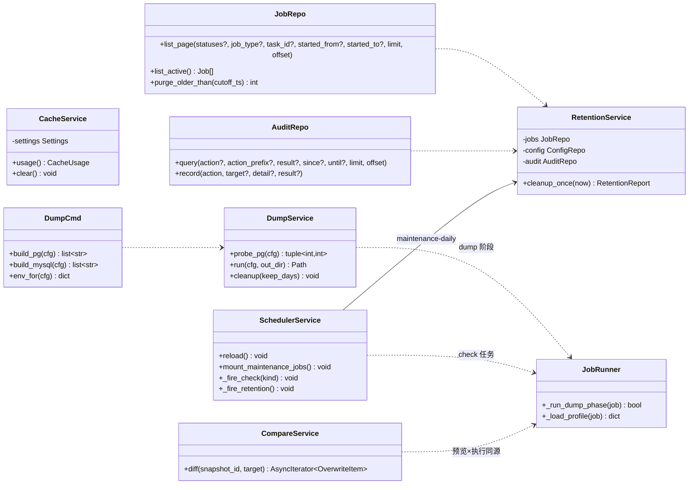
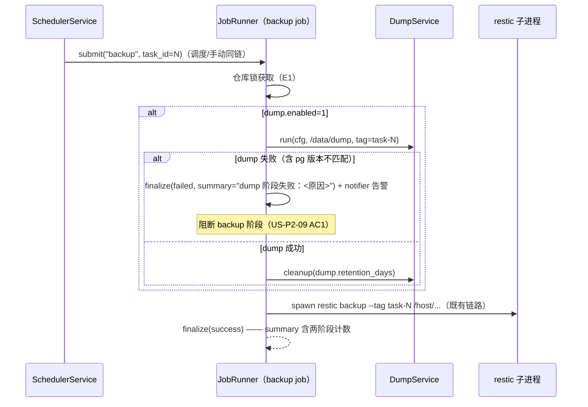
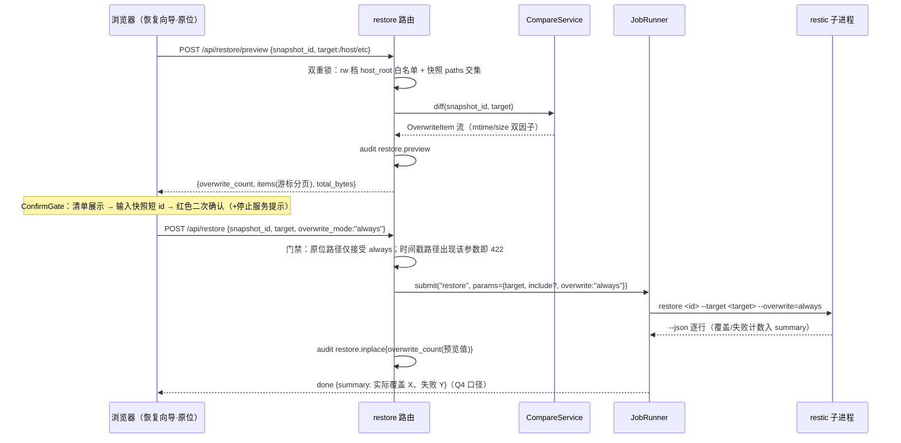

# 增量设计：P2 收尾批次（R-015 / R-017 / R-019 / R-020 / R-021；R-022 暂缓）

> **已归档（2026-10-15）**：结论见《架构设计文档.md》（M1–M14 差异点已机械合并，§14b 为差异登记索引）与《Web版PRD.md》v1.3（§3 旅程 H / §4 需求池 / §5 页面 / §8 Q9–Q14）；红线 S7 修订草案（§8）已经 owner 2026-10-15 签署生效于《代码审查规范.md》v1.3。归档仅供追溯，不再更新；批次 B/D 提交链与 QA 复验证据见 §13/§14。

> 类型：**过程层文档**（带日期，符合《文档管理规范》§1/§4）；结论由 owner 并入《架构设计文档.md》后归档（§3）。
> 撰写：架构师 高见远 ｜ 日期：2026-10-14 ｜ 读者：工程师（实现）、QA（验证）、owner（签署与合并）。
> 上游权威：《archive/增量PRD-P2收尾-2026-10-14.md》（**唯一需求依据**，2026-10-15 已归档，结论已并入《Web版PRD.md》v1.3；含 v1.0 R-015 归期裁决变更与 v1.1 owner 裁决记录）、《架构设计文档.md》v1.4、《增量设计-多备份任务-2026-10-13.md》（结构模板）、《Web版改造方案.md》v2.3.4。
> **R-022 暂缓（owner 2026-10-14「先憋实施，需要讨论」）**：本文**不含 R-022 任何设计**（批次 C 取消，Q17/Q18/Q20 随再立项重开）；文末仅登记其退出对依赖面的影响。
> 裁决状态标注：R-015 五件套（Q1–Q5）、R-017 触发时机（Q6）为 **owner 已裁决，直接采用**；Q7–Q16/Q19 为「**按 PM 建议，owner 批量确认中**」的设计基线（§9 逐条标注）。
> 修订记录：v1.0（2026-10-14）初稿；v1.1（2026-10-14）增补 **V4 留档结论**（§7.1，fixture 先行实测），同步修正 §1.1/§2.4/§6-T04/§7/§9/§11/§12 中按「进度事件」建模的表述。

---

## 0. 代码事实核实（2026-10-14 工作树抽验，证据带 文件:行号）

> PM PRD 引用的基线已逐项复核；与 PM 引用的偏差均为 ±1–2 行级（.notify 常量插入导致顺移），下表为**当前实况**。

| # | 事实 | 证据 |
|---|---|---|
| F1 | E13 门禁：`_parse_active_statuses` 仅放行 running/pending；路由在 `routers/jobs.py:115-135`（`list_jobs` :115、门禁函数 :242）；`limit` 上限 200（`le=200`） | `backend/app/routers/jobs.py:115-135,242-248` |
| F2 | `JobRepo.list_page` 已支持 statuses+task_id+COUNT 分页（E13 完整版的仓储基座，**零新 SQL 散点可扩展**） | `backend/app/db/repositories/job_repo.py:75-110` |
| F3 | `AuditRepo.query` 已实现 action **精确**过滤 + 分页（上限 500），**无 result/时间维度、无前缀匹配**；表索引 `idx_audit_ts`/`idx_audit_action` 可命中前缀 LIKE 与范围查询 | `backend/app/db/repositories/audit_repo.py:72-102`；`db/migrations/0001_init.sql:97-98` |
| F4 | JobRunner check 分支已可执行（`--read-data` 白名单具名字段 `read_data`），restic 侧 `--read-data` 拼装在 `_verb_flags`；**`--read-data-subset` 不存在**（本批新增具名字段） | `backend/app/services/job_runner.py:558-559`；`backend/app/services/restic.py:81,384-385` |
| F5 | `OVERWRITE_MODES = ("if-changed", "always", "never")`（restic.py:35）；restore 分支 `--overwrite` 拼装 :352-358；**JobRunner 侧 restore 的 overwrite 取自 params 且缺省 if-changed（job_runner.py:552）**——即白名单已可透传 always，R-015 的门禁必须设在**路由层**（E19 请求体校验），不能依赖白名单兜底 | `backend/app/services/restic.py:35,352-358`；`backend/app/services/job_runner.py:552` |
| F6 | E19 现契约：请求体仅 snapshot_id/target/paths；时间戳子目录服务端计算；审计 `restore.run`；恢复白名单 `RESTORE_ALLOWED_PREFIXES = ("/restore",)` | `backend/app/routers/restore.py:59-121`；`backend/app/constants.py:23` |
| F7 | dump 占位：`job_type == "dump"` 直接 422「随 P2 Dump 模块生效」；`JOB_TYPES` 白名单已含 dump；镜像已装 postgresql-client/mysql-client（Dockerfile:44-45） | `backend/app/services/job_runner.py:519-520`；`backend/app/constants.py:10`；`web版/docker/Dockerfile:44-45` |
| F8 | dump 密码脱敏零改动可用：`SENSITIVE_EXACT_KEYS` 已含 `dump.password`（notify 两键为 E23 交付时并入，是**三态写口径的现成先例**） | `backend/app/db/repositories/config_repo.py:22` |
| F9 | `AUDIT_CACHE_CLEAR = "cache.clear"` 已定义（**零使用**，本批启用）；`forget.preview` 只读敏感留痕先例（constants.py:94，ops.py:199-200 消费）——`restore.preview`/`restore.inplace`/`retention.cleanup` 沿此惯例落 constants 审计区 | `backend/app/constants.py:94,100`；`backend/app/routers/ops.py:132-205` |
| F10 | SchedulerService 现状（512 行）：`_JOB_ID_PREFIX = "backup-task-"`（:52）、cron 语义修复 helpers（:65-232，X11 裁决产物 `_cron_trigger` :197）、`reload()` 全量重建且**只识别 backup-task- 前缀**（:315）、`maybe_auto_forget`（R-016 已交付 :391）——**每日维护任务挂载点不存在，本批新增**（挂载必须与 `backup-task-` 前缀互不干扰，reload 的 keep 集合按前缀分域） | `backend/app/services/scheduler.py:52,65-232,286-319,391` |
| F11 | E30 30s 结果缓存先例：`REPO_STATUS_CACHE_SECONDS = 30.0`（constants.py:171）；`invalidate_repo_status_cache` 经 JobRunner `on_finish` 失效 | `backend/app/constants.py:171`；`backend/app/main.py:203-204` |
| F12 | E25/E26/E20/E22 **均无路由**（架构 §5.1 占位设计）；无 compare.py/dump.py/cache.py 服务文件 | `backend/app/services/` 目录清单；`backend/app/routers/` 目录清单 |
| F13 | 前端现状：无 settings/audit 页面（pages 共 9 个：bootstrap/dashboard/jobs/login/notifications/repo/restore/snapshots/taskWizard）；恢复页「原位置」置灰占位已在（P1）；JobType 联合类型已含 'dump'（api/types.ts:6） | `frontend/src/pages/` 目录清单；`frontend/src/pages/restore/index.vue:139-152`；`frontend/src/api/types.ts:6` |
| F14 | parser.py 纯函数零 IO（红线 A4/A6），**无 check 事件解析**——fixture 必须先行 | `backend/app/services/parser.py` 模块头；`backend/tests/fixtures/restic-json/` 目录 |
| F15 | `AUDIT_RESTORE_RUN = "restore.run"`（constants.py:93）——R-015 的 in-place 场景**不复用**该动作（语义不同：覆盖 vs 时间戳落盘），新开 `restore.inplace`；预览留痕新开 `restore.preview` | `backend/app/constants.py:93-94` |
| F16 | `check_sample_ratio` / `monthly_full_day` 列在 backup_tasks 与 policies 两域均存在、**当前零消费**（仅在 TaskService/PolicyService 归一时透传） | `backend/app/db/migrations/0002_multi_backup_tasks.sql:34-35` |
| F17 | 本批**零 DDL 变更**：六条需求全部落在既有表（jobs/audit_logs/backup_tasks）与 config 键（behavior.*/dump.*/retention.jobs_days）；无新表、无 ALTER | 架构 §4 全章 + 本文 §1.2 推导 |

---

## 1. 实现方案总览

### 1.1 核心难点与选型

| 难点 | 选型 / 决策 | 理由 |
|---|---|---|
| E13 全量化但仓储已预留 | 仅放开路由层门禁 + `JobRepo.list_page` 增 `job_type`/时间范围参数（A1：扩展全部在 repo 内） | F2；不新建查询散点（PRD 假设 A3） |
| 审计前缀匹配 | `AuditRepo.query` 增 `action_prefix` → `WHERE action LIKE ? ESCAPE '\'`（`restore.%` 形态，右锚定走 `idx_audit_action` 索引）；**参数转义 `%`/`_`/`\`** 防通配注入 | F3 索引可命中；target 搜索不做（Q11 基线） |
| retention 的调度挂载 | SchedulerService 新增**维护任务域**：固定 cron 的 `maintenance-*` job id 前缀，与 `backup-task-*` 在 reload 的 keep 集合中**按前缀分域互不清理**（F10 是本批唯一调度器结构改动） | 复用既有 AsyncIOScheduler（PRD 假设 A4），不建第二个调度器；backup 动态重载语义零回归 |
| dump 子进程的 S2 纪律 | 新建 `services/dump_cmd.py` 的 `DumpCmd`：逐具名字段白名单拼装 pg_dump/mysqldump argv（禁自由字符串）；密码走 env（`PGPASSWORD`/`MYSQL_PWD`），**不出现在 argv**（S3） | PRD 假设 A5；ResticCmd 模式复制 |
| dump→backup 同锁串行 | **单 job 双阶段**：backup 任务在 `_run` 内、同一仓库锁下先执行 dump 阶段（失败 → finalize failed + notifier，阻断后续），成功后继续 restic 阶段；SSE 事件按阶段标注；另保留 E12 `type=dump` 独立任务供测试 | US-P2-09 AC1/AC3「同一互斥锁、链内阶段可辨」的字面实现；避免跨 job 编排的新状态机 |
| check 触发（Q6 已裁决） | 调度器独立触发：每日抽样（`behavior.check_enabled=1` 时固定时刻 + jitter）+ 月度全量（`monthly_full_day` 当日）；**不做**备份后立即 check | owner 裁决；不占备份互斥锁窗口 |
| `--read-data-subset` 接入（Q7 基线） | `WhitelistArgs.read_data_subset: str | None` 具名字段，拼装前按**形态白名单**校验（三形态：`^\d+/\d+$` 分数、`^\d+(\.\d+)?%$` 比例、`^\d+[KMGTPE]?B?$` 字节后缀，§7.1 V4 核对）；**422 校验必须落在 WhitelistArgs 层**——V4 实测：非法取值 restic 端即 Fatal 且无任何 JSON 输出，执行层无兜底机会（S2 纪律前移） | S2 禁自由字符串；取值域已经 restic 0.19.1 源码核对（cmd_check.go），§7.1 留档 |
| E20 比对与 TOCTOU | CompareService 以 `restic ls --json`（run_json 复用）× `os.stat`（to_thread）自研比对；预览结果**只承诺预览时点**；执行后 jobs.summary 回报实际覆盖/失败计数（Q4 已裁决口径） | PRD US-P2-13 AC1；§12 V1 定基（dry-run 仅交叉校验） |
| 原位恢复双重目标锁（Q1 已裁决） | 路由层两段校验：① `PathMapper.validate(target, allowed_prefixes=(host_root,))` 且 `settings.host_mount_mode == "rw"`（ro 档 403 RESTORE_FORBIDDEN）；② target ∈ **快照 paths 交集**（快照首层目录，预读 snapshots 元数据收紧）；`RESTORE_ALLOWED_PREFIXES` 常量**不改**，原位白名单独立为 `INPLACE_RESTORE_ALLOWED_PREFIXES`（constants.py 新常量，S1 豁免点唯一） | owner Q1 裁决；原位与时间戳白名单分离，避免 `/restore` 语义被污染 |
| E19 overwrite 门禁（Q3 已裁决） | E19 请求体增可选 `overwrite_mode`；路由层规则：target 落 `/restore`（时间戳路径）→ **忽略并拒绝**该参数（422）；target 落原位白名单 → 仅接受 `"always"`（其他值 422），经 params 入 JobRunner（F5 白名单既有） | owner Q3；修复 F5 暴露的「白名单已可透传」缺口——门禁在路由层而非执行层 |
| 缓存 409 护栏（Q15 基线） | `POST /api/cache/clear` 前查 `JobRepo.list_active()`，非空 → 409 `JOB_CONFLICT`（data 带 running_job_id；护栏格式援 TASK_RUNNING） | 复用既有错误码，不新增；US-P2-04 AC2 |
| du 成本兜底（Q14 基线） | `asyncio.to_thread` + 超时（30s）+ **30s 进程内结果缓存**（新常量 `CACHE_STATUS_CACHE_SECONDS = 30.0`，援 F11 先例） | US-P2-04 AC1 |
| dump 产物清理（Q10 基线） | 每次成功 dump 后执行一次 + 每日维护任务兜底；按 `dump.retention_days` 判定（C8 时间语义）；仅删 `/data/dump` 白名单内文件（settings 新派生属性 `dump_dir`） | US-P2-10；S1 前缀约束（路径字面量唯一出处 settings.py） |

### 1.2 数据模型决策：**零 DDL 变更**

本批**不新增任何表、列、索引、迁移**（F17）：任务历史/审计/check/dump/缓存全部落在既有结构上——
- 任务历史：`jobs` 表既有列 + `retention.jobs_days`（架构 §4.3:318）；
- 审计：`audit_logs` 既有索引；新增动作名走 constants（F9），**无表结构变更**；
- check：`behavior.*` 五键（架构 §4.3:315）+ `check_sample_ratio`/`monthly_full_day` 既有列（F16）；
- dump：`dump.*` 键既有（架构 §4.3:313）；新增键仅 `dump.enabled`（开关，默认 off）与可选 `dump.password`（已脱敏）——config KV 写入，非 DDL；
- retention 独立日志保留键（Q12 基线待确认）：预留 `retention.logs_days`（缺省回退 `retention.jobs_days`），实现为读取时的 fallback 逻辑而非新列。

**新审计动作常量（constants.py 审计区，F9 惯例）**：`AUDIT_RESTORE_PREVIEW = "restore.preview"`、`AUDIT_RESTORE_INPLACE = "restore.inplace"`、`AUDIT_RETENTION_CLEANUP = "retention.cleanup"`；`AUDIT_CACHE_CLEAR` 本批启用。

**新错误码：无**（409 护栏复用 `JOB_CONFLICT`；越界复用既有 `PATH_OUT_OF_PREFIX`/`RESTORE_FORBIDDEN`/`VALIDATION_ERROR`）——§5.0 错误码表零新增。

### 1.3 类图



---

## 2. API 设计（沿用既有 E 编号，不新造）

### 2.1 E13 完整版 `GET /api/jobs`（批次 A，US-P2-01）

请求：`?type=&status=&task_id=&started_from=&started_to=&limit=&offset=`。

- `type`：JOB_TYPES 白名单（单值）；`status`：放开至**全状态**（running/pending/success/failed/interrupted/cancelled，缺省=不过滤，改动点 `_parse_active_statuses` → `_parse_statuses`）；`task_id`：既有；`started_from`/`started_to`：ISO 8601（含时区归一到 UTC 比较，C8）；`limit` 上限 **500**（对齐 E26，Q13 基线；现 `le=200` 改 `le=500`）；
- 仓储：`JobRepo.list_page` 增具名参数（F2 扩展），SQL 仅在 repo（A1）；
- 响应 `Page[JobOut]` 不变；404/422 语义不变。
- **审计**：查询只读不留痕（与 E13 P1 口径一致）。

### 2.2 E26 `GET /api/audit`（批次 A，US-P2-02，路由化）

请求：`?action=&result=&since=&until=&limit=&offset=`。

- `action`：**前缀匹配**（含 `.` 结尾惯例如 `restore.`；转义用户输入中的 `%`/`_`/`\`）；`result`：`ok|denied|failed` 白名单；`since`/`until`：ISO 8601 → UTC 比较；`limit` ≤500；
- 仓储：`AuditRepo.query` 扩展（F3）；**无 PUT/DELETE**（S6）；路由挂 `require_session`（S4）；
- 响应 `Page[AuditRow]`（ts/action/target/detail/result）；
- **审计动作名枚举暴露**：响应增 `actions: list[str]`（`SELECT DISTINCT action`，供前端筛选下拉）——实现细节可后定，不阻塞契约。

### 2.3 E25 `GET /api/cache` + `POST /api/cache/clear`（批次 A，US-P2-04）

- GET：`{"path": "/cache/restic", "size_bytes": n, "items_count": n, "measured_at": iso, "truncated": bool}`；du 在 `to_thread`、超时 30s、结果缓存 30s（Q14 基线）；
- POST：活跃 job 检查 → 409 `JOB_CONFLICT`（Q15 基线）→ `rm -rf {settings.cache_dir}/*`（白名单路径，`CacheService.clear`）→ 审计 `cache.clear`（F9 启用）→ 200 `OkResponse`；
- 落点：`services/cache_service.py`（新）+ `routers/ops.py`（E21/E23/E24 同文件）。

### 2.4 E22 `GET /api/checks/{job_id}`（批次 B，US-P2-06）

- 校验 job 存在且 `type == "check"`（否则 404 / 422）；响应 = `JobOut` + `check_view`：`{"errors": [{"message": "<文本>"}...], "error_count": n, "num_errors": n, "broken_packs": n|None, "suggest_repair_index": bool, "suggest_prune": bool, "read_data": bool}`——数据源为 parser 对 `check --json` 输出的结构化提取：**由 summary + error 行驱动，无进度事件**（§7.1 V4 实测；`broken_packs` 健康仓库为 `null` 而非 `[]`，解析层须容错两种形态）；**不建新表**（Q9 基线）；
- check **无进度事件**（V4 定稿）：SSE（E15）仅透传 stdout 逐行（error 行即解析原料）与生命周期事件，A4 底座零改动；前端**不建进度条**，改为运行状态 + 终态结果视图（T06 check 视图同步此口径）。

### 2.5 E20 `POST /api/restore/preview`（批次 D，US-P2-13，前置=红线签署）

- 请求：`{"snapshot_id", "target"}`；响应：`{"overwrite_count": n, "items": [{"path","snapshot_mtime","disk_mtime","snapshot_size","disk_size"}], "total_bytes": n, "next_cursor": str|null, "truncated": bool}`——**游标分页**（复用 snapshots 偏移游标编码）；
- 目标双重锁（Q1 裁决）：`PathMapper.validate` 于 `INPLACE_RESTORE_ALLOWED_PREFIXES`（= rw 档 `settings.host_root`）+ 快照 paths 交集收紧；ro 档 403 `RESTORE_FORBIDDEN`；越界 400 `PATH_OUT_OF_PREFIX`；
- 预览写审计 `restore.preview`（Q19 基线：新增常量，援 `forget.preview` 先例 F9）；
- 实现锚点：`services/compare.py`（新，§7.8 签名实化）。

### 2.6 E19 扩展（批次 D，US-P2-14，前置=红线签署）

- 请求体增可选 `overwrite_mode`；**路由层门禁**（修复 F5 缺口）：
  - target 落 `/restore`（时间戳路径）→ `overwrite_mode` 若出现即 422（该路径由 JobRunner 固定注入 if-changed，界面无入口——修订记录首条边界）；
  - target 落原位白名单（双重锁通过）→ `overwrite_mode` **必须**为 `"always"`（其他值 422；UI 固定传 always，无选择项）；
- 执行审计：新动作 `restore.inplace`，detail = `{"snapshot_id","target","overwrite_count"(预览值),"keyword_confirmed": true}`；实际覆盖/失败计数**回填 jobs.summary**（Q4 裁决口径），S6 只增不改（detail 不回填）。

### 2.7 E07 扩展消费（批次 B，配置键面）

- `behavior.*` 五键（US-P2-07）：经既有 E07 读写，`config.update` 审计覆盖；校验：`check_sample_ratio` ∈ [0,1]（0=不抽样只月度全量）、`monthly_full_day` ∈ [1,28]——**写入侧校验落在 config 路由的键级校验钩子**（与 `repo.type` 只读键同一机制位）；
- `dump.*` 键（US-P2-08）：`dump.enabled`(0/1)/`dump.type`(pg|mysql|sqlite)/`dump.host`/`dump.port`/`dump.user`/`dump.databases`(JSON 数组)/`dump.retention_days`/`dump.password`（三态：None=不变/`""`=清除/非空=设置，读只回 `dump.password_set` + source——**三态处理在 config 路由的键级钩子**，沿 notify.* E23 交付先例）；`retention.logs_days`（可选，Q12 基线）。

---

## 3. 服务设计（签名级）

### 3.1 CacheService（§7.6 签名实化）

```python
# services/cache_service.py
class CacheService:
    def __init__(self, settings: Settings | None = None,
                 cache_seconds: float | None = None) -> None: ...
    async def usage(self) -> CacheUsage:
        """du settings.cache_dir（to_thread + 30s 超时 + 进程内结果缓存）。"""
    async def clear(self) -> None:
        """rm settings.cache_dir/*（白名单路径字面量唯一出处 settings）。"""
```

### 3.2 DumpCmd + DumpService（§7.5 签名实化，S2/S3）

```python
# services/dump_cmd.py —— pg_dump/mysqldump 白名单拼装（ResticCmd 模式复制，PRD 假设 A5）
class DumpCmd:
    def build(self, engine: Literal["pg", "mysql"], *, cfg: DumpConfig) -> list[str]:
        """逐具名字段拼 argv；库名/主机/端口经 _assert_safe_value；密码永不入 argv。"""
    def env_for(self, cfg: DumpConfig) -> dict[str, str]:
        """PGPASSWORD / MYSQL_PWD 注入（S3：仅 env 通道）。"""

# services/dump.py
class DumpService:
    async def probe_pg(self, cfg) -> tuple[int, int]: ...   # 版本不匹配抛 PgVersionMismatchError（文案 §7.5 既有）
    async def run(self, cfg, out_dir: Path, *, tag: str) -> Path:  # → /data/dump/<db>-<tag>-<ts>.sql(.gz)，空文件校验
    def cleanup(self, keep_days: int, *, now: datetime) -> tuple[int, int]:  # (deleted_count, freed_bytes)
```

- SQLite 走 Python `sqlite3` backup API（镜像零新增依赖，PRD AC3）；
- JobRunner 集成：`_run` 在 restic 阶段前插 `_run_dump_phase(job)`（`dump.enabled=1` 时）：失败 → `finalize(failed, summary="dump 阶段失败：<原因>")` + notifier 告警 → **阻断** backup 阶段；成功 → 继续并按阶段推进 SSE 事件；独立 `type=dump` 任务仍可经 E12 触发（测试用途）。

### 3.3 CompareService（§7.8 签名实化）

```python
# services/compare.py
class CompareService:
    def __init__(self, restic: ResticCmd, parser: OutputParser, config: ConfigRepo) -> None: ...
    async def diff(self, snapshot_id: str, target: str) -> AsyncIterator[OverwriteItem]:
        """restic ls --json（run_json 复用）× os.stat（to_thread）：
        目标存在且 (mtime != 快照 mtime 或 size != 快照 size) → OverwriteItem。
        dry-run 输出仅作交叉校验（§12 V1 定基）。"""
```

### 3.4 RetentionService（新）

```python
# services/retention.py
class RetentionService:
    async def cleanup_once(self, *, now: datetime) -> RetentionReport:
        """jobs 行按 retention.jobs_days、日志文件按 retention.logs_days（缺省回退 jobs_days）
        清理；删除动作记审计 retention.cleanup（detail 含行数/文件数/字节数）；A5 串行写。"""
```

### 3.5 SchedulerService 维护任务域（本批唯一调度器结构改动）

```python
_JOB_ID_PREFIX = "backup-task-"          # 既有
_MAINTENANCE_PREFIX = "maintenance-"     # 新增：reload keep 集合按前缀分域（F10）

# 固定时刻常量（模块级，不裸写；时区取 config.timezone → settings.tz）
MAINTENANCE_CHECK_DAILY_CRON = "30 4 * * *"    # 每日抽样 check
MAINTENANCE_RETENTION_CRON = "40 3 * * *"      # 每日 retention
MAINTENANCE_DUMP_CLEANUP_CRON = "50 3 * * *"   # 每日 dump 产物清理兜底
# 月度全量 check：CronTrigger 按 behavior.monthly_full_day 当日 04:00（check_enabled=1 才挂载）

async def mount_maintenance_jobs(self) -> None:
    """reload() 与 start() 末尾调用：按 behavior.check_enabled / monthly_full_day 重建
    maintenance-* 触发器（replace_existing），移除失效遗留。"""
async def _fire_check(self, kind: Literal["sample", "full"]) -> None:
    """submit("check", params={"read_data": kind=="full", "read_data_subset": 比例})；
    与 backup 同仓库互斥（E1），调度冲突记 cancelled + job.skipped_conflict。"""
async def _fire_retention(self) -> None: ...   # RetentionService.cleanup_once
```

- AUTO_INIT/AUTO_UNLOCK（Q8 基线）：`recover_on_startup` 的 TODO(P2) 分支随批交付——`behavior.auto_unlock=1` 时对锁残留执行 unlock（审计既有埋点），`auto_init=1` 时对未初始化仓库先 init 再补跑；开关默认 off 保持 P1 语义。

---

## 4. 前端结构

| 页面 | 内容 | 批次 |
|---|---|---|
| **11 系统设置**（骨架首建） | `pages/settings/index.vue`：分区 = DB dump（B 批填充表单）/ 行为开关（B 批）/ 时区（既有键，随骨架）/ 缓存维护（A 批：`cache.usage` + ConfirmGate 清空，`cache.confirm_impact` 文案）/ 管理员改密（既有 E28 入口迁入或链接）；菜单 5→**6** 项 | A 骨架 |
| **12 审计日志**（新建） | `pages/audit/index.vue`：筛选（action 前缀/result/时间范围）+ `n-data-table virtual-scroll` + detail JSON 折叠 + `audit.readonly_note` 无删除声明；菜单 **7** 项（独立页，PRD 页面 12） | A |
| 7 任务历史 | 全量筛选器（type/status/task_id/时间范围）+ 虚拟滚动；check 任务行进 E22 详情视图（B 批）；日志抽屉复用 | A / B |
| 9 恢复向导 | 「原位置」激活（D 批）：选目标（限快照 paths 交集，双重锁后端兜底）→ E20 预览清单（游标分页 + 虚拟滚动）→ ConfirmGate（keyword=**快照短 id 前 8 位**，Q2 裁决）→ 二次确认红按钮 + `restore.stop_services` 提示 → 执行后 `restore.summary.overwritten` 回报展示；ro 档置灰 + `restore.inplace.ro_hint`（既有占位激活） | D |
| i18n | §4.1 文案表全量键（PRD），双语成对写入 zh-CN.ts / en-US.ts | 随各批 |

---

## 5. 关键流程时序





---

## 6. 任务分解（T 编号；单次合入 ≤400 行，切分点已标）

> 依赖：T01–T03（批次 A）→ T04–T06（批次 B，依赖 A 的维护任务挂载点定型）；T07–T09（批次 D，**前置 = T07 红线修订经 owner 签署**）。批次 C 已取消（R-022 暂缓）。T04 的 fixture 子提交无依赖，可最先动工。

### T01 R-020 后端：E13 完整版 + E26 路由 + retention（批次 A）

- **文件**：`backend/app/db/repositories/job_repo.py`（list_page 增 type/时间参数 + `purge_older_than`）、`backend/app/db/repositories/audit_repo.py`（query 增前缀/result/时间 + distinct actions）、`backend/app/services/retention.py`（新）、`backend/app/routers/jobs.py`（E13 参数与门禁放开、limit 500）、`backend/app/routers/ops.py`（E26 两段：GET + actions 枚举）、`backend/app/constants.py`（AUDIT_RETENTION_CLEANUP）、`backend/app/services/scheduler.py`（maintenance 挂载点 + `_fire_retention`）、`backend/app/main.py`（RetentionService 装配）、`backend/tests/test_api/`（jobs/audit 扩展用例）、`backend/tests/test_retention.py`（新）。
- **切分**：提交 1 = 仓储层两文件 + retention 服务 + 单测（~350 行）；提交 2 = 路由 + scheduler 挂载 + 接线 + API 测试（~300 行）。
- **验收要点**：全终态筛选/时间范围命中；前缀 LIKE 转义对抗用例（输入 `restore.%` 不越权）；retention 幂等（重跑零删除）；审计 detail 含计数；A1/A5 红线自查零命中。
- **红线落点**：S4（新路由挂 protected）、S6（retention.cleanup 只增）、A1/A5。

### T02 R-021 后端：CacheService + E25（批次 A）

- **文件**：`backend/app/services/cache_service.py`（新）、`backend/app/routers/ops.py`（GET/POST /api/cache*）、`backend/app/constants.py`（CACHE_STATUS_CACHE_SECONDS）、`backend/tests/test_api/test_cache.py`（新：409 护栏、审计埋点、30s 缓存）。
- **预估**：~220 行（单提交）。
- **验收要点**：运行中 job 清缓存 → 409 data.running_job_id；审计 `cache.clear` 首次落库；du 超时回 truncated 不 5xx；clear 仅触碰 cache_dir 白名单（S1）。

### T03 批次 A 前端：设置页骨架 + 审计页 + 任务历史全量（批次 A）

- **文件**：`frontend/src/pages/settings/index.vue`（新骨架：缓存分区实装 + dump/behavior 占位 + 时区/改密分区）、`frontend/src/pages/audit/index.vue`（新）、`frontend/src/pages/jobs/index.vue`（全量筛选改造）、`frontend/src/api/settings.ts`（cache/retention 封装）、`frontend/src/api/audit.ts`（新）、`frontend/src/api/jobs.ts`（E13 新参数）、`frontend/src/router/index.ts` + `frontend/src/layouts/BasicLayout.vue`（菜单 5→7）、`frontend/src/api/types.ts`、i18n 双语。
- **切分**：提交 1 = 审计页 + api/audit + i18n（~300）；提交 2 = 任务历史筛选 + api/jobs（~200）；提交 3 = 设置页骨架 + 缓存分区 + 菜单路由（~250）。
- **验收要点**：审计页无任何删除入口（S6 UI 面一致）；两列表虚拟滚动；菜单不回归；`pnpm typecheck/test/build` 全绿。

### T04 R-017 后端：check 解析 + 调度 + E22 + AUTO 分支（批次 B）

- **文件**：`backend/tests/fixtures/restic-json/check-*.ndjson`（**已先行交付并独立复验**：`check-clean.ndjson` / `check-errors-index.ndjson` / `check-read-data-damaged.ndjson` + `README-check.md`，§7.1）、`backend/app/services/parser.py`（check 事件解析 + CheckAggregate——**summary + error 行驱动，无进度事件**）、`backend/app/services/restic.py`（WhitelistArgs.read_data_subset + `--read-data-subset` 拼装 + 三形态白名单校验）、`backend/app/services/job_runner.py`（check 分支透传 subset；recover_on_startup AUTO_INIT/AUTO_UNLOCK 分支）、`backend/app/services/scheduler.py`（`_fire_check` 抽样/月度）、`backend/app/routers/ops.py` 或新 `checks.py`（E22）、`backend/app/constants.py`、`backend/tests/test_parser_check.py`（**独立保留，check 契约专用**——主任务在其中扩展用例并移除 xfail，不并入 test_parser.py，§7.1 裁决 2）、`backend/tests/test_scheduler.py`（若届时已补——援 §14 X3 P2 首个补测项）、`backend/tests/test_api/test_checks.py`（新）。
- **切分**：提交 1 = fixture + parser + 回归（~300，tests 豁免行数）；提交 2 = WhitelistArgs + 调度触发 + E22 + AUTO 分支（~380）。
- **验收要点**：fixture 回归全绿（A6：parser 零 IO 不破坏；test_parser_check.py 现状 11 passed + 3 xfailed，主任务移除 xfail 后全绿）；`--read-data-subset` 非法形态 422（WhitelistArgs 层，§7.1 事实 3）；check 调度冲突记 cancelled；AUTO_UNLOCK 开关 off 时行为与现状逐字节一致（回归保护）；V4 残留真机校准项（错误行文本/退出码实机复核）在本任务内完成并回填架构 §12。
- **红线落点**：S2（具名字段）、A4/A6（SSE/解析层）、S6（unlock 埋点既有）。

### T05 R-019 后端：DumpCmd + DumpService + 调度链（批次 B）

- **文件**：`backend/app/services/dump_cmd.py`（新）、`backend/app/services/dump.py`（新，probe_pg/run/cleanup + PgVersionMismatchError）、`backend/app/services/job_runner.py`（`_run_dump_phase` + 独立 dump 分支替换占位 ：519-520）、`backend/app/routers/config.py`（dump.*/behavior.* 键级校验钩子 + dump.password 三态）、`backend/app/settings.py`（`dump_dir` 派生属性）、`backend/app/constants.py`（DUMP_DIR 默认值单一真源）、`backend/tests/test_dump.py`（新：三态密码、白名单拼装、pg 版本兜底、cleanup 判定）。
- **切分**：提交 1 = dump_cmd + dump 服务 + 单测（~380）；提交 2 = JobRunner 链集成 + config 键钩子 + 接线（~300）。
- **验收要点**：密码零出现在 argv/日志/审计（S3 grep 自查）；pg 版本不匹配文案与 §7.5 一致；dump 失败 → backup 阻断 + failed 终态 + notifier；cleanup 仅删 /data/dump（S1）；三态写 None 不变/空清除/非空设置。

### T06 批次 B 前端：设置页 dump/behavior 分区 + check 视图（批次 B）

- **文件**：`frontend/src/pages/settings/index.vue`（dump 表单含三态密码 + behavior 五键）、`frontend/src/pages/jobs/index.vue`（check 详情视图：errors/read_data/进度）、`frontend/src/api/settings.ts`、`frontend/src/api/jobs.ts`、i18n 双语。
- **预估**：~380 行（单提交，超出即拆表单/视图两提交）。
- **验收要点**：密码只回 `*_set`（零明文，S3 UI 面）；ratio/day 校验前端先行 + 后端 422 对齐；check 失败醒目提示 + 下一步动作。

### T07 红线修订（批次 D 前置闸门——**owner 签署后生效**，草案见 §8）

- **文件**：`docs/代码审查规范.md`（§3.1 S7 条目）、`AGENTS.md`（红线 6 编号同步 + 自查线索扩写）；**纯文档提交**。
- **验收要点**：双文档编号锚点一致（`bash scripts/verify_redlines.sh`）；新旧自查线索对既有代码零误伤（时间戳路径既有注入点不被新 grep 命中——用现有 182+ 测试与红线脚本实测）。

### T08 R-015 后端：CompareService + E20 + E19 原位分支（批次 D，前置 T07 签署）

- **文件**：`backend/app/services/compare.py`（新）、`backend/app/routers/restore.py`（E20 + E19 原位分支 + 双重锁 + overwrite 门禁）、`backend/app/constants.py`（AUDIT_RESTORE_PREVIEW/INPLACE、INPLACE_RESTORE_ALLOWED_PREFIXES）、`backend/app/settings.py`（如需 host_mount 判定辅助）、`backend/tests/test_compare.py`（新：E20 比对单测含 **TOCTOU 计数用例**——mock os.stat 在预览与执行间变化，断言 summary 回报实际值）、`backend/tests/test_api/test_restore_inplace.py`（新：双重锁越界矩阵、门禁 422 矩阵、审计断言）。
- **切分**：提交 1 = CompareService + 单测（~300）；提交 2 = 路由 + 常量 + 门禁 + API 测试（~350）。
- **验收要点**：ro 档 403；非快照 paths 目标 403；时间戳路径带 overwrite_mode → 422；原位路径 overwrite_mode=if-changed → 422；`restore.preview`/`restore.inplace` 审计落库；G3 DoD 按 Q4 口径验收。

### T09 R-015 前端：原位恢复确认流（批次 D）

- **文件**：`frontend/src/pages/restore/index.vue`（原位流：目标选择限快照 paths → 预览清单游标加载 → ConfirmGate keyword=快照短 id → 结果回报展示）、`frontend/src/api/restore.ts`（preview/inplace 封装）、`frontend/src/api/types.ts`、i18n 双语（`restore.preview.*`/`restore.confirm.*`/`restore.summary.*`）。
- **预估**：~350 行（单提交）。
- **验收要点**：ro 档置灰 + 原因（既有占位激活）；确认门三重完整；清单虚拟滚动；模板零硬编码中文。

---

## 7. 测试策略

| 层 | 内容 | 工具/方法 |
|---|---|---|
| 解析层（最高优先级） | check `--json` 解析——**fixture 先行已交付**（check-clean / check-errors-index / check-read-data-damaged 三集：**summary + error 行驱动，无进度事件**；含 broken_packs=null 容错、畸形行容错用例），再改 parser | pytest + `tests/test_parser_check.py`（独立保留，§7.1） |
| 比对层 | E20 单测：mtime 相同 size 不同 / 反之 / 双异 / 双同 四矩阵；**TOCTOU 计数**：预览后 mock 磁盘变化，断言执行 summary 回报实际覆盖/失败而非预览值 | pytest-asyncio + tmp_path 假盘 |
| 参数白名单 | `--read-data-subset` 形态矩阵（`50%`/`1G`/`abc`→422）；dump argv 断言无密码字段 | pytest（S2 自查） |
| API 集成 | E13 全维筛选、E26 前缀转义对抗（`restore.%`/`_%`）、E25 409 护栏与审计、dump 三态密码（None/""/值）、E22 非 check 任务 422 | httpx AsyncClient + dependency_overrides |
| 调度器 | maintenance 挂载/摘除（enabled 开关翻转）、check 冲突记 cancelled、月度全量按 monthly_full_day 触发一次 | pytest-asyncio（援 §14 X3 补测基建） |
| retention | 90 天边界（含时区 C8）、日志文件随行删除、独立 logs_days fallback | 临时 SQLite + tmp_path |
| 红线回归 | S7 修订后 `verify_redlines.sh` 全绿 + 时间戳路径零覆盖回归（E19 不带 overwrite_mode 的既有用例逐一复跑） | bash scripts + 全量 pytest |

### 7.1 V4 留档结论（fixture 先行实测，2026-10-14）

> 依据：restic 0.19.1 源码逐段核对（`cmd/restic/cmd_check.go`）+ T04 fixture 先行子任务已交付资产（pytest 独立复验 **11 passed + 3 xfailed**）。以下四项事实直接影响 T04 主任务建模，v1.0 初稿中按「read_data 进度事件」建模的表述已全部同步修正（§1.1/§2.4/§6-T04/§7 表）。

**事实 1：check `--json` 无任何进度事件**。输出仅两类消息——错误行 `{"message_type":"error","message":"<文本>"}`（逐行）+ 末尾**唯一 summary**（含 `num_errors` / `broken_packs` / `suggest_repair_index` / `suggest_prune`）。→ `CheckAggregate` 由 **summary + error 行**驱动；E22 结果视图 = 错误列表 + summary 指标，**无进度集**（§2.4 已定稿）。

**事实 2：健康仓库 `broken_packs` 为 `null` 而非 `[]`**。解析层与 schema 须容错两种形态（`null` / 数组），模型上以 `n | None` 建模，禁止假定恒为数组。

**事实 3：`--read-data-subset` 非法取值即 Fatal 且无 JSON 输出**。取值域三形态：`n/t`（分数）、`n%`（比例，含小数）、`n` + 字节后缀（如 `1G`）；与 `--read-data` 互斥。非法值 restic 端直接 Fatal、零 JSON 产出——**422 形态校验必须前移到 WhitelistArgs 层**（S2 纪律落在拼装侧，执行层无兜底机会；§1.1 已同步）。

**事实 4：退出码仅 0（健康）/ 1（有错误）；错误行 `message` 文本真机可能有出入**。解析断言**只依赖 `message_type` 与字段结构**，不锁定文本内容——残留的真机校准项（文本样本、退出码实机复核）留 T04 主任务完成并回填架构 §12。

**fixture 资产（已交付，路径即验收基线）**：

| 文件 | 覆盖场景 |
|---|---|
| `backend/tests/fixtures/restic-json/check-clean.ndjson` | 健康仓库：summary only（`broken_packs: null` 形态在案） |
| `backend/tests/fixtures/restic-json/check-errors-index.ndjson` | 索引错误：error 行 × N + summary |
| `backend/tests/fixtures/restic-json/check-read-data-damaged.ndjson` | `--read-data` 损坏数据场景 |
| `backend/tests/fixtures/restic-json/README-check.md` | 来源、契约与断言口径说明 |
| `backend/tests/test_parser_check.py` | 11 passed + 3 xfailed（独立复验通过） |

**裁决登记（2026-10-14）**：

1. **fixture 命名维持连字符风格**（`check-clean.ndjson` 等，已交付验证可用）；与 `fixtures/restic-json/` 既有下划线风格的差异**推迟到并入架构文档时统一**，本批不返工；
2. **`tests/test_parser_check.py` 独立保留**（check 契约专用）：T04 主任务在该文件内扩展用例并移除 xfail 标注，**不并入** `test_parser.py`。

---

## 8. 红线 S7 修订草案（批次 D 前置，供 owner 签署）

### 8.1 《代码审查规范》§3.1 S7 新表述（建议全文替换）

> **[S7] 覆盖语义仅在「原位恢复（in-place）」路径引入**，且必须同时满足四要件：① 目标经**双重锁**（rw 档 `host_root` 白名单 + 快照 paths 交集收紧，实现于 restore 路由）；② 先经 E20 覆盖预览 + 三重确认门（keyword=快照短 id）；③ `--overwrite` 固定 `always`（`OVERWRITE_MODES` 白名单校验，界面无模式选择项）；④ 执行写审计 `restore.inplace`。**时间戳子目录路径（E19 默认）继续零覆盖语义**：该路径 `--overwrite=if-changed` 仅由 JobRunner 固定注入、界面无入口，E19 请求体在该路径出现 `overwrite_mode` 即 422。除上述两类调用点外，任何覆盖语义参数不得接任何路由。
> 自查（区分两类合法调用点，避免误伤既有注入）：
> `grep -rn "overwrite" backend/app frontend/src --include=*.py --include=*.ts --include=*.vue | grep -v "restic.py\|job_runner.py\|routers/restore.py\|services/compare.py\|constants.py\|locales"` ——剩余命中仅允许出现在 `frontend/src/pages/restore/index.vue` 的原位确认流内；
> 辅助断言：`constants.py` 中 `OVERWRITE_MODES` 是模式枚举唯一出处；`job_runner.py` 的 overwrite 透传点 ≤2（时间戳固定注入 + 原位 params 透传）。

### 8.2 AGENTS.md 同步点

- 红线 6 条目正文替换为 §8.1 表述（编号 S7 不变——**编号对不上即视为同步失败**）；
- 自查行替换为 §8.1 双段线索；**实现侧新增覆盖语义代码前，先跑新线索确认零意外命中**。

### 8.3 连带核对（A8 假设）

- S6 危险操作清单随 S7 修订复核：新增 `restore.inplace`（写入）、`retention.cleanup`（调度器删除动作）；`restore.preview` 为只读留痕不入危险清单（援 `forget.preview` 先例）；清单 7 项 → 9 项需在规范 §3.1 与架构 §4.6 注同步。

---

## 9. 裁决记录与基线标注

| 项 | 状态 |
|---|---|
| R-015 五件套（Q1–Q5）：双重目标锁 / 三重确认门（keyword=快照短 id）/ `--overwrite` 固定 always / `restore.inplace` 审计 / DoD=「预览时点一致+执行后回报」 | **owner 已裁决（2026-10-14 v1.1），直接采用** |
| R-017 Q6：check 调度器独立触发（抽样每日/每周 + 月度全量），不做备份后立即 check | **owner 已裁决，直接采用** |
| R-022：整体暂缓退出本批（批次 C 取消） | **owner 已裁决**；本文零设计；Q17/Q18/Q20 与假设 A6 随再立项重开 |
| Q7（read-data-subset 接入+V4）、Q8（AUTO 随批）、Q9（结果不建新表）、Q10（三态+链前缀+cleanup 时机）、Q11（审计最小集）、Q12（retention 挂每日+日志保留独立键待定）、Q13（E13 维度+limit 500）、Q14（du 兜底）、Q15（409 护栏）、Q16（缓存确认门形态）、Q19（restore.preview 新常量） | **按 PM 建议，owner 批量确认中**——本设计按上述基线展开，若否决随裁决修订；其中 Q16 的「是否降级单重门」与 Q12 的「日志独立保留」实现面极小，不影响骨架 |
| R-015 归期裁决变更（增量 PRD v1.0 首条：原「S7 P1/P2 均不引入」作废） | 已由 PM 显式记录；本文 §8 红线修订草案为其落地件 |
| V4 fixture 命名：连字符风格维持（check-clean.ndjson 等），与既有下划线风格的统一推迟到并入架构文档时 | **已裁决（2026-10-14）**，交付已验证可用，本批不返工（§7.1） |
| `tests/test_parser_check.py` 独立保留（check 契约专用）；T04 主任务在其内扩展并移除 xfail，不并入 test_parser.py | **已裁决（2026-10-14）**（§7.1） |

---

## 10. 红线 S1–S8 / A1–A6 落点核对

| 红线 | 本批落点 | 结论 |
|---|---|---|
| S1 | 原位白名单独立常量 `INPLACE_RESTORE_ALLOWED_PREFIXES`（constants.py，rw 档 host_root）；`dump_dir`/`cache_dir` 路径字面量唯一出处 settings.py | ✅ 前缀白名单唯一出处不破 |
| S2 | `--read-data-subset` 具名字段 + 形态白名单（**422 校验落在 WhitelistArgs 层**——V4：非法值 restic 端 Fatal 无 JSON，§7.1）；DumpCmd 逐具名字段；`--overwrite=always` 经 OVERWRITE_MODES | ✅ 无自由字符串通道 |
| S3 | dump 密码 env 通道 + 三态 + `*_set` 回读；rclone/REST 已随暂缓移除 | ✅ 零明文面 |
| S4 | E13 完整版/E20/E22/E25/E26 全部挂 require_session；写方法 Origin 校验既有 | ✅ |
| S6 | `restore.inplace`/`retention.cleanup` 新常量；`cache.clear` 启用；审计面仅 INSERT/SELECT | ✅（危险清单 7→9 随 §8.3 修订） |
| S7 | **唯一修订项**——§8 草案，owner 签署为批次 D 前置 | ⏸ 闸门 |
| A1 | 全部扩展在 JobRepo/AuditRepo/repo 级服务内 | ✅ |
| A4/A6 | parser fixture 先行；SSE 底座零改动 | ✅ |
| A5 | retention/cleanup 走 Database.write 串行 | ✅ |
| C8 | check/cleanup/retention 时间比较全走 utils/time.py | ✅ |
| i18n | §4.1 全量键双语；大列表虚拟滚动 | ✅ |

**依赖包清单：空**——本批零新增依赖（rclone 随 R-022 暂缓移除；sqlite3 为标准库）。

---

## 11. 并入架构文档的差异点清单（owner 机械合并）

| # | 落点 | 操作 |
|---|---|---|
| M1 | §5.1 E13/E26 | 替换为本文 §2.1/§2.2 定稿（过滤维度/limit 500/前缀语义） |
| M2 | §5.1 E25 | 补 409 护栏与 30s 缓存语义 |
| M3 | §5.1 E22 | 替换为「E14 + check 解析视图，不建新表」定稿 |
| M4 | §5.1 E19/E20 | R-015 定稿（双重锁/门禁/审计/DoD 口径）——**随红线签署后并入** |
| M5 | §7.5/§7.6/§7.8 | DumpService（+DumpCmd）/CacheService/CompareService 由占位签名改实化签名（本文 §3） |
| M6 | §7.4 SchedulerService | 补维护任务域（maintenance-* 前缀分域 + 固定 cron 常量 + _fire_check/_fire_retention） |
| M7 | §4.3 config 键表 | dump.* 键补 enabled/databases/retention_days；retention 补 logs_days（可选）；behavior.* 补「E07 键级校验钩子」注 |
| M8 | §4.6 审计注 + §5.0 | 危险操作清单 7→9（restore.inplace/retention.cleanup）；错误码零新增 |
| M9 | §12 | 新增 V4（--read-data-subset 实测）；V1 状态更新（比对层定基后复核） |
| M10 | §11 追溯矩阵 | R-015/R-017/R-019/R-020/R-021 状态与 API/页面列更新；R-022 标「暂缓（2026-10-14）」 |
| M11 | §9 前端 | 路由表增 settings/audit 两行；菜单 5→7 |
| M12 | §3 目录树 | 增 services/retention.py、dump_cmd.py、dump.py、cache_service.py、compare.py；前端 pages/settings|audit |
| M13 | §8 红线修订 | **随 T07 owner 签署后**：规范 §3.1 S7 新表述 + AGENTS.md 同步在本文 §8 定稿 |
| M14 | §12 V4 + 测试策略注 | V4 由「待实测」改为**留档结论**（本文 §7.1 四事实：check 无进度事件 / broken_packs null 容错 / subset 三形态取值域 / 断言只依赖结构）；E22 无进度事件定稿随 M3 一并并入；fixture 资产与 test_parser_check.py 独立保留说明入架构文档 |

---

## 12. 待明确事项（仅余项）

1. **Q12 日志保留独立性**：`retention.logs_days` 键是否设立（缺省回退 jobs_days 的实现已兼容两种裁决结果，owner 批量确认时定即可）；
2. **Q16 缓存确认门形态**（三重 vs 双重）：实现面为 ConfirmGate keyword 有无，一行级差异；
3. **§8 红线草案**：owner 对 S7 新表述与 grep 线索的逐字签署（批次 D 唯一前置）；
4. **V4 真机校准残留**：取值域与输出形态已经 fixture 先行实测定稿（§7.1）——残留项为错误行 `message` 文本样本与退出码的实机复核，留 T04 主任务完成并回填架构 §12。

---

## 13. 批次 B 实现落账（lead 汇总，2026-10-15；提交 88361f0…38c10e7）

QA 双端复验后的登记项，供 §11 并入架构文档时一并机械合并：

| # | 事项 | 定案 |
|---|---|---|
| L1 | §2.4 `broken_packs` 措辞 | 文本「n\|None」含糊——实现为 `list[str]` 保序 pack id 列表（健康仓库空列表，解析层归一 Go nil）；前端已按列表形态对齐（E22 抽屉逐 id 展示） |
| L2 | `read_data` 持久化 | jobs 表无参数列（零 DDL，F17）——JobRunner 内存 FIFO 保留最近 200 条 check 提交参数（`CHECK_PARAMS_MEMORY_MAX`），重启回落 False；错误列表与 summary 指标从日志完整还原不受影响 |
| L3 | sqlite 产物后缀 | `.sqlite`（Python backup API 直写）；pg/mysql 为 `.sql` |
| L4 | `--read-data-subset` 取值域 | 三形态（百分比 `N%` / 字节域 `N-M` / 多包 `hex[,hex…]`）校验前移 WhitelistArgs 层 422；与 `read_data` 互斥；fixture 形状分流按 §7.1 钉死版本 |
| L5 | mysql 链路级用例缺口 | test_dump 覆盖 build_mysql 命令构造与注入对抗，**未覆盖真实 mysqldump 子进程链路**（沙箱无 MySQL）——登记为真机 E2E 补验项 |
| L6 | V4 真机校准 | 同 §12-4：错误行 message 文本样本与退出码实机复核，随真机重建验证一并执行 |
| L7 | D2 门控（QA 揪出→已修） | `_run_dump_phase` 原作用于全部 job type——收窄为 `DUMP_PHASE_JOB_TYPES=("backup","dump")`；5 参数化（check/unlock/restore/forget/init 在 dump 必坏下照常 success）+ 1 对照（backup/dump 阻断语义不变）回归护栏 |
| L8 | 前端裁决项（QA T06 复验） | P1 `validation-status` 已修；P2 任务取消/失败不再显示绿色「校验通过」已修（中性 warning 提示）；P3 retention_days UI 允许 0=不启用（对齐后端语义）已修；P4 pgVersionNote 去除占位 N/M 表述已修；P5/P6（表单分栏与抽屉宽审美项）挂起待 owner |

---

## 14. 批次 D 实现落账（lead 汇总，2026-10-15；提交 aabe07c…91e1aa3）

QA 独立复验后的登记项，供 §11 并入架构文档时一并机械合并。

**提交清单（5 笔，本地未 push）**

| 提交 | 内容 |
|---|---|
| `aabe07c` | docs: 红线 S7 修订签署生效 + S6 危险清单 7→9（T07 前置闸门） |
| `4466784` | feat(backend): CompareService 覆盖比对 + 游标编码收口（T08 一） |
| `de0a1a0` | feat(backend): restic 白名单原位 target 开关（T08 落点支撑） |
| `b7f7e9e` | feat(backend): E20 覆盖预览与 E19 原位恢复分支（T08 二） |
| `91e1aa3` | feat(frontend): 原位恢复确认流（T09） |

**QA 复验结论**：独立复跑 ruff 绿 / pytest **527 passed** / 红线 **17/17** / 前端 typecheck 0 错 / vitest 逐文件 **47/47** / build 通过；契约逐字段同型、i18n 532/532 成对零孤儿、E19 既有 6 条**原样全绿**（未发现为自证而改既有断言）；**无 Blocker**，有条件可提交的 4 项已全部处置后提交。

| # | 事项 | 定案 |
|---|---|---|
| D1 | **执行层落点缺陷（owner 揪出→已修）** | 实现初版把用户语义原位目录 `/host/etc` 直接当 `--target`——restic 落点是「`--target` + 快照内绝对路径」**拼接**（官方论坛与多来源一致），实际写到 `/host/etc/host/etc/...`，**一个目标文件都不会被覆盖**。定案：`INPLACE_RESTORE_TARGET_ROOT = "/"`（constants 唯一出处）+ `WhitelistArgs.inplace_target` **布尔开关**（restic.py 显式放行分支只认该常量本身，值不符 422，S1/S2 不破）+ **强制非空 `--include`** 限定目标子树（纵深防御）；`restore_target` 响应与审计 detail 仍回用户语义目录 |
| D2 | **预览层同根缺陷（QA 揪出→已修）** | `disk_path` 原按「target 重定基点」映射，target ⊊ 快照根时算出 `/host/etc/nginx/nginx/nginx.conf` 双层嵌套，且会把 target 之外文件报成待覆盖。定案：预览与执行同基底——过滤改按 target 子树（`in_snapshot_paths([target], ...)`），落点直接取 `record.path`；补 target 子目录回归用例 |
| D3 | 错误码口径 | 按 PRD US-P2-13 AC2：完全越界（既不在 `/restore` 也不在 `/host`）→ **400 `PATH_OUT_OF_PREFIX`**；ro 档 / 在 `/host` 内但非快照 paths → **403 `RESTORE_FORBIDDEN`**；时间戳分支越界**保持既有 403**（C7 零回归，既有用例 `test_e19_target_out_of_whitelist_403` 未动） |
| D4 | E20 与 E19 同码 | 二者共用 `_enforce_inplace_lock`，错误码同口径（避免「预览 403 / 执行 400」分裂） |
| D5 | `jobs.summary` 实际覆盖/失败计数回填 | **未实现，登记为真机校准遗留**：restic restore 的 error 行 `during` 取值未经真机校准，不硬造计数（防 AI 幻觉，规范 §3.2）。现口径：审计 detail 记执行前重算 `overwrite_count` + summary 沿用既有 files/bytes/skipped；前端计数容错（未回填显示「未回报」） |
| D6 | `overwrite_count` 取执行前重算值 | E19 请求体**不接受**前端传入计数（防伪造）；代价是提交请求多一次全量 ls+stat（量级同 E20 预览），已在 `_current_overwrite_count` docstring 注明阻塞语义 |
| D7 | `CompareService.diff` 返回 `CompareScan` 句柄 | 非裸 async generator——`ls` 的截断标记要回给 E20 响应 `truncated`；调用形态 `async for item in compare.diff(...)` 与设计 §3.3 签名一致 |
| D8 | 只比对 `type=="file"` | 目录 size/mtime 语义不同，纳入会把整棵树标成待覆盖（噪声） |
| D9 | mtime 等值带 1ms 容差 | restic 存纳秒、os.stat 回 float（1.7e9 量级 double 精度 ≈2e-7s），严格等值产生假差异 |
| D10 | 游标编码抽 `utils/cursor.py` | E18/E20 共用（snapshots.py 私有 helpers 删除）；E18 行为与 40 条既有测试全绿 |
| D11 | items 增 `display_path` | S1/A2「容器形态路径不出 API」的派生字段；前端只用 display_path 展示 |
| D12 | `paths` 与目标部分相交 | 按交集收窄放行，仅交集为空 → 422（`_path_intersects` 判定互为祖先） |
| D13 | 前端 ro_hint 复用 | 未新造 `restore.inplace.ro_hint`——既有 `restore.inPlaceRoReason` 语义一致，直接复用（避免同义键） |
| D14 | 前端确认门第①步位置 | 完整五列清单放向导步骤 2 主区；ConfirmGate 弹窗（560px）展示汇总 + 前 20 条路径 + stop_services 提示 |
| D15 | 前端额外置灰条件 | 除 ro 档外，非 host 运行模式、快照 paths 为空也置灰（防必然 403 的空操作），各配原因键 |
| D16 | 红线脚本收窄豁免 | S7 段只豁免 `overwrite_mode` / `overwrite_count` / `overwrite=` 三个契约字面（不整文件排除，其他形态命中仍违规）+ OVERWRITE_MODES 唯一出处 / JobRunner 透传 ≤2 两条反向锚点 |

**真机 E2E 待校准（与 V4 同类，不阻断提交）**

1. `--target /` + `--include <目标子树>` 的落点与权限失败表现，**rw/root 与非 root 两档**各验一次（US-P2-15 部分失败列明仍依赖既有 skipped 机制）；
2. restic restore error 行 `during` 字段形状（D5 回填的前置）；
3. TOCTOU 窗口实测（预览 → 执行间磁盘变化）与 G3 DoD「预览时点一致 + 执行后回报」口径终验；
4. UI 全量走查（含批次 A/B/D 全部新页面）。

**架构文档机械合并提示（§11 已列 M4/M5/M8/M13）**：M4（E19/E20 R-015 定稿）、M5（CompareService 实化）、M8（危险清单 7→9）、M13（§8 红线修订）——其中 M13 已由 `aabe07c` 落在规范/AGENTS/脚本，架构文档 §4.6 注与 §8 待合并时同步。
