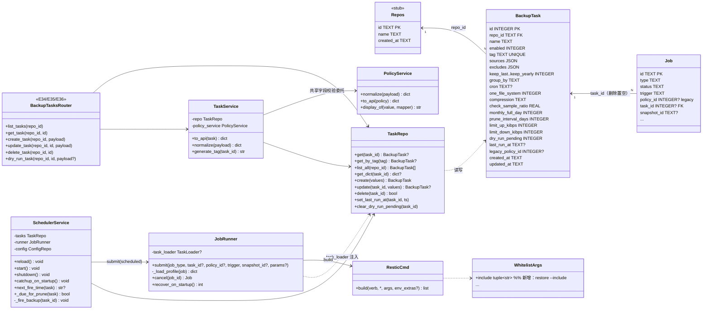
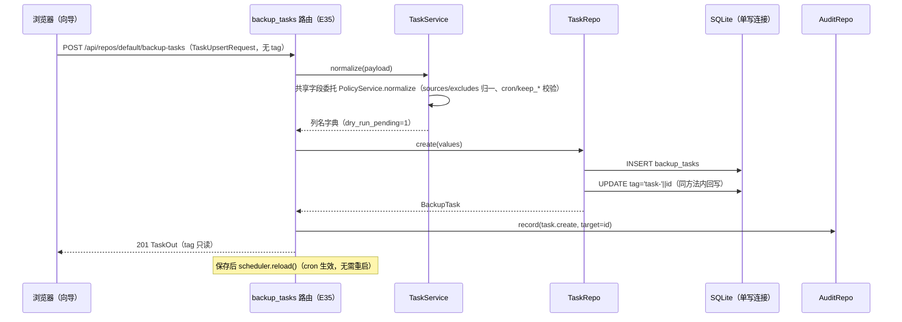
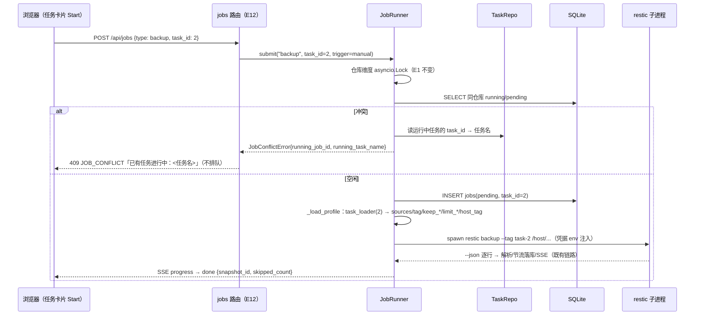
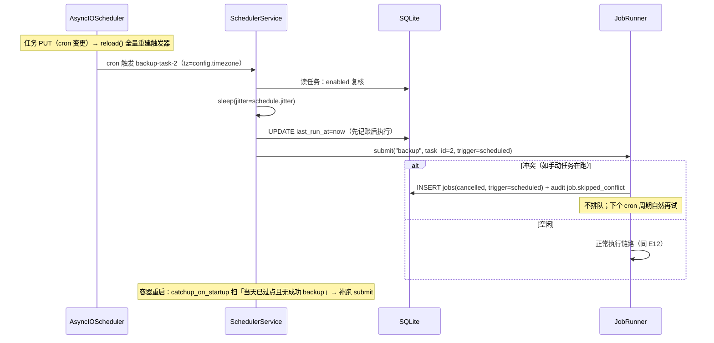
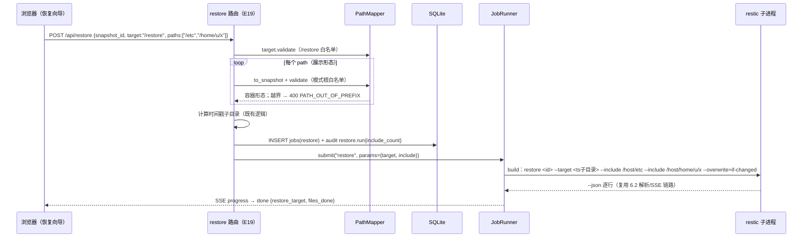

# 增量设计：轻量多备份任务（选项② · R-026 + B1 文件级恢复 R-027）

> 类型：**过程层文档**（带日期，符合《文档管理规范》§1/§4）；结论由 owner 并入《架构设计文档.md》后归档（§3）。
> 撰写：架构师 高见远 ｜ 日期：2026-10-13 ｜ 读者：工程师（实现）、QA（验证）、owner（决策）。
> 上游权威：《增量PRD-多备份任务-2026-10-13.md》（主输入）、《架构设计文档.md》v1.3（§13 演进位 E1–E7 为硬约束）、《UI视觉对齐Duplicati设计方案.md》§4.3（T3 结构层规范）、《Web版PRD.md》v1.2、《对齐Duplicati的改造方案.md》（B1 已裁决）。
> 设计基线（owner 已裁 / PM 建议默认，**未经 owner 逐条确认**）：文中以「待 owner 确认」标注；PM 9 问处置见 §10.1。
> 修订记录：v1.0（2026-10-13）初稿。

---

## 0. 代码事实核实（设计基线，证据带 文件:行号）

> 设计前对现有代码的逐项核实；所有引用均以本仓当前代码为准。

### 0.1 后端

| 事实 | 证据 |
|---|---|
| 迁移机制：`migrations/000N_*.sql` 按序执行，`user_version` 守卫（只应用 version > current 的脚本），每文件一个事务；当前仅 `0001_init.sql`（user_version=1） | `backend/app/db/database.py:107-130`；`backend/app/db/migrations/0001_init.sql:101` |
| `policies` 表已按多策略建全字段（cron/keep_*/group_by/one_file_system/compression/check_sample_ratio/monthly_full_day/prune_interval_days/limit_*_kibps/last_run_at），P1 仅默认策略可写 | `backend/app/db/migrations/0001_init.sql:36-62`；`backend/app/routers/policies.py:1-7` |
| `policies.sources/excludes` 入库与 argv 均为**容器前缀形态**；API 边界出 `display_sources/display_excludes`；三分类归一点为 `PolicyService._normalize_sources` 与 `exclusions.normalize_user_excludes` | `backend/app/services/policy_service.py:9-13,144-183`；`backend/app/exclusions.py:185-239` |
| `jobs` 表现有 `policy_id INTEGER REFERENCES policies(id)`，**无 task_id** | `backend/app/db/migrations/0001_init.sql:71`；`backend/app/db/repositories/job_repo.py:13-17` |
| `JobRunner.submit(job_type, *, policy_id=None, trigger="manual", snapshot_id=None, params=None)`；互斥为仓库维度 `asyncio.Lock`（`_repo_lock(repo_url)`，字典惰性建锁）；manual 冲突抛 `JobConflictError`（409，data 仅 `running_job_id`），scheduled 冲突落 cancelled + `job.skipped_conflict` 审计 | `backend/app/services/job_runner.py:112-194` |
| `JobRunner` 经 `policy_loader` 回调（注入 `PolicyRepo.get_dict`）取策略字典；backup argv 取 `params.sources or policy.sources`、`params.tags or [policy.tag]`；restore 取 `params.target` 与 `params.overwrite`（默认 if-changed） | `backend/app/services/job_runner.py:397-466`；`backend/app/main.py:187-196` |
| `ResticCmd.build` 白名单：verb 白名单 10 项；`WhitelistArgs` 具名字段；`--tag/--exclude/--host` 在 `_verb_flags`；路径经 `PathMapper.validate`（restore `--target`、backup targets）；**无 `--include` 条目** | `backend/app/services/restic.py:26-28,56-83,309-390` |
| `AUDIT_*` 常量集中于 `constants.py`（现无 `task.*`）；错误码唯一映射 `ERROR_STATUS`，`errors.py` 只引用不定义 | `backend/app/constants.py:80-101,57-78`；`backend/app/errors.py:5-7` |
| `app.state` 装配点（lifespan）：policy_repo/policy_service/job_repo/job_runner/sse_channel 等；`recover_on_startup` 当前只做 interrupted 改标（补跑/AUTO_UNLOCK 为 TODO(P2)） | `backend/app/main.py:157-235,342-359`（job_runner.py） |
| **调度器（R-013/SchedulerService）未实现**：`services/` 无 `scheduler.py`，无 APScheduler 装配；cron 仅存库（`PolicyService._normalize_cron` 轻量校验字段数） | `backend/app/services/` 目录清单；`backend/app/services/policy_service.py:213-222` |
| E12 路由提交前对 `params.excludes` 做三分类归一（越界 422 同步回前端，不打进 failed） | `backend/app/routers/jobs.py:58-81` |
| E19 恢复：请求体仅 `snapshot_id/target`；时间戳子目录服务端计算；`restore.run` 审计既有埋点 | `backend/app/routers/restore.py:50-98`；`backend/app/constants.py:89` |
| E31 dry-run：`sources/excludes` 收展示形态（`_to_container_path` 还原），restic 非 0 返回 200 + `error` 字段（禁止静默） | `backend/app/routers/sources.py:142-238,243-270` |
| E17/E18：快照列表/文件树；`tags` 原样透出，**无 tag 过滤**；`paths`/`display_path` 为原路径语义 | `backend/app/routers/snapshots.py:50-141,146-155` |
| config 键表含 `schedule.cron_default/jitter/retry_times/retry_interval` 与 `timezone`（全局缺省，无 UI） | `backend/app/db/repositories/config_repo.py:158-173`（backfill 先例）；架构 §4.3 |

### 0.2 前端

| 事实 | 证据 |
|---|---|
| 仪表盘现有三卡：仓库状态（E30，60s 轮询）/进行中任务（E13，15s）/运行模式 TierCard；无任务卡片 | `frontend/src/pages/dashboard/index.vue:27-44,76-142` |
| 策略页表单字段（enabled/tag/cron/keep_*/group_by/one_file_system/compression/check_sample_ratio/monthly_full_day/prune_interval_days；限速置灰 P2）——向导 ScheduleRetentionForm 的抽取源 | `frontend/src/pages/policies/index.vue:36-52,147-234` |
| 备份源页：VirtualTree 勾选 + E32 只读展示 + 追加排除 + E31 dry-run——向导 SourcesPicker 的抽取源 | `frontend/src/pages/sources/index.vue:38-60`（treeLoader/exclusionsQuery） |
| 恢复向导三步：选快照（默认最新）→ ConfirmGate（keyword=RESTORE，预览含快照/路径/目标）→ JobProgress | `frontend/src/pages/restore/index.vue:36-45,83-105,188-204` |
| 快照页：分页 Table + VirtualTree 抽屉 + 「恢复此快照」`?snapshot=` 直达；无 tag 筛选 | `frontend/src/pages/snapshots/index.vue:26-50` |
| `ConfirmGate.vue` 三步门（预览 slot → keyword 输入 → 二次确认，红色按钮）；`JobProgress.vue` 统一 SSE 进度卡（含日志抽屉）；`VirtualTree.vue` 懒加载虚拟滚动树（`selectDir` 模式支持选中目录） | `frontend/src/components/ConfirmGate.vue:10-50`；`frontend/src/components/JobProgress.vue:19-31`；`frontend/src/components/VirtualTree.vue:30-45` |
| api 层唯一出口 `src/api/`（http.ts 统一 401/403/错误码）；`types.ts` 与后端 schema 一一对应 | `frontend/src/api/http.ts:66`；`frontend/src/api/types.ts:1-2` |
| 菜单 7 项（含备份源/策略与调度）；路由 7 页；无任务相关路由 | `frontend/src/layouts/BasicLayout.vue:70-76`；`frontend/src/router/index.ts:33-77` |
| i18n 嵌套对象词条（zh-CN.ts/en-US.ts），`useI18n()` + `$t()`，模板禁硬编码 | `frontend/src/i18n/locales/zh-CN.ts:1-32`；`frontend/src/i18n/index.ts:24-31` |
| 视觉令牌 T1/T2 已落地（theme/tokens.ts + BasicLayout 响应式），新页面自动继承；§4.3 只给结构规范 | `docs/UI视觉对齐Duplicati设计方案.md:161-183` |

---

## 1. 实现方案总览

### 1.1 核心技术难点与选型

| 难点 | 选型 / 决策 | 理由 |
|---|---|---|
| 任务↔策略 1:1 后「策略字段全集」的复用 | `backup_tasks` 字段与 `policies` 逐列同构；`TaskService` 的共享字段校验**委托既有 `PolicyService.normalize`**，不复制第二套校验 | 字段语义单一真源；cron/keep_*/compression 校验规则不漂移（PM Q1 基线 1:1） |
| 仓库维度互斥（E1）不回归 | JobRunner 仓库锁**零改动**；多任务串行由 restic 锁决定；`submit` 增 `task_id` 形参，profile 解析走注入式 `task_loader`（仿 `policy_loader` 先例） | 互斥语义是 P1 已验证不变量；双并发竞态测试基线保持（AGENTS.md 编码约定） |
| `repo_id` 外键（E7）无父表可指 | 0002 同批建 `repos` **身份注册表**（id/name/created_at 三列，P2 仅 `default` 一行）；仓库连接事实仍以 config `repo.*` 为单一真源，`repos` 不镜像 url | FK 字面落地；R-023 退化为「加行 + 切换器」；不制造第二数据源（E4 精神） |
| 存量兼容（US-026-09） | **owner 裁决 greenfield（2026-10-13）：无任何存量数据，不做迁移/物化**——0002 只建表结构（repos/backup_tasks/jobs.task_id），不产生首任务；全新部署从「新建首个任务」开始（向导入口） | 消除物化分支与 legacy_policy_id 溯源列；T01 验收简化为结构+幂等断言 |
| tag 安全（PM Q3 基线） | tag **自动生成只读**：新建任务 `task-<自增 id>`（插入后同方法内回写，单写连接下无竞态）；greenfield 无存量快照归组问题；DDL `UNIQUE(tag)` | 杜绝改 tag 导致 forget `--tag` 误删他任务快照；中文任务名不做 slug（无规范化争议） |
| 删除任务的数据安全（PM Q7 基线） | **不删快照只解绑**：`jobs.task_id` 外键 `ON DELETE SET NULL`（历史保留、脱离关联）；仓库内 tag 快照不动（forget 是唯一删快照路径）；运行中/等待中任务 409 `TASK_RUNNING` 拒绝删除 | S6/S7 合规；US-026-03 AC1/AC5 |
| 首跑/源变更后不盲跑（R-026-08） | `backup_tasks.dry_run_pending` 列：创建时置 1；sources/excludes 更新时置 1；E36 预览成功或首次成功备份后清 0；UI Start 按钮据此拦截 | 「UI 拦截 + 状态标记」的服务端真源，刷新不丢 |
| 调度器从零（R-013 未实现） | 新建 `services/scheduler.py`：APScheduler AsyncIOScheduler + `_cron_trigger()` 自行拆 5 字段显式构造（2026-10-14 修正：弃用 `from_crontab`——APScheduler 3.x 星期字段偏移一天，issue #286；tz=config.timezone→settings.tz）；`reload()` 全量重建；`catchup_on_startup()` 按「当天已过点且无成功任务」补跑；jitter 在 fire 回调内 sleep（先查 enabled → jitter → 记账 → submit） | 最小可用面；动态重载满足「保存即生效不重启」；`get_next_fire_time` 顺供 E34 下次运行时间 |
| 自动 prune 的安全边界（架构 §6.4 vs PRD G3） | 调度器实现 `_due_for_prune` 判定并在卡片暴露 `prune_due`，但**不自动提交 forget**；自动 forget 留待 R-016 预览-确认流（本批不含） | G3「不发生未经确认门的裁剪事故」；§6.4 机制就位但执行门后置（待 owner 确认，§10.2-N3） |
| B1 `--include`（S2 合规） | `WhitelistArgs` 增 `include: tuple[str,...]`；`_verb_flags` restore 分支拼 `--include`，每值过 `PathMapper.validate`（白名单=当前模式根）；路由层提交前 display→容器形态归一（越界 400/422 同步回） | 既有机制内扩展，无自由字符串通道；与 E31/E05 归一口径一致 |

### 1.2 数据模型决策

**决策一（模型）**：`backup_tasks` 与 `policies` **字段同构、地位取代**——任务即策略实体（1:1，PM Q1 基线）；`policies` 表保留为 legacy（历史 jobs 的 `policy_id` 外键兼容；greenfield 部署无历史行），不再出现在任何 UI 写路径；E08–E11 端点保留（legacy 读），P1 写门禁（`POLICY_WRITE_CLOSED`/`DEFAULT_POLICY_IMMUTABLE`）不变。

**决策二（关联）**：`jobs` 增 `task_id INTEGER REFERENCES backup_tasks(id) ON DELETE SET NULL`——新任务（backup/forget）落 `task_id`、`policy_id` 为 NULL；legacy 行两列皆空/仅 policy_id；`task_id` 语义 = 「该 job 由哪个任务产生」，删除任务后置 NULL（历史保留、不再关联，US-026-03 AC1「不再与本任务关联」的字面落地）。

**决策三（迁移 0002，greenfield 简化版）**：单脚本三件事——① 建 `repos` 注册表并种 `default` 行；② 建 `backup_tasks`（带 `repo_id` 外键 + `dry_run_pending`；**无 legacy_policy_id**——owner 裁决无存量数据，不做物化）；③ `ALTER TABLE jobs ADD COLUMN task_id`（由 `user_version` 守卫幂等，见下注）。全新部署从「新建首个任务」开始，无默认任务、无迁移门禁。

> **幂等性注记**：`ALTER TABLE ADD COLUMN` 无 `IF NOT EXISTS` 形态。依赖迁移器 `user_version` 守卫（`database.py:119-121`：仅应用 version > current 的脚本，重跑返回 0）——与 `tests/test_migrations.py` 既有幂等口径（`test_migrate_is_idempotent_when_run_twice`）一致。0002 测试需新增：应用后 user_version=2、重跑零应用、重连不重应用、三表结构断言（repos/backup_tasks/jobs.task_id 存在）。

**DDL 草案（0002_multi_backup_tasks.sql）**：

```sql
-- 0002_multi_backup_tasks.sql —— 选项②「轻量多备份任务」（R-026；架构 §13 E6/E7）
-- 新增 repos（身份注册，R-023 预留）/ backup_tasks（任务即策略）/ jobs.task_id；
-- greenfield（owner 2026-10-13 裁决）：无存量数据，无物化/迁移分支；
-- 幂等：CREATE TABLE 全 IF NOT EXISTS；ALTER TABLE ADD COLUMN 由迁移器 user_version 守卫。

CREATE TABLE IF NOT EXISTS repos (
    id         TEXT PRIMARY KEY,          -- P2 恒 'default'；R-023 起为仓库 id
    name       TEXT NOT NULL,
    created_at TEXT NOT NULL
);
INSERT OR IGNORE INTO repos (id, name, created_at)
VALUES ('default', '默认仓库', strftime('%Y-%m-%dT%H:%M:%SZ', 'now'));

CREATE TABLE IF NOT EXISTS backup_tasks (
    id                  INTEGER PRIMARY KEY,
    repo_id             TEXT NOT NULL DEFAULT 'default' REFERENCES repos(id),  -- E7：第一天带外键
    name                TEXT NOT NULL,
    enabled             INTEGER NOT NULL DEFAULT 1,
    tag                 TEXT NOT NULL UNIQUE,     -- 自动生成只读：task-<id>（greenfield 无 legacy 继承）
    sources             TEXT NOT NULL,            -- JSON 数组，容器前缀形态（同 policies 口径）
    excludes            TEXT NOT NULL,            -- JSON 数组；内置排除集不入库（D8）
    keep_last           INTEGER NOT NULL DEFAULT 0,
    keep_hourly         INTEGER NOT NULL DEFAULT 0,
    keep_daily          INTEGER NOT NULL DEFAULT 0,
    keep_weekly         INTEGER NOT NULL DEFAULT 0,
    keep_monthly        INTEGER NOT NULL DEFAULT 0,
    keep_yearly         INTEGER NOT NULL DEFAULT 0,
    group_by            TEXT NOT NULL DEFAULT 'host,paths,tags',
    cron                TEXT,                     -- 空 → 回退全局缺省 schedule.cron_default
    one_file_system     INTEGER NOT NULL DEFAULT 0,
    compression         TEXT NOT NULL DEFAULT 'auto',
    check_sample_ratio  REAL NOT NULL DEFAULT 0.02,
    monthly_full_day    INTEGER NOT NULL DEFAULT 1,
    prune_interval_days INTEGER NOT NULL DEFAULT 7,
    limit_up_kibps      INTEGER NOT NULL DEFAULT 0,   -- KiB/s，0=不限（随 P2 生效）
    limit_down_kibps    INTEGER NOT NULL DEFAULT 0,
    dry_run_pending     INTEGER NOT NULL DEFAULT 0,   -- R-026-08：创建时服务端置 1（首跑/源变更须 dry-run 确认），E36 预览成功或首次成功备份清 0
    last_run_at         TEXT,                          -- 调度记账（先记账后执行）
    created_at          TEXT NOT NULL,
    updated_at          TEXT NOT NULL
);
CREATE INDEX IF NOT EXISTS idx_backup_tasks_repo   ON backup_tasks(repo_id);

ALTER TABLE jobs ADD COLUMN task_id INTEGER REFERENCES backup_tasks(id) ON DELETE SET NULL;
CREATE INDEX IF NOT EXISTS idx_jobs_task ON jobs(task_id);

PRAGMA user_version = 2;
```

**tag 生成规则（共享知识）**：
- 新建任务：`TaskRepo.create` 插入后同方法内 `UPDATE backup_tasks SET tag = 'task-' || id WHERE id = last_insert_rowid()`（单写连接串行，无竞态）；客户端提交的 `tag` 字段**忽略**（API 不接收）。
- 迁移首任务：继承 legacy 策略 tag（P1 默认策略为 `auto`，`policy_repo.py:35`）；存量快照按原 tag 归组不断裂。
- 更新任务：tag 永不变更（`TaskService.normalize` 显式剔除）。
- 唯一性：DDL `UNIQUE(tag)`；`task-<id>` 形态天然不撞。

**任务状态机**：`backup_tasks` **无 status 列、无新状态机**——卡片状态为派生值（优先级：`enabled=0 → paused` > 活跃 job（running/pending）> 最近一次 backup job 终态 > `never_run`）；`enabled` 是调度门而非状态机迁移。jobs 六态状态机（`constants.JOB_STATUSES`）零改动。

### 1.3 类图



---

## 2. API 设计

### 2.0 统一约定（不变）

- 全部新端点挂 `require_session` + `require_bootstrap_done`，写方法经 Origin 同源校验（S4，中间件①+路由依赖②③）；
- 错误响应 `{code, message, data}`；新错误码同批更新 `constants.ERROR_STATUS` 与架构 §5.0（维护约定）；
- 分页 `?limit=&offset=` → `{items,total,limit,offset}`；
- DB 访问仅经 `repositories/`（A1）；审计只增不改（S6）。

**repo 作用域形式（E6，待 owner 确认 §10.1-Q5）**：本批新端点采用**路径前缀** `/api/repos/{repo_id}/backup-tasks`；`repo_id` 仅接受 `default`（P2 唯一仓库），其余值 404 `REPO_NOT_FOUND`（data 带 `repo_id`）。R-023 时零改路由（加行 + 仓库切换器）。

### 2.1 新端点

#### E34 `GET /api/repos/{repo_id}/backup-tasks`（任务卡片列表，US-026-06）

请求：`?limit=50&offset=0`。响应 `Page[TaskCardOut]`：

```json
{
  "items": [
    {
      "id": 2, "name": "每日全量", "enabled": true, "tag": "task-2",
      "cron": "0 3 * * *",
      "status": "running",                 // paused/running/pending/success/failed/interrupted/cancelled/never_run（派生，见 §1.2）
      "last_run_at": "2026-10-12T19:00:00Z", "last_result": "success",
      "next_run_at": "2026-10-13T03:00:00Z", // null=仅手动或已暂停
      "running_job_id": "01JAAA...",          // 有活跃 job 时非空（卡片内联进度/取消/日志入口）
      "dry_run_pending": false,               // true 时 UI 拦截 Start（R-026-08）
      "prune_due": false,                     // 保留清理到期提示（不自动执行，见 §4.4）
      "updated_at": "2026-10-13T02:00:00Z"
    }
  ],
  "total": 3, "limit": 50, "offset": 0
}
```

数据装配（路由内聚合，无新 SQL 散出）：`TaskRepo.list_all(repo_id)` + `JobRepo.list_active()`（进行中）+ `JobRepo.latest_backup_by_tasks(task_ids)`（每任务最近一次 backup 终态）+ `SchedulerService.next_fire_time(task)`（cron 推导）+ `_due_for_prune(task)`。错误：404 `REPO_NOT_FOUND`。

#### E34b `GET /api/repos/{repo_id}/backup-tasks/{id}`（任务详情/编辑预填，US-026-02）

响应 `TaskOut`（全字段 + display 派生，tag 只读露出）：

```json
{
  "id": 2, "repo_id": "default", "name": "每日全量", "enabled": true, "tag": "task-2",
  "sources": ["/host/etc"], "display_sources": ["/etc"],
  "excludes": [], "display_excludes": [],
  "keep_last": 0, "keep_hourly": 0, "keep_daily": 7, "keep_weekly": 4, "keep_monthly": 6, "keep_yearly": 1,
  "group_by": "host,paths,tags", "cron": "0 3 * * *", "one_file_system": false,
  "compression": "auto", "check_sample_ratio": 0.02, "monthly_full_day": 1,
  "prune_interval_days": 7, "limit_up": 0, "limit_down": 0,
  "dry_run_pending": false, "last_run_at": null,
  "legacy_policy_id": null, "created_at": "...", "updated_at": "..."
}
```

错误：404 `REPO_NOT_FOUND` / 404 `NOT_FOUND`（任务不存在）。

#### E35 `POST /api/repos/{repo_id}/backup-tasks`（创建，US-026-01）

请求 `TaskUpsertRequest`（**无 tag 字段**——服务端生成）：

```json
{
  "name": "每日全量", "enabled": true,
  "sources": ["/etc", "/home"], "excludes": ["/home/*/.cache"],
  "keep_last": 0, "keep_hourly": 0, "keep_daily": 7, "keep_weekly": 4, "keep_monthly": 6, "keep_yearly": 1,
  "group_by": "host,paths,tags", "cron": "0 3 * * *", "one_file_system": null,
  "compression": "auto", "check_sample_ratio": 0.02, "monthly_full_day": 1,
  "prune_interval_days": 7, "limit_up": 0, "limit_down": 0
}
```

行为：`TaskService.normalize`（共享字段委托 `PolicyService.normalize`：sources/excludes 三分类归一为容器形态、cron 5/6 字段校验、keep_* 非负、compression 白名单；`name` 必填非空；`enabled` 缺省 true；`one_file_system=null` 按模式缺省）→ `TaskRepo.create`（`dry_run_pending=1`，`legacy_policy_id=NULL`，tag 回写 `task-<id>`）→ 审计 `task.create`（target=task id，detail={name}）→ 201 `TaskOut`。

错误：404 `REPO_NOT_FOUND`；422 `VALIDATION_ERROR`（name 空 / sources 空或越界 / cron 字段数 / compression 非法——与策略页同规则）。

#### E35b `PUT /api/repos/{repo_id}/backup-tasks/{id}`（更新，US-026-02）

请求同 E35（全量语义，与 E10 一致）。行为：存在性校验 → normalize → 若 `sources`/`excludes` 与库中现值**不同**则 `dry_run_pending=1`（US-026-02 AC2）→ `tag`/`legacy_policy_id` 永不被写 → 调度器动态重载（cron 改动即生效，不重启容器）→ 审计 `task.update`（detail={fields}）→ 200 `TaskOut`。

错误：404 `REPO_NOT_FOUND` / 404 `NOT_FOUND` / 422 同上。

#### E35c `DELETE /api/repos/{repo_id}/backup-tasks/{id}`（删除，US-026-03）

行为：存在性校验 → **活跃 job 检查**（该 task_id 存在 running/pending → 409 `TASK_RUNNING`，data={running_job_id, task_name}，提示先取消）→ `TaskRepo.delete`（jobs.task_id 经外键 `ON DELETE SET NULL` 自动解绑；快照与历史日志不动）→ 调度器移除对应触发器 → 审计 `task.delete`（detail={name, tag}）→ 200 `OkResponse`。

错误：404 `REPO_NOT_FOUND` / 404 `NOT_FOUND` / 409 `TASK_RUNNING`。

> 三重确认在 UI（§5.3）；删除是危险操作，审计 action 取 `AUDIT_TASK_DELETE`（S6：append-only，只 INSERT）。

#### E36 `POST /api/repos/{repo_id}/backup-tasks/{id}/dry-run`（任务域扫描预览，R-026-08）

请求（均可选，缺省取任务存量值——支撑「源集合变更后重新预览」）：

```json
{ "sources": ["/etc", "/home"], "excludes": [] }
```

行为：加载任务 → 请求体覆盖或存量 sources/excludes → 经 `_to_container_path` 归一 → `restic backup --dry-run --json --verbose`（E31 同链路：超时 120s、条目上限 5000、伪文件系统目录名黄色 warnings、restic 非 0 回 200 + error 字段）→ **预览成功（无 error）即清 `dry_run_pending=0`**（用户已见扫描范围，US-026-01 AC1 第⑤步「预览→确认」的服务端凭证）→ 200 `DryRunResponse`。

无任务实体的新建流：继续用 E31（`POST /api/sources/dry-run`，sources 全在请求体）——E31 **不改契约**，仅文档注明其定位为「无实体任务的向导内预览」。

### 2.2 既有端点扩展

| 端点 | 扩展 | 请求/响应/错误码/审计 |
|---|---|---|
| **E12** `POST /api/jobs` | 请求体增可选 `task_id: int`（与 `policy_id` 互斥，同供 422 `VALIDATION_ERROR`）。`{type:"backup", task_id:2}` → `JobRunner.submit(task_id=2)`：jobs 落 `task_id`、`policy_id=NULL`；profile 经 `task_loader` 加载（sources/tag/keep_*/limit_*/host_tag 同形） | 202 `{id,status,type}`（不变）；409 `JOB_CONFLICT` **data 增 `running_task_name`**（US-026-04 AC2：UI 提示「已有任务进行中：<任务名>」）；scheduled 冲突 cancelled + `job.skipped_conflict`（detail 带 task_id）；审计 `job.submit` detail 带 task_id |
| **E13** `GET /api/jobs` | 查询增可选 `task_id`（任务历史按任务筛选；卡片日志入口同源） | P1 最小版 status 门禁不变（running/pending）；带 `task_id` 时允许终态过滤的说明见共享知识——本批仅放开 `task_id` 维度，status 语义不变 |
| **E17** `GET /api/snapshots` | 查询增可选 `tag`（精确匹配，US-026-08 AC1 筛选）；分组展示由前端按 tag 归并（见 §5.6） | 200 `Page[SnapshotOut]`（结构不变）；`tag` 与任务名映射来自 E34（前端） |
| **E19** `POST /api/restore` | 请求体增可选 `paths: list[str]`（**展示形态**；缺省/空=整快照恢复，兼容既有行为） | 路由层逐条 `to_snapshot` + `PathMapper.validate`（模式根白名单）→ 越界 400 `PATH_OUT_OF_PREFIX`（data 带 path）；归一后经 `params.include` 入 JobRunner；`restore.run` 审计 detail 增 `include_count`（**不新增动作名**，S6）；目标仍为服务端计算的时间戳子目录（S7） |
| **E31** `POST /api/sources/dry-run` | **契约不变**；定位收窄为「向导内无实体预览」 | 同现有（200 + error 字段） |
| **E05/E32** | **无 API 变更**。「E05 源选择 per-task」指选择态迁入任务向导（存于 `backup_tasks.sources`），E05 仍是无状态目录浏览 | — |

### 2.3 新错误码与审计常量（同批登记）

| 项 | 值 | 落点 |
|---|---|---|
| `TASK_RUNNING` | 409，运行中/等待中任务拒绝删除（data: running_job_id, task_name） | `constants.py` + `ERROR_STATUS` + `errors.py`（`TaskRunningError`） |
| `REPO_NOT_FOUND` | 404，repo 作用域 id 不存在（P2 仅 `default`） | 同上（`RepoNotFoundError`） |
| `AUDIT_TASK_CREATE/UPDATE/DELETE` | `task.create` / `task.update` / `task.delete` | `constants.py`（Q8 基线） |

---

## 3. B1 文件级恢复（R-027）

### 3.1 后端：`--include` 白名单拼装

```
恢复向导步骤1（VirtualTree 多选，展示形态 /etc、/home/u）
  → restore.ts: restoreSnapshot(id, target, paths?)         # paths 为 display 形态数组
  → E19 路由：paths 逐条 to_snapshot → PathMapper.validate(模式根)   # S1 校验点①（越界 400 同步回）
  → params["include"]（容器形态）→ JobRunner.submit("restore", ...)
  → ResticCmd.build：WhitelistArgs.include 逐值 PathMapper.validate    # S1 校验点②（纵深防御）
                   → argv 追加 ["--include", 值]...                    # S2：白名单内拼装，无自由字符串
  → restic restore <id> --target <时间戳子目录> --include /host/etc --overwrite=if-changed
```

- `WhitelistArgs.include: tuple[str, ...] = ()`（`restic.py:56-83` 同址增列）；拼装落在 `_verb_flags` 的 `verb == "restore"` 分支（`restic.py:334-343` 同址增段），白名单前缀取 `self._settings.mode_root`（host=/host、sources=/sources——与 sources 归一口径一致，`exclusions.py:231-237` 先例）。
- `--include` 语义：目录含子树、文件精确匹配；与 `--target` 组合只恢复命中路径（restic 0.19.1 既有能力，非新依赖）。
- **S7 不变**：目标仍为时间戳子目录，`--overwrite=if-changed` 仍由 JobRunner 固定注入，界面无任何覆盖入口；`paths` 不改变该语义（只缩小恢复范围）。
- 不选 paths（缺省/空数组）= 现有整快照行为，回归零影响。

### 3.2 前端：文件树多选

- 恢复向导步骤 1 增「选择要恢复的文件/目录（可选）」区：复用 `VirtualTree`（`selectDir` 模式可选目录；文件行默认可选，`VirtualTree.vue:150-161`）+ E18 `listSnapshotFiles` 游标分页；多选态为组件内 `Set<path>`（展示形态）。
- 交互对齐 Duplicati 三态文件选择器（UI 文档 §2.4/§4.3）：已选行绿勾样式（仅样式类，不引依赖）；「全不选=整快照」在 UI 明示。
- `ConfirmGate` 预览 slot 增「已选文件清单」（前 N 条 + 共 M 条，超出折叠；`ConfirmGate.vue:63-70` 的 `#preview` 插槽既有机制）。
- 步骤 3 结果区展示 `restore_target` 与本次恢复的文件数（SSE done 帧 `files_done`）。

---

## 4. 调度器 per-task 化（R-013 从零落地）

> 现状核实：`services/` 无 `scheduler.py`、无 APScheduler 装配（§0.1）。本节为最小可用面全量设计。

### 4.1 模块签名（`backend/app/services/scheduler.py`）

```python
class SchedulerService:
    def __init__(self, tasks: TaskRepo, runner: JobRunner, config: ConfigRepo,
                 settings: Settings | None = None) -> None: ...

    def reload(self) -> None:
        """全量重建 backup 触发器：enabled=1 且有效 cron 非空的任务各建一个
        _cron_trigger(effective_cron, tz)（2026-10-14 修正：弃用 from_crontab，星期字段按标准 crontab 语义换算，见架构 §7.4；job id=f"backup-task-{id}", replace_existing）；
        随后移除已不存在/已暂停任务的遗留 job。策略/任务保存后由路由调用。"""

    async def start(self) -> None:
        """AsyncIOScheduler.start() → reload() → await catchup_on_startup()（lifespan 接线）。"""

    async def shutdown(self) -> None:
        """scheduler.shutdown(wait=True)——与 JobRunner.on_shutdown 顺序：先停调度再收尾进程。"""

    async def catchup_on_startup(self) -> None:
        """补跑（US-026-07 AC3）：逐任务算「今天首个应触发点」=
        trigger.get_next_fire_time(None, 当天 00:00(tz))；若该点 ≤ now 且该任务
        无 finished_at ≥ 该点的成功 backup job → submit(trigger=scheduled) 补跑。
        全部冲突则按 §6.4 落 cancelled + job.skipped_conflict（复用 JobRunner 既有分支）。"""

    def next_fire_time(self, task: BackupTask) -> str | None:
        """E34 卡片「下次运行」：有效 cron 的 get_next_fire_time(None, now) → ISO 8601 UTC；
        enabled=0 或无有效 cron 返回 None（UI：已暂停 / 仅手动）。"""

    def _due_for_prune(self, task: BackupTask) -> bool:
        """prune 到期独立判定（§6.4）：距上次成功 backup 超 prune_interval_days → True（仅提示，不执行）。"""

    async def _fire_backup(self, task_id: int) -> None:
        """触发链：读任务 → enabled 复核 → sleep(jitter=config schedule.jitter, 默认 300s 内随机)
        → 先记账 set_last_run_at(now)（防崩溃重复触发，§6.4）→ runner.submit("backup", task_id=..., trigger="scheduled")。"""
```

### 4.2 关键语义

- **有效 cron 解析**（单一实现点 `SchedulerService._effective_cron`）：`task.cron` 非空 → 用之；否则回退 config `schedule.cron_default`；仍空 → 无触发器（仅手动）。A8 基线（全局缺省保留 config，任务级为空回退）。
- **时区**：`config.timezone` → 回退 `settings.tz` → UTC（`utils.resolve_timezone` 既有能力）；cron 解释与「当天」判定同源。
- **jitter**：全局 `schedule.jitter`（秒），在 `_fire_backup` 内 sleep——先查 enabled、后记账再 submit；容器在 jitter 窗口内死亡则无记账，补跑逻辑自然覆盖。
- **动态重载**：E35'/E35'' 保存/删除后调 `scheduler.reload()`（经 `app.state.scheduler`）；「保存即生效、无需重启容器」（US-026-02 AC1）。
- **补跑与互斥的协作**：补跑提交若遇运行中任务 → scheduled 冲突分支（cancelled + 审计），下个周期自然再试；不排队（E1）。
- **misfire**：APScheduler `coalesce` 默认行为（一次补触发）即可满足「当天已过点未成功」语义，不额外配置。

### 4.3 启动/停机时序（接线点）

`main.py` lifespan：`recover_on_startup()` 之后 `await scheduler.start()`；shutdown 时 `await scheduler.shutdown()` 先于 `job_runner.on_shutdown()`。启动补跑与 interrupted 改标共享同一启动窗口（§6.5 既有语义按任务维度落地，US-026-07 AC4）。

### 4.4 prune/forget 边界（安全裁决，待 owner 确认 §10.2-N3）

`_due_for_prune` 判定实现并暴露到 E34 卡片（`prune_due`），**本批不提交 forget**：R-016 的 forget 预览-确认流不在本增量池内，自动裁剪会触碰 PRD G3「不发生未经确认门的覆盖/裁剪事故」。R-016 落地时复用同一判定 + 确认门（手动）或经 owner 裁决开放自动（架构 §6.4 原语义）。

---

## 5. 前端结构

### 5.1 信息架构变化（对齐增量 PRD §4.0）

| 页面 | 变化 |
|---|---|
| 3 仪表盘 | 新增**任务卡片列表**（主内容）；仓库状态卡、运行模式卡保留；原「进行中任务卡」并入卡片内联进度 |
| 5 备份源 | **退役**：全局源勾选/全局 dry-run 迁入任务向导；E32 只读展示移入向导步骤 2（D8 不变） |
| 6 策略与调度 | **退役**：策略随任务走；全局缺省 cron/jitter 仍留 config（本批无 UI，随 P2 设置页） |
| 8 快照浏览 | 增 tag 筛选 + 分组头（R-026-10，P2 最小实现） |
| 9 恢复向导 | 步骤 1 增文件级多选（B1）；ConfirmGate 预览增清单 |
| 新增 | 任务向导路由 `tasks/new`、`tasks/:id/edit`（五步 n-steps） |

### 5.2 任务卡片（视觉规范引用 UI 文档 §4.3，不复制色值）

`components/TaskCard.vue`（新）：结构按增量 PRD §4.1——标题行（名称 + 状态徽章 + 「⋯」菜单：编辑/删除）→ 元信息行（上次运行/下次运行）→ 进度区（running 时嵌 `JobProgress` + 「取消」；终态时结果摘要 + skipped 计数）→ 操作行（「立即运行」主按钮 + 「日志」）。扁平卡片（白底/1px 边框/小圆角）由 T1 令牌自动继承；徽章色用 Naive 语义色（success/error/warning/default/info）。空状态：`task.empty.title` + 「新建备份任务」主按钮。

### 5.3 新建/编辑任务五步向导

`components/TaskWizard.vue`（新，n-steps；编辑路由复用，预填来自 E34'）：

| 步骤 | 组件/来源 | 要点 |
|---|---|---|
| 1 基础信息 | 向导内联 | 任务名称必填；运行模式说明卡复用 `TierCard` 数据（`ui.me`）；密码文件挂载状态只读（`getConfig().passfile_status`，S3：无输入框） |
| 2 备份源 | `components/task/SourcesPicker.vue`（新，抽自 sources 页） | VirtualTree 多选目录（展示形态）+ E32 内置排除集只读（强制生效）+ 追加排除输入 + 「首次备份最慢属预期」提示 |
| 3 存储目标 | 向导内联 | 当前仓库只读（E30/E06）+ 「测试连接」（`testRepo()`，失败明示 reason） |
| 4 调度 | `components/task/ScheduleRetentionForm.vue`（新，抽自 policies 页） | cron + 常用模板快捷填充 + 「不调度（仅手动）」；保留档位 keep_*；下次触发预览（后端 E34 数据或保存后可见） |
| 5 保留与首跑 | 同上组件续 | 「预览扫描范围」（E31 无实体/E36 有实体）→ 扫描清单 + 伪文件系统黄色警告 → 「确认并立即首跑」（`createJob('backup',{taskId})`）或「仅保存，稍后手动运行」 |

编辑流差异：第 5 步的 dry-run 门在 sources/excludes 变更后再次出现（`dry_run_pending` 服务端标记 + UI 拦截双保险）；tag 只读展示（不可编辑，US-026-02 AC4）。

### 5.4 删除任务三重确认门（复用 `ConfirmGate.vue`）

第一重影响告知（`delete.impact`：将删除任务定义与调度；保留历史/日志/tag 快照；不可撤销）→ 第二重输入任务名称（`keyword` = 任务名，`delete.type_name`）→ 第三重红色确认（`delete.final`）。旁路：运行中任务删除入口置灰 + `delete.running_blocked`（US-026-03 AC5；后端 409 `TASK_RUNNING` 双保险）。确认通过 → `deleteTask(id)` → 审计 `task.delete`（后端）。

### 5.5 虚拟滚动选型（偏差说明，待 owner 确认 §10.2-N2）

PM Q6 建议 `n-data-table virtual-scroll`；**本设计选 `@vueuse/core` 的 `useVirtualList`**：卡片为**非表格场景**（可变高度内容区：进度条/摘要/skipped 折叠），PRD §7 已裁决「虚拟滚动列表优先 n-data-table，**非表格场景用 useVirtualList 兜底**」；n-data-table 的行高一致性契约与卡片形态冲突。实现：固定卡片骨架高度（内容截断/省略号）+ `useVirtualList`；自托管任务数通常 <20，虚拟化仅为防劣化（与 PM 判断一致）。

### 5.6 快照 tag 筛选与分组（R-026-10，最小实现）

快照页增 tag 筛选下拉（选项来自 E34 任务列表的 `{id,name,tag}` + 历史遗留 tag）；选中后 E17 带 `?tag=` 请求，列表上方展示分组头（任务名 · 快照数=total · 最新时间=首条 time）；未匹配任何任务的 tag 归「未知标签」（`snapshot.unknownTag`）。跨页全量分组不纳入（分页口径下分组头为当前筛选维度摘要，R-026-10 为 P2 优先级）。

### 5.7 i18n 键清单（中英，增量 PRD §4.4 全量 + 新增）

`task.status.*`（running/pending/success/failed/interrupted/cancelled/paused/never_run）、`task.last_run`、`task.next_run`、`task.manual_only`、`task.paused`、`task.start`、`task.cancel`、`task.logs`、`task.edit`、`task.delete`、`task.new`、`task.empty.title`、`task.empty.desc`、`task.conflict`、`task.progress`、`task.menu`、`task.card.title`；`wizard.step1~5`、`wizard.name`、`wizard.namePlaceholder`、`wizard.modeCard`、`wizard.passfile`、`wizard.passfileConfigured`、`wizard.passfileMissing`、`wizard.sources`、`wizard.sourcesHint`、`wizard.exclusionsBuiltin`、`wizard.exclusionsExtra`、`wizard.extraExclude`、`wizard.first_slow`、`wizard.repoReadonly`、`wizard.testConnection`、`wizard.testOk`、`wizard.testFail`、`wizard.cron`、`wizard.cronTemplates.*`、`wizard.noSchedule`、`wizard.jitterNote`、`wizard.retention`、`wizard.keep_*`、`wizard.dry_run`、`wizard.dry_run_confirm`、`wizard.save_only`、`wizard.rescan_required`、`wizard.tagReadonly`、`wizard.submitCreate`、`wizard.submitUpdate`；`delete.title`、`delete.impact`、`delete.type_name`、`delete.final`、`delete.running_blocked`、`delete.confirmBtn`；`restore.filesTitle`、`restore.filesHint`、`restore.filesSelected`、`restore.filesWhole`、`restore.gateFiles`；`snapshot.tagFilter`、`snapshot.allTags`、`snapshot.unknownTag`、`snapshot.groupHeader`。全部双语成对写入 `zh-CN.ts`/`en-US.ts`（模板零硬编码）。

---

## 6. 关键流程时序图









时序图与类图已同步抽取至 `docs/sequence-diagram.mermaid` 与 `docs/class-diagram.mermaid`。

---

## 7. 任务列表（有序，按依赖）

> 每个任务预计 diff 为**任务总量**；合入按 AGENTS.md「单次 ≤400 行、拆分在实现侧完成」由工程师在同任务内切多次提交（tests/** 与 tests/fixtures/** 豁免行数）。并行建议：T01–T04 后端（software-engineer）、T05 前端（software-engineer-2，T01 定稿 API 契约后可先按 mock 动工）。

### T01 数据模型与共享契约层

- **文件**：`backend/app/db/migrations/0002_multi_backup_tasks.sql`（新）、`backend/app/constants.py`（改：AUDIT_TASK_*、TASK_RUNNING/REPO_NOT_FOUND + ERROR_STATUS）、`backend/app/errors.py`（改：TaskRunningError/RepoNotFoundError）、`backend/app/schemas/api_schemas.py`（改：TaskOut/TaskCardOut/TaskUpsertRequest；JobCreateRequest.task_id；RestoreRequest.paths；DryRunRequest 不变）、`backend/tests/test_migrations.py`（改：0002 断言）、`backend/tests/test_errors.py`？——不新增，错误码映射断言并入 `tests/test_api` 既有文件或 test_migrations 同批（以现有测试组织为准）。
- **依赖**：无（首个任务）。
- **优先级**：P0。**预计 diff**：~330 行。
- **验收标准**：`uv run pytest tests/test_migrations.py` 全绿（user_version=2、幂等重跑零应用、重连不重应用、repos/backup_tasks/jobs.task_id 三结构断言；**greenfield：无物化断言**）；`ERROR_STATUS` 新码可查；`bash scripts/verify_redlines.sh` 通过。
- **红线自查**：A5（迁移走 user_version 机制、不改 0001）；S6（仅新增常量，无审计表变更）；迁移注释注明 ALTER 幂等依据。

### T02 任务域后端（仓储/服务/路由）

- **文件**：`backend/app/db/repositories/task_repo.py`（新：Task dataclass + CRUD + get_dict + set_last_run_at + clear_dry_run_pending）、`backend/app/services/task_service.py`（新：to_api/normalize，委托 PolicyService）、`backend/app/routers/backup_tasks.py`（新：E34/E34'/E35/E35'/E35''/E36 + repo 作用域守卫）、`backend/app/services/policy_service.py`（改：`_display_of` 提为公开 `display_of`，调用点同步）、`backend/app/db/repositories/job_repo.py`（改：Job.task_id、create 形参、`latest_backup_by_tasks`、list_page task_id 过滤）、`backend/app/main.py`（改：task_repo/task_service 装配 + router 挂载）、`backend/tests/test_api/test_backup_tasks.py`（新）。
- **依赖**：T01。
- **优先级**：P0。**预计 diff**：~400 行（实现侧按 仓储+服务 / 路由+main+测试 两个提交切分）。
- **验收标准**：E34 列表/详情/E35 增改删/E36 预览的 httpx 集成测试全绿（含 404 REPO_NOT_FOUND、409 TASK_RUNNING、删除后 jobs.task_id 置空而 jobs 行保留）；`uv run pytest` 全量不回归；`uv run ruff check app tests` 干净。
- **红线自查**：A1（SQL 只在 task_repo/job_repo）；S4（router 挂 protected 依赖）；S6（task.create/update/delete 埋点，append-only）；E7（repo_id 外键真实存在）；E4（未把仓库级状态塞 config KV）。

### T03 执行链路 per-task 化与 B1 后端

- **文件**：`backend/app/services/job_runner.py`（改：submit 增 task_id、profile 解析 task_loader 优先、冲突 data 增 running_task_name、scheduled 跳过带 task_id）、`backend/app/routers/jobs.py`（改：E12 task_id 互斥校验、E13 task_id 过滤）、`backend/app/routers/restore.py`（改：paths 归一 + include_count 审计）、`backend/app/services/restic.py`（改：WhitelistArgs.include + restore 分支 --include 拼装）、`backend/tests/test_state_machine.py`（改：task 提交路径用例）、`backend/tests/test_api/test_restore.py`（改：paths 用例）、`backend/tests/test_restic_whitelist.py`（改或新增：--include 白名单/越界用例）、`backend/app/main.py`（改：task_loader 注入——与 T02 同文件不同 hunk）。
- **依赖**：T01、T02。
- **优先级**：P0。**预计 diff**：~380 行（按 JobRunner+E12 / restore+restic+测试 两个提交切分）。
- **验收标准**：双并发竞态测试（task 维度）断言恰好 1 成功；409 data 含任务名；restore paths 越界 400、缺省整包、`--include` 拼装顺序与值形态正确；fixture 回归（如涉解析）先补 fixture。
- **红线自查**：S1（include 双重 PathMapper 校验）；S2（--include 仅白名单内拼装，无自由字符串）；E1（仓库锁不改）；S7（时间戳子目录与 overwrite 注入不变）。

### T04 调度器从零落地（per-task）

- **文件**：`backend/app/services/scheduler.py`（新：§4.1 签名全量）、`backend/app/main.py`（改：lifespan start/shutdown 接线 + app.state.scheduler）、`backend/app/routers/backup_tasks.py`（改：E35'/E35'' 保存后 reload 调用——与 T02 同文件后续 hunk）、`backend/tests/test_scheduler.py`（新：触发器重建、动态重载、补跑判定、jitter/记账顺序、prune 到期只提示）、`backend/tests/test_state_machine.py`（改：catchup 提交路径，如与 T03 同文件则合并提交）。
- **依赖**：T01、T02。
- **优先级**：P0。**预计 diff**：~420 行（按 scheduler.py+测试 / main+路由接线 两个提交切分）。
- **验收标准**：cron 变更后不重启即重排（reload 单测）；「当天已过点无成功」补跑提交一次（mock runner）；容器重启 interrupted + 补跑 + 锁残留提示语义按 §6.5 可演绎；`uv run pytest` 全量绿。
- **红线自查**：E1（提交仍走 JobRunner 互斥，调度器不并行设计）；可调阈值不裸写（jitter 读 config）；A1（SQL 经 repos）。

### T05 前端全量（数据层 + 任务卡片 + 向导 + B1 UI + 退役）

- **文件**：
  - 数据层：`frontend/src/api/backupTasks.ts`（新：E34/E35/E36 封装）、`frontend/src/api/types.ts`（改：BackupTask/TaskCard/TaskUpsert + JobOut.task_id + RestoreRequest.paths）、`frontend/src/api/jobs.ts`（改：createJob taskId）、`frontend/src/api/restore.ts`（改：paths）、`frontend/src/api/snapshots.ts`（改：tag 过滤）；
  - 组件：`frontend/src/components/TaskCard.vue`（新）、`frontend/src/components/TaskWizard.vue`（新）、`frontend/src/components/task/SourcesPicker.vue`（新）、`frontend/src/components/task/ScheduleRetentionForm.vue`（新）；
  - 页面：`frontend/src/pages/dashboard/index.vue`（改：任务卡片列表 + 空状态 + 退役原「进行中任务卡」）、`frontend/src/pages/taskWizard/index.vue`（新：create/edit 双模式，路由 `tasks/new` 与 `tasks/:id/edit` 共用）、`frontend/src/pages/restore/index.vue`（改：文件多选 + 门预览清单）、`frontend/src/pages/snapshots/index.vue`（改：tag 筛选 + 分组头）；
  - 退役：删 `frontend/src/pages/policies/index.vue`、`frontend/src/pages/sources/index.vue`、`frontend/src/api/policies.ts`；改 `frontend/src/router/index.ts`（移除两路由、加 tasks/new|edit）、`frontend/src/layouts/BasicLayout.vue`（菜单 7→5 项 + 仪表盘内「新建备份任务」入口）；
  - i18n：`frontend/src/i18n/locales/zh-CN.ts`、`frontend/src/i18n/locales/en-US.ts`（§5.7 全量键）。
- **依赖**：T01（契约）；联调依赖 T02–T04 端点就绪。
- **优先级**：P0。**预计 diff**：~1500 行（按 ①数据层+i18n ②TaskCard+仪表盘+退役 ③向导 ④B1 恢复+快照 tag 四个提交切分，各 ≤400 行）。
- **验收标准**：`pnpm run typecheck && pnpm run test && pnpm run build` 全绿；新建任务五步走通并首跑；卡片 409 文案含任务名；删除三重门 + 运行中置灰；恢复不选=整包、选 N 条=精准（对抗用例：越界路径前端不发/后端 400 展示）；模板无硬编码中文（grep 自查）；导航无 sources/policies。
- **红线自查**：S3（密码只读状态，无输入框）；S4（无新免鉴权面）；A4/A6（SSE 仍走 useJobStream，ConfirmGate 复用）；i18n 全量；路径只展示形态（前端不存不拼 /host）；大列表虚拟滚动（useVirtualList）。

---

## 8. 依赖包清单

**预期为空——本增量不新增任何依赖**：

- 后端：APScheduler（`^3.10`）已在架构 §2.1 依赖表内（P2 调度器既选型），本批首次启用，非新增；`get_next_fire_time` 为 3.x 既有 API；`from_crontab` 已弃用（2026-10-14 星期语义修正，见架构 §7.4）。
- 前端：`useVirtualList` 来自已依赖的 `@vueuse/core`（`^11`）；n-steps/n-modal/n-data-table 来自已依赖的 naive-ui；无新包。
- 论证结论：若实现中确需引入（如 cron 解析库），须走 AGENTS.md「新增依赖需说明理由并锁版本」评审，并同步 `uv.lock`/`pnpm-lock.yaml` 与架构 §2。

---

## 9. 共享知识（跨文件约定）

1. **tag 命名**：新建任务 `task-<自增id>`（插入后同方法回写，只读）；更新永不变更；DDL `UNIQUE(tag)`；forget 的 `--tag` 只认任务 tag（防误删他任务快照）。
2. **jobs.task_id 语义**：新产生 job（backup/forget）落 `task_id`、`policy_id=NULL`；legacy job 仅 `policy_id`；删除任务 → `task_id` 置 NULL（外键 ON DELETE SET NULL），行与日志保留；卡片状态派生只认 **backup 类** job 的最近终态。
3. **display_path 纪律**：容器形态（`/host/...`）只存在于 DB 存储与 restic argv；出 API 一律 display 派生（`display_sources/display_excludes/display_path`）；前端不存不拼容器前缀。
4. **有效 cron 解析**（单一实现点）：`task.cron` → config `schedule.cron_default` → 无（仅手动）；时区 `config.timezone` → `settings.tz` → UTC。
5. **错误码新增**：`TASK_RUNNING`(409, data{running_job_id, task_name})、`REPO_NOT_FOUND`(404, data{repo_id})——同批登记 `constants.ERROR_STATUS` 与架构 §5.0。
6. **审计动作新增**：`task.create` / `task.update` / `task.delete`（`AUDIT_TASK_*` 常量）；`restore.run` 的 B1 扩展只加 `include_count` detail，不新增动作名。
7. **dry_run_pending 语义**：1=首跑或源集合变更后必须先过 dry-run 预览（E36 成功即清 0；首次成功备份亦清 0）；UI Start 拦截 + 工具提示 `wizard.rescan_required`。
8. **repo 作用域**：本批所有新端点路径前缀 `/api/repos/{repo_id}/...`，`repo_id` 仅 `default`；其余 404 `REPO_NOT_FOUND`；R-023 时加行 + 切换器，路由不动。
9. **调度记账**：`last_run_at` 先记账后执行（防崩溃重复触发）；补跑判据 = 当天已过点且无 `finished_at ≥ 当天首个触发点` 的成功 backup job。
10. **prune 边界**：`_due_for_prune` 只判定 + 卡片提示，不自动 forget（待 R-016/owner）。

---

## 10. 裁决记录（2026-10-13 owner 全部确认）

> 基线声明：owner 明确 **greenfield——无任何存量数据（无存量策略/任务/库/快照），不考虑存量迁移**。据此本设计已删除全部迁移/物化/legacy 兼容分支（见 §1.2 决策三与 DDL 定稿）。

### 10.1 PM 9 问（全部确认）

| # | 事项 | 裁决 |
|---|---|---|
| Q1 | 任务↔策略 1:1，policies 退 legacy 保留不删、E08–E11 仅 legacy 读 | 确认（无历史任务数据需兼容） |
| Q2 | 备份源页整体退役，源选择迁入向导步骤 2 | **确认退役** |
| Q3 | tag 自动生成只读 `task-<id>` | 确认（无存量数据，归组问题不存在） |
| Q4 | 首任务「默认备份」+ dry_run_pending=0 | **greenfield 后作废**：不物化首任务；全新部署从「新建首个任务」开始 |
| Q5 | E34–E36 + 路径前缀 `/api/repos/{repo_id}/backup-tasks` | 按建筑师建议确认 |
| Q6 | 任务列表 useVirtualList（偏离 PM 的 n-data-table 建议） | 按建筑师建议确认 |
| Q7 | 删除任务只解绑（jobs.task_id 置空、运行中 409） | 确认；快照删除口径见 §10.3 |
| Q8 | AUDIT_TASK_* + 删除任务三重确认（keyword=任务名） | 按建筑师建议确认 |
| Q9 | enabled 启停纳入首版 | 按建筑师建议确认 |

### 10.2 架构师新发现（全部确认）

| # | 事项 | 裁决 |
|---|---|---|
| N1 | repos 最小身份注册表（三列，default 行，不镜像 url） | 按建筑师建议确认 |
| N2 | 虚拟滚动选型（同 Q6） | 按建筑师建议确认 |
| N3 | prune 到期只判定 + 卡片提示，不自动 forget | 按建筑师建议确认（G3 优先） |
| N4 | dry_run_pending 列位与清除时机 | 按建筑师建议确认 |
| N5 | 全局 jitter/cron_default 本批无 UI | 按建筑师建议确认 |
| N6 | 任务名不强制唯一 | 按建筑师建议确认 |
| N7 | E13 本批仅放 task_id 过滤维度 | 确认（任务历史页提前到 P2） |
| N8 | 补跑口径（当天已过点且无成功 backup 才补跑） | 按建筑师建议确认（greenfield 后无存量边界情形） |

### 10.3 删除任务与快照的关系（owner Q7 追问口径）

- **删除任务只碰元数据**：删 `backup_tasks` 行 → `jobs.task_id` 外键 `ON DELETE SET NULL`（历史任务记录与日志保留、脱离归属）；调度触发器随之移除；
- **快照是 restic 仓库内的物理数据，不在 SQLite 删除**：本项目 DB 只存任务/作业元数据，删除任务**完全不触碰仓库**；
- **快照的唯一删除途径 = restic forget（+ --prune）**，且只经 R-016 预览-确认流（P2，三重确认门）按 `--tag`/keep-* 规则执行——与删任务是两个独立动作，删除任务不级联删快照。

---

## 11. 并入架构文档的差异点清单（机械操作）

> 供 owner 将本设计结论并入《架构设计文档.md》v1.4 时逐项执行；每条给出落点。

| # | 架构文档落点 | 操作 |
|---|---|---|
| M1 | §3 目录结构 | 增列：`db/repositories/task_repo.py`、`routers/backup_tasks.py`、`services/task_service.py`、`services/scheduler.py`（scheduler 由「P2」改「P2 首批」）；前端增 `api/backupTasks.ts`、`components/TaskCard.vue`、`components/TaskWizard.vue`、`components/task/`、`pages/taskWizard/index.vue`；删 `pages/sources|policies/index.vue`、`api/policies.ts` |
| M2 | §4 DDL | 新增 §4.7 `repos` + `backup_tasks`（本文 §1.2 DDL 草案定稿版）；§4.5 `jobs` 增 `task_id` 列说明；§4.3 键表补注：`schedule.*` 为任务级 cron/jitter 缺省（无新键） |
| M3 | §5.0 错误码表 | 增 `TASK_RUNNING`(409)、`REPO_NOT_FOUND`(404) 两行（与 constants.ERROR_STATUS 对齐） |
| M4 | §5.1 端点明细 | 新增 E34（列表/详情）、E35（POST/PUT/DELETE）、E36（任务 dry-run）；修订 E12（task_id + 冲突 data）、E13（task_id）、E17（tag）、E19（paths）、E31（定位注记） |
| M5 | §6 时序 | 新增 §6.6 任务创建、§6.7 per-task 手动触发与 409、§6.8 调度触发与补跑（本文 §6 四图定稿版）；§6.4 补注 prune 边界（N3 裁决后） |
| M6 | §7.1 JobRunner | `submit` 签名增 `task_id`；profile 解析（task_loader 优先、policy_loader 兼容）；冲突 data 增 `running_task_name` |
| M7 | §7.1 restic | `WhitelistArgs` 增 `include`；`_verb_flags` restore 分支 `--include` 拼装与校验口径 |
| M8 | §7.4 SchedulerService | 由占位签名替换为本文 §4.1 定稿签名（reload/start/shutdown/catchup_on_startup/next_fire_time/_due_for_prune/_fire_backup） |
| M9 | §9.1 路由表 | 备份源/策略与调度两行标注「退役（R-026）」；新增任务向导行；§9.5 不变（新页面自动继承令牌） |
| M10 | §11 追溯矩阵 | R-026 行更新（backup_tasks/E34–E36/仪表盘卡片）；R-014 行更新（任务管理 UI 定稿）；R-013 行更新（调度器本批落地）；新增 R-027 行（B1 文件级恢复）；R-016 行补注（prune 自动执行待裁决） |
| M11 | §13 演进位 | E7 标注「已满足（0002 repos + repo_id 外键）」；E6 标注「已应用（/api/repos/{repo_id}/ 前缀）」；E1/E4/E5 复核无回归 |
| M12 | §12 风险表 | 增补：补跑口径与时区边界（N8）、自动 prune 安全边界（N3） |

---

## 附：红线与硬约束核对

| 约束 | 本文落点 | 状态 |
|---|---|---|
| E7 repo_id 外键 | §1.2 DDL（0002 repos + backup_tasks.repo_id） | ✅ |
| E1 仓库维度互斥 | JobRunner 锁零改动；调度器不并行 | ✅ |
| E4 不塞 config KV | repos 不镜像 url；schedule.* 为既有键 | ✅ |
| E6 repo 作用域 | `/api/repos/{repo_id}/backup-tasks` 前缀（待确认 Q5） | ✅ |
| S1 路径全过 PathMapper | include 双重校验；sources/excludes 三分类归一点 | ✅ |
| S2 restic 白名单 | `--include` 仅 WhitelistArgs 内拼装 | ✅ |
| S3 凭据零泄漏 | 向导仅只读密码文件状态；审计 detail 无敏感值 | ✅ |
| S4 新端点鉴权 | protected 依赖 + Origin 中间件 | ✅ |
| S6 审计只增不改 | task.* 三动作经 AuditService.record | ✅ |
| S7 无覆盖语义 | 恢复仍仅时间戳子目录；paths 只缩小范围 | ✅ |
| A1 DB 访问唯一点 | task_repo/job_repo 唯一 SQL 落点 | ✅ |
| A5 单写连接 | 迁移走 user_version 机制；tag 回写依赖单写串行 | ✅ |
| i18n 双语 | §5.7 键清单；模板零硬编码 | ✅ |
| 不新增依赖 | §8 论证（APScheduler 为既有选型启用） | ✅ |
| ≤400 行/次合入 | §7 每任务内多提交切分 | ✅ |