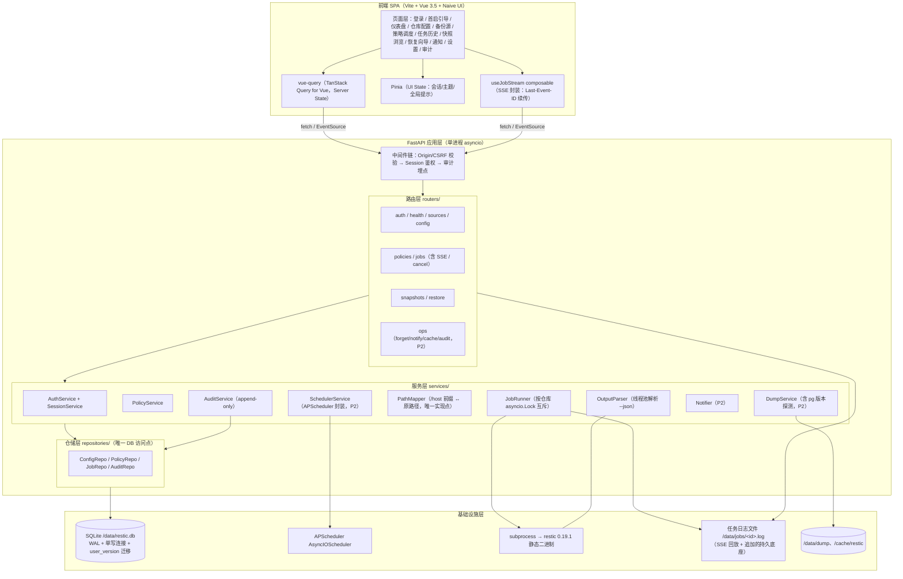
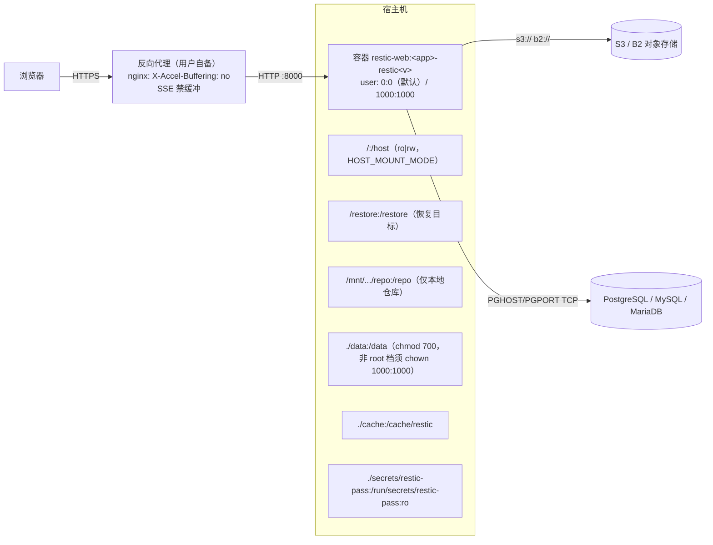
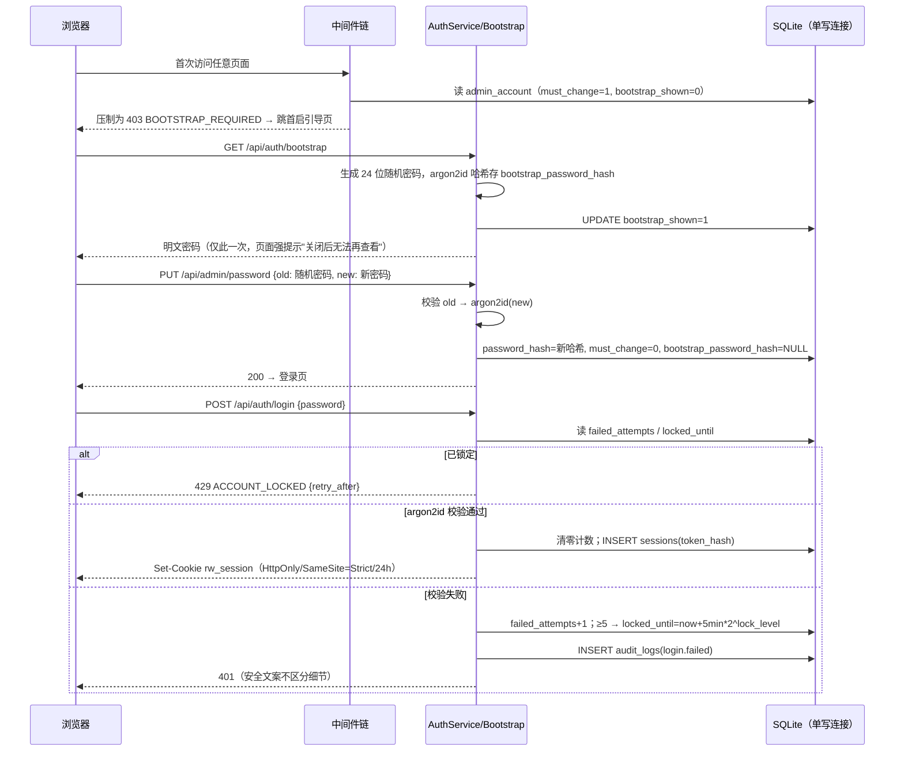
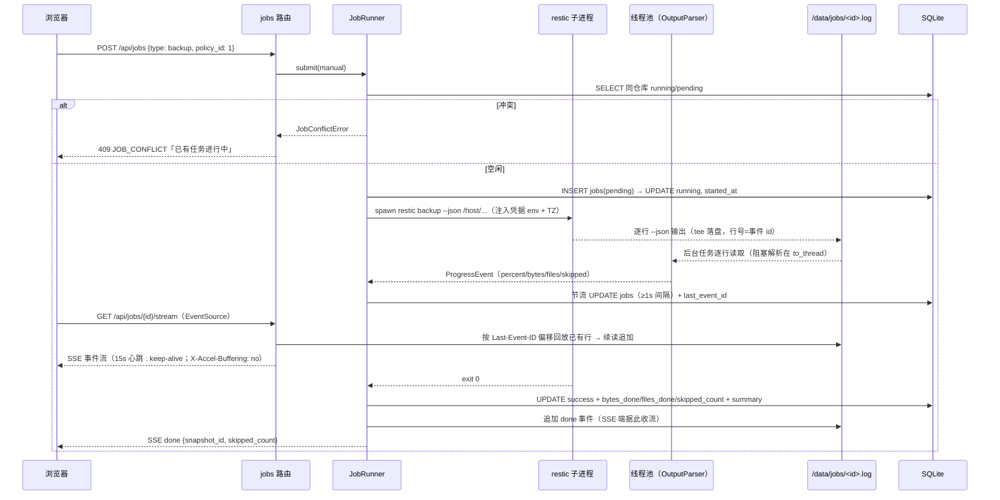
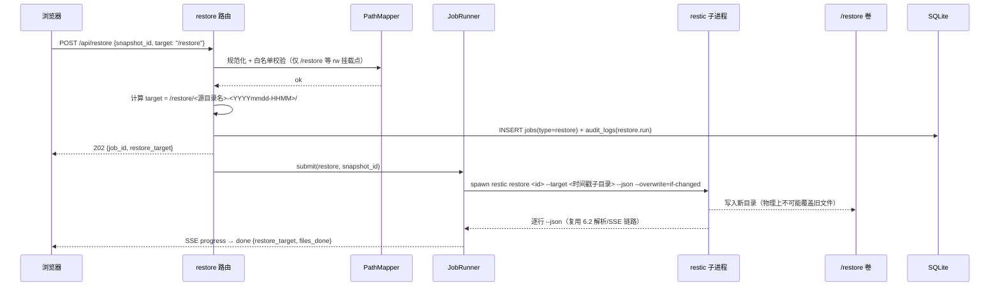
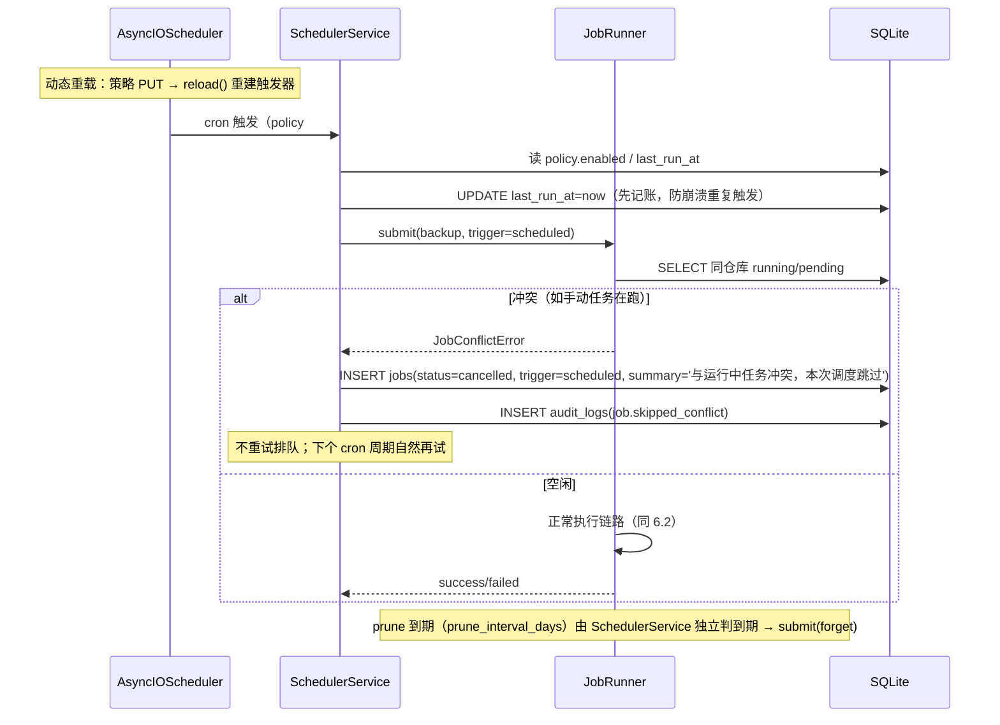
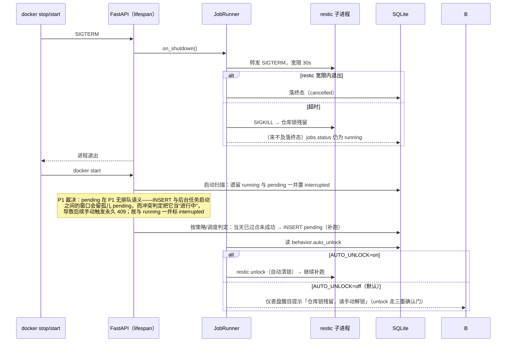

# restic-docker-backup Web 版架构设计文档

> 版本：v1.2（2026-10-11）  
> v1.2 修订：P1 实现定案的文档同步批次——E05/E31 入参改收展示路径（兼容容器路径）、policies.sources/excludes 存储形态与三分类归一、PolicyOut 增 display_* 派生字段、E15 起始游标约定、recover_on_startup 将遗留 running+pending 一并置 interrupted（P1 裁决）、目录树补 errors.py/auth/service.py/env_sync.py、E32 归期 P2→P1、CI 依赖源固化。  
> 上游文档：《Web版改造方案 v2.3.4》（技术决策、API 清单、分阶段计划以该文档为准）、《Web版PRD v1.1》（需求池 R-001~R-025、12 页面线框、非功能需求）  
> 读者：实现阶段 P1 的工程师；文档给出可直接照做的目录结构、Schema DDL、API 契约与模块签名。

---

## 1. 架构总览

### 1.1 分层架构



要点：

- **三层后端**（路由-服务-仓储）+ 独立 auth 模块；DB 访问只存在于仓储层，路径映射只存在于 PathMapper——两处"唯一实现点"是防泄漏的关键约束；
- **SSE 的持久底座是任务日志文件而非内存队列**：日志先落盘、SSE 只是"按偏移回放 + 追加"，天然获得断点续传与容器重启后的进度可回放性；
- **--json 解析放线程池**：解析为 CPU 密集，避免阻塞事件循环（方案 §5）。

### 1.2 部署拓扑



- 单实例强约束（禁止多副本，方案 §4）；`HEALTHCHECK` 探测 `GET /api/health`；
- 非 root 档部署前置：`chown -R 1000:1000 ./data ./cache ./secrets`，否则 SQLite 建库失败容器起不来；
- **HTTPS 双轨（Q2 裁决）**：上图为首选反代路径（终结 TLS + SSE 禁缓冲）；镜像内置"挂证书"式 TLS——config `server.tls_cert`/`server.tls_key` 齐备时 uvicorn 以 `ssl_certfile`/`ssl_keyfile` 直接启动（无自动签发续期），未配置则纯 HTTP 供反代终结（§4.3 键表）。
- **前端 SPA 由后端同源提供**（单容器方案 §2，不引入 nginx 第二进程）：构建阶段产出 `dist` 并 COPY 进运行时的 `/app/webroot`（`settings.static_dir`，环境变量 `STATIC_DIR` 可覆盖）；`create_app()` 在**业务路由之后** `mount("/", StaticFiles(html=True))`，保证 `/api` 优先匹配；404 处理器仅对 `GET/HEAD`、非 `/api` 前缀、末段无扩展名的请求回落 `index.html`（SPA 深链刷新），其余一律返回统一 JSON 错误。目录不存在时不挂载——`/` 仍是 JSON 404，本地开发页面由 Vite dev server 提供。

### 1.3 关键架构决策汇总

| #  | 决策                                                            | 理由（出处）                                                 |
| -- | ------------------------------------------------------------- | ------------------------------------------------------ |
| D1 | 单容器 + restic 静态二进制内嵌，版本随镜像 tag 固定                             | 版本确定性 + 仓库格式安全（方案 §4）                                  |
| D2 | SQLite 单库 + WAL + aiosqlite 单写连接                              | 自托管规模单实例足够；单写连接规避 SQLITE_BUSY（方案 §5）                   |
| D3 | 调度统一 cron 触发器（策略级 + 全局缺省），P1 即按多策略建表                          | 消除 interval/cron 双轨；P2 开放多策略零改表（方案 §4.1/§5）            |
| D4 | P1 恢复仅"时间戳子目录"，不存在任何覆盖路径                                      | 误操作零事故（PRD G3）；覆盖比对层 P2 自研                             |
| D5 | 鉴权是 P1 第 0 项，cookie session 全端点（含 SSE）统一                      | 无鉴权 + rw 全盘挂载 = 裸奔（方案 §6.1/§8）                         |
| D6 | SSE 持久底座 = 任务日志文件 + last_event_id 游标                          | 断点续传、刷新回放、重启可回放                                        |
| D7 | 路径映射/DB 访问各只有一个实现点（PathMapper / repositories/）                | 防止 `/host` 前缀语义泄漏到业务代码                                 |
| D8 | 内置排除集为代码常量（语义核心集 + 按 `RESTIC_WEB_MODE` 派生前缀，不存 DB），UI 可追加不可删减 | 单一事实来源，host/sources 两模式不漂移（方案 §3.1 v2.3.2）；"不可删减"由代码保证 |

---

## 2. 技术栈与依赖清单

### 2.1 后端

| 依赖                              | 版本锁定建议               | 用途 / 选型理由                                                                                                                                                       |
| ------------------------------- | -------------------- | --------------------------------------------------------------------------------------------------------------------------------------------------------------- |
| python                          | 3.13（alpine 镜像）      | zoneinfo、asyncio 成熟                                                                                                                                             |
| fastapi                         | `^0.115`             | 路由 + 依赖注入 + SSE（StreamingResponse）                                                                                                                              |
| uvicorn                         | `^0.32`              | ASGI server，单 worker（单实例假设）                                                                                                                                     |
| aiosqlite                       | `^0.20`              | **选型：裸 aiosqlite，不用 SQLAlchemy**——表仅 6 张、关系简单；单写连接串行化在裸连接上是一行语义（单例），SQLAlchemy async engine 反而引入连接池与 ORM 会话管理复杂度；迁移用自研 user_version + SQL 文件，不需要 Alembic 的依赖图能力 |
| apscheduler                     | `^3.10`（不用 4.x beta） | AsyncIOScheduler + CronTrigger + jitter，动态重载（remove_job/add_job）                                                                                                |
| argon2-cffi                     | `^23`                | argon2id 密码哈希                                                                                                                                                   |
| pydantic                        | `^2.9`               | API schema 校验（pydantic-settings 读环境变量）                                                                                                                          |
| httpx                           | `^0.27`              | 通知 webhook / healthchecks ping（P2）、pg 版本探测可复用                                                                                                                   |
| python-ulid                     | `^2`                 | job id（可排序 ULID）                                                                                                                                                |
| pytest / pytest-asyncio / respx | dev                  | 测试（respx mock httpx 通知）                                                                                                                                         |

### 2.2 前端

| 依赖                  | 版本锁定建议                    | 用途                                                                                                           |
| ------------------- | ------------------------- | ------------------------------------------------------------------------------------------------------------ |
| vite                | `^6` + @vitejs/plugin-vue | 构建（Vue SFC 支持）                                                                                               |
| vue                 | `^3.5`                    | UI 框架（3.6 尚在 RC/Vapor，稳定后再评估）                                                                                |
| vue-router          | `^4`                      | 路由                                                                                                           |
| naive-ui            | `^2.43`                   | 组件库（PRD §7 已裁决：n-data-table virtual 虚拟滚动、n-form 联动、n-steps 向导、n-modal 三重确认、n-config-provider + darkTheme 暗色） |
| @tanstack/vue-query | `^5`                      | Server State（请求缓存/失效/重试；TanStack Query 官方 Vue 适配版）                                                                |
| pinia               | `^3`                      | UI State（会话态、主题、全局提示），克制使用；Vue 官方状态库                                                                         |
| @vueuse/core        | `^11`                     | 虚拟滚动兜底（`useVirtualList`，n-data-table virtual 不足的非表格场景）                                                       |
| typescript          | `^5.6` + vue-tsc          | 类型（vue-tsc 负责 .vue SFC 类型检查）                                                                                 |
| vue-i18n            | `^10`                     | 国际化（PRD Q3 已裁决：首版即中英双语，i18n 架构 P1 预留——P1 仅骨架：语言包目录 + 文案抽取约定，不强制完成全部翻译）            |

锁定方式：后端 `pyproject.toml` + `uv.lock`（Dockerfile `uv sync --frozen`）；前端 `package-lock.json`（CI 用 `npm ci`）。镜像内依赖一次锁定、随镜像原子发布。

---

## 3. 目录结构（文件级）

```
web版/
├─ docker/
│  ├─ Dockerfile                      # python:3.13-alpine3.24（锁定小版本）+ restic 0.19.1 + HEALTHCHECK
│  ├─ docker-compose.yml              # 部署模板：host/sources 双模式 + HOST_MOUNT_MODE ro|rw（不含 build 段）
│  ├─ docker-compose.build.yml        # 本地构建叠加文件（overlay）：build 段 + 本地专用镜像名，须与上一份并用
│  └─ entrypoint.sh                   # 首启属主检查（root 档自动 chown，非 root 报错提示）
├─ backend/
│  ├─ pyproject.toml                  # 依赖 + uv.lock
│  ├─ app/
│  │  ├─ main.py                      # FastAPI 实例、中间件链、startup/shutdown 钩子（内置 TLS：server.tls_cert/tls_key 齐备时以 ssl_certfile/ssl_keyfile 启动，§4.3）
│  │  ├─ settings.py                  # 环境变量（RESTIC_WEB_MODE、TZ、DATA_DIR…，pydantic-settings）
│  │  ├─ errors.py                    # 统一 AppError 异常族 + 错误码→HTTP 状态唯一映射点（实现期新增，v1.2）
│  │  ├─ constants.py                 # JOB_TYPES、路径白名单前缀
│  │  ├─ exclusions.py               # ExclusionRules：内置排除集（语义核心集 + 模式派生，§7.3）
│  │  ├─ db/
│  │  │  ├─ database.py               # Database 单例：WAL、busy_timeout、单写连接、user_version 迁移器
│  │  │  ├─ migrations/
│  │  │  │  └─ 0001_init.sql          # P1 全部建表（§4）
│  │  │  └─ repositories/
│  │  │     ├─ config_repo.py
│  │  │     ├─ policy_repo.py
│  │  │     ├─ job_repo.py
│  │  │     └─ audit_repo.py
│  │  ├─ auth/
│  │  │  ├─ service.py                # AuthService（登录校验/会话签发）+ LoginRateLimiter（IP 固定窗口限流，§8；实现期新增，v1.2）
│  │  │  ├─ password.py               # 密码哈希封装（argon2-cffi 默认 PasswordHasher，bcrypt 降级编译期选择，§8）
│  │  │  ├─ session.py                # session 签发/校验/滑动续期（DB 存储）
│  │  │  ├─ bootstrap.py              # 首启随机密码一次性展示 + 强制改密状态机
│  │  │  └─ dependencies.py           # require_session / require_csrf / require_bootstrap_done
│  │  ├─ routers/
│  │  │  ├─ auth.py                   # E01–E03 + E28 改密 + bootstrap
│  │  │  ├─ health.py                 # E04
│  │  │  ├─ sources.py                # E05（目录浏览）+ E31（首备 dry-run 预览）+ E32（内置排除集只读；E32 落点在本文件，不单独建路由——实现期定案，v1.2）
│  │  │  ├─ fs.py                     # E33 容器文件系统浏览（仓库路径选择的树/挂载点数据源）
│  │  │  ├─ config.py                 # E06/E07 + E29/E30（仓库测试连接/仓库状态）
│  │  │  ├─ policies.py               # E08–E11
│  │  │  ├─ jobs.py                   # E12–E16（含 SSE stream、cancel）
│  │  │  ├─ snapshots.py              # E17/E18
│  │  │  ├─ restore.py                # E19（P1）/ E20（P2 preview）
│  │  │  └─ ops.py                    # P2：E21–E26（forget/notify/cache/audit）
│  │  ├─ services/
│  │  │  ├─ job_runner.py             # 核心执行器（§7.1）
│  │  │  ├─ restic.py                 # restic 命令拼装（参数白名单）+ spawn + tee 日志
│  │  │  ├─ parser.py                 # --json 逐行解析（线程池调用）
│  │  │  ├─ sse.py                    # SseChannel：日志回放 + 追加 + 心跳
│  │  │  ├─ path_mapper.py            # §7.3
│  │  │  ├─ policy_service.py
│  │  │  ├─ env_sync.py               # env→config 一次性同步 + cred.* 唯一实现点 + passfile.status/repo.type 派生落库（实现期新增，v1.2）
│  │  │  ├─ scheduler.py              # P2：APScheduler 封装 + 补跑
│  │  │  ├─ compare.py                # P2：快照 ls × 目标磁盘覆盖比对
│  │  │  ├─ dump.py                   # P2：pg 版本探测 + dump + 清理
│  │  │  ├─ notifier.py               # P2
│  │  │  ├─ cache_service.py          # P2
│  │  │  └─ audit.py
│  │  ├─ schemas/                     # pydantic 请求/响应模型（api_schemas.py、enums.py）
│  │  └─ utils/                       # ulid、时间（zoneinfo + TZ 注入）、log 截断
│  └─ tests/
│     ├─ fixtures/restic-json/        # 固定版本 restic 真实输出 fixture（backup/restore/ls/snapshots…）
│     ├─ test_parser.py               # fixture 回归（优先级最高）
│     ├─ test_state_machine.py        # 状态机转换表驱动测试
│     ├─ test_migrations.py           # 迁移器幂等性
│     └─ test_api/                    # httpx AsyncClient 集成测试（auth/config/jobs/restore…）
├─ frontend/
│  ├─ index.html
│  ├─ package.json  package-lock.json
│  ├─ vite.config.ts                  # dev proxy → :8000
│  ├─ tsconfig.json
│  └─ src/
│     ├─ main.ts  App.vue  routes.ts            # .vue SFC 约定（vue-tsc 类型检查）
│     ├─ i18n/                        # vue-i18n（P1 骨架）：index.ts + locales/zh-CN.json + locales/en-US.json
│     ├─ api/                         # http.ts（统一错误/401 处理）+ auth/config/policies/jobs/snapshots
│     ├─ composables/
│     │  ├─ useJobStream.ts           # SSE composable：Last-Event-ID 续传 + 回放 + 心跳超时感知
│     │  └─ usePolicies.ts  useSnapshots.ts
│     ├─ stores/ui.ts                 # Pinia（defineStore）：session 态 / 暗色主题 / 全局消息
│     ├─ pages/                       # login/ bootstrap/ dashboard/ repo/ sources/
│     │                               # policies/ jobs/ snapshots/ restore/ notify/ settings/ audit/（各页 index.vue）
│     ├─ components/
│     │  ├─ JobProgress.vue           # 统一 SSE 进度卡（所有长任务复用，PRD 贯穿规范）
│     │  ├─ ConfirmGate.vue           # 危险操作三重确认（预览→确认文本→二次确认）
│     │  ├─ PathBreadcrumb.vue        # 原路径语义面包屑（经 /host 映射）
│     │  ├─ VirtualTree.vue           # 懒加载 + 虚拟滚动文件树
│     │  └─ QuadrantCard.vue          # 能力四象限说明卡（当前组合高亮，PRD US-G2）
│     └─ theme/                       # Naive UI n-config-provider 挂载（darkTheme 暗色主题切换）
└─ docs/
   ├─ Web版改造方案.md  Web版PRD.md  架构设计文档.md（本文）
```

---

## 4. 数据库 Schema（DDL）

六张表，P1 一次性建齐于 `backend/app/db/migrations/0001_init.sql`（本章即该文件的内容契约）。时间列统一 `TEXT`（ISO 8601 UTC）；布尔以 `INTEGER 0/1` 表示。

### 4.1 admin_account（单行表：鉴权 + 首启引导状态）

```sql
CREATE TABLE admin_account (
    id                       INTEGER PRIMARY KEY CHECK (id = 1),  -- 恒单行
    password_hash            TEXT NOT NULL,    -- argon2-cffi 默认 PasswordHasher（id 变体）；bcrypt 降级时以 "$2b$" 前缀区分（§8）
    must_change              INTEGER NOT NULL DEFAULT 1,          -- 1=首启未改密；Bootstrap 门（§5.1）依据
    bootstrap_shown          INTEGER NOT NULL DEFAULT 0,          -- 随机密码是否已展示（仅一次；1 后再取 → 410 BOOTSTRAP_SHOWN）
    bootstrap_password_hash  TEXT,                                 -- 首启随机密码哈希；改密完成后置 NULL
    failed_attempts          INTEGER NOT NULL DEFAULT 0,          -- 登录失败计数（存 DB 防容器重启清零，§8）
    lock_level               INTEGER NOT NULL DEFAULT 0,          -- 指数退避级数：锁定时长 = 5min × 2^lock_level，上限 1h
    locked_until             TEXT,
    updated_at               TEXT NOT NULL
);
```

### 4.2 sessions（服务端会话，24h 滑动续期）

```sql
CREATE TABLE sessions (
    token_hash    TEXT PRIMARY KEY,   -- SHA-256(会话 token)；明文 token 只存在于 cookie，不落库不落日志
    last_seen_at  TEXT NOT NULL,      -- 每次认证请求刷新（滑动续期）
    expires_at    TEXT NOT NULL,      -- = last_seen_at + 24h；过期行由启动期惰性清理（§8）
    created_at    TEXT NOT NULL
);
```

### 4.3 config（KV 配置 + 全局键表）

```sql
CREATE TABLE config (
    key         TEXT PRIMARY KEY,
    value       TEXT,                            -- 敏感项（cred.*）明文落盘程度与 compose env 等价（§6.1）
    source      TEXT NOT NULL DEFAULT 'ui',      -- 'ui' | 'env'：compose 环境变量覆盖；E07 对 source='env' 的键返回 409 ENV_OVERRIDDEN
    updated_at  TEXT NOT NULL
);
```

**config 键表**（E06 `GET /api/config` / E07 `PUT /api/config` 的键空间）：

| 键 | 说明 | 敏感 |
|---|---|---|
| `repo.url` / `repo.type` | 仓库地址与类型（type 枚举随 §4.2 归期扩展：P1 s3/b2/local） | 否 |
| `repo.host_tag` | host 标识（restic --host） | 否 |
| `passfile.status` | 只读派生、不落库：密码文件挂载状态 configured/missing | — |
| `cred.aws_*` / `cred.b2_*` | 后端凭据（S3/B2）；API 只回 `has_value` + `source` | 是 |
| `dump.*` | dump 类型/主机/端口/账号/密码/库名/保留天数（R-019） | password 是 |
| `schedule.cron_default` / `schedule.jitter` / `schedule.retry_times` / `schedule.retry_interval` | 全局调度缺省（策略级 cron 为空时回退） | 否 |
| `behavior.auto_init` / `behavior.auto_unlock` / `behavior.check_enabled` / `behavior.check_sample_ratio` / `behavior.monthly_full_day` | 行为开关（R-017） | 否 |
| `notify.*` | healthchecks_url、webhook.url/template、meow.nickname、on_success 开关、skipped 阈值、各渠道 redact 脱敏开关（R-018） | 否 |
| `server.tls_cert` / `server.tls_key` | 内置"挂证书"式 TLS 的证书/私钥路径（Q2 裁决）：**两者齐备时 main.py 以 uvicorn `ssl_certfile`/`ssl_keyfile` 启动；未配置则纯 HTTP，供反代终结 HTTPS** | 否 |
| `retention.jobs_days` | 任务元数据保留天数（默认 90，Q7） | 否 |
| `timezone` | 时区（zoneinfo 名；UI 可配，容器 TZ 仅回退） | 否 |

> 注（R-025 演进位）：`cred.*` 可选加密存储——密钥源自仓库密码文件派生，P1 不做；届时 `config.value` 改存密文（列不变，以格式前缀区分明文/密文），无需 schema 迁移。

### 4.4 policies（多策略；P1 建表即含全字段，UI 分期暴露）

```sql
CREATE TABLE policies (
    id                  INTEGER PRIMARY KEY,
    name                TEXT NOT NULL,
    is_default          INTEGER NOT NULL DEFAULT 0,   -- 恒一条；DELETE 默认策略 → 409 DEFAULT_POLICY_IMMUTABLE
    enabled             INTEGER NOT NULL DEFAULT 1,
    tag                 TEXT,
    sources             TEXT NOT NULL,                -- JSON 数组；**容器前缀形态**（host=/host、sources=/sources）：入库与下游 restic argv 均为该形态；展示映射由 PathMapper / display_* 派生字段管理（§5.1 E08–E11）
    excludes            TEXT NOT NULL,                -- JSON 数组（用户追加，容器前缀形态同 sources；纯 glob 不以 / 开头原样透传）；内置排除集为代码常量不入库（D8）
    keep_last           INTEGER NOT NULL DEFAULT 0,
    keep_hourly         INTEGER NOT NULL DEFAULT 0,
    keep_daily          INTEGER NOT NULL DEFAULT 0,
    keep_weekly         INTEGER NOT NULL DEFAULT 0,
    keep_monthly        INTEGER NOT NULL DEFAULT 0,
    keep_yearly         INTEGER NOT NULL DEFAULT 0,
    group_by            TEXT NOT NULL DEFAULT 'host,paths,tags',
    cron                TEXT,                          -- 空则回退全局缺省 schedule.cron_default
    one_file_system     INTEGER NOT NULL DEFAULT 0,   -- sources 模式缺省 1（方案 §3.2）
    compression         TEXT NOT NULL DEFAULT 'auto', -- auto/off/max
    check_sample_ratio  REAL NOT NULL DEFAULT 0.02,
    monthly_full_day    INTEGER NOT NULL DEFAULT 1,
    prune_interval_days INTEGER NOT NULL DEFAULT 7,
    limit_up_kibps      INTEGER NOT NULL DEFAULT 0,   -- Q5 裁决：P2 起生效；0=不限（对应 API 字段 limit_up/limit_down，KiB/s）
    limit_down_kibps    INTEGER NOT NULL DEFAULT 0,
    last_run_at         TEXT,                          -- 调度记账：先记账后执行，防崩溃重复触发（§6.4）
    created_at          TEXT NOT NULL,
    updated_at          TEXT NOT NULL
);
```

> 注（P1 实现定案）：用户提交的排除规则存在三分类——**展示路径**（`/etc/nginx`）、**容器路径**（`/host/etc/nginx`）、**锚定 glob**（`/etc/*.log`）——均在 API 边界归一为容器形态入库：sources 由 `PolicyService._normalize_sources`、excludes 由 `exclusions.normalize_user_excludes` 处理（白名单均 = `settings.mode_root`）；**纯 glob 模式**（不以 `/` 开头）原样透传。

### 4.5 jobs（任务元数据）

```sql
CREATE TABLE jobs (
    id             TEXT PRIMARY KEY,     -- ULID（python-ulid，可排序）
    type           TEXT NOT NULL,        -- backup/restore/forget/check/unlock/init/dump（E12 白名单）
    status         TEXT NOT NULL DEFAULT 'pending',  -- pending/running/success/failed/interrupted/cancelled（方案 §5 状态机）
    trigger        TEXT NOT NULL,        -- manual | scheduled
    policy_id      INTEGER REFERENCES policies(id),
    snapshot_id    TEXT,                 -- restore/forget 关联快照
    bytes_done     INTEGER,
    files_done     INTEGER,
    skipped_count  INTEGER NOT NULL DEFAULT 0,       -- 非 root 静默跳过计数（R-012）
    last_event_id  INTEGER NOT NULL DEFAULT 0,       -- SSE 游标（= 日志行偏移，E15 断点续传）
    log_path       TEXT NOT NULL,        -- /data/jobs/<id>.log
    summary        TEXT,
    started_at     TEXT,
    finished_at    TEXT,
    exit_code      INTEGER,
    created_at     TEXT NOT NULL
);
```

### 4.6 audit_logs（append-only）

```sql
CREATE TABLE audit_logs (
    id          INTEGER PRIMARY KEY AUTOINCREMENT,
    ts          TEXT NOT NULL,
    action      TEXT NOT NULL,     -- login.failed / restore.run / job.skipped_conflict / cache.clear / config.update …
    target      TEXT,              -- 操作对象（快照 id / 策略 id / 路径 / job id…）
    detail      TEXT,              -- JSON
    result      TEXT NOT NULL DEFAULT 'ok',   -- ok / denied / failed
    created_at  TEXT NOT NULL
);
-- append-only：代码面仅存在 INSERT 与 SELECT（AuditService.record/query）；无 UPDATE/DELETE 路径，
-- 归档 = 整段滚动导出后截断新文件（方案 §6.1），不覆盖已写入内容。
```

字段对应关系：E03/E06 ↔ config、E08–E11 ↔ policies、E12–E14/E16 ↔ jobs、E26 ↔ audit_logs、§6.1 时序 ↔ admin_account/sessions。


## 5. API 详细设计

### 5.0 统一约定

**统一错误响应**（所有非 2xx）：

```json
{ "code": "JOB_CONFLICT", "message": "已有任务进行中", "data": { "running_job_id": "01JAAA…" } }
```

| code               | HTTP | 场景                                             |
| ------------------ | ---- | ---------------------------------------------- |
| `VALIDATION_ERROR` | 422  | 参数/路径校验失败                                      |
| `UNAUTHORIZED`     | 401  | 未登录 / 会话过期                                     |
| `FORBIDDEN`        | 403  | CSRF Origin 校验失败 / 首启未改密（`BOOTSTRAP_REQUIRED`） |
| `NOT_FOUND`        | 404  | 资源不存在                                          |
| `JOB_CONFLICT`     | 409  | 同仓库已有 running/pending 任务（方案 §5：手动触发拒绝不排队）      |
| `ACCOUNT_LOCKED`   | 429  | 登录锁定（data 带 `retry_after`）                     |
| `RATE_LIMITED`     | 429  | 登录接口限流                                         |
| `INTERNAL`         | 500  | 兜底（不回内部细节）                                     |

> 端点级扩展码（响应格式同上表）：`400 PATH_OUT_OF_PREFIX`（E05）、`409 ENV_OVERRIDDEN`（E07）、`409 DEFAULT_POLICY_IMMUTABLE`（E11）、`409 NOT_CANCELLABLE`（E16）、`403 RESTORE_FORBIDDEN`（E19）、`410 BOOTSTRAP_SHOWN`（Bootstrap）——见各端点定义。
>
> 其余已登记码（2026-10-11 补全，与 `app/constants.py` 的 `ERROR_STATUS` 对齐，此前本表遗漏 6 项）：`500 RESTIC_FAILED`（restic 子进程非 0 退出，message 不回显内部细节）、`409 POLICY_WRITE_CLOSED`（非默认策略写/删，E10）、`409 READONLY_KEY`（写只读派生源，`repo.type`）、`401 PASSWORD_WRONG`（E28 改密）、`403 CSRF_ORIGIN`（Origin/Referer 校验失败）、`403 BOOTSTRAP_REQUIRED`（首启未改密，业务 API 压制）。
> **维护约定**：`ERROR_STATUS` 新增条目时须同 PR 更新本表（规范 §3.2「错误码登记」为该要求的审查依据）。

**分页约定**：列表类 `?limit=50&offset=0` → `{"items": [...], "total": 123, "limit": 50, "offset": 0}`；文件树用游标 `?cursor=<opaque>&limit=200` → `{"items": [...], "next_cursor": "…" | null}`。

**鉴权**：除 E04 与 E01、bootstrap 外全部要求有效 session；写方法（POST/PUT/DELETE）额外要求 Origin 同源（§8）。

### 5.1 端点明细（方案 §5 全覆盖；E01–E32）

**E01 `POST /api/auth/login`**（P1，免鉴权）

```json
// 请求 {"password": "..."}
// 200：Set-Cookie: rw_session=<token>; HttpOnly; SameSite=Strict; Path=/; Max-Age=86400
// 401 PASSWORD_WRONG / 429 ACCOUNT_LOCKED / 429 RATE_LIMITED / 403 CSRF_ORIGIN
```

**E02 `POST /api/auth/logout`**（P1）：销毁服务端 session + 清 cookie；200 `{"code":"ok"}`。

**E03 `GET /api/auth/me`**（P1）：

```json
{ "authenticated": true, "must_change_password": false,
  "mode": "host", "host_mount": "rw", "user": "root" }   // 供四象限卡（US-G2）
// 401 UNAUTHORIZED / 403 BOOTSTRAP_REQUIRED（data 带 bootstrap 步骤提示）
```

**E04 `GET /api/health`**（P1，免鉴权）：HEALTHCHECK 用；200 `{"status":"ok","db":"ok"}`（不校验仓库连通，避免拖垮探测）。

**E05 `GET /api/sources?path=/etc/nginx`**（P1）：目录浏览（按 RESTIC_WEB_MODE 定位 `/host`|`/sources` 模式根下）。

> 入参 `path` 语义修订（P1 实现定案）：**收展示路径**（如 `/etc/nginx`；缺省为模式根），服务端内部经 PathMapper `to_snapshot` 还原为容器路径；**兼容旧文档示例的容器路径形态**——`/host`、`/sources` 前缀照常接受（按当前模式白名单校验）。响应 `items[].display_path` 一律为剥前缀的展示路径。

```json
{ "path": "/etc", "items": [ {"name":"nginx","type":"dir","display_path":"/etc/nginx"} ],
  "next_cursor": null }
```

错误：`400 PATH_OUT_OF_PREFIX`（越出当前模式白名单，方案 §6 注入防护）；跨模式输入（如 host 模式传 `/sources/...`）返回 `422 VALIDATION_ERROR`。

**E06 `GET /api/config`**（P1）：按 §4.3 键返回；敏感项 `{has_value:true, source:"env"}`，仓库密码只回 `passfile_status: "configured"|"missing"`。**E07 `PUT /api/config`**（P1）：`{"patch": {"repo.url": "s3:s3.amazonaws.com/bk", ...}}`；`source='env'` 的键返回 409 `ENV_OVERRIDDEN`；写审计。

**E08–E11 策略 CRUD**（E08 `GET /api/policies`、E09 `POST`、E10 `PUT /api/policies/{id}`、E11 `DELETE`；P1 仅默认策略可写，多策略写开放于 P2）：

```json
// GET 单条 / POST body 同构
{ "name": "default", "is_default": true, "tag": "auto",
  "sources": ["/host/etc", "/host/home"], "excludes": ["/host/var/backups"],
  "keep_last": 0, "keep_hourly": 0,
  "keep_daily": 7, "keep_weekly": 4, "keep_monthly": 6, "keep_yearly": 1,
  "group_by": "host,paths,tags", "cron": "0 3 * * *", "one_file_system": false,
  "compression": "auto", "check_sample_ratio": 0.02,
  "monthly_full_day": 1, "prune_interval_days": 7,
  "limit_up": 0, "limit_down": 0 }   // 限速 KiB/s，0=不限；P2 起生效（Q5；DDL 列 limit_up_kibps/limit_down_kibps，§4.4）
```

cron 改动 → SchedulerService 动态重载（P2 起生效）；DELETE 默认策略返回 409 `DEFAULT_POLICY_IMMUTABLE`。

> 响应模型补（P1 实现定案）：`PolicyOut` 额外携带 **`display_sources` / `display_excludes`**（展示形态，供 UI 回显）——锚定/容器路径剥前缀还原为展示路径、纯 glob 原样保留。上例 `"sources"` 为请求侧（写）字段，入库前按 §4.4 注归一为容器形态。**原则：容器形态只存在于存储与 restic argv，凡出 API 给 UI 的一律带 display 派生字段**（E05/E17/E18/E31 的 `display_path`、E08–E11 的 `display_sources`/`display_excludes` 同一原则）。

**E12 `POST /api/jobs`**（P1）：

```json
// 请求 {"type": "backup", "policy_id": 1}     // 白名单：backup|restore|check|forget|unlock|init|dump
// 202 {"id": "01JAAA...", "status": "pending"}
// 409 JOB_CONFLICT（同仓库 running/pending，manual 与 scheduled 同规则；
//                    scheduled 冲突不返回 409——由调度侧跳过并记 jobs(cancelled) + audit）
```

**E13 `GET /api/jobs?status=&limit=&offset=`**（P1 最小版：`status=running|pending` 进行中列表——仪表盘"最近任务"与任务历史页"进行中任务"数据源；P2 完整版：全量分页/筛选/retention）：jobs 表分页。

**E14 `GET /api/jobs/{id}`**（P1）：

```json
{ "id": "01JAAA...", "type": "backup", "status": "running", "trigger": "manual",
  "bytes_done": 104857600, "files_done": 3210, "skipped_count": 0,
  "last_event_id": 87,
  "log_path": "/data/jobs/01JAAA....log", "started_at": "...", "exit_code": null }
```


**E15 `GET /api/jobs/{id}/stream`**（P1，SSE；cookie 鉴权同普通 API）：

- 请求头 `Last-Event-ID`（或 `?last_event_id=` 仅限重连由浏览器自动携带）→ 从 jobs.last_event_id/日志偏移回放；
- 事件：`id: <n>` + `event: progress|log|done|error` + `data: {json}`；空闲 15s 发 `: keep-alive` 注释行；
- 响应头 `X-Accel-Buffering: no`、`Cache-Control: no-cache`；
- 无该事件游标时从头回放；任务已终态则回放完 done 后关闭；
- **客户端约定（P1 实现定案）**：客户端应先用 E14 响应的 `last_event_id` 作为起始游标开流——终态任务不必触发全量回放（带游标开流时服务端 seek 到日志文件尾，只补发终态帧后关闭）；服务端"无游标从头回放"语义不变；
- 服务端行为细节（P1 实现定案）：日志文件不存在时降级为空日志（不报错），按任务当前状态直接发终态帧后关闭连接。

**E16 `POST /api/jobs/{id}/cancel`**（P1）：202；JobRunner SIGTERM → 30s 宽限 → SIGKILL，终态 `cancelled`；对非 running/pending 返回 409 `NOT_CANCELLABLE`；写审计。

**E17 `GET /api/snapshots?limit=&offset=`**（P1）：`restic snapshots --json` → 映射原路径语义后分页：

```json
{ "items": [ {"id":"abc123","time":"...","host":"nas","tags":["auto"],
  "paths":["/etc/nginx"], "size": 52428800} ], "total": 42, "limit": 50, "offset": 0 }
```

**E18 `GET /api/snapshots/{id}/files?path=/etc&cursor=`**（P1）：`restic ls --json` 流式转发 + 子树过滤 + 游标分页；`items[].display_path` 为原路径语义。

**E19 `POST /api/restore`**（P1，**仅时间戳子目录**）：

```json
// 请求 {"snapshot_id": "abc123", "target": "/restore"}   // target 白名单：可写挂载点
// 202 {"job_id": "01JAAB...", "restore_target": "/restore/etc-20261010-0138"}
//      ↑ 服务端计算时间戳子目录并落审计，请求体不存在任何覆盖语义参数
// 403 RESTORE_FORBIDDEN（目标不在白名单）/ 409 JOB_CONFLICT
```

**E20 `POST /api/restore/preview`**（P2）：`{"snapshot_id","target"}` → CompareService 比对 → `{"overwrite_count": n, "items":[{"path","snapshot_mtime","disk_mtime","snapshot_size","disk_size"}], "total_bytes": n}`（游标分页）。

**E21 `POST /api/forget/preview`**（P2）：策略参数 → `forget --dry-run --json` → 将被裁剪快照列表；确认后经 E12 `{"type":"forget"}` 执行（三重确认门在 UI，执行入审计）。

**E22 `GET /api/checks/{id}`**（P2）：check 任务结果（errors、read_data 进度、抽样文件集）。

**E23 `GET/PUT /api/notify`**（P2）：healthchecks URL、webhook 模板、MeoW 昵称、各渠道 redact 脱敏开关、成功通知开关、skipped 阈值。**E24 `POST /api/notify/test`**（P2）：即时发送测试消息，返回 `{"ok":true,"latency_ms":120}` 或失败原因。

**E25 `GET /api/cache` / `POST /api/cache/clear`**（P2）：缓存占用（du /cache/restic）与清空（审计；UI 注明"不丢数据，仅变慢"）。

**E26 `GET /api/audit?action=&limit=&offset=`**（P2）：append-only 查询；**不存在** PUT/DELETE。

**E27 `GET /api/jobs/{id}/log`**（P1）：日志文件尾部（`?tail_bytes=`）——日志详情抽屉与 skipped 明细数据源（R-012）。

**E28 `PUT /api/admin/password`**（P1）：`{"old_password": "...", "new_password": "..."}`；首启场景 old=随机引导密码；argon2id 重哈希 + 销毁其他 session + 审计；强度校验失败 422。

**E29 `POST /api/repo/test`**（P1）：仓库连通性测试（PRD 页 4"测试连接"动作）——复用 `restic cat config` 探测，返回 `{"ok": true, "latency_ms": 120}` 或 `{"ok": false, "reason": "..."}`（锁残留/凭据缺失等原因明示，禁止静默）。

**E30 `GET /api/repo/status`**（P1）：仓库状态卡数据源（PRD 页 3 仪表盘 + §6.5 锁残留醒目提示）——`{"connected": true, "locked": false, "capacity": {"size": n, "snaps": 42}, "last_error": null}`；锁状态供"仓库锁残留，请手动解锁"提示（走 E12 unlock 三重确认门）。

**E31 `POST /api/sources/dry-run`**（P1）：首备扫描范围预览（PRD 页 5/US-B2/R-006 确认门）——`restic backup --dry-run --json` 流式返回 `{"items": [{"path", "display_path", "size"}], "warnings": [{"type": "pseudo_fs_name", "path": "/sources/proc"}]}`；扫描范围中出现 proc/sys/dev/run/docker/lost+found 类目录名时 warnings 置黄色警告（不强制拦截，方案 §3.2 四层防线）。

> 入参口径同 E05（P1 实现定案）：`sources` **收展示路径**、兼容 `/host`/`/sources` 容器路径形态；白名单收紧为 `settings.mode_root`（host=/host、sources=/sources），跨模式输入 `422 VALIDATION_ERROR`。restic 非 0 退出时返回 **200 + `error` 字段**（原因明示，如仓库未初始化/凭据缺失/预览超时截断）——不 5xx、不静默。

**E32 `GET /api/exclusions?mode=host|sources`**（P1；归期由 P2 提前至 P1——随 P1 备份源页"内置排除集只读展示"一并实现，v1.2 同步）：内置排除集按模式派生结果（`ExclusionRules.built_in(mode)` 的只读暴露）——供备份源页"内置排除集（强制生效）"只读展示与 `is_builtin` 校验，保证 D8 单一事实来源不因前端展示而泄漏复制。落点在 `routers/sources.py`（不单独建文件）。

**E33 `GET /api/fs/browse?path=/&cursor=&limit=`**（P1，v1.0.x 新增；仓库配置页「浏览路径」用）：容器文件系统的**单层只读列举**，回 `{"path", "items": [{"name","type","path","is_mountpoint"}], "mounts", "next_cursor"}`——与 E05 的两处关键差异：① **无 `/host`|`/sources` 白名单**（仓库地址可落在 `/repo` 或用户自挂的任意挂载点），② **回容器绝对路径而非 display_path**（`repo.url` 本就容器形态，`PathMapper` 的模式根换算不适用）。`mounts` 由 `/proc/mounts` 过滤伪文件系统（proc/sys/cgroup/overlay…）得出，仅 `path=/` 时返回，供前端做挂载点快跳；Linux 外环境（开发机/Windows）返回空列表。**只列名不看内容**，且鉴权同其余业务端点（会话 + 首启完成）。单层扫描与游标分页抽到 `services/dir_scan.py`，与 E05 共用（D8）。

**Bootstrap（E01 前置，P1）**：`GET /api/auth/bootstrap` —— `must_change=1` 且 `bootstrap_shown=0` 时返回随机密码明文一次并置 `bootstrap_shown=1`（之后 410 `BOOTSTRAP_SHOWN`，须删数据重引导）；改密完成前中间件将除 auth/bootstrap 外全部路由压到 403 `BOOTSTRAP_REQUIRED`（PRD US-A1 AC2）。

---

## 6. 关键流程时序图

### 6.1 登录 + 首启改密（R-001）



### 6.2 手动备份全链路（R-004/007/011）



### 6.3 恢复到时间戳子目录（R-008，P1 唯一恢复路径）



### 6.4 APScheduler cron 触发 + 互斥拒绝（R-013，P2）



### 6.5 容器重启补跑 + AUTO_UNLOCK 语义（R-004/013）



---

## 7. 模块设计（签名级接口）

### 7.1 JobRunner（R-004/011）

```python
# services/job_runner.py
class JobType(StrEnum): BACKUP/RESTORE/FORGET/CHECK/UNLOCK/INIT/DUMP

class JobConflictError(Exception): ...

class JobRunner:
    def __init__(self, db: Database, restic: ResticCmd, parser: OutputParser,
                 audit: AuditService, notifier: Notifier,
                 grace_seconds: int = 30, db_flush_interval: float = 1.0): ...

    def _repo_lock(self, repo_url: str) -> asyncio.Lock:
        """按仓库维度互斥（字典惰性建锁）；当前单仓库，为 R-023 多仓库预留。"""

    async def submit(self, job_type: JobType, *, policy_id: int | None,
                     trigger: Literal["manual", "scheduled"],
                     snapshot_id: str | None = None, params: dict = {}) -> Job:
        """查重（同仓库 running/pending）→ 冲突抛 JobConflictError；
        INSERT jobs(pending)，创建后台任务 _run()。返回 Job。"""

    async def cancel(self, job_id: str) -> Job:
        """SIGTERM → 宽限 grace_seconds → SIGKILL；终态 cancelled；写审计。"""

    async def _run(self, job: Job) -> None:
        """acquire 仓库锁 → pending→running → restic.spawn（tee 日志文件）
        → 后台任务逐行读日志 → to_thread(parser.parse_line) → 节流落库+SSE
        → 退出码落终态 → 通知/审计。异常路径全部收敛到 failed。"""

    async def on_shutdown(self) -> None:   # 容器 stop 收尾（§6.5）
    async def recover_on_startup(self) -> None:
        """启动扫描：遗留 running 与 pending 一并置 interrupted（P1 裁决，理由见 §6.5 图注）；
        随后按策略/调度判定补跑、AUTO_UNLOCK。"""
```

```python
# services/restic.py
class ResticCmd:
    def build(self, verb: Literal["backup","restore","forget","check","snapshots","ls","unlock","init","cat"],
              *, args: WhitelistArgs, env_extras: dict[str, str]) -> list[str]:
        """参数白名单拼装（方案 §6 注入防护）：无自由字符串进 shell；路径经 PathMapper.validate。"""

    async def spawn(self, argv: list[str], log_path: Path) -> ResticProcess:
        """subprocess + stdout/stderr tee 到日志文件；暴露 stdout 逐行异步迭代器。"""
```

### 7.2 OutputParser（R-007，fixture 回归对象）

```python
@dataclass
class ProgressEvent:
    event_id: int; percent: float; bytes_done: int; total_bytes: int
    files_done: int; total_files: int; skipped_delta: int; raw: dict

class OutputParser:
    """仅做行→结构转换与聚合，零 IO，纯函数化便于 fixture 回归测试。"""
    def parse_line(self, raw: str) -> ProgressEvent | SnapshotRecord | FileRecord | LogLine | None: ...
    def aggregate(self, state: JobAggregate, ev: ProgressEvent) -> JobAggregate: ...
```

### 7.3 PathMapper（R-005，唯一实现点）

```python
class PathMapper:
    PREFIX = "/host"   # sources 模式为 "/sources"

    def to_snapshot(self, display_path: str) -> str:      # /etc/nginx → /host/etc/nginx
    def to_display(self, stored_path: str) -> str:        # /host/etc/nginx → /etc/nginx
    def validate(self, path: str, *, allowed_prefixes: tuple[str, ...] = ("/host", "/sources", "/restore")) -> str:
        """规范化（realpath 语义）+ 前缀白名单；越界抛 PathValidationError → API 400。"""

class ExclusionRules:
    """内置排除集（v2.3.2 模式感知，方案 §3.1/§3.2）：语义核心集 + 模式附加集的唯一实现点。"""
    CORE = ("proc", "sys", "dev", "run", "var/run", "var/lib/docker", "tmp", "lost+found")

    def built_in(self, mode: Literal["host", "sources"]) -> list[str]:
        """核心集按 mode 派生前缀（host=/host、sources=/sources）+ 模式附加条目
        （host：部署目录 data/cache/restore 防套娃；sources：仓库/缓存特征路径）。"""
    def is_builtin(self, rule: str, mode: Literal["host", "sources"]) -> bool:
        """供 UI 只读展示与"不可删减"校验。"""
```


### 7.4 SchedulerService（R-013，P2）

```python
class SchedulerService:
    def reload(self) -> None:
        """读 policies 表全量重建 APScheduler 任务（cron + jitter + 重试配置）——策略 PUT 后调用。"""
    def _make_trigger(self, p: Policy) -> CronTrigger: ...       # p.cron or 全局缺省
    async def catchup_on_startup(self) -> None:
        """扫 last_run_at：当天已过点且无成功任务 → 立即 submit 补跑。"""
    def _due_for_prune(self, p: Policy) -> bool: ...             # prune_interval_days 独立判到期
```

### 7.5 DumpService（R-019，P2）

```python
class DumpService:
    async def probe_pg(self, cfg: DumpConfig) -> tuple[int, int]:
        """SELECT version() 取 server 主版本；与镜像内 pg_dump --version 主版本比对；
        client < server → 抛 PgVersionMismatchError → 任务 failed + UI 提示
        『镜像内 client 为 N、server 为 M：请以 Alpine edge 源自构建镜像，或等待镜像更新收录』（方案 §4 v2.3.3）。"""
    async def run(self, cfg: DumpConfig) -> Path:   # → /data/dump/<db>-<ts>.sql，空文件校验
    def cleanup(self, keep_days: int) -> None: ...
    # mysql-client（MariaDB 系）无主版本强校验，仅探测并记录
```

### 7.6 Notifier / AuditService / CacheService（R-018/020/021，P2）

```python
class Notifier:
    async def on_start(self, job: Job) -> None: ...        # healthchecks /start ping
    async def on_finish(self, job: Job) -> None: ...       # /fail 或成功摘要；skipped>阈值 → 告警
    async def send_test(self) -> TestResult: ...           # E24

# 渠道：healthchecks / webhook（飞书钉钉模板）/ MeoW（POST JSON 至 api.chuckfang.com/{昵称}，
#   成功以响应 JSON status==200 判定（HTTP 恒 200），429 记日志不重试推送）
# 渠道级脱敏（方案 §5）：channel.redact 布尔，渲染时按变量分级过滤——
#   敏感变量（paths/error_detail/repo/host/db_names）直接剔除、不显示占位符；
#   非敏感摘要（job_id/task_type/status/duration/file_count/bytes/started_at）保留；
#   消息附任务详情深链 url={web_base}/jobs/{job_id}；默认值：MeoW=true、自建 webhook=false

class AuditService:
    async def record(self, action: str, *, target: str | None = None,
                     detail: dict | None = None, result: Literal["ok","denied","failed"] = "ok") -> None:
        """唯一写入口（INSERT only）；无更新/删除方法（append-only 由接口面保证）。"""
    async def query(self, *, action: str | None, limit: int, offset: int) -> Page[AuditRow]: ...

class CacheService:
    async def usage(self) -> CacheUsage: ...               # du /cache/restic
    async def clear(self) -> None: ...                     # rm -rf /cache/restic/*（白名单路径），入审计
```

### 7.7 Database（R-010）

```python
class Database:
    """aiosqlite 单例：启动时 journal_mode=WAL、busy_timeout、foreign_keys=ON。"""

    def __init__(self, db_path, migrations_dir=None, *, busy_timeout_ms: int | None = None) -> None:
        """busy_timeout_ms 缺省读 settings.db_busy_timeout_ms（默认 constants.DB_BUSY_TIMEOUT_MS=5000）。"""

    @property
    def busy_timeout_ms(self) -> int:
        """实际生效的锁等待超时；显式注入优先，否则读 settings，再回退常量。"""

    async def migrate(self) -> None:
        """PRAGMA user_version=N；按序执行 migrations/000N_*.sql（每文件包在事务内，可重复执行）。"""
    async def write(self, sql: str, params: tuple = ()) -> None:   # 全部写经此串行（单连接天然串行）
    async def fetch_all / fetch_one(self, sql, params) -> ...:     # 读走同一连接（SQLite 单文件，读写共用即可）
```

> **可调阈值约定（2026-10-11）**：SQLite 锁等待与 SSE 心跳不再硬编码，改由 `settings` 承载，
> 环境变量为 `DB_BUSY_TIMEOUT_MS`（默认 5000）与 `SSE_HEARTBEAT_SECONDS`（默认 15.0），
> 常量仅作默认值单一真源（`constants.DB_BUSY_TIMEOUT_MS` / `SSE_HEARTBEAT_SECONDS`）。
> 参照 `JobRunner(db_flush_interval: float = 1.0)` 的既有可注入设计——**新阈值一律走 settings 或构造参数，不得裸写在业务逻辑里**。

### 7.8 CompareService（R-015，P2）

```python
class CompareService:
    async def diff(self, snapshot_id: str, target: str) -> AsyncIterator[OverwriteItem]:
        """restic ls --json（线程池流式）× 目标磁盘 os.stat 逐文件比对：
        目标存在且 (mtime != 快照 mtime 或 size != 快照 size) → 记为将被覆盖项。
        供 E20 预览与原位恢复确认门（P2 前不接任何路由）。"""
```

---

## 8. 鉴权实现（R-001）

| 项       | 实现                                                                                                                                                                                 |
| ------- | ---------------------------------------------------------------------------------------------------------------------------------------------------------------------------------- |
| Cookie  | 名 `rw_session`；`HttpOnly` + `SameSite=Strict` + `Path=/`；反代 HTTPS 时加 `Secure`（由 settings `force_https` 或检测 `X-Forwarded-Proto`）；服务端只存 SHA-256(token)（§4.2）                         |
| 会话有效期   | 24h 滑动：每次认证请求刷新 `last_seen_at`，`expires_at=last_seen_at+24h`；登出 DELETE 行（E02）；过期行由启动期惰性清理                                                                                          |
| CSRF    | **写方法**（POST/PUT/DELETE）校验 `Origin`（缺失则回退 `Referer`）host 与 `Host`/`X-Forwarded-Host` 同源，不一致 403 `CSRF_ORIGIN`；SameSite=Strict 为第一道，Origin 校验为第二道（双保险，兼容非浏览器客户端禁用场景为零——本产品只有浏览器客户端） |
| 密码哈希    | argon2-cffi 默认 PasswordHasher（默认 type 即 id 变体）：`time_cost=3, memory_cost=65536(64MiB), parallelism=4`；argon2 不可用时降级 bcrypt（cost=12）——编译期选择，运行期常量                                                       |
| 登录锁定    | 计数持久化于 `admin_account`（failed_attempts/lock_level/locked_until，§4.1）——**存 DB 不存内存，容器重启不清零**（防绕过）；5 次失败 → 锁 5min×2^level，上限 1h；成功登录清零                                               |
| 登录限流    | 进程内固定窗口：同 IP 登录接口 5 次/分钟（内存实现，重启清零可接受——锁定持久化已兜底）；429 `RATE_LIMITED`                                                                                                                |
| 中间件顺序   | `main.py` 中间件链：① Origin/CSRF（仅写方法）→ ② Session 鉴权（FastAPI dependency `require_session`）→ ③ Bootstrap 门（must_change=1 时仅放行 auth/bootstrap 相关）→ ④ 审计埋点（危险操作路由显式调用 AuditService，非全局）   |
| SSE 鉴权  | `EventSource` 无法自定义 header → **不用 query token**；`/api/jobs/{id}/stream` 与普通 API 走同一 `require_session` dependency（cookie 自动携带）；中间件链对 stream 端点完全一致（§8 中间件位置即在此）                     |
| 仓库密码/凭据 | 密码文件永不入库不出 API（只回挂载状态）；凭据 API 脱敏 has_value + source；Job Runner spawn 时注入 env                                                                                                       |

---

## 9. 前端架构

### 9.1 路由表（对齐 PRD §5 十二页面）

| 路由           | PRD 页面  | 阶段                           | 关键组件                                    |
| ------------ | ------- | ---------------------------- | --------------------------------------- |
| `/login`     | 1 登录页   | P1                           | 锁定倒计时提示                                 |
| `/bootstrap` | 2 首启引导  | P1                           | 一次性密码展示（Steps）+ 强制改密                    |
| `/`          | 3 仪表盘   | P1                           | 仓库状态卡、最近任务、QuadrantCard                 |
| `/repo`      | 4 仓库配置  | P1                           | 类型联动表单、脱敏回显、env 置灰                      |
| `/sources`   | 5 备份源   | P1                           | VirtualTree、内置排除集（按模式派生）只读、首备 dry-run 门 |
| `/policies`  | 6 策略与调度 | P1 单策略 / P2 多策略              | cron 模板 + 下次触发预览、forget 确认门（P2）         |
| `/jobs`      | 7 任务历史  | P1（进行中任务）/ P2（历史与 retention） | JobProgress、日志抽屉（skipped 折叠）            |
| `/snapshots` | 8 快照浏览  | P1                           | 分页 Table + VirtualTree 懒加载              |
| `/restore`   | 9 恢复向导  | P1                           | Steps；P2 增加"原位置"（ro 档置灰+原因）             |
| `/notify`    | 10 通知设置 | P2                           | 测试按钮即时反馈                                |
| `/settings`  | 11 系统设置 | P2                           | dump 表单（pg 版本报错提示）、行为开关、缓存维护、改密         |
| `/audit`     | 12 审计日志 | P2                           | 只读 Table，无删除入口                          |

### 9.2 状态管理与数据层

- **Server State（@tanstack/vue-query）**：全部 REST 请求；失效策略——任务终态事件后 invalidate `jobs`/`snapshots`；策略保存后 invalidate `policies`（TanStack Query 官方 Vue 适配版，失效策略不变）；
- **UI State（Pinia，克制）**：会话态（me 缓存）、暗色主题、全局 message（`useUiStore` defineStore）；**不缓存任何服务端数据**；
- **SSE 不进 Vue 响应式树**：`useJobStream(jobId)` composable 内部持有 EventSource，暴露 `progress/log/done/error` 回调与 `lastEventId`；组件卸载即 close，重挂载自动凭 Last-Event-ID 续传（对应 PRD US-D1 AC1 刷新不丢进度）。

### 9.3 SSE 客户端封装要点

```typescript
// composables/useJobStream.ts
// 1. new EventSource(`/api/jobs/${id}/stream`) —— cookie 自动携带，无自定义 header
// 2. 浏览器重连自动带 Last-Event-ID；首次订阅如已知进度偏移可经 ?last_event_id= 传入
// 3. 心跳超时检测：>45s 无任何行（含 : keep-alive）判定断链 → 显式 close + query 重取状态
// 4. done/error 事件后 close，并 invalidateJobs()
```

### 9.4 目录约定

见 §3 前端树：`api/`（网络层唯一出口，`http.ts` 统一处理 401→跳登录、403 BOOTSTRAP_REQUIRED→跳引导、错误码→message）；`components/` 全局复用；页面内私有组件不放公共目录；**i18n 约定（PRD Q3）**：页面/组件文案一律经 `vue-i18n` 的 `$t()` 引用，禁止硬编码中文字符串（P1 即生效，双语文案翻译可分期补齐）。

---

## 10. 测试策略与 CI

### 10.1 测试分层

| 层          | 范围                                                                                                                                | 工具 / 方法                                                               |
| ---------- | --------------------------------------------------------------------------------------------------------------------------------- | --------------------------------------------------------------------- |
| 解析层（最高优先级） | `parser.py` 对固定版本 restic 真实 `--json` 输出的全量 fixture 回归：backup status / restore / snapshots / ls / check / forget dry-run 六类，含畸形行容错 | pytest + `tests/fixtures/restic-json/`；**解析器改动必须先补 fixture**（方案 §8.1） |
| 状态机        | JobRunner 六状态转换表驱动测试（含 cancel 竞态、shutdown 路径 mock）                                                                                | pytest-asyncio                                                        |
| 迁移器        | user_version 升级链、幂等重复执行                                                                                                           | 临时 SQLite 文件                                                          |
| API 集成     | auth/bootstrap/CSRF/409/分页/脱敏回显全链路（restic 子进程 mock 为预录脚本输出）                                                                       | httpx AsyncClient + dependency_overrides                              |
| 前端         | composables（useJobStream 用 mock EventSource）、ConfirmGate、api 层错误处理；页面冒烟                                                           | vitest + Vue Test Utils（@vue/test-utils，mount/stub n-* 组件）            |

### 10.2 CI 流水线（GitHub Actions 或同等）

```yaml
# 阶段：lint(backend ruff + frontend eslint/tsc) → test(pytest + vitest) → build(镜像)
# 依赖安装源固化：https://mirrors.cloud.tencent.com/pypi/simple（P1 实测 pypi 直连/清华/阿里均不可用）
# 镜像 tag：分支构建 = sha 短标签；发布 = 双版本 <app>-restic<restic>（如 1.2.0-restic0.19.1）
# 发布由 git tag 触发（main 保护）；构建参数 RESTIC_VERSION 显式声明，与方案 §4 双版本约定一致
```

---

## 11. 需求追溯矩阵（PRD 需求池 R-001~R-025 全覆盖）

| 编号    | 需求                          | 模块                                                                                        | API                   | 页面    | 阶段                        |
| ----- | --------------------------- | ----------------------------------------------------------------------------------------- | --------------------- | ----- | ------------------------- |
| R-001 | 鉴权与首启改密                     | auth/（§8）、admin_account/sessions 表                                                        | E01–E03、E28、bootstrap | 1、2   | P1                        |
| R-002 | 镜像骨架与 compose               | docker/（Dockerfile/entrypoint）                                                            | E04                   | —     | P1                        |
| R-003 | 配置模型（仓库+凭据）                 | ConfigRepo、env 同步逻辑                                                                       | E06/E07、E29/E30       | 4     | P1                        |
| R-004 | Job Runner 与状态机             | JobRunner（§7.1）、jobs 表                                                                    | E12/E14/E16           | 7     | P1                        |
| R-005 | /host 路径映射层                 | PathMapper（§7.3，唯一实现点）                                                                    | E05/E17/E18/E19       | 5、8、9 | P1                        |
| R-006 | 备份源与内置排除集                   | ExclusionRules（§7.3，模式感知派生）+ sources 路由 + 首备 dry-run 门（含伪文件系统目录名警告）+ one-file-system 模式缺省 | E05/E31/E32           | 5     | P1                        |
| R-007 | --json 解析 + SSE             | OutputParser、SseChannel、useJobStream                                                      | E15、E27               | 7、9   | P1                        |
| R-008 | 恢复到时间戳子目录                   | restore 路由（§6.3）                                                                          | E19                   | 9     | P1                        |
| R-009 | 快照浏览                        | snapshots 路由分页/流式 + VirtualTree                                                           | E17/E18               | 8     | P1                        |
| R-010 | SQLite 工程约定                 | Database（§7.7）、迁移器                                                                        | —                     | —     | P1                        |
| R-011 | 手动触发与取消                     | JobRunner.submit/cancel、409                                                               | E12/E16               | 7     | P1                        |
| R-012 | 非 root skipped 展示           | parser.skipped_delta、jobs.skipped_count                                                   | E14/E27               | 3、7   | P1 基础 / P2 阈值告警（Notifier） |
| R-013 | 调度器                         | SchedulerService（§7.4）、policies.last_run_at                                               | E10                   | 6     | P2                        |
| R-014 | 多策略管理 UI                    | PolicyService（表 P1 已建）                                                                    | E08–E11               | 6     | P2                        |
| R-015 | 覆盖比对确认流 + 原位恢复              | CompareService（§7.8）                                                                      | E20                   | 9     | P2                        |
| R-016 | forget 预览-确认流               | forget dry-run + ConfirmGate                                                              | E21                   | 6     | P2                        |
| R-017 | check 校验与行为开关               | config.behavior.* + check 任务                                                              | E22                   | 11    | P2                        |
| R-018 | 通知模块                        | Notifier（§7.6）                                                                            | E23/E24               | 10    | P2                        |
| R-019 | DB dump 配置 UI               | DumpService（§7.5）                                                                         | E07                   | 11    | P2                        |
| R-020 | 任务历史与审计                     | JobRepo retention + AuditService                                                          | E13/E26/E27           | 7、12  | P2                        |
| R-021 | 缓存维护                        | CacheService                                                                              | E25                   | 11    | P2                        |
| R-022 | sftp / rclone / REST Server | sftp/rclone：**待设计**（镜像依赖 + known_hosts 托管）；REST Server：P2（协议即 HTTP，E07 类型枚举扩展，方案 §4.2）    | E07 扩展                | 4     | P2/P3                     |
| R-023 | 多仓库/多主机视图                   | JobRunner.\_repo_lock 已按仓库维度预留                                                            | —                     | —     | P3                        |
| R-024 | Prometheus 指标与报表            | 新增 metrics 路由（P3 设计时补）                                                                    | —                     | —     | P3                        |
| R-025 | 凭据可选加密存储                    | config.value 加密列演进（§4.3 注）                                                                | —                     | —     | P3                        |

覆盖情况：25/25 全部映射；P0×11 → 全部落在阶段 P1；P1×11 → P2 为主（R-012 跨 P1/P2）；P2×3 → P3。

---

## 12. 风险与待实测项

| #  | 项                                                    | 影响                                    | 缓解 / 状态                                                                  |
| -- | ---------------------------------------------------- | ------------------------------------- | ------------------------------------------------------------------------ |
| V1 | restic 0.19.1 `restore --dry-run --json` 是否输出结构化文件清单 | E20/CompareService 是否可直接消费 dry-run 输出 | **待实测验证**；无论结果，比对层以 `ls --json × os.stat` 自研为准（方案 §3.4），dry-run 结果仅作交叉校验 |
| V2 | restic 0.19.1 限速实际行为确认                          | IO 影响缓解（PRD Q5、方案 §7 第 7 条）           | **Q5 已裁决支持**（`--limit-upload/--limit-download`，P2 以策略字段接入，DDL 列 §4.4）；P2 实现时对限速实际行为做确认性实测并记录（非存在性验证）                                |
| R1 | 非 root 档静默跳过被误读为全量成功                                 | 用户数据缺失而不自知                            | skipped_count 贯穿 jobs 表/日志/SSE/UI + 阈值告警（R-012），PRD G4                   |
| R2 | 容器被 SIGKILL（非 stop）时 last_run_at 先记账可能造成当期漏备         | 单次备份缺失                                | 启动补跑扫描覆盖"当天已过点未成功"场景；healthchecks /start 未 ping 亦可被外部监测发现                |
| R3 | SQLite `/data` bind-mount 属主错误导致容器起不来                | 部署失败                                  | entrypoint 首启检查 + 部署文档 chown 前置（方案 §4）                                   |
| R4 | EventSource 在代理层被缓冲                                  | 进度卡住                                  | 文档强制 X-Accel-Buffering: no + 响应头双保险；心跳超时检测兜底                             |
| R5 | 单写连接串行化在高频进度落库时的写放大                                  | DB 延迟                                 | 进度落库节流 ≥1s（§7.1），细粒度进度只走 SSE/日志文件                                        |

---

## 附：本文与上游文档的一致性声明

- API 端点、状态机枚举、策略字段、鉴权参数、SQLite 约定全部继承《改造方案 v2.3.4》§5/§6，无偏离；
- 页面/需求编号引用《PRD v1.1》§4/§5；
- P1/P2/P3 阶段划分与人周估算见《改造方案 v2.3.4》§8 / 《PRD v1.1》§9，本文不重复排期。
