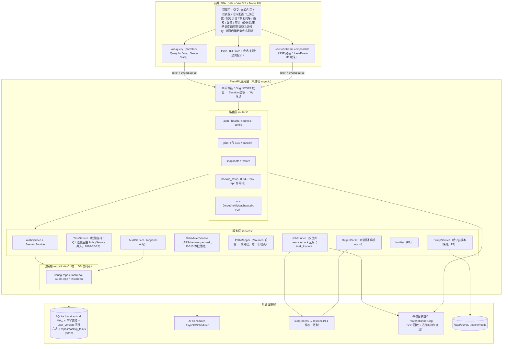
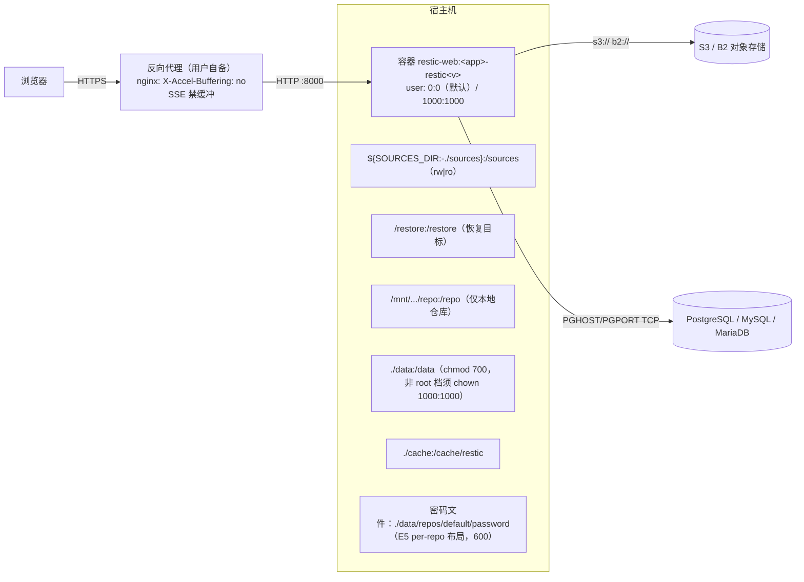
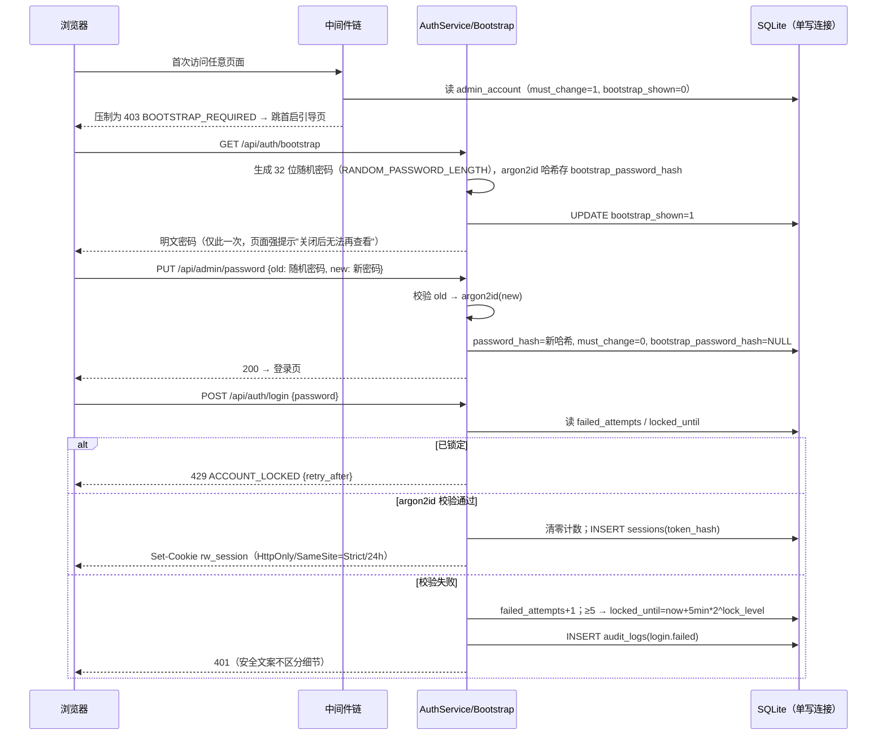
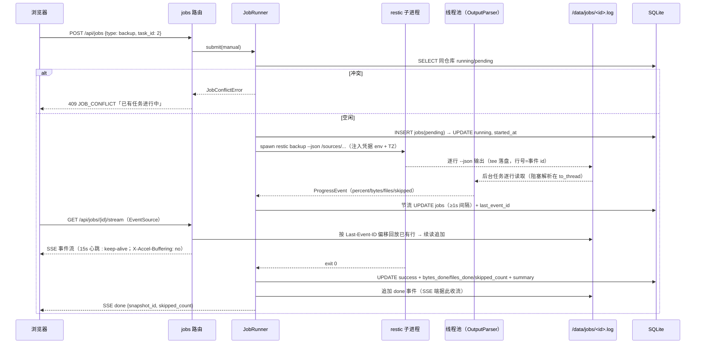
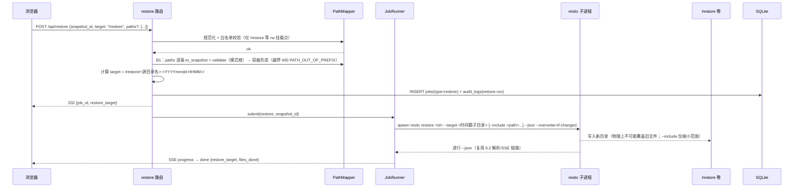
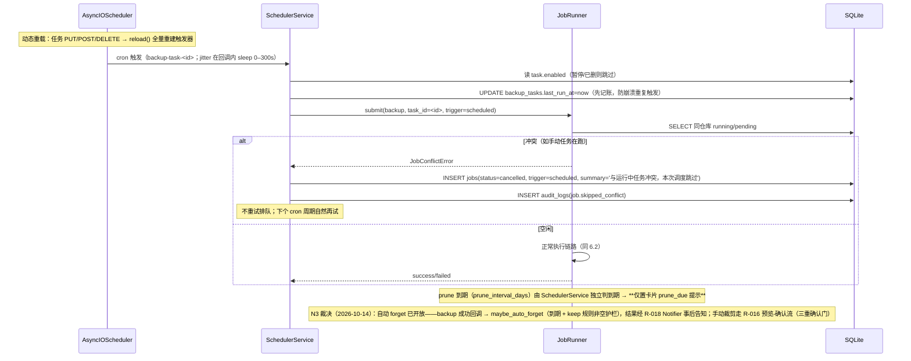
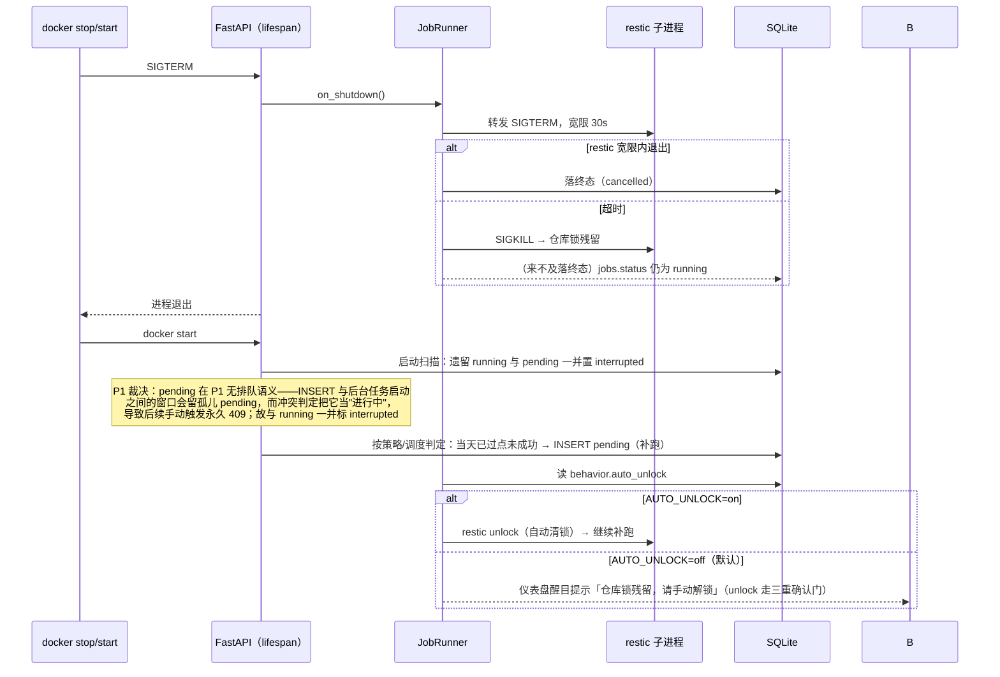
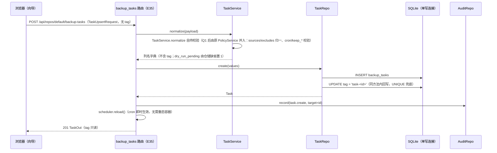
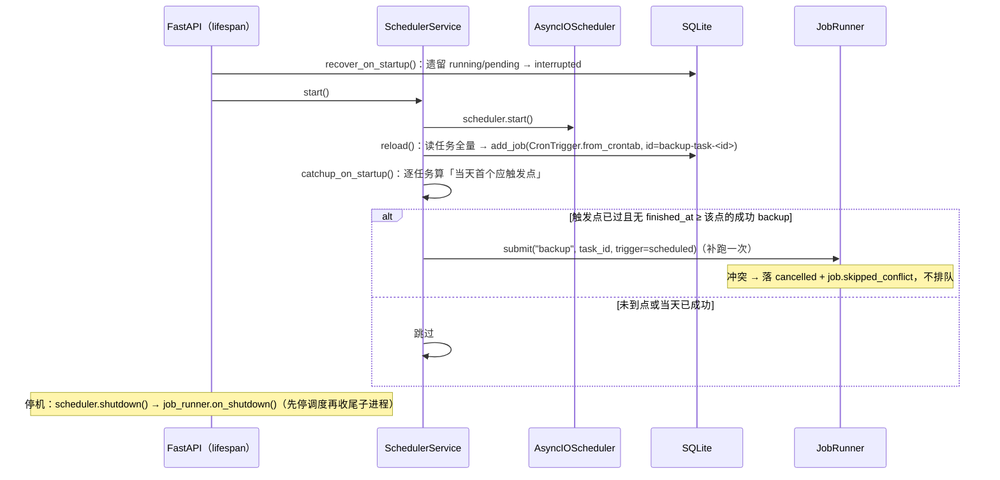
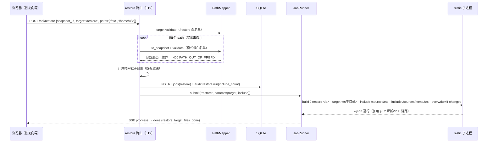

# restic-docker-backup Web 版架构设计文档

> 版本：v1.10（2026-10-27 / v1.9 2026-10-23 / v1.8 2026-10-23 / v1.7 2026-10-20 / v1.6 2026-10-17）
> **v1.10 修订（2026-10-27，rclone 配置管理工具：Q17 有边界放宽）**：
> - **新增 E48–E51**（§5.1）：`GET /api/rclone/configs` / `POST` / `PUT` / `DELETE /api/rclone/config/{remote_name}`——conf 段的查询、生成、编辑、删除。**Q17 档位有边界放宽**：仅**非 OAuth 类型**（crypt/webdav，凭据由用户自填）可生成与字段级编辑；OAuth 网盘段不可编辑（真实恢复须跑 `rclone authorize` 授权流），但**可删除**（清理废弃远端，确认门加重提示 + 审计留痕）；宿主机手工配置的 s3/sftp 同理（删除放开、编辑待进注册表）。
> - **写入路径 = 官方 rclone CLI**（`config create/update/delete`，`--obscure` 内置）而非自研 INI 手术：官方自带临时文件 + 双 rename 原子替换 + 备份。**由此 conf 挂载形态从单文件改为目录**（`./rclone:/etc/rclone:rw`）——真机实证单文件 bind mount 下 CLI 写入**退出码 0 但零落盘**且写操作挂住（详见《rclone配置生成工具设计方案.md》§12）；该修正同时使 OAuth token 回写真正可用（原「必须 `:rw`」的前提）。
> - 新增错误码 `RCLONE_UNAVAILABLE`（503）；审计动作 ×3 `rclone.config_append`/`_edit`/`_delete`（S6 清单 17→20，见《代码审查规范》v1.14）。§3 目录树与 §11 追溯矩阵 R-022 行同步。
> **v1.9 修订（2026-10-23，远端仓库明文暴露面收口：init 后密钥身份中性化 + 只读密钥可见性）**：
> - **init 后密钥身份自动中性化**（新服务 `services/repo_keys.py` 的 `neutralize_repo_key()`）：restic `keys/<id>` 是仓库里**唯一明文**文件，其 `username`/`hostname` 落在对象存储上对云商可见 → init 成功后自动 `key add --user svc-backup --host repo --new-password-file <**init 用的同一份**口令文件>` 再造一个中性 key，随后 `--key-hint <新 id> key remove <旧 id>` 删掉带真实身份的那个（**口令不变**，用户无感）。**幂等**（已中性化/多 key 即跳过）、**不抛**（任一步失败只记日志并返回 `False`，绝不把已成功的 init 反转成 failed）。覆盖两个 init 落点——`rebuild` 路由与作业类型 `init`（JobRunner success 终态）；未来新增 init 路径须复用同一函数（接入三要素、覆盖边界与最大坑见《云端仓库安全基线.md》§4.4）。
> - **新端点 E47 `GET /api/repos/{repo_id}/keys`**（§5.1，只读）：`restic key list --json` → `{overall, keys[], probe_error}`，`overall` 四态 `neutralized`/`exposing`/`mixed`/`unknown`。**只回展示白名单字段**（`id`/`id_full`/`user`/`host`/`created`/`created_tz`/`current`/`neutral`）；`data`（master key 密文）与 KDF 参数（`salt/N/r/p`）**绝不进 API**（少给一份仓库指纹）。**不复用 E42 的 30s TTL 缓存**——「是否已中性化」是安全判定，缓存会误导；无审计（只读探测，援 E45 先例）。
> - **白名单扩**（`services/restic.py`）：`WhitelistArgs` 增 `key_user`/`key_host`/`key_hint`；`--key-hint` 落 `_global_flags`（verb **之前**，`_assert_key_id` 校验「8~64 位小写十六进制」），`key add` 的 `--user`/`--host` 过 `_assert_safe_value`。**`--key-hint` 是必需项而非可选优化**：新旧 key 同口令时 restic 先解出哪个不确定，不加会撞 `refusing to remove key currently used`（restic 0.18.0 真机实证）。
> - 前端：仓库状态卡新增「密钥身份」小节（`pages/repo/KeyIdentity.vue`，自带 `useQuery(['repo','keys',id])`，不并入页面 30s 状态查询），与左侧连接态**左右并排**、按内容收缩 + 垂直居中、**无分隔线**，三条告警（last_error / 口令文件缺失 / 锁残留）通栏下沉到分栏下方；≤640px 回落上下堆叠。`created` 由 restic 按子进程 TZ 渲染且**不带时区标记** → 服务端补 `created_tz` 标注并**不换算**（C8 单一时间语义）。
> - §7.1 `ResticCmd.build` 的 verb 清单补齐 `copy`/`key`/`repair`/`recover`（v1.6-D / 批次 B 已落地但签名块漏列），并删去重复的旧块。
>
> **v1.8 修订（2026-10-23，UI 改造 P7 收口；端点表补齐）**：① 新增 **E36b `POST /api/repos/{repo_id}/backup-tasks/{id}/export`**（单任务配置导出，`kind=backup-task`；导入侧按 kind 分流，见 §5.1）；② 新增 **E18b `POST /api/snapshots/{id}/files/search`**（快照内文件搜索，服务端过滤 + 游标同 E18）；③ **E16 增 `?force=`**（Abort 二段：跳过宽限直接 SIGKILL，审计分流 `job.abort`，规范 §3.1 S6 15→16 项）；状态机不变。
> **v1.7 修订（2026-10-20，前端仓库页「目标位置」模块复刻 + Windows 子进程防护；API 契约不变）**：
> - **S3 URL 方言修正（事实核验，推翻此前拼法）**：restic 0.19.1 原生语法为 `s3:<endpoint>/<bucket>[/<prefix>]`——**endpoint 与 bucket 之间是斜杠**（冒号仅用于协议头或 `host:port`）；此前按 `s3://bucket/...` 组译，落库即错地址。前端字段组改为「endpoint（必填）+ bucket + prefix」，path 为空时不补尾斜杠（与解析严格互逆）。同期**退役** URL 区域段与死凭据键 **`AWS_ENDPOINT_URL`**（实证：restic 0.19.1 不读该环境变量，其 minio-go v7.1.0 依赖零引用）；区域语义由 `cred.aws_default_region` 承担。全八类型逐一比对结论：**仅 s3 一种错误**，b2/gs/azure/sftp/rest/rclone/local 均符合 restic 原生。
> - **子进程事件循环硬约束（Windows，新增 §7.10）**：uvicorn 裸 `--reload` 在 Windows 强制 `SelectorEventLoop`，其 `create_subprocess_exec` 抛 `NotImplementedError`（`asyncio/base_events.py:539`）→ restic/rclone **全部子进程操作 500**（真机实证：rclone 探测报「服务器内部错误」）。四层防护落地：`constants.SUBPROCESS_LOOP_HINT`、`rclone.list_remotes` 降级 `available=false` + `reason`、`restic.spawn` 转 `ResticFailedError`、`main.py` lifespan 启动自检 error。**启动纪律：本机必须 `--loop none`**（`dev-scripts/dev.ps1 restart backend` 已内置）；Linux/Docker 无此问题。护栏 `tests/test_subprocess_loop_guard.py`。
> - 前端同步：仓库页两态交互（列表态 ↔ 编辑态整页替换）、类型驱动字段组、测试按钮状态机（新建态「创建并测试」，后端 `testRepo` 读已落库配置故顺序恒为先存后测）、审计日志动作名/详情中文化（i18n 嵌套键 + `te()` 回落）。后端除上述防护外**零业务改动**。
> **v1.6 修订（2026-10-17）**：R-023 补遗——新增 **E44 `POST /api/repos/{repo_id}/password`**（§5.1）：首次写入仓库密码文件，生成场景一次性回显明文、已存在文件拒绝覆盖（密码同时是仓库密钥与 R-025 凭据加密密钥源）；同批登记 **`repo_id` 命名规则**（`REPO_ID_PATTERN`，不含 `.` 与 `/`，schema 侧 + 路径参数侧双校验，防路径穿越）。§3 目录树 repos.py 标注改 E39–E44；§11 追溯矩阵 R-023 行与 §13 E6 口径同步；部署指南同步「新仓库密码文件的两条获取路径」。
> **v1.6-A0 修订（2026-10-17，owner 裁决「去掉 host 模式」）**：**运行模式收敛为单一 `/sources` 形态**——`settings.restic_web_mode`/`host_mount_mode`/`host_root` 与 `RunMode`/`HostMountMode` 枚举已删除（开发期无存量数据，不做兼容）；备份源/浏览/原位恢复前缀白名单全部收敛为 `/sources`+`/restore`；`/me` 响应只剩 `user` 字段（运行模式卡收敛为单轴）；E32 排除集无 `mode` 入参/响应；compose `RESTIC_WEB_MODE`/`HOST_MOUNT_MODE` 退役。**本文 §12/§14 中 2026-10-16 及更早的「host 模式 / `mode=host` / `host_mount=rw` / `/host/*`」真机取证与缺陷记录均为 A0 前历史事实**（取证当时系统确实运行在 host 模式），结论的方法论与缺陷形状仍成立，路径示例已按新形态更新；**当前契约以代码与本文修订后正文为准**。原位恢复 overwrite 布尔化/单次确认门（A7）属后续批次，届时再修订 S7 相关表述。
> **v1.6-A1 修订（2026-10-17，Duplicati 对齐计划批次 A1）**：**仓库类型扩展为 restic 0.19.1 全部七后端**——`RepoType` 增 `sftp`/`azure`/`gcs`/`rest`/`rclone`（`derive_repo_type` 前缀映射表单一事实源；gcs 的 restic 前缀是 `gs:` 非 `gcs:`）；新增 **E45 `GET /api/rclone/remotes`**（§5.1，只读探测）；URL 严格校验（Q20：rest/rclone 前缀+remote 在册校验，s3/b2/local 不动）；`ENV_ALLOWED_PREFIXES` 增 `AZURE_/GOOGLE_/RCLONE_/SSH_`（§7.1）；镜像装 rclone + openssh-client（§2）；conf 宿主机挂载 `:rw`（Q17 硬约束）。§3 目录树与 §11 追溯矩阵 R-022 行同步。
> **v1.6-A2 修订（2026-10-17，Duplicati 对齐计划批次 A2）**：**forget 保留档位补齐**（Duplicati keep-time / retention-policy 分段的 restic 等价物）——`backup_tasks` 新增 `keep_within`/`keep_within_{hourly,daily,weekly,monthly,yearly}` 六时长档（restic duration 形态 y/m/d/h，如 `1y5m7d2h`）与 `keep_tags`（`--keep-tag` 清单，OR 语义）共七列（0004 迁移，§4.8）；E21 预览请求与 E12 执行 params 同扩七字段；**G3 兜底门扩为三门并列**（计数/时长/标签任一即放行，对齐 restic `ExpirePolicy.Empty` 含 Within/Tags）；duration 形态校验前移至拼装层 `_normalize_duration`（restic 端 Fatal 无 JSON 产出，§7.1 V4 事实 3 同型），**本项目 stricter**：重复单位 422（restic 后者覆盖属静默歧义）、全零归一未启用（与 `keep_*` 的 0 口径一致）；写侧 `TaskService.normalize` fail-fast 校验 + `keep_tags` flag 注入防护；调度器自动 forget 预检同步扩三门。前端向导保留区新增时长档/标签档输入，快照页 forget 卡片同步。

> **v1.6-A3 修订（2026-10-17，Duplicati 对齐计划批次 A3）**：**快照版本标签**（Duplicati 版本标签的 restic 等价物）——`VERBS` 增 `tag` 动词；`WhitelistArgs` 增 `tag_add`/`tag_remove`（每元素一条 `--add`/`--remove`，`_assert_safe_value` 防注入）；`_verb_flags` 新增 `tag` 分支 + 位置参数挂 `extra_positionals`（快照 id）；快照 id 经 `_assert_snapshot_id`（8~64 小写十六进制）校验。新端点 **E46 `POST /api/snapshots/tag`**（§5.1）：`{snapshot_ids?, add[], remove[], tag_filter[]?, host?}` → `restic tag --add/--remove` → `{changed_count, changed[], truncated}`（restic `changed`/`summary` JSON 解析）；restic `cmd_tag.go` 源码核验的两道约束前移为服务端校验——(1) `add`/`remove` 皆空 → 422（restic 端 "nothing to do!"）；(2) 无 `snapshot_ids` 且无 `tag_filter`/`host` → 422（restic 无 id 即改**全部**匹配快照，高危）。审计动作 **`tag.update`**（constants.py `AUDIT_TAG_UPDATE`）；快照页新增「快照标签」卡片（打/去标签输入 + 可选目标快照 ID + 按当前筛选作用全部匹配快照）。
> **v1.6-A8-r2 修订（2026-10-22，owner 裁决「单字母前缀」）**：**仓库 ID 生成规则改版**——服务端自动生成由 `repo-<26 位小写 ULID>`（31 字符、不可读）改为 **`r<YYMMDD>-<6 位小写 Base32 随机>`**（14 字符，如 `r261022-k3f9x2`）。日期段取 **UTC**（C8：经 `utils/time.now_utc`，无环境依赖、跨部署可比；字典序即时间序，百年内有效）；随机段 `secrets.choice` + Crockford 字母表（剔除易混淆 i/l/o/u），32⁶≈10 亿组合/天，配 `exists` 查重 + 重试上限 10 次。单字母 `r` 前缀保留「服务端生成」辨识度，同时满足「小写字母开头」约束（纯日期开头 `261022-…` 会被 `ReposRepo.create` 拒）。**存量 `repo-<ULID>` id 全部照旧工作，零迁移**；`REPO_ID_PATTERN`、`X-Repo-Id` 头、`passfile_path` 拼装契约不变（A8 契约清单照旧）。前端预填/「换一个」/`idAutoHint` 文案同步。同日另一修订：删除仓库 `purge_disk` 由「rmtree 整目录」改为「清空目录内容、保留目录本身」+ 回收 `<passfile_root>/<repo_id>/` 空目录（见 E41 与 rebuild 段内注）。
> **v1.6-A8 修订（2026-10-17，Duplicati 对齐计划批次 A8）**：**仓库 ID 自动生成**（owner 2026-10-17 07:37 立项）——`POST /api/repos` 的 `RepoCreateRequest.id` 由**必填改为可选**，留空（null/空串，schema 前置校验把空白归一为 None）时服务端生成 **`repo-<小写 ULID>`**（26 位、全局唯一、按时间有序，天然满足 `REPO_ID_PATTERN` 与 64 长度上限；落库前 `exists` 查重 + 碰撞重试上限 10 次）。显式提供仍按既有规则校验（形态 422 + 撞名 422，非 409）。配套新增 **`GET /api/repos/_new_id`**（§5.1）返回候选标识供新建向导预填（对齐 Duplicati 自动起名；不落库，用户可改可不改；声明在 `/repos/{repo_id}` 之前避免被路径参数捕获）。契约不变：`repo_id` 语义、密码文件 `passfile_path` 拼装、`X-Repo-Id` 头全部照旧。前端新建仓库弹窗预填自动生成值 + 「换一个」按钮（可改可不改）。复用 `utils/ulid.py`（与任务 id 同一 ULID 实现）。
> **v1.6-B 修订（2026-10-17，Duplicati 对齐计划批次 B = A4/A5/A6，纯前端、后端零改动）**：三项均为**前端体验对齐 Duplicati**，后端契约与 API 不动（cron 仍存 DB 字符串、仓库类型仍由 url 派生、`PathMapper` 白名单已收敛 `/sources`）。
> - **A4 源侧远端目录**：`SourcesPicker.vue` 在目录树点选之外新增「手动输入挂载路径」入口——`manualPath` 输入校验 `startsWith('/')` 且不含 `..`、去重后复用 `emit('update:sources')`；展示形态（如 `/mnt/onedrive`）经既有 `PathMapper.to_snapshot` 归一到 `/sources/mnt/onedrive`，恒在白名单内，零后端改动。部署指南新增「2.3.1 远端源挂载指引」（NFS/SMB、rclone mount 70+ 云、其它 FUSE；compose 映射约定 `/sources/<remote-name>/`；对象存储当源性能/一致性告警；云到云走 `rclone copy`）。
> - **A5 目的地类型选择卡**：`repo/index.vue` 新建弹窗顶部新增目的地类型卡片网格（local/s3/b2/sftp/azure/gcs/rest/rclone 八类，含 scheme 前缀/URL 占位/说明）+ rclone 预设卡（onedrive/googledrive/s3compat/other，URL 模板 `rclone:<remote>:`）。卡片**只驱动 UI 提示与默认 scheme 预填**，仓库类型仍由后端 `derive_repo_type` 从 url 前缀派生；凭据留待创建后仓库配置页（`CRED_FIELDS` 已按类型条件渲染）填写。
> - **A6 调度双模式**：`ScheduleRetentionForm.vue` 调度区重做为 `none/simple/advanced` 三段 Tabs——简单模式（频率 NSelect + 时/分 NInputNumber + 星期 NCheckboxGroup + 多选用 NSelect 日期/月份）生成**可反向解析的受控 cron 子集**（hourly/daily/weekly/monthly/yearly/every_n_hours/every_n_days）；高级模式直接编辑 5 字段 `NInput`。双向解析由新文件 `utils/cronConverter.ts` 的纯函数 `simpleToCron`/`cronToSimple`/`defaultSimpleSchedule` 承担：解析不动（dom 与 dow 同时非 `*` 的 OR 语义、`*/N` 错位、范围/名称写法、字段数≠5、越界）时 `cronToSimple` 返回 `null` 自动落高级模式，不丢信息。cron **星期字段按标准 Vixie 语义（0=周日…6=周六）直写**，后端 `scheduler.py`/`policy_service._normalize_cron` 的 `(n+6)%7` 换算负责对齐 APScheduler 3.x（同 §14 X11 口径）。保留档位（keep_* + A2 keep_within* + keep_tags）逻辑沿用。
>
> **v1.6-C 修订（2026-10-17，Duplicati 对齐计划批次 C = 修复自愈）**：对齐 Duplicati Repair / RecreateDatabase / ListBrokenFiles 三操作。
> - **B1 修复仓库**：JobType 增 `repair`（E12 通用入口触发）；`ResticCmd` VERBS 增 `repair`——repair 是**两级命令**，子命令 `index`/`packs` 走 `WhitelistArgs.repair_target` **具名字段**（非自由位置参数，S2 白名单纪律），非法值 422；`JobRunner._build_args` repair 分支 `json_output=False`（repair 输出非 JSON）。审计 `repair.run`（S6 危险操作清单 9→11 项，连同 `recover.run`）。前端「仓库配置」状态卡（已连接仓库显示「修复仓库」error 按钮 + index/packs 单选，ConfirmGate 关键词 `REPAIR`）与任务历史 check 抽屉共用同一 E12 通道。
> - **B2 损坏检测报告**：`check --read-data` 输出解析 → `CheckView.broken_packs`（保序 64hex pack id 清单）+ `suggest_repair_index`（批次 B 已预实现解析与视图字段）；本次补**「一键修复索引」建议链按钮**——任务历史 check 详情抽屉在 `suggest_repair_index` 为真时展示，内联 ConfirmGate（关键词 REPAIR）→ `POST /api/jobs {"type":"repair","params":{"repair_target":"index"}}`。**文件级损坏映射为受限项**（restic 无原生命令），部署指南 §7.1 如实标注：精确定位受影响文件以受影响快照为范围做恢复演练。
> - **B3 找回未快照数据**：JobType 增 `recover`；VERBS 增 `recover`（无子命令无额外 flag，`json_output=False`），审计 `recover.run`。「重建缓存」引导（Duplicati RecreateDatabase 等价）落部署指南 §7.1：restic 无独立本地数据库、`/cache/restic` 可弃重建（E25 缓存维护），三场景对照表（清缓存 / repair / recover）+ 无界面 API 触发示例。
> **v1.6-E 修订（2026-10-18，批次 E = 配置导入/导出）**：新服务 `services/config_transfer.py` + `POST /api/config/export|import`。包格式 `restic-web-config-export` v1：明文段（仓清单/任务/`behavior.*`/`notify.*` 非敏感键）+ 加密段（`cred.*` 与敏感 `notify.*`，PBKDF2-HMAC-SHA256 600k + AES-256-GCM，错口令 GCM 拒绝）。匹配键：仓按 id、任务按 `(repo_id, name)`（任务 id 自增主键跨机不可带）；`mirror_repo_ids` 接前校验「id 在包内且 url 一致」否则置空+警告；冲突默认跳过+报告，`replace_existing` 整体替换；导入剔除 `last_run_at`/`dry_run_pending`（跨机不可带）。不导 `dump.*`/`security.*`。审计 `config.export`/`config.import`（S6 清单 12→14，detail 只含计数）。前端设置页「配置迁移」卡（导出 Blob 下载 / 导入 ConfirmGate + 报告）。
> **v1.6-D 修订（2026-10-18，Duplicati 对齐计划批次 D = 运维与通知 C1–C4）**：对齐 Duplicati RunScript / 邮件通知 / number-of-retries / copy+key+多目的地。
> - **C1 任务级前后钩子（⏸ 已暂缓下架 2026-10-18）**：整体摘除（迁移/服务/端点字段/前端/UI），设计方案与全部代码存档于 `docs/暂缓存档-任务级前后钩子C1-2026-10-18.md`，恢复实施与否另行裁决；规范 S9 条款保留为防御性规范。
> - **C2 SMTP 邮件渠道**：E23 notify 配置面扩 `mail_*` 九键（凭据 `mail_password` 入加密存储，只回 `mail_password_set` 布尔）；`notifier.py` 增 mail 渠道（STARTTLS/TLS/none）；E24 逐渠道测试结果含 mail。前端通知页 SMTP 表单（密码三态：留空不变 / 清除删除 / 新值覆盖）。
> - **C3 任务级失败重试**：`backup_tasks` 增 `retry_count`（0006 迁移，0–5 默认 2，对齐 Duplicati number-of-retries）；调度触发失败按**指数退避**自动重试，手动触发不重试；重试次数耗尽才计终态失败并触发通知。
> - **C4 copy + key + 任务级多目的地**：`VERBS` 增 `copy`/`key`（copy 拒 `--exclude`、url 走 env；key 两级命令子命令走具名字段，`passwd`/`add` 用 `--new-password-file`——密码值只落临时文件路径，绝不进 argv/日志/审计）；迁移 0007 `backup_tasks.mirror_repo_ids`（JSON 数组 ≤3）；JobRunner **镜像阶段**——主备份成功后串行 copy 到各镜像仓（`secondary_repo_env` 注入目的仓 url/口令文件，目的信息不进 argv；增量按 `--tag task-<id>`，失败自动补齐自愈），**失败隔离不翻转主终态**，自指/缺仓/缺口令全部显式记账（日志 + 审计，绝不静默）；新端点 `POST /api/repos/rotate-key`（key passwd + 重写口令文件，新密码不回显）与 `POST /api/copy`（手动搬家，超时 3600s）；审计 `copy.run` / `key.rotate`（S6 清单 11→13 项）；任务写路径镜像仓存在性/自指 422 前置拦截（运行期优雅降级双保险）。前端：向导步骤 3 镜像仓多选（未就绪仓禁选）、仓库状态卡「密钥轮换」「复制快照到…」双弹窗。
> v1.2 修订：P1 实现定案的文档同步批次——E05/E31 入参改收展示路径（兼容容器路径）、policies.sources/excludes 存储形态与三分类归一、PolicyOut 增 display_* 派生字段、E15 起始游标约定、recover_on_startup 将遗留 running+pending 一并置 interrupted（P1 裁决）、目录树补 errors.py/auth/service.py/env_sync.py、E32 归期 P2→P1、CI 依赖源固化。  
> v1.3 修订（2026-10-13）：选项②「轻量多备份任务」立项同步——新增 §13 演进位预留（E1–E7）、§11 追溯矩阵升版至 R-026、R-014 语义升级为多备份任务管理 UI。  
> **v1.4 修订（2026-10-13）：选项②已交付并正式并入**——`repos` + `backup_tasks` 表与 0002 迁移（§4.7/§4.8）、`jobs.task_id`（§4.5）、E34–E36 任务端点（§5.1）、JobRunner per-task 化（§7.1）、**SchedulerService 从零落地（§7.4，R-013 本批交付，非 P2）**、B1 文件级恢复 `--include`（§7.1/§6.3）、前端任务卡片与五步向导（§9）、追溯矩阵增 R-027（§11）、演进位 E6/E7 标注已满足（§13）。设计与实现的差异集中登记于 **§14**（本次并入以代码为准）。  
> **v1.4 追记（2026-10-13）**：§14 四项差异 owner 已全部裁决——**X2/X5/X6 按建议落实**（提交 d6bf5ca / 0e0ce6d / 7eff049，工程已实现并独立核实 193 passed），**X3 列为 P2 首个补测项**；正文 §5.1 E17、§7.1、§12 V3 已随裁决同步。  
> **v1.4 追记（2026-10-14）**：2026-10-14 真机 E2E 后 QA 独立复验提出 2 项「设计与实现/底层库语义」差异，owner 裁决**维持现状、不改代码**，已登记为 §14 的 **X10**（手动触发与调度触发的 `last_run_at` 记账时序不一致）与 **X11**（cron「日」与「星期」同时受限时 APScheduler 3.x 取 AND 而非标准 Vixie cron 的 OR）——两者在各自场景下语义均成立，强行统一代价大于收益，此处留痕备查。  
> **v1.5 修订（2026-10-15）**：**Q1「选删」——policies 遗留面全部移除**（owner 裁决，2026-10-13 原裁决「保留 legacy 只读」废止）。删除路由 E08–E11、`PolicyRepo`、`PolicyService`、E12 `policy_id` 提交入口、`PolicyOut`/`PolicyUpsertRequest`、`AUDIT_POLICY_*` 与两个错误码；共享字段校验原样并入 `TaskService`（口径逐字保留）；表与 `jobs.policy_id` 列/`JobRunner` 兼容形参保留待 0003（§4.4 注）。§13 演进位 E2/E7 口径同步。增量 PRD 与增量设计的 Q1–Q9/N1–N8 裁决已并入《Web版PRD.md》v1.4，两部过程稿转 `docs/archive/`。  
> **裁决依据**：2026-10-13 立项批次（选项②立项 + R-023 规划提前实现不提前）+ **greenfield 裁决（同日）**——本产品无存量数据，0002 迁移**不物化首任务、不建 `legacy_policy_id` 列**，原「存量迁移」需求（增量 PRD 的 R-026-07 / US-026-09）不适用。增量设计过程稿见 `docs/archive/增量设计-多备份任务-2026-10-13.md`（过程层，结论已并入本文）。  
> 上游文档：《Web版改造方案 v2.3.4》（技术决策、API 清单、分阶段计划以该文档为准）、《Web版PRD v1.4》（需求池 R-001~R-027、12 页面线框、非功能需求；US-026 与 Q15–Q24 裁决已并入）、《archive/增量PRD-多备份任务-2026-10-13.md》（R-026/B1 展开，过程稿已归档）  
> 读者：实现阶段 P2 的工程师；文档给出可直接照做的目录结构、Schema DDL、API 契约与模块签名。

---

## 1. 架构总览

### 1.1 分层架构



要点：

- **三层后端**（路由-服务-仓储）+ 独立 auth 模块；DB 访问只存在于仓储层，路径映射只存在于 PathMapper——两处"唯一实现点"是防泄漏的关键约束；
- **SSE 的持久底座是任务日志文件而非内存队列**：日志先落盘、SSE 只是"按偏移回放 + 追加"，天然获得断点续传与容器重启后的进度可回放性；
- **--json 解析放线程池**：解析为 CPU 密集，避免阻塞事件循环（方案 §5）。

### 1.2 部署拓扑



- 单实例强约束（禁止多副本，方案 §4）；`HEALTHCHECK` 探测 `GET /api/health`；
- 非 root 档部署前置：`chown -R 1000:1000 ./data ./cache`，否则 SQLite 建库失败、密码文件不可读，容器起不来；
- **HTTPS 双轨（Q2 裁决）**：上图为首选反代路径（终结 TLS + SSE 禁缓冲）；镜像内置"挂证书"式 TLS——config `server.tls_cert`/`server.tls_key` 齐备时 uvicorn 以 `ssl_certfile`/`ssl_keyfile` 直接启动（无自动签发续期），未配置则纯 HTTP 供反代终结（§4.3 键表）。
- **前端 SPA 由后端同源提供**（单容器方案 §2，不引入 nginx 第二进程）：构建阶段产出 `dist` 并 COPY 进运行时的 `/app/webroot`（`settings.static_dir`，环境变量 `STATIC_DIR` 可覆盖）；`create_app()` 在**业务路由之后** `mount("/", StaticFiles(html=True))`，保证 `/api` 优先匹配；404 处理器仅对 `GET/HEAD`、非 `/api` 前缀、末段无扩展名的请求回落 `index.html`（SPA 深链刷新），其余一律返回统一 JSON 错误。目录不存在时不挂载——`/` 仍是 JSON 404，本地开发页面由 Vite dev server 提供。

### 1.3 关键架构决策汇总

| #  | 决策                                                            | 理由（出处）                                                 |
| -- | ------------------------------------------------------------- | ------------------------------------------------------ |
| D1 | 单容器 + restic 静态二进制内嵌，版本随镜像 tag 固定                             | 版本确定性 + 仓库格式安全（方案 §4）                                  |
| D2 | SQLite 单库 + WAL + aiosqlite 单写连接                              | 自托管规模单实例足够；单写连接规避 SQLITE_BUSY（方案 §5）                   |
| D3 | 调度统一 cron 触发器（策略级 + 全局缺省），P1 即按多策略建表                          | 消除 interval/cron 双轨；P2 开放多策略零改表（方案 §4.1/§5）            |
| D4 | P1 恢复仅"时间戳子目录"，不存在任何覆盖路径                                      | 误操作零事故（PRD G3）；覆盖比对层 P2 自研                             |
| D5 | 鉴权是 P1 第 0 项，cookie session 全端点（含 SSE）统一                      | 无鉴权 + rw 全盘挂载 = 裸奔（方案 §6.1/§8）                         |
| D6 | SSE 持久底座 = 任务日志文件 + last_event_id 游标                          | 断点续传、刷新回放、重启可回放                                        |
| D7 | 路径映射/DB 访问各只有一个实现点（PathMapper / repositories/）                | 防止 `/sources` 前缀语义泄漏到业务代码（A0 后唯一备份源前缀）             |
| D8 | 内置排除集为代码常量（语义核心集 + 附加条目统一派生 `/sources` 前缀，不存 DB），UI 可追加不可删减 | 单一事实来源（方案 §3.1 v2.3.2；A0 模式收敛后不再有双模式派生）；"不可删减"由代码保证 |

---

## 2. 技术栈与依赖清单

### 2.1 后端

| 依赖                              | 版本锁定建议               | 用途 / 选型理由                                                                                                                                                       |
| ------------------------------- | -------------------- | --------------------------------------------------------------------------------------------------------------------------------------------------------------- |
| python                          | 3.13（alpine 镜像）      | zoneinfo、asyncio 成熟                                                                                                                                             |
| fastapi                         | `^0.115`             | 路由 + 依赖注入 + SSE（StreamingResponse）                                                                                                                              |
| uvicorn                         | `^0.32`              | ASGI server，单 worker（单实例假设）                                                                                                                                     |
| aiosqlite                       | `^0.20`              | **选型：裸 aiosqlite，不用 SQLAlchemy**——表仅 6 张、关系简单；单写连接串行化在裸连接上是一行语义（单例），SQLAlchemy async engine 反而引入连接池与 ORM 会话管理复杂度；迁移用自研 user_version + SQL 文件，不需要 Alembic 的依赖图能力 |
| apscheduler                     | `^3.10`（不用 4.x beta） | AsyncIOScheduler + CronTrigger + jitter，动态重载（remove_job/add_job）                                                                                                |
| argon2-cffi                     | `^23`                | argon2id 密码哈希                                                                                                                                                   |
| pydantic                        | `^2.9`               | API schema 校验（pydantic-settings 读环境变量）                                                                                                                          |
| httpx                           | `^0.27`              | 通知 webhook / healthchecks ping（P2）、pg 版本探测可复用                                                                                                                   |
| python-ulid                     | `^2`                 | job id（可排序 ULID）                                                                                                                                                |
| pytest / pytest-asyncio / respx | dev                  | 测试（respx mock httpx 通知）                                                                                                                                         |

### 2.2 前端

| 依赖                  | 版本锁定建议                    | 用途                                                                                                           |
| ------------------- | ------------------------- | ------------------------------------------------------------------------------------------------------------ |
| vite                | `^6` + @vitejs/plugin-vue | 构建（Vue SFC 支持）                                                                                               |
| vue                 | `^3.5`                    | UI 框架（3.6 尚在 RC/Vapor，稳定后再评估）                                                                                |
| vue-router          | `^4`                      | 路由                                                                                                           |
| naive-ui            | `^2.43`                   | 组件库（PRD §7 已裁决：n-data-table virtual 虚拟滚动、n-form 联动、n-steps 向导、n-modal 三重确认、n-config-provider + darkTheme 暗色） |
| @tanstack/vue-query | `^5`                      | Server State（请求缓存/失效/重试；TanStack Query 官方 Vue 适配版）                                                           |
| pinia               | `^3`                      | UI State（会话态、主题、全局提示），克制使用；Vue 官方状态库                                                                         |
| @vueuse/core        | `^11`                     | 虚拟滚动兜底（`useVirtualList`，n-data-table virtual 不足的非表格场景）                                                       |
| typescript          | `^5.6` + vue-tsc          | 类型（vue-tsc 负责 .vue SFC 类型检查）                                                                                 |
| vue-i18n            | `^10`                     | 国际化（PRD Q3 已裁决：首版即中英双语，i18n 架构 P1 预留——P1 仅骨架：语言包目录 + 文案抽取约定，不强制完成全部翻译）                                       |

锁定方式：后端 `pyproject.toml` + `uv.lock`（Dockerfile `uv sync --frozen`）；前端 `package-lock.json`（CI 用 `npm ci`）。镜像内依赖一次锁定、随镜像原子发布。

---

## 3. 目录结构（文件级）

```
web版/
├─ docker/
│  ├─ Dockerfile                      # python:3.13-alpine3.24（锁定小版本）+ restic 0.19.1 + HEALTHCHECK
│  ├─ docker-compose.yml              # 部署模板：单一 /sources 挂载 rw|ro（A0 收敛，不含 build 段）
│  ├─ docker-compose.build.yml        # 本地构建叠加文件（overlay）：build 段 + 本地专用镜像名，须与上一份并用
│  └─ entrypoint.sh                   # 首启属主检查（root 档自动 chown，非 root 报错提示）
├─ backend/
│  ├─ pyproject.toml                  # 依赖 + uv.lock
│  ├─ app/
│  │  ├─ main.py                      # FastAPI 实例、中间件链、startup/shutdown 钩子（内置 TLS：server.tls_cert/tls_key 齐备时以 ssl_certfile/ssl_keyfile 启动，§4.3）
│  │  ├─ settings.py                  # 环境变量（TZ、DATA_DIR…，pydantic-settings）
│  │  ├─ errors.py                    # 统一 AppError 异常族 + 错误码→HTTP 状态唯一映射点（实现期新增，v1.2）
│  │  ├─ constants.py                 # JOB_TYPES、路径白名单前缀
│  │  ├─ exclusions.py               # ExclusionRules：内置排除集（语义核心集 + 模式派生，§7.3）
│  │  ├─ db/
│  │  │  ├─ database.py               # Database 单例：WAL、busy_timeout、单写连接、user_version 迁移器
│  │  │  ├─ migrations/
│  │  │  │  ├─ 0001_init.sql          # P1 全部建表（§4）
│  │  │  │  └─ 0002_multi_backup_tasks.sql  # 选项②：repos + backup_tasks + jobs.task_id（§4.7/§4.8/§4.5）
│  │  │  └─ repositories/
│  │  │     ├─ config_repo.py
│  │  │     ├─ job_repo.py            # + task_id 列与按任务聚合查询
│  │  │     ├─ task_repo.py           # backup_tasks 唯一 SQL 落点 + tag 生成（§4.8）
│  │  │     └─ audit_repo.py
│  │  ├─ auth/
│  │  │  ├─ service.py                # AuthService（登录校验/会话签发）+ LoginRateLimiter（IP 固定窗口限流，§8；实现期新增，v1.2）
│  │  │  ├─ password.py               # 密码哈希封装（argon2-cffi 默认 PasswordHasher，argon2-only，§8）
│  │  │  ├─ session.py                # session 签发/校验/滑动续期（DB 存储）
│  │  │  ├─ bootstrap.py              # 首启随机密码一次性展示 + 强制改密状态机
│  │  │  └─ dependencies.py           # require_session / require_csrf / require_bootstrap_done
│  │  ├─ routers/
│  │  │  ├─ auth.py                   # E01–E03 + E28 改密 + bootstrap
│  │  │  ├─ health.py                 # E04
│  │  │  ├─ sources.py                # E05（目录浏览）+ E31（首备 dry-run 预览）+ E32（内置排除集只读；E32 落点在本文件，不单独建路由——实现期定案，v1.2）
│  │  │  ├─ fs.py                     # E33 容器文件系统浏览（仓库路径选择的树/挂载点数据源）
│  │  │  ├─ config.py                 # E06/E07（E29/E30 已随 R-023 迁出至 repos.py）
│  │  │  ├─ repos.py                 # R-023 仓库 CRUD/状态/测试/密码（E39–E45 + E47 密钥身份只读 + v1.10 E48–E51 rclone conf 管理，per-repo + X-Repo-Id；A1：URL 校验 + rclone remotes）
│  │  │  ├─ jobs.py                   # E12–E16（含 SSE stream、cancel）+ E27
│  │  │  ├─ backup_tasks.py           # E34–E36 备份任务（repo 作用域前缀，§5.1）
│  │  │  ├─ snapshots.py              # E17/E18
│  │  │  ├─ restore.py                # E19（时间戳 + 原位分支，R-015）/ E20（P2 preview，已交付）
│  │  │  ├─ checks.py                 # E22 check 结果视图（R-017，批次 B 新增）
│  │  │  └─ ops.py                    # P2：E21–E26（forget/notify/cache/audit）
│  │  ├─ services/
│  │  │  ├─ job_runner.py             # 核心执行器（§7.1）
│  │  │  ├─ restic.py                 # restic 命令拼装（参数白名单）+ spawn + tee 日志
│  │  │  ├─ parser.py                 # --json 逐行解析（线程池调用）
│  │  │  ├─ sse.py                    # SseChannel：日志回放 + 追加 + 心跳
│  │  │  ├─ path_mapper.py            # §7.3
│  │  │  ├─ task_service.py           # 任务域归一 + display 换算（§7.9；Q1 选删后共享校验由原 PolicyService 并入，2026-10-15）
│  │  │  ├─ env_sync.py               # env→config 一次性同步 + cred.* 唯一实现点 + passfile.status/repo.type 派生落库（实现期新增，v1.2）
│  │  │  ├─ scheduler.py              # R-013：APScheduler per-task cron + 动态重载 + 启动补跑（§7.4，本批落地）+ maintenance-* 维护任务域（R-017/019/020）
│  │  │  ├─ compare.py                # P2：快照 ls × 目标磁盘覆盖比对（R-015，已交付）
│  │  │  ├─ dump.py                   # P2：pg 版本探测 + dump + 清理（R-019，已交付）
│  │  │  ├─ dump_cmd.py               # P2：pg/mysql/sqlite dump 命令白名单拼装（R-019，S2；已交付）
│  │  │  ├─ notifier.py               # P2
│  │  │  ├─ cache_service.py          # P2
│  │  │  ├─ retention.py              # P2：任务历史/日志保留清理（R-020，maintenance-retention 执行体；已交付）
│  │  │  ├─ crypto.py                 # P3-A：凭据加密（HKDF-SHA256 派生 + AES-256-GCM，R-025；已交付）
│  │  │  ├─ metrics.py                # P3-B：Prometheus exposition 聚合渲染（R-024，pull 模型；已交付）
│  │  │  ├─ repo_migration.py         # P3-C：config repo.* → repos 表启动期一次性搬迁（marker 键幂等，R-023；已交付）
│  │  │  ├─ repo_keys.py              # v1.9：init 后密钥身份中性化（neutralize_repo_key）+ key list 解析/分类（E47）
│  │  │  ├─ rclone.py                 # A1：listremotes 只读探测（E45）；v1.10 抽出 exec_rclone/resolve_conf_path 供配置层共用
│  │  │  ├─ rclone_config.py          # v1.10：conf 段管理（E48–E51）——GENERATORS 注册表 ×2（crypt/webdav）+ CLI 编排 + managed 过滤 + 写锁 + 写后复核
│  │  │  └─ audit.py
│  │  ├─ schemas/                     # pydantic 请求/响应模型（api_schemas.py、enums.py）
│  │  └─ utils/                       # ulid、时间（zoneinfo + TZ 注入）、log 截断、cursor（E18/E20 共用 base64 偏移游标）
│  └─ tests/
│     ├─ fixtures/restic-json/        # 固定版本 restic 真实输出 fixture（backup/restore/ls/snapshots…）
│     ├─ test_parser.py               # fixture 回归（优先级最高）
│     ├─ test_state_machine.py        # 状态机转换表驱动测试
│     ├─ test_migrations.py           # 迁移器幂等性
│     └─ test_api/                    # httpx AsyncClient 集成测试（auth/config/jobs/restore…）
├─ frontend/
│  ├─ index.html
│  ├─ package.json  pnpm-lock.yaml    # 前端依赖由 pnpm 管理（无 package-lock.json）
│  ├─ vite.config.ts                  # dev proxy → :8000
│  ├─ tsconfig.json  tsconfig.node.json  env.d.ts
│  └─ src/
│     ├─ main.ts  App.vue  router/index.ts      # .vue SFC 约定（vue-tsc 类型检查）
│     ├─ i18n/                        # vue-i18n：index.ts + locales/zh-CN.ts + locales/en-US.ts
│     ├─ api/                         # http.ts（统一错误/401 处理）+ auth/config/
│     │                               # backupTasks（E34–E36 + E05/E31 向导消费）/ exclusions（E32）
│     │                               # fs/health/jobs/repo/restore/snapshots
│     ├─ composables/
│     │  ├─ useJobStream.ts           # SSE composable：Last-Event-ID 续传 + 回放 + 心跳超时感知
│     │  └─ __tests__/                # useJobStream.spec.ts（改本文件必须有对应用例）
│     │     # 注：usePolicies / useSnapshots 未落地——策略已随 Q1 选删并入任务域，
│     │     #     快照取数走 api/ + vue-query，不再单独封装 composable（2026-10-16 校正）
│     ├─ stores/ui.ts                 # Pinia（defineStore）：session 态 / 暗色主题 / 全局消息
│     ├─ pages/                       # login/ bootstrap/ dashboard/ repo/ taskWizard/ jobs/
│     │                               # snapshots/ restore/ notifications/ settings/ audit/（各页 index.vue）
│     │                               # 注：sources/ 与 policies/ 两页随选项②退役（§9.1）
│     ├─ components/
│     │  ├─ JobProgress.vue           # 统一 SSE 进度卡（所有长任务复用，PRD 贯穿规范）
│     │  ├─ ConfirmGate.vue           # 危险操作确认门（预览→确认文本→二次确认；keyword 缺省 = 无关键词单次确认，A7 原位流）；删除任务门复用
│     │  ├─ PathBreadcrumb.vue        # 原路径语义面包屑（经 /sources 映射）
│     │  ├─ VirtualTree.vue           # 懒加载 + 虚拟滚动文件树（+ selectedPaths 多选，B1 恢复用）
│     │  ├─ TaskCard.vue              # 任务卡片（仪表盘列表单元，§9.2）
│     │  ├─ TaskWizard.vue            # 新建/编辑任务五步向导（§9.3）
│     │  ├─ task/SourcesPicker.vue    # 向导步骤 2：源树勾选 + 内置排除集只读 + 追加排除
│     │  ├─ task/ScheduleRetentionForm.vue  # 向导步骤 4/5：cron 模板 + 保留档位
│     │  ├─ task/dryRunGate.ts        # 首备 dry-run 门禁判定（N4：dry_run_pending 来源）
│     │  ├─ icons/                    # 零依赖内联 SVG 菜单图标
│     │  ├─ __tests__/  task/__tests__/   # 组件级 vitest 用例
│     │  └─ TierCard.vue              # 运行模式说明卡（运行用户 × 挂载模式；向导步骤 1 复用）
│     └─ theme/tokens.ts              # **视觉令牌唯一源**（明暗双主题色板；UI 视觉方案已归档，
│                                     #   指针见 PRD §5）——n-config-provider 挂载处消费它
└─ docs/
   ├─ Web版改造方案.md  Web版PRD.md  架构设计文档.md（本文）
```

---

## 4. 数据库 Schema（DDL）

八张表：六张 P1 一次性建齐于 `backend/app/db/migrations/0001_init.sql`（§4.1–§4.6），另两张随选项②于 `0002_multi_backup_tasks.sql` 建（§4.7 `repos`、§4.8 `backup_tasks`，同脚本并为 `jobs` 加 `task_id` 列，见 §4.5 注）。时间列统一 `TEXT`（ISO 8601 UTC）；布尔以 `INTEGER 0/1` 表示。

### 4.1 admin_account（单行表：鉴权 + 首启引导状态）

```sql
CREATE TABLE admin_account (
    id                       INTEGER PRIMARY KEY CHECK (id = 1),  -- 恒单行
    password_hash            TEXT NOT NULL,    -- argon2-cffi 默认 PasswordHasher（id 变体）；bcrypt 降级时以 "$2b$" 前缀区分（§8）
    must_change              INTEGER NOT NULL DEFAULT 1,          -- 1=首启未改密；Bootstrap 门（§5.1）依据
    bootstrap_shown          INTEGER NOT NULL DEFAULT 0,          -- 随机密码是否已展示（仅一次；1 后再取 → 410 BOOTSTRAP_SHOWN）
    bootstrap_password_hash  TEXT,                                 -- 首启随机密码哈希；改密完成后置 NULL
    failed_attempts          INTEGER NOT NULL DEFAULT 0,          -- 登录失败计数（存 DB 防容器重启清零，§8）
    lock_level               INTEGER NOT NULL DEFAULT 0,          -- 指数退避级数：锁定时长 = 5min × 2^lock_level，上限 1h
    locked_until             TEXT,
    updated_at               TEXT NOT NULL
);
```

### 4.2 sessions（服务端会话，24h 滑动续期）

```sql
CREATE TABLE sessions (
    token_hash    TEXT PRIMARY KEY,   -- SHA-256(会话 token)；明文 token 只存在于 cookie，不落库不落日志
    last_seen_at  TEXT NOT NULL,      -- 每次认证请求刷新（滑动续期）
    expires_at    TEXT NOT NULL,      -- = last_seen_at + 24h；过期行由启动期惰性清理（§8）
    created_at    TEXT NOT NULL
);
```

### 4.3 config（KV 配置 + 全局键表）

```sql
CREATE TABLE config (
    key         TEXT PRIMARY KEY,
    value       TEXT,                            -- 敏感项（cred.*）明文落盘程度与 compose env 等价（§6.1）
    source      TEXT NOT NULL DEFAULT 'ui',      -- 'ui' | 'env'：compose 环境变量覆盖；E07 对 source='env' 的键返回 409 ENV_OVERRIDDEN
    updated_at  TEXT NOT NULL
);
```

**config 键表**（E06 `GET /api/config` / E07 `PUT /api/config` 的键空间）：

| 键 | 说明 | 敏感 |
|---|---|---|
| `repo.url` / `repo.type` | **已退休（0003，R-023 P3-C）**：仓库地址/类型迁 `repos` 表（§4.7）；存量值由启动期 `services/repo_migration.py` 一次性搬迁（marker 键幂等），E07 对 `repo.*` 前缀一律拒收 `422 VALIDATION_ERROR`（防新旧双源） | 否 |
| `repo.host_tag` | **已退休（0003，R-023 P3-C）**：迁 `repos.host_tag`（§4.7），同上经 `repo_migration.py` 搬迁 | 否 |
| `passfile.status` | 只读派生、不落库：密码文件挂载状态 configured/missing | — |
| `cred.aws_*` / `cred.b2_*` | 后端凭据（S3/B2）；API 只回 `has_value` + `source`。**v1.7**：界面 S3 凭据集收敛为 `aws_access_key_id` / `aws_secret_access_key` / `aws_default_region` 三项——`aws_endpoint_url` 已从**界面字段**退役（restic 0.19.1 不读 `AWS_ENDPOINT_URL`，其 minio-go v7.1.0 依赖零引用，属死凭据；端点语义已由 URL 的 `s3:<endpoint>/...` 段承担）。后端 `env_sync` 的 `AWS_ENDPOINT_URL → cred.*.aws_endpoint_url` 映射**保留原样**（env 覆盖路径不变，restic 不读故无实际效果；存量键值亦不动） | 是 |
| `dump.*` | dump 开关/类型/主机/端口/账号/密码/库名/保留天数（R-019；**批次 B 定稿键集**：`dump.enabled` 0/1、`dump.type`（pg\|sqlite\|mysql）、`dump.host`、`dump.port`、`dump.user`、`dump.password`、`dump.databases`（JSON 字符串数组）、`dump.retention_days`（**0=不启用清理**，对齐 UI 语义））；sqlite 产物后缀 `.sqlite`，pg/mysql 为 `.sql` | password 是 |
| `schedule.cron_default` / `schedule.jitter` / `schedule.retry_times` / `schedule.retry_interval` | 全局调度缺省（**任务级 `cron` 为空时回退 `schedule.cron_default`；`schedule.jitter` 为调度触发抖动秒数，见 §7.4**） | 否 |
| `behavior.auto_init` / `behavior.auto_unlock` / `behavior.check_enabled` / `behavior.check_subset_denominator` / `behavior.monthly_full_enabled` / `behavior.monthly_full_day` / ~~`behavior.check_sample_ratio`~~ | 行为开关（R-017；三开关缺省关，AUTO_INIT/AUTO_UNLOCK 零调用回归保护）。`check_sample_ratio` **已废弃**（2026-10-21）：随机百分比改为 n/t 确定性分桶，仅在新键缺失时按 `t = round(1/ratio)` 兜底 | 否 |
| `notify.*` | healthchecks_url、webhook.url/template、meow.nickname、on_success 开关、skipped 阈值、各渠道 redact 脱敏开关（R-018） | 否 |
| `server.tls_cert` / `server.tls_key` | 内置"挂证书"式 TLS 的证书/私钥路径（Q2 裁决）：**两者齐备时 main.py 以 uvicorn `ssl_certfile`/`ssl_keyfile` 启动；未配置则纯 HTTP，供反代终结 HTTPS** | 否 |
| `retention.jobs_days` | 任务元数据保留天数（默认 90，Q7） | 否 |
| `retention.logs_days` | 日志文件保留天数（**可选键**，R-020；缺省回退 `jobs_days`——实现两种裁决结果均兼容，Q12 未最终裁决） | 否 |
| `timezone` | 时区（zoneinfo 名；UI 可配，容器 TZ 仅回退）；**cron 解释与「当天」判定的真源（§7.4）** | 否 |
| `security.cred_encryption` | 凭据加密开关（R-025；0/1，**缺省 1=默认开**，owner 2026-10-16 裁决；非敏感键故 UI 可读当前态） | 否 |
| `metrics.token` | Prometheus 抓取令牌（R-024；**库内只存 SHA-256 硬哈希**，界面设置不可读、env 同步不映射；空/未设=仅 session 可拉） | 是 |

> 注（R-025 **已落地，P3-A 2026-10-16**）：`cred.*` / `dump.password` / `notify.*`（SENSITIVE 集）可选加密存储——密钥由仓库密码文件经 HKDF-SHA256 派生（唯一实现点 `services/crypto.py`），AES-256-GCM 加密，`config.value` 存 `enc:v1:<base64>` 密文（**列不变、无 schema 迁移**）。**读侧恒按前缀判定、与开关无关**（崩溃安全：迁移中断的混合形态一律可读）；开关只决定写侧。启用时序=先落开关后存量明文→密文，关闭=先密文→明文后落开关（`ConfigRepo.migrate_encryption` 幂等）。密码文件缺失：启用/写敏感键 422 `VALIDATION_ERROR` 前置（无部分写入）；解密失败 500 `CREDENTIAL_DECRYPT_FAILED`。代价：密码文件成为单点（丢失/被换 ⇒ 凭据解不开，与仓库本身同源）。
>
> 注（R-017/R-019 键级校验钩子，批次 B 定案）：`behavior.*` / `dump.*` 的值域校验前移至 **E07 `put_config` 路由层**（`routers/config.py` 的键级钩子——坏值落库会让调度/清理行为漂移，故不接受「存了再炸」）；值为 `None`（清除语义）一律放行，`dump.password` 走三态写（None=不变 / ""=清除 / 非空=设置，API 只回 `has_value` 零明文回显）。

### 4.4 policies（遗留表；代码面已于 2026-10-15 Q1「选删」移除）

```sql
CREATE TABLE policies (
    id                  INTEGER PRIMARY KEY,
    name                TEXT NOT NULL,
    is_default          INTEGER NOT NULL DEFAULT 0,   -- 恒一条；历史：DELETE 默认策略 → 409 DEFAULT_POLICY_IMMUTABLE（码已删，Q1 选删）
    enabled             INTEGER NOT NULL DEFAULT 1,
    tag                 TEXT,
    sources             TEXT NOT NULL,                -- JSON 数组；**容器前缀形态**（A0 模式收敛后统一为 /sources）：入库与下游 restic argv 均为该形态；展示映射由 PathMapper / display_* 派生字段管理（Q1 选删后由 TaskService 承担，§5.1 E35）
    excludes            TEXT NOT NULL,                -- JSON 数组（用户追加，容器前缀形态同 sources；纯 glob 不以 / 开头原样透传）；内置排除集为代码常量不入库（D8）
    keep_last           INTEGER NOT NULL DEFAULT 0,
    keep_hourly         INTEGER NOT NULL DEFAULT 0,
    keep_daily          INTEGER NOT NULL DEFAULT 0,
    keep_weekly         INTEGER NOT NULL DEFAULT 0,
    keep_monthly        INTEGER NOT NULL DEFAULT 0,
    keep_yearly         INTEGER NOT NULL DEFAULT 0,
    group_by            TEXT NOT NULL DEFAULT 'host,paths,tags',
    cron                TEXT,                          -- 空则回退全局缺省 schedule.cron_default
    one_file_system     INTEGER NOT NULL DEFAULT 0,   -- sources 模式缺省 1（方案 §3.2）
    compression         TEXT NOT NULL DEFAULT 'auto', -- auto/off/max
    check_sample_ratio  REAL NOT NULL DEFAULT 0.02,
    monthly_full_day    INTEGER NOT NULL DEFAULT 1,
    prune_interval_days INTEGER NOT NULL DEFAULT 7,
    limit_up_kibps      INTEGER NOT NULL DEFAULT 0,   -- Q5 裁决：P2 起生效；0=不限（对应 API 字段 limit_up/limit_down，KiB/s）
    limit_down_kibps    INTEGER NOT NULL DEFAULT 0,
    last_run_at         TEXT,                          -- 调度记账：先记账后执行，防崩溃重复触发（§6.4）
    created_at          TEXT NOT NULL,
    updated_at          TEXT NOT NULL
);
```

> 注（Q1 选删后，2026-10-15）：policies 的**代码面已全部移除**——路由 E08–E11、`PolicyRepo`、`PolicyService`、E12 的 `policy_id` 提交入口、`PolicyOut`/`PolicyUpsertRequest` 模型、`AUDIT_POLICY_*` 常量与两个错误码（`POLICY_WRITE_CLOSED`/`DEFAULT_POLICY_IMMUTABLE`）均删除；共享字段校验（三分类归一/cron 5 字段/keep_*/compression 白名单）原样并入 `TaskService`（口径逐字保留，见 §7.9）。**表与 `jobs.policy_id` 列保留**：greenfield 无存量行，`tests/test_migrations.py` 仍断言外键生效；随后续迁移（建议 0003）连同 `JobRunner` 的 `policy_id`/`policy_loader` 兼容形参一并清理。
>
> 注（P1 实现定案）：用户提交的排除规则存在三分类——**展示路径**（`/etc/nginx`）、**容器路径**（`/sources/etc/nginx`）、**锚定 glob**（`/etc/*.log`）——均在 API 边界归一为容器形态入库：sources 由 `TaskService._normalize_sources`、excludes 由 `exclusions.normalize_user_excludes` 处理（白名单均 = `settings.mode_root`，A0 后恒为 `/sources`）；**纯 glob 模式**（不以 `/` 开头）原样透传。

### 4.5 jobs（任务元数据）

> **选项②增列（`0002_multi_backup_tasks.sql`）**：`task_id INTEGER REFERENCES backup_tasks(id) ON DELETE SET NULL`，见下方 DDL 的 `task_id` 行。语义与解绑规则见 §4.8 注与 §9「共享知识」。

```sql
CREATE TABLE jobs (
    id             TEXT PRIMARY KEY,     -- ULID（python-ulid，可排序）
    type           TEXT NOT NULL,        -- backup/restore/forget/check/unlock/init/dump（E12 白名单）
    status         TEXT NOT NULL DEFAULT 'pending',  -- pending/running/success/failed/interrupted/cancelled（方案 §5 状态机）
    trigger        TEXT NOT NULL,        -- manual | scheduled
    policy_id      INTEGER REFERENCES policies(id),  -- 遗留列（Q1 选删后无写入方，新 job 恒 NULL；随 0003 清理，§4.4 注）
    task_id        INTEGER REFERENCES backup_tasks(id) ON DELETE SET NULL,  -- 选项②：产生该 job 的备份任务（0002 增列）
    snapshot_id    TEXT,                 -- restore/forget 关联快照
    bytes_done     INTEGER,
    files_done     INTEGER,
    skipped_count  INTEGER NOT NULL DEFAULT 0,       -- 非 root 静默跳过计数（R-012）
    last_event_id  INTEGER NOT NULL DEFAULT 0,       -- SSE 游标（= 日志行偏移，E15 断点续传）
    log_path       TEXT NOT NULL,        -- /data/jobs/<id>.log
    summary        TEXT,
    started_at     TEXT,
    finished_at    TEXT,
    exit_code      INTEGER,
    created_at     TEXT NOT NULL
);
```

### 4.6 audit_logs（append-only）

```sql
CREATE TABLE audit_logs (
    id          INTEGER PRIMARY KEY AUTOINCREMENT,
    ts          TEXT NOT NULL,
    action      TEXT NOT NULL,     -- 危险操作 15 项（S6 清单，枚举见《代码审查规范》§3.1 S6 行，此处不复制以免项数漂移）；只读留痕（restore.preview / forget.preview）不入清单
    target      TEXT,              -- 操作对象（快照 id / 策略 id / 路径 / job id…）
    detail      TEXT,              -- JSON；S6 只增不改——执行后**不回填**（预览时点值与实际值可能不同，见 §5.1 E20）
    result      TEXT NOT NULL DEFAULT 'ok',   -- ok / denied / failed
    created_at  TEXT NOT NULL
);
-- append-only：代码面仅存在 INSERT 与 SELECT（AuditService.record/query）；无 UPDATE/DELETE 路径，
-- 归档 = 整段滚动导出后截断新文件（方案 §6.1），不覆盖已写入内容。
-- 动作名一律取 app/constants.py 的 AUDIT_* 常量（S6：不得散落字符串字面量）。
```

### 4.7 repos（仓库事实表 · 0002 新增 / 0003 扩展，R-023 已落地）

```sql
CREATE TABLE IF NOT EXISTS repos (
    id         TEXT PRIMARY KEY,          -- 0002~0003 过渡期恒 'default'；0003 起为任意仓库 id
    name       TEXT NOT NULL,
    created_at TEXT NOT NULL
);
INSERT OR IGNORE INTO repos (id, name, created_at)
VALUES ('default', '默认仓库', strftime('%Y-%m-%dT%H:%M:%SZ', 'now'));

-- 0003_multi_repos.sql（R-023 P3-C）：由「身份注册表」扩为「仓库事实表」
ALTER TABLE repos ADD COLUMN url              TEXT;                      -- 仓库地址（容器形态）；NULL=未配置
ALTER TABLE repos ADD COLUMN host_tag         TEXT;                      -- host 标识（restic --host）
ALTER TABLE repos ADD COLUMN url_source       TEXT NOT NULL DEFAULT 'ui'; -- 'ui'|'env'（env 只覆盖 default，镜像 config.source 语义）
ALTER TABLE repos ADD COLUMN host_tag_source  TEXT NOT NULL DEFAULT 'ui';
-- 同迁移：jobs 增 repo_id 归属列（历史行恒 'default'，E1 仓库维度互斥的数据基础）+ idx_jobs_repo
```

> **R-023 落地注（P3-C 2026-10-16）**：§13 E4 按裁决兑现——`repo.url`/`repo.host_tag` 全局键整体迁入本表，存量搬迁由启动期 `services/repo_migration.py` 完成（marker 键幂等，重复启动零副作用）；`config.repo.*` 键自此**退休**，E07 对该前缀拒收 `422 VALIDATION_ERROR`。业务端点的仓库归属由 `X-Repo-Id` 请求头驱动（`current_repo_id(request)`：缺省 `default`；值须存在，否则 404 `REPO_NOT_FOUND`）；凭据键命名空间化为 `cred.{repo_id}.*`（`env_sync.load_credentials` 按 repo_id 拼前缀，历史 `cred.*` 键即 `default` 命名空间）。仓库 CRUD/状态/测试端点见 §5.1「R-023 仓库管理端点」。`repos` 行即「加行 = 接入新仓库」，路由与调度器不动（§13 E7 兑现）。

### 4.8 backup_tasks（备份任务 · 0002 新增，选项②核心）

```sql
CREATE TABLE IF NOT EXISTS backup_tasks (
    id                  INTEGER PRIMARY KEY,
    repo_id             TEXT NOT NULL DEFAULT 'default' REFERENCES repos(id),  -- E7：第一天带外键
    name                TEXT NOT NULL,
    enabled             INTEGER NOT NULL DEFAULT 1,
    tag                 TEXT NOT NULL UNIQUE,     -- 自动生成只读：task-<id>（greenfield 无 legacy 继承）
    sources             TEXT NOT NULL,            -- JSON 数组，容器前缀形态（同 policies 口径）
    excludes            TEXT NOT NULL,            -- JSON 数组；内置排除集不入库（D8）
    keep_last           INTEGER NOT NULL DEFAULT 0,
    keep_hourly         INTEGER NOT NULL DEFAULT 0,
    keep_daily          INTEGER NOT NULL DEFAULT 0,
    keep_weekly         INTEGER NOT NULL DEFAULT 0,
    keep_monthly        INTEGER NOT NULL DEFAULT 0,
    keep_yearly         INTEGER NOT NULL DEFAULT 0,
    -- A2 时间线保留（0004 新增，批次 A2）：restic duration 形态（y/m/d/h，如 1y5m7d2h），
    -- 空串 = 未启用；keep_tags 为 JSON 数组（每元素一条 --keep-tag，OR 语义），空数组 = 未启用
    keep_within           TEXT NOT NULL DEFAULT '',
    keep_within_hourly    TEXT NOT NULL DEFAULT '',
    keep_within_daily     TEXT NOT NULL DEFAULT '',
    keep_within_weekly    TEXT NOT NULL DEFAULT '',
    keep_within_monthly   TEXT NOT NULL DEFAULT '',
    keep_within_yearly    TEXT NOT NULL DEFAULT '',
    keep_tags             TEXT NOT NULL DEFAULT '[]',
    group_by            TEXT NOT NULL DEFAULT 'host,paths,tags',
    cron                TEXT,                     -- 空 → 回退全局缺省 schedule.cron_default（§7.4）
    one_file_system     INTEGER NOT NULL DEFAULT 0,
    compression         TEXT NOT NULL DEFAULT 'auto',
    check_sample_ratio  REAL NOT NULL DEFAULT 0.02,
    monthly_full_day    INTEGER NOT NULL DEFAULT 1,
    prune_interval_days INTEGER NOT NULL DEFAULT 7,
    limit_up_kibps      INTEGER NOT NULL DEFAULT 0,   -- KiB/s，0=不限
    limit_down_kibps    INTEGER NOT NULL DEFAULT 0,
    dry_run_pending     INTEGER NOT NULL DEFAULT 0,   -- R-026-08 首跑门：创建置 1，E36 预览成功清 0
    last_run_at         TEXT,                          -- 调度记账（先记账后执行，§6.8）
    created_at          TEXT NOT NULL,
    updated_at          TEXT NOT NULL
);
CREATE INDEX IF NOT EXISTS idx_backup_tasks_repo ON backup_tasks(repo_id);
```

**与 `policies` 的关系（决策 1:1）**：

- 任务即策略实体：`backup_tasks` 与 `policies` **字段同构**，任务表新增 `repo_id` / `dry_run_pending`，不设 `is_default`（策略的「恒一条默认」约束在任务域不存在）；
- `policies` 表为**遗留表**（Q1 选删 2026-10-15）：代码面已全部移除（§4.4 注），仅存 DDL 与 `jobs.policy_id` 外键（greenfield 无行），随后续迁移清理；
- **无 `status` 列**：任务状态是派生值（§5.1 E34 卡片），避免双状态源漂移；`enabled` 是调度门而非状态机迁移。

**tag 规则（共享知识）**：新建任务由 `TaskRepo.create` 插入后同方法内回写 `tag='task-<id>'`（单写连接串行无竞态，`UNIQUE(tag)` 兜底）；更新路径显式剔除 tag（`TaskRepo.update`），客户端提交一律忽略——防止改 tag 导致 forget `--tag` 误删他任务快照。greenfield 裁决下**无 legacy tag 继承分支**。

**删除任务的解绑语义（Q7）**：`DELETE` 一条任务 → `jobs.task_id` 经外键 `ON DELETE SET NULL` 置空（历史行与日志保留、脱离归属）；仓库内该 tag 的快照**不动**（forget 是唯一删快照路径）。库中**不存在**指向已删任务的孤儿 `task_id` —— 外键本身禁止该形态。

字段对应关系：E03/E06 ↔ config、E12–E14/E16 ↔ jobs、E26 ↔ audit_logs、**E34–E36 ↔ backup_tasks**、§6.1 时序 ↔ admin_account/sessions。


## 5. API 详细设计

### 5.0 统一约定

**统一错误响应**（所有非 2xx）：

```json
{ "code": "JOB_CONFLICT", "message": "已有任务进行中", "data": { "running_job_id": "01JAAA…" } }
```

| code               | HTTP | 场景                                             |
| ------------------ | ---- | ---------------------------------------------- |
| `VALIDATION_ERROR` | 422  | 参数/路径校验失败                                      |
| `UNAUTHORIZED`     | 401  | 未登录 / 会话过期                                     |
| `FORBIDDEN`        | 403  | CSRF Origin 校验失败 / 首启未改密（`BOOTSTRAP_REQUIRED`） |
| `NOT_FOUND`        | 404  | 资源不存在                                          |
| `JOB_CONFLICT`     | 409  | 同仓库已有 running/pending 任务（方案 §5：手动触发拒绝不排队）      |
| `ACCOUNT_LOCKED`   | 429  | 登录锁定（data 带 `retry_after`）                     |
| `RATE_LIMITED`     | 429  | 登录接口限流                                         |
| `INTERNAL`         | 500  | 兜底（不回内部细节）                                     |
| `TASK_RUNNING`     | 409  | 任务正在运行/等待中，拒绝删除（E35c；data 带 `running_job_id` + `task_name`；选项②新增） |
| `REPO_NOT_FOUND`   | 404  | repo 作用域 id 不存在（E34–E36 路径前缀；P2 仅 `default`；data 带 `repo_id`；选项②新增） |
| `REPO_NOT_EMPTY`   | 409  | 仓库下仍有 backup_tasks 或 running/pending 作业，拒绝删除（E41；data 带 `repo_id` + `tasks`/`active_jobs` 计数；终态历史随仓库级联删除；R-023 新增） |
| `CREDENTIAL_DECRYPT_FAILED` | 500 | 凭据密文无法解密（R-025：密码文件被更换/数据被篡改；message 不回显明文或密文） |

> 端点级扩展码（响应格式同上表）：`400 PATH_OUT_OF_PREFIX`（E05/E19 原位分支）、`409 ENV_OVERRIDDEN`（E07）、`409 NOT_CANCELLABLE`（E16）、`403 RESTORE_FORBIDDEN`（E19/E20）、`410 BOOTSTRAP_SHOWN`（Bootstrap）、`409 TASK_RUNNING`（E35c）、`404 REPO_NOT_FOUND`（E34–E36）——见各端点定义。**P2 收尾批次（R-015/017/019）零新增错误码**：所有新失败形态均归入既有码（422 VALIDATION_ERROR 门禁 / 403 RESTORE_FORBIDDEN 双重锁 / 400 PATH_OUT_OF_PREFIX 越界），未扩 `ERROR_STATUS` 面。
>
> 其余已登记码（2026-10-11 补全，与 `app/constants.py` 的 `ERROR_STATUS` 对齐；2026-10-15 Q1 选删同步：`409 POLICY_WRITE_CLOSED`（E10）/`409 DEFAULT_POLICY_IMMUTABLE`（E11）已随 policies 遗留面删除，`ERROR_STATUS` 不再含 POLICY 码——历史记载见 §4.4/§5.1 E08–E11 删除条目）：`500 RESTIC_FAILED`（restic 子进程非 0 退出，message 不回显内部细节）、`409 READONLY_KEY`（写只读派生源，`repo.type`）、`401 PASSWORD_WRONG`（E28 改密）、`403 CSRF_ORIGIN`（Origin/Referer 校验失败）、`403 BOOTSTRAP_REQUIRED`（首启未改密，业务 API 压制）。
> **维护约定**：`ERROR_STATUS` 新增条目时须同 PR 更新本表（规范 §3.2「错误码登记」为该要求的审查依据）。

**分页约定**：列表类 `?limit=50&offset=0` → `{"items": [...], "total": 123, "limit": 50, "offset": 0}`；文件树用游标 `?cursor=<opaque>&limit=200` → `{"items": [...], "next_cursor": "…" | null}`。

**鉴权**：除 E04 与 E01、bootstrap 外全部要求有效 session；写方法（POST/PUT/DELETE）额外要求 Origin 同源（§8）。

### 5.1 端点明细（方案 §5 全覆盖；E01–E32）

**E01 `POST /api/auth/login`**（P1，免鉴权）

```json
// 请求 {"password": "..."}
// 200：Set-Cookie: rw_session=<token>; HttpOnly; SameSite=Strict; Path=/; Max-Age=86400
// 401 PASSWORD_WRONG / 429 ACCOUNT_LOCKED / 429 RATE_LIMITED / 403 CSRF_ORIGIN
```

**E02 `POST /api/auth/logout`**（P1）：销毁服务端 session + 清 cookie；200 `{"code":"ok"}`。

**E03 `GET /api/auth/me`**（P1）：

```json
{ "authenticated": true, "must_change_password": false,
  "user": "root" }   // 供运行模式卡（US-G2；A0 收敛后只剩 user 维度）
// 401 UNAUTHORIZED / 403 BOOTSTRAP_REQUIRED（data 带 bootstrap 步骤提示）
```

**E04 `GET /api/health`**（P1，免鉴权）：HEALTHCHECK 用；200 `{"status":"ok","db":"ok"}`（不校验仓库连通，避免拖垮探测）。

**E05 `GET /api/sources?path=/etc/nginx`**（P1）：目录浏览（定位 `/sources` 备份源根下；A0 收敛后无模式分支）。

> 入参 `path` 语义修订（P1 实现定案）：**收展示路径**（如 `/etc/nginx`；缺省为模式根），服务端内部经 PathMapper `to_snapshot` 还原为容器路径；**兼容旧文档示例的容器路径形态**——`/sources` 前缀照常接受（按白名单校验；`/host` 为已退役前缀，越界 400）。响应 `items[].display_path` 一律为剥前缀的展示路径。

```json
{ "path": "/etc", "items": [ {"name":"nginx","type":"dir","display_path":"/etc/nginx"} ],
  "next_cursor": null }
```

错误：`400 PATH_OUT_OF_PREFIX`（越出 `/sources`|`/restore` 白名单，方案 §6 注入防护）；无前缀的展示路径由 `to_snapshot` 归一，越界（如残留 `/host/...`）返回 `400`。

**E06 `GET /api/config`**（P1）：按 §4.3 键返回；敏感项 `{has_value:true, source:"env"}`，仓库密码只回 `passfile_status: "configured"|"missing"`。**E07 `PUT /api/config`**（P1）：`{"patch": {"repo.url": "s3:s3.amazonaws.com/bk", ...}}`；`source='env'` 的键返回 409 `ENV_OVERRIDDEN`；写审计。

> **R-024 扩展（P3-B）**：E06 返回的敏感项恒为**解密后语义**（`has_value` 判定对密文透明）；`security.cred_encryption`（0/1，缺省开）经 E07 切换——启用/写敏感键而密码文件缺失 → 422 `VALIDATION_ERROR` 前置（**无部分写入**：同 patch 的非敏感键也不落库）；开关变更触发存量形态搬运，审计 `config.update` detail 增 `cred_migrated` 计数（不含任何明文）。`metrics.token` 在 E07 写入路径**原地置换为 SHA-256 硬哈希**（None=不变 / ""=清除 / 非空=设置；保持 set_many 原子性）。

**E08–E11 策略 CRUD**：~~E08 `GET /api/policies`、E09 `POST`、E10 `PUT /api/policies/{id}`、E11 `DELETE`~~ **已随 Q1「选删」移除（2026-10-15，owner 裁决）**——原 P1 口径「仅默认策略可写，多策略写开放于 P2」作废；策略职能由 `backup_tasks`（E34–E36）全量承担。写路径曾经的 409 `DEFAULT_POLICY_IMMUTABLE` / `POLICY_WRITE_CLOSED` 两个错误码一并删除（§5.0）。policies 表现为遗留表（§4.4 注），无任何端点。

**E12 `POST /api/jobs`**（P1；选项②扩展 `task_id`）：

```json
// 请求 {"type": "backup", "task_id": 2}       // 白名单：backup|restore|check|forget|unlock|init|dump
// 202 {"id": "01JAAA...", "status": "pending"}
// 409 JOB_CONFLICT（同仓库 running/pending，manual 与 scheduled 同规则；
//                    scheduled 冲突不返回 409——由调度侧跳过并记 jobs(cancelled) + audit）
//     data: {"running_job_id": "01JAAA...", "running_task_name": "每日全量"}   ← 选项②新增任务名（US-026-04 AC2）
// 422 VALIDATION_ERROR（task_id 不存在 / 传已删除的 policy_id ——Q1 选删后请求体不再收该字段，_Base 为 extra=forbid）
```

> `task_id` 的 profile 解析：JobRunner 内 `task_loader` 加载（任务即策略 1:1）。`policy_id` 兼容形参在 `JobRunner.submit` 中保留（DB 列 `jobs.policy_id` 仍在，§4.4 注），但 Q1 选删后无任何注入方与提交入口——新 backup/forget job 一律落 `task_id`、`policy_id` 为 NULL。
**E13 `GET /api/jobs?status=&type=&task_id=&started_from=&started_to=&limit=&offset=`**（P1 最小版→**P2 全量版已交付**，R-020；选项②增 `task_id`）：jobs 表分页。

> **P2 完整版定稿（US-P2-01，Q13 基线）**：过滤维度四个——`status`（逗号分隔多值、全状态白名单、**缺省=不过滤**；P1「仅活跃」语义由前端显式传 `running,pending` 保持，`listActiveJobs` 已显式传参无隐式依赖）、`type`（JOB_TYPES 白名单单值）、`task_id`（按备份任务）、`started_from`/`started_to`（ISO 8601，经 `parse_utc_bound` 归一 UTC 后进 SQL；无时区后缀按 UTC 解释，C8）。`limit` 默认 50、**上限 500**（`constants.HISTORY_QUERY_MAX_LIMIT`，与 E26 共用）。retention：`retention.jobs_days` 驱动的历史清理走 `maintenance-retention` 每日维护任务（§7.4）。

**E14 `GET /api/jobs/{id}`**（P1）：

```json
{ "id": "01JAAA...", "type": "backup", "status": "running", "trigger": "manual",
  "bytes_done": 104857600, "files_done": 3210, "skipped_count": 0,
  "last_event_id": 87,
  "log_path": "/data/jobs/01JAAA....log", "started_at": "...", "exit_code": null }
```


**E15 `GET /api/jobs/{id}/stream`**（P1，SSE；cookie 鉴权同普通 API）：

- 请求头 `Last-Event-ID`（或 `?last_event_id=` 仅限重连由浏览器自动携带）→ 从 jobs.last_event_id/日志偏移回放；
- 事件：`id: <n>` + `event: progress|log|done|error` + `data: {json}`；空闲 15s 发 `: keep-alive` 注释行；
- 响应头 `X-Accel-Buffering: no`、`Cache-Control: no-cache`；
- 无该事件游标时从头回放；任务已终态则回放完 done 后关闭；
- **客户端约定（P1 实现定案）**：客户端应先用 E14 响应的 `last_event_id` 作为起始游标开流——终态任务不必触发全量回放（带游标开流时服务端 seek 到日志文件尾，只补发终态帧后关闭）；服务端"无游标从头回放"语义不变；
- 服务端行为细节（P1 实现定案）：日志文件不存在时降级为空日志（不报错），按任务当前状态直接发终态帧后关闭连接。

**E16 `POST /api/jobs/{id}/cancel?force=`**（P1；`force` 为 2026-10-23 P7 D2 增补）：202；JobRunner SIGTERM → 30s 宽限 → SIGKILL，终态 `cancelled`；对非 running/pending 返回 409 `NOT_CANCELLABLE`；写审计。**`force=true` = Abort 二段**（Duplicati isStopping→abort）：跳过 SIGTERM 与宽限直接 SIGKILL，审计动作分流为 `job.abort`（detail 记 `force` 与 `grace_seconds=0`，普通取消仍为 `job.cancel`）；状态机不变（终态仍是 `cancelled`，不新增状态）。

**E17 `GET /api/snapshots?limit=&offset=&tag=`**（P1；选项②补 `?tag=` 过滤）：`restic snapshots --json` → 映射原路径语义 →（可选 tag 包含过滤）→ 按时间倒序 → 分页：

```json
{ "items": [ {"id":"abc123","time":"...","host":"nas","tags":["task-2"],
  "paths":["/etc/nginx"], "size": 52428800} ], "total": 42, "limit": 50, "offset": 0 }
```

> **`?tag=` 过滤语义（R-026-10，X2 裁决已落地 d6bf5ca）**：可选 `tag` 参数，快照 `tags` 数组**包含**该 tag 则保留（任务 tag 形如 `task-<id>`）；过滤在 **Python 侧**对取回结果执行、**先于分页**（保证 `total` 为筛选后总数）；**不往 restic argv 传 `--tag`**（S2 白名单不扩面）。缺省时行为与既有契约完全一致。实现 `routers/snapshots.py:60-95`；用例 `tests/test_api/test_snapshots.py`（E17 首个 API 测试）。快照页的标签下拉与分组头（前端 `pages/snapshots/index.vue:31-78`）由此端到端生效。

**E18 `GET /api/snapshots/{id}/files?path=/etc&cursor=`**（P1）：`restic ls --json` 流式转发 + 子树过滤 + 游标分页；`items[].display_path` 为原路径语义。

**E18b `POST /api/snapshots/{id}/files/search`**（P3，2026-10-22）：快照内文件搜索——请求 `{query, limit, cursor}`（`query` 1..200 字符、`limit` ≤ `SNAPSHOT_FILES_MAX_LIMIT`）→ 响应 `{snapshot_id, query, items, total, next_cursor, truncated}`。实现：整棵快照跑**一次** `restic ls --json`（不带子树位置参数），在**服务端**对 `display_path` 做大小写不敏感子串匹配，再按展示路径升序游标分页（`decode/encode_cursor` 与 E18 同口径）。**禁止前端拉全量再过滤**（方案 §4.8 V-3）；关键词纯空白 → 422（空词等价于全量拉取）。`truncated=true` 表示 restic 输出被行数上限截断，此时 `total` 仅为已收流部分的命中数。

**E19 `POST /api/restore`**（P1，**时间戳子目录路径 + R-015 原位分支**；选项②增 B1 `paths`）：

```json
// 请求（时间戳路径，零覆盖语义） {"snapshot_id": "abc123", "target": "/restore"}
//   或 {"snapshot_id": "abc123", "target": "/restore", "paths": ["/etc", "/home/u/x"]}   ← B1 文件级恢复（R-027）
// 请求（原位路径，R-015/A7） {"snapshot_id": "abc123", "target": "/sources/etc",
//                        "overwrite_mode": "never"}   ← never=跳过已存在（默认）/ always=覆盖；A7 起无 keyword
// 202 {"job_id": "01JAAB...", "restore_target": "/restore/etc-20261010-0138"}   // 原位分支回**用户语义目录**（/sources/etc，非 /）
// 403 RESTORE_FORBIDDEN（目标不在白名单 / 非该快照 paths）/ 409 JOB_CONFLICT
// 400 PATH_OUT_OF_PREFIX（paths 越界 data 带 path；原位分支完全越界：既不在 /restore 也不在 /sources）
// 422 VALIDATION_ERROR（门禁违规，见下）
```

> **B1（R-027）语义**：`paths` 为**展示形态**的文件/目录清单（来自 E18 文件树多选），路由层逐条 `to_snapshot` + `PathMapper.validate`（模式根白名单）归一为容器形态，经 `params.include` 入 JobRunner，由 `ResticCmd.build` 拼 `--include`（§7.1，S2 白名单内，无自由字符串）。**缺省/空 = 整快照恢复**（兼容既有行为）。目标仍是服务端计算的时间戳子目录，`--overwrite=if-changed` 仍由 JobRunner 固定注入——**不引入任何覆盖语义**（S7）。审计沿用 `restore.run`（detail 增 `include_count`，不新增动作名）。
>
> **R-015 原位分支（US-P2-13/14，S7 v1.3 签署后落地）**：
> - **双重目标锁**（Q1）：① `PathMapper.validate(target, inplace_restore_allowed_prefixes)`（**部署形态派生**，owner 2026-10-25 裁决 Q1=A：docker = `/sources`、host = `/`；越界 400；host 另由 deny 前缀挡 `/proc` `/sys` `/dev` `/run` + 仓库/数据/密码目录）；② **快照 paths 交集收紧**——目标必须是该快照 `paths` 命中的目录**或其子目录**，仅交集为空 → 403（`_path_intersects` 判定互为祖先）。两条同时满足才放行（纵深防御）。**时间戳流白名单同理派生**（`restore_allowed_prefixes`：docker `/restore` / host `/`）。
> - **门禁**（路由层，修设计 F5 缺口）：target 落时间戳路径（`/restore` 白名单）时出现 `overwrite_mode` → **422**（该路径由 JobRunner 固定注入 if-changed，界面无入口）；target 落原位白名单时 `overwrite_mode` **必须为 `"never"` 或 `"always"`**（S7 v1.4 要件③：Duplicati 布尔勾选，`if-changed` 是时间戳路径的服务端注入值、原位分支不接受；已删除的 `keyword` 字段传入即 422——A7 起确认门放松为单次 ConfirmGate，无关键词）。
> - **执行层落点纪律（S7 v1.3，D1 定案）**：restic 落点是「`--target` + 快照内绝对路径」的**拼接**（非替换），而快照存的是容器绝对路径（`/sources/etc/...`）——故原位执行 `--target` 恒为 **`/`**（`constants.INPLACE_RESTORE_TARGET_ROOT`，S1 唯一出处）+ **强制非空 `--include`** 限定目标子树（用户 `target` 与 `paths` 取交集，交集空 → 422；纵深防「往任意绝对路径写」）。传 `<目标目录>` 会写成 `/sources/etc/sources/etc/...` 嵌套路径、一个目标文件都不会被覆盖——这是返工修复的 Blocker 级缺陷形状，回归用例含反证断言（`--target != /sources/etc`）。
> - **审计**：原位执行写 `restore.inplace`（S6 危险清单 9 项之一），detail = `{snapshot_id, target, overwrite_count(执行前重算值), overwrite_mode}`；S6 只增不改，**不回填**。`overwrite_count` 服务端重算（E19 请求体**不接受**前端传入计数，防伪造；代价是提交请求多一次全量 ls+stat，已在 docstring 注明阻塞语义）。
> - **`jobs.summary` 实际覆盖/失败计数**：**未回填，登记为真机校准遗留**（D5）——restic restore 的 error 行 `during` 取值未经真机校准，不硬造计数（防 AI 幻觉，规范 §3.2）；前端计数容错（未回填显示「未回报」，不编造数字）。
> - **错误码口径（D3/D4，PRD AC2）**：原位分支完全越界 → 400 `PATH_OUT_OF_PREFIX`；在 `/sources` 内但非快照 paths → 403 `RESTORE_FORBIDDEN`（A0 前另有 ro 档 403，随 `HOST_MOUNT_MODE` 删除）（E20 与 E19 共用 `_enforce_inplace_lock`，同码不分裂）；**时间戳分支越界保持既有 403**（C7 零回归，`test_e19_target_out_of_whitelist_403` 未动）。

**E20 `POST /api/restore/preview`**（P2，**已交付**，`routers/restore.py`）：`{"snapshot_id", "target", "limit?", "cursor?"}` → CompareService 比对 → 覆盖清单（游标分页）：

```json
// 200 RestorePreviewResponse
{ "overwrite_count": 42,          // 整次覆盖总量（预览时点口径，非当前页）
  "items": [ {"path": "/sources/etc/nginx/nginx.conf",      // 容器形态
              "display_path": "/etc/nginx/nginx.conf",    // 原路径语义派生（S1/A2：容器形态不出 API）
              "snapshot_mtime": "2026-10-01T03:00:00+00:00", "disk_mtime": "2026-10-10T12:00:00+00:00",
              "snapshot_size": 1024, "disk_size": 2048} ],
  "total_bytes": 1048576, "next_cursor": null, "truncated": false }
```

> **契约要点**：`overwrite_count` 为整次汇总、`total_bytes` 为清单合计；`snapshot_size` 容错 `int | None`；游标编码与 E18 共用 `utils/cursor.py`（base64 偏移，D10）。**双重目标锁与错误码同 E19 原位分支**（`_enforce_inplace_lock` 共用，D4）；**预览与执行同基底**（D2 定案）：过滤按 `target` 子树（与执行层 `--include` 范围一致），落点直接取快照内绝对路径（`record.path`）——**不再按 target 重定基点**（旧实现的嵌套映射缺陷已修，回归用例覆盖 `target ⊊ 快照根`）。**TOCTOU 口径（Q4）**：每次调用重新比对、不做缓存；执行侧 `overwrite_count` 取执行前重算值（D6）。
> **审计**：预览写 `restore.preview`（**只读留痕，不入 S6 危险清单**，援 `forget.preview` 先例）。
> **比对规则（D8/D9）**：只比对 `type=="file"`（目录 size/mtime 语义不同，纳入会把整棵树标成待覆盖）；mtime 等值带 **1ms 容差**（restic 存纳秒、`os.stat` 回 float，1.7e9 量级 double 精度 ≈2e-7s，严格等值产生假差异）。

**E21 `POST /api/forget/preview`**（P2，**已交付 2026-10-14**）：策略参数 `{tag?, group_by, keep_*, prune}` → `forget --dry-run --json` → `{remove: [...], remove_count, keep_count, group_count, params(回显), truncated}`；确认后经 E12 `{"type":"forget", params}` 执行（三重确认门在 UI，执行入审计）。实现锚点：`routers/ops.py`（恒 `dry_run=True`，调用方无法覆盖）+ `parser.parse_forget_groups`（NDJSON 分组）+ `JobRunner._build_args` forget 分支（params 与预览同源消费，`prune` 仅执行侧）。**G3 服务端兜底**：无任何保留规则 → preview 与执行两侧同拒 422（无规则 forget 会删除组内全部快照）。参数回显 `params` 与执行侧消费键同名（tag → `params.tags` 列表；A2 起 `keep_tags` → `params.keep_tags` 列表，与 filter 的 `tags` 键区分），前端确认门原样透传，保证「预览与实际结果一致」。**A2（2026-10-17）保留规则扩为三门**：计数档 `keep_last/hourly/daily/weekly/monthly/yearly`（≥1）+ 时长档 `keep_within`/`keep_within_{hourly,daily,weekly,monthly,yearly}`（restic duration，如 `1y5m7d2h`）+ 标签档 `keep_tags`（`--keep-tag` 清单，OR 语义）——三门任一即过 G3 门（对齐 restic `ExpirePolicy.Empty` 含 Within/Tags）；时长档拼装层校验（`_normalize_duration`：形态 422、重复单位 422、全零归一未启用），任务级策略经 `TaskRepo.get_dict` profile 回退同源消费；调度器自动 forget 预检同步扩三门。

**E22 `GET /api/checks/{id}`**（P2，**已交付**）：check 任务结果视图——**不建新表**（Q9 基线），响应 = `JobOut` 全字段 + `check_view`：

```json
// 200 CheckDetailResponse
{ "id": "01JAAA...", "type": "check", "status": "success", "log_path": "...",   // JobOut 全字段
  "check_view": {
    "errors": [{"line": 3, "message": "error: ... 原文"}],   // error 行**逐字保留**（保序）
    "error_count": 1,                     // errors 明细行数
    "num_errors": 1,                      // restic summary 原值——与 error_count 独立（截断场景下行数可能少于 summary）
    "broken_packs": ["a1b2c3..."],        // 损坏 pack id 保序列表；健康仓库为空列表（解析层已把 Go nil 的 null 归一）
    "suggest_repair_index": false,        // 修复建议（供 UI「下一步动作」）
    "suggest_prune": false,               // 建议 forget --prune
    "read_data": false                    // 本次是否为 --read-data（全量读数据）形态
  } }
```

> **V4 定稿（无进度建模）**：check 的 restic 输出**无进度事件集**（fixture 先行实测，§10.1 / 增量设计 §7.1 四事实）——E22 视图不含任何 percent/bytes/files 字段，UI 侧进行中 check 卡片也**无进度条**（`JobProgress` 的 `hideProgressBar` 属性）；错误列表与 summary 指标从日志完整还原。
> **`broken_packs` 措辞定稿（批次 B L1）**：`list[str]` 保序 pack id 列表（非计数、非 null）。
> **`read_data` 持久化定稿（批次 B L2）**：jobs 表无参数列（零 DDL，F17）——JobRunner **内存 FIFO 保留最近 200 条** check 提交参数（`CHECK_PARAMS_MEMORY_MAX`），重启回落 `false`；不影响错误列表与 summary 的日志还原。
> **`--read-data-subset` 取值域（批次 B L4）**：三形态（百分比 `N%` / 字节域 `N-M` / 多包 `hex[,hex…]`），校验前移至 `WhitelistArgs` 层 422，与 `read_data` 互斥。

**E23 `GET/PUT /api/notify`**（P2，**已交付 2026-10-14**，`routers/ops.py`）：healthchecks/webhook URL（敏感，只回 `*_set` 布尔不回明文；写入三态 None=不变/""=清除/非空=设置）、webhook 模板、MeoW 昵称、各渠道 redact 脱敏开关、成功通知开关、skipped 阈值（默认 100，0=只要有 skipped 即告警，Q4）。**E24 `POST /api/notify/test`**（已交付）：向全部已配置渠道发测试消息，逐渠道回结果（失败必须带原因）；入审计 `notify.update`/`notify.test`。

**E25 `GET /api/cache` / `POST /api/cache/clear`**（P2，**已交付**）：缓存占用（du /cache/restic，`to_thread` 执行，超时回 truncated 部分值，**30s 结果缓存**）与清空（审计 `cache.clear`；UI 注明"不丢数据，仅变慢"）。

> **护栏（Q15 基线）**：clear 存在 running/pending 任务时 **409 `JOB_CONFLICT`**（data 带 running_job_id）——清缓存会移走进行中任务可能复用的 pack，与 E12 冲突判定同源。

**E26 `GET /api/audit?action=&since=&until=&limit=&offset=`**（P2，**已交付**）：append-only 查询；**不存在** PUT/DELETE。

> **定稿（R-020）**：`action` 为**前缀匹配**（用户输入中的 `%`/`_`/`\` 先转义再拼 LIKE，防通配注入越权，右锚定命中 `idx_audit_action`）；`since`/`until` 时间范围（ISO 8601 同 E13 归一口径）；`limit` 默认 50、上限 500（`HISTORY_QUERY_MAX_LIMIT` 共用）。响应附 `actions`（去重动作名枚举，repo 层 DISTINCT，前端筛选下拉数据源）。

**E27 `GET /api/jobs/{id}/log`**（P1）：日志文件尾部（`?tail_bytes=`）——日志详情抽屉与 skipped 明细数据源（R-012）。

**E28 `PUT /api/admin/password`**（P1）：`{"old_password": "...", "new_password": "..."}`；首启场景 old=随机引导密码；argon2id 重哈希 + 销毁其他 session + 审计；强度校验失败 422。

**E29 `POST /api/repo/test`**（P1）：仓库连通性测试（PRD 页 4"测试连接"动作）——复用 `restic cat config` 探测，返回 `{"ok": true, "latency_ms": 120}` 或 `{"ok": false, "reason": "..."}`（锁残留/凭据缺失等原因明示，禁止静默）。**已随 R-023 迁移为 E43（per-repo `/api/repos/{repo_id}/test`），旧路径退休**。

**E30 `GET /api/repo/status`**（P1）：仓库状态卡数据源（PRD 页 3 仪表盘 + §6.5 锁残留醒目提示）——`{"connected": true, "locked": false, "capacity": {"size": n, "snaps": 42}, "last_error": null}`；锁状态供"仓库锁残留，请手动解锁"提示（走 E12 unlock 三重确认门）。**已随 R-023 迁移为 E42（per-repo `/api/repos/{repo_id}/status`），旧路径退休**。

**E31 `POST /api/sources/dry-run`**（P1）：首备扫描范围预览（PRD 页 5/US-B2/R-006 确认门）——`restic backup --dry-run --json` 流式返回 `{"items": [{"path", "display_path", "size"}], "warnings": [{"type": "pseudo_fs_name", "path": "/sources/proc"}]}`；扫描范围中出现 proc/sys/dev/run/docker/lost+found 类目录名时 warnings 置黄色警告（不强制拦截，方案 §3.2 四层防线）。

> 入参口径同 E05（P1 实现定案）：`sources` **收展示路径**、兼容 `/sources` 容器路径形态；白名单收紧为 `settings.mode_root`（A0 后恒为 `/sources`），越界输入 `422 VALIDATION_ERROR`。restic 非 0 退出时返回 **200 + `error` 字段**（原因明示，如仓库未初始化/凭据缺失/预览超时截断）——不 5xx、不静默。

**E32 `GET /api/exclusions?mode=host|sources`**（P1；归期由 P2 提前至 P1——随 P1 备份源页"内置排除集只读展示"一并实现，v1.2 同步）：内置排除集按模式派生结果（`ExclusionRules.built_in(mode)` 的只读暴露）——供备份源页"内置排除集（强制生效）"只读展示与 `is_builtin` 校验，保证 D8 单一事实来源不因前端展示而泄漏复制。落点在 `routers/sources.py`（不单独建文件）。

**E33 `GET /api/fs/browse?path=/&cursor=&limit=`**（P1，v1.0.x 新增；仓库配置页「浏览路径」用）：容器文件系统的**单层只读列举**，回 `{"path", "items": [{"name","type","path","is_mountpoint"}], "mounts", "next_cursor"}`——与 E05 的两处关键差异：① **无 `/host`|`/sources` 白名单**（仓库地址可落在 `/repo` 或用户自挂的任意挂载点），② **回容器绝对路径而非 display_path**（`repo.url` 本就容器形态，`PathMapper` 的模式根换算不适用）。`mounts` 由 `/proc/mounts` 过滤伪文件系统（proc/sys/cgroup/overlay…）得出，仅 `path=/` 时返回，供前端做挂载点快跳；Linux 外环境（开发机/Windows）返回空列表。**只列名不看内容**，且鉴权同其余业务端点（会话 + 首启完成）。单层扫描与游标分页抽到 `services/dir_scan.py`，与 E05 共用（D8）。

> **E5 连带护栏（2026-10-16）**：密码文件随 E5 迁入 `settings.passfile_root`（默认 `/data/repos`）后，本端点对该根目录**整棵子树**开一个洞——`path` 落在 `passfile_root` 或其子目录 → **422 `VALIDATION_ERROR`**，不回任何条目；判定**跟随 `settings.passfile_root`**（env `PASSFILE_ROOT` 可覆盖），不在路由里硬编码路径前缀（单一真源）。挂载点快跳列表另按 `_MOUNT_PREFIX_DENY` 屏蔽 `/data` 卷（该层挡的是卷，故用字面量）。护栏用例：`tests/test_api/test_fs.py`（边界判定 + 422 门 + 其它路径不被误伤）。全文件系统浏览的既定语义不变——除密码目录外，仓库仍可落在任意自挂点。

**R-024 指标与报表端点（P3-B）**

**E37 `GET /api/metrics`**（Prometheus exposition format 0.0.4，`text/plain`）：**pull 模型**——抓取时从 jobs 表即时聚合（单进程 + SQLite 单库下无进程内计数器、重启不漂移）。指标族：`restic_web_info` / `process_start_time_seconds` / `jobs_active` / `backup_jobs_total{status}`（四终态分别计数）/ `backup_success_ratio`（success/终态总数；无历史 -1）/ `backup_last_run_timestamp_seconds` / `backup_last_success_timestamp_seconds` / `backup_last_duration_seconds` / `backup_last_skipped_files` / `cred_encryption_enabled`。

> **鉴权（owner 2026-10-16 裁决 1C）**：`Authorization: Bearer <token>` 或 session cookie **任一通过**——Prometheus scraper 不存 cookie，纯 session 反人类；S4 禁的是 query 字符串传令牌（URL 泄露面），Authorization 头不违红线。令牌 = config 键 `metrics.token`，**库内只存 SHA-256**（与 session token 同口径）；未设令牌时仅 session 可拉。首启未改密两种路径都压（403 `BOOTSTRAP_REQUIRED`，S4/S8 全站压制不因新路由破防）。GET 只读无 CSRF 面。

**E38 `GET /api/reports/backup-success?days=30`**（`BackupSuccessReportOut`）：备份成功率日报表——按**配置时区**（`config.timezone` → `settings.tz` → `resolve_timezone`，C8）分桶、零运行日补齐；窗口下界=**本地零点**换算 UTC（防正偏移时区漏首日 8 小时）。成功率口径：分母只计终态 backup，`interrupted`/`cancelled` 单列（取消/中断既不是成功也不是备份失败，混入分母会扭曲成功率）。`days` 值域 1..90（`REPORTS_MAX_DAYS`，与 retention 缺省对齐），越界 422。普通 session 端点（报表页数据源）。

**E39 系统时间与时区同步（2026-10-20 交付）**

> 时区从「只读展示」升级为**可手动设置**（下拉选 IANA 时区 → E07 `timezone` 键写入；写入侧前置校验合法 IANA 名——坏值落库会被 `resolve_timezone` 静默回退 UTC，表现为「保存成功但触发时刻没变」，故必须在 E07 钩子拒绝；env 覆盖仍只读 409）。保存后即时 `scheduler.reload()`（调度触发器按新时区重建，「保存即生效不重启」）。

- **`GET /api/system/time`**（`SystemTimeOut`）：服务器 UTC 时刻 + 生效时区（`config.timezone` → `settings.tz`）本地时间与偏移 + `epoch_ms`（前端实时时钟基准，规避本机时钟漂移）+ NTP 探测结果（含 `ntp_servers` **生效链**透传——配置了主备就按配置，未配置回落内置默认链）。探测为 SNTP（RFC 4330）单发单收（纯 asyncio + 标准库，零第三方依赖），候选服务器按序探测，任一成功即用、全失败回最后失败 reason（**DNS 失败也归入 `ntp.unreachable`，禁止裸抛 `gaierror` 500**），结果 **30s 进程内缓存**（缓存键含服务器组——改主备立即换链；前端轮询不得把公网 NTP 池当心跳打）。
- **`POST /api/system/time/sync`**（`TimeSyncOut`）：按 NTP 结果校准系统时钟。只走 libc `clock_settime(CLOCK_REALTIME)`，**不经 shell**（S9 延续）；边界：偏移 < 1s 不动时钟（`clock.noop`）、> 1 天拒绝（`clock.out_of_range`，坏响应防护）、Windows 无对应 POSIX 调用（`clock.unsupported_platform`）、容器缺 `CAP_SYS_TIME`（`clock.permission_denied`）——**一律显式回 reason 机器码，绝不假报成功**，由 UI 转译并指路「宿主机 chrony / systemd-timesyncd 或 `--cap-add SYS_TIME`」。危险动作入审计 `time.sync`（detail 只含 applied/offset/server/reason，零凭据面 S3）。落点 `routers/system.py` + `services/time_sync.py`。
- **通知设置页（R-018 A 方案重构）**：渠道类型下拉（Healthchecks / Webhook / MeoW / SMTP）→ 仅渲染该类型配置项 → 「已保存的渠道」列表（状态 pill + 脱敏摘要 + 编辑/清除，清除走确认门）；全局告警规则（`on_success` / `skipped_threshold`）独立成卡。**零后端改动**（E23 三态写入契约不变：敏感 URL 只回 `*_set` 不回明文）。多实例（同类型多条）留待后续 P 级改造（新表 + 幂等迁移 + Notifier 遍历）。
- **NTP 主备服务器（E39 增补，2026-10-20）**：`ntp_primary` / `ntp_backup` 两个 E07 配置键（主机名或 `主机名:端口`，**空串 = 清除回落内置默认链**；校验器拒空白串/带协议地址/端口越界/超长主机名）。探测与同步按「主 → 备 → 内置链」取值，卡片内展示**生效链**与两个输入框（同批双键保存）。env 覆盖时只读并指路改环境变量（与 timezone 同口径）。

**R-023 仓库管理端点（P3-C，2026-10-16 交付）**

> 仓库 CRUD 与状态从「config 全局键 + E29/E30 单仓库端点」整体迁移为 repo 作用域资源（§13 E4/E6 兑现）。业务端点（快照/任务/恢复/比对等）的仓库归属由 **`X-Repo-Id` 请求头**驱动：缺省 `default`，值须存在于 repos 表，否则 404 `REPO_NOT_FOUND`。全部端点挂 `require_session` + `require_bootstrap_done`，写方法过 Origin 同源校验（S4）；落点 `routers/repos.py`（`APIRouter(prefix="/api")`）。

**E39 `GET /api/repos`**：全部仓库列表（`RepoOut[]`；default 恒首位；含 `type`/`url`/`host_tag` 及各自 `*_source`、`passfile_status`）。**不受 X-Repo-Id 过滤**（切换器的数据源）。

**E40 `POST /api/repos`**（200）：新建仓库（`RepoCreateRequest`：`id?`/`name`/`url?`/`host_tag?`；`*_source` 恒 `ui`——compose env 只覆盖 default）。**A8：`id` 由必填改为可选**——留空（null/空串）时服务端生成 `r<YYMMDD>-<6 位小写 Base32 随机>`（14 字符，如 `r261022-k3f9x2`；日期段 UTC 口径、字典序即时间序，Crockford 字母表剔除 i/l/o/u；2026-10-22 由 `repo-<26 位 ULID>` 改版——31 字符过长不可读，**存量 id 照旧、零迁移**；落库前 `exists` 查重 + 碰撞重试上限 10 次）；显式提供仍按既有规则校验，**撞名 422**（非 409）。配套 **`GET /api/repos/_new_id`** 返回候选标识供新建向导预填（对齐 Duplicati 自动起名；不落库，用户可改可不改；声明在 `/repos/{repo_id}` 之前避免被路径参数捕获）。

**E41 `GET/PUT/DELETE /api/repos/{repo_id}`**：详情（404 `REPO_NOT_FOUND`）/ 更新（`RepoUpdateRequest` **三态**：`None`=不变、`""`=清除、非空=设置）/ 删除（**default 禁删**；仍有 backup_tasks 或 running/pending 作业 → **409 `REPO_NOT_EMPTY`**，先清理再删；**终态作业历史 jobs 行 + 日志文件与 `cred.{repo_id}.*` 凭据键（env 来源除外）随仓库级联删除**——v1「有历史即拒删」会使任何初始化过的仓库永远无法删除（init 即落 job 行且 jobs 无单行删除入口），2026-10-21 修订；restic 物理快照与密码文件不触碰，重新添加同 id 仓库仍可复用）。删除仓库不存在 → **404 `REPO_NOT_FOUND`**；删除成功写审计 **`repo.delete`**（`AUDIT_REPO_DELETE`，S6 危险清单第 15 项，detail 含 `name`/`removed_logs`/`cleared_credentials`/`purged_disk`）。**`?purge_disk=true`（查询参数，默认 false）**：删 DB 行**之前**先清空磁盘数据（清空仓库目录**内容**、保留目录本身 + 删密码文件并回收 `<PASSFILE_ROOT>/<repo_id>/` 空目录）——治「删库后同址新建撞上打不开的旧仓库」（`cat config` 报密码错误，文件夹被孤儿仓库卡住）的死循环；仅本地 FS 可自动清空（远程后端/未配置地址 → 422）。保留目录本身（2026-10-22 owner 反馈修订）：整体 `rmtree` 掉 `/home/123/qqq` 后同址新建还得先手动建文件夹，restic init 虽会 MkdirAll，但挂载点/运维预置目录不该被连根拔掉；密码目录回收同为该次反馈——只删 `password` 不删目录会长期堆积以仓库 id 命名的孤儿空文件夹（`rmdir` 仅空目录成功，用户手动放入的文件不误删）。清理刻意后置于删除前置校验（default 禁删/409 三门）——「拒绝删除却已毁数据」比不清理更糟，校验拒绝时数据必须原封不动（2026-10-21 修订）。

**E42 `GET /api/repos/{repo_id}/status`**（原 E30 迁移）：连通状态（`configured`/`connected`/`locked`/`capacity{size,snaps}`/`last_error`）；服务端 30s TTL 缓存，由 `invalidate_repo_status_cache()` 在配置写入 + 任务终态（JobRunner `on_finish`）双路失效（E30 缓存教训，§9）。

**E43 `POST /api/repos/{repo_id}/test`**（原 E29 迁移）：restic 连通性探测（`RepoTestResponse`：`ok`/`reason`/`latency_ms`）；探测失败不静默，审计 `repo.test`（`AUDIT_REPO_TEST`，失败记 `denied`）。

**E44 `POST /api/repos/{repo_id}/password`**（200）：首次写入仓库密码文件 `<PASSFILE_ROOT>/<repo_id>/password`（`RepoPasswordRequest`：`password?`）。

- `password` 为空 → 后端按 `REPO_PASSWORD_LENGTH`（**32 位**，四类字符各至少一个再洗牌，`secrets.SystemRandom`）生成强随机密码，响应 `generated=true` 并**一次性回显明文**（前端以 `SecretReveal` 统一呈现）；非空 → 按用户自填写入，**响应不回显**（`password: null`）。回显口径援 §8 首启随机密码先例：明文不落库、不落日志、不进审计。
- **仅在文件不存在时允许**：该密码既是 restic 仓库密钥，也是 R-025 凭据加密的密钥源（HKDF info 混入 `repo_id`，§4.7）——覆盖会让仓库不可读、已加密凭据全部失效，故已存在 → **422 `VALIDATION_ERROR`**（message 带容器路径，指引到宿主机挂载点手动处理）。
- 写入为原子操作（同目录临时文件 + `os.replace`）并 `chmod 0600`；只读挂载/权限不足 → **422** 且给出可操作提示，**不静默、不 500**。写后调用 `invalidate_repo_status_cache()` 让状态卡即时翻转。
- 审计 `repo.password_set`（`AUDIT_REPO_PASSWORD_SET`）只记 `{generated: bool}`，**明文永不入审计**（红线 S3）。

**`POST /api/repos/{repo_id}/rebuild`**（200）：重建仓库——清空该仓库全部快照、用新密码重新初始化（`RepoPasswordResponse`；`password?` 缺省生成并一次性回显）。**2026-10-21 起对全部仓库开放**（原 default 专属）：删除仓库不触碰磁盘数据，同址新建会撞上打不开的旧仓库（报「密码错误」），非默认仓库此前唯一的指引「删除后换 URL 新建」同址即死循环、无恢复路径。约束：仅本地 FS 后端（远程 422，提示手动清空后端存储后删除重建）；运行中作业 409；写新密码文件 → 清空仓库目录**内容**、保留目录本身（文件系统根硬拒绝）→ `restic init`；仓库密码是凭据加密密钥源（HKDF info 混入 `repo_id`）——重建后旧 enc:v2 凭据无法解密，一并清除（需重新录入）。审计 `repo.rebuild`（`AUDIT_REPO_REBUILD`，detail 只记 `{generated, cleared_credentials}`，明文不入审计，S3）。UI 保留三门确认门（关键词 REBUILD）。**v1.9**：`restic init` 成功后立即调用 `repo_keys.neutralize_repo_key()` 把 `keys/<id>` 里的明文身份（`username`/`hostname`）换成中性值 `svc-backup@repo`（与作业类型 `init` 同一套逻辑；失败只记日志、不反转 init 结果）。

**A1 存储后端扩展（2026-10-17，Duplicati 对齐计划批次 A1；事实基线 = restic 0.19.1 源码核验）**

> 仓库 `type` 恒由 `derive_repo_type`（`repo_repo._PREFIX_TO_TYPE`，单一事实源）从 URL 前缀现算，不落库。新增后端只改映射表一处。

| 类型 | URL 前缀（restic 官方语法） | 凭据通道（env / 界面键） | 认证机制 |
| --- | --- | --- | --- |
| S3（含 MinIO / COS 等 S3 兼容） | `s3:<endpoint>/<bucket>[/<prefix>]`（**endpoint 与 bucket 之间是斜杠**，冒号仅用于协议头或 `host:port`；兼容读 `s3://host/...` 与 `s3:http(s)://host:port/...` 两种存量写法）——**v1.7 修正方言** | `cred.<repo>.aws_access_key_id` / `aws_secret_access_key` / `aws_default_region`（**`aws_endpoint_url` 界面字段已退役**，见 §4.3 注） | env（`AWS_*`）或界面凭据（R-025 加密存储） |
| B2 | `b2:<bucket>:/<prefix>` | `cred.<repo>.b2_account_id` / `b2_account_key` | env（`B2_*`）或界面凭据 |
| SFTP | `sftp:user@host:path` / `sftp://user@host[:port]/path` | 无（`location.NoPassword`） | 系统 `ssh` 子进程免密登录（私钥/agent 宿主机挂载） |
| Azure Blob | `azure:container:/prefix` | `AZURE_ACCOUNT_NAME/KEY/SAS/ENDPOINT_SUFFIX` | env（后端 `ApplyEnvironment`） |
| GCS | `gs:bucket:/prefix`（**前缀是 `gs:` 不是 `gcs:`**） | `GOOGLE_PROJECT_ID` + `GOOGLE_APPLICATION_CREDENTIALS`/`GOOGLE_ACCESS_TOKEN` | env（restic 读 PROJECT_ID，Google 客户端库读其余） |
| REST | `rest:http(s)://host[:port][/path]` | `RESTIC_REST_USERNAME/PASSWORD`（已被 `RESTIC_` 前缀覆盖） | env；**URL 带用户信息时 env 不生效**且密码明文落库 → 写入路径拒 userinfo |
| rclone（万能后端） | `rclone:remote:path` | `RCLONE_*`（conf 宿主机挂载，凭据零落库） | restic 按需拉起 `rclone serve restic --stdio` 子进程（命令结束即退出） |

**E45 `GET /api/rclone/remotes`**（A1）：`rclone listremotes` 只读探测（`RcloneRemotesOut`：`available`/`conf_present`/`conf_path`/`remotes`/`reason`）。Q17 档位（owner 裁定）：conf 由宿主机 `rclone config` 生成、compose 挂载（**必须 `:rw`**——网盘 OAuth token 过期时 rclone 回写 conf，只读挂载 = 授权静默失效，硬约束）；端点**不生成、不编辑、不展示凭据**（conf 内 OAuth token 永不进 API）。探测失败（缺二进制/超时）降级为 `available=false` + 可操作 `reason`，不抛异常、不静默。无审计（只读探测，援 E30 先例）。
**v1.10 边界放宽**：Q17「UI 不生成、不编辑」对**非 OAuth 类型**（crypt / webdav）放开——新增 E48–E51 提供 conf 段的查询/生成/编辑/删除（凭据仍零回显、OAuth 网盘段不可编辑）。E45 本身语义不变，仍是仓库页选远端时的只读探测。

**URL 严格校验（Q20）**（`routers/repos.py`，仅写入路径 POST/PUT；env 同步不走此门）：`s3:`/`b2:`/本地路径**不校验**（零回归）；sftp 双形态 + 拒密码内嵌（走了也是静默误解）；azure/gs 冒号形态 + 容器/桶名规则；rest 协议/主机校验 + **拒 user:pass@ 内嵌**（指向加密凭据字段）；rclone 语法 + **remote 必须在 `listremotes` 清单内**（不在册 422 并列出可用远端；探测不可用时放行、交由 E43 连通性测试终判）。坏 URL 不落库。

**E46 `POST /api/snapshots/tag`**（A3）：快照版本标签（`restic tag --add/--remove`）。请求 `{snapshot_ids?: []，add?: []，remove?: []，tag_filter?: []，host?}` → `restic tag --add/--remove [snapshotIDs]`，解析 `changed`/`summary` JSON 行 → `{changed_count, changed[{old_snapshot_id,new_snapshot_id}], truncated}`。restic `cmd_tag.go` 源码核验的两道约束前移为服务端校验：(1) `add`/`remove` 皆空 → 422（restic 端 "nothing to do!"）；(2) 无 `snapshot_ids` 且无 `tag_filter`/`host` → 422（restic 无 id 即改**全部**匹配快照，高危）。`tag` 动词取独占锁（与备份并发会 exit 11 锁冲突，由 `failure_reason` 明示「仓库锁残留」）。审计动作 `tag.update`（constants.py `AUDIT_TAG_UPDATE`）。实现锚点：`routers/snapshots.py` + `services/restic.py`（`VERBS`/`WhitelistArgs.tag_add/tag_remove`/`_verb_flags` tag 分支）+ `ResticCmd.run_json` 同步执行（非 job，援 forget 预览同步先例）。

**E47 `GET /api/repos/{repo_id}/keys`**（v1.9，**只读**）：仓库密钥身份可见性——`restic key list --json` → `RepoKeysOut`：

```
{ "repo_id": "...", "overall": "neutralized|exposing|mixed|unknown",
  "keys": [ { "id": "70b65d8e", "id_full": "<64 hex>", "user": "svc-backup",
              "host": "repo", "created": "2026-10-23 15:00:51",
              "created_tz": "UTC", "current": true, "neutral": true } ],
  "probe_error": null }
```

- **为什么需要**：`keys/<id>` 是仓库里唯一**明文**文件，`username`/`hostname` 随对象存储对云商可见。端点让用户确认「init 后的中性化是否真生效」「有没有历史遗留的真实身份 key」，不必进容器跑 CLI。威胁模型与加固分层见《云端仓库安全基线.md》§1–§3。
- **`overall` 四态**（`repo_keys.classify_keys` 纯函数）：`neutralized` 全部 key 均中性；`exposing` 存在非中性 key 且无中性 key；`mixed` 两种并存（中性化只处理**唯一** key，多 key 属人工介入场景）；`unknown` 探不到 key（未初始化/仓库不可达，此时 `probe_error` 说明原因）。
- **字段白名单**：只回 `id`（8 位短 id，与 `key list` 表格列一致）/`id_full`（64 hex，供复制到 CLI 排障）/`user`/`host`/`created`/`created_tz`/`current`/`neutral`。**`data`（master key 密文）与 KDF 参数 `salt/N/r/p` 绝不进 API**——它们不是展示所需，回传等于白送一份仓库指纹。
- **`created_tz`**：restic 按子进程 `TZ`（`build_env` 注入 `settings.tz`，默认 `UTC`）渲染 `created` 且**不带时区标记**。服务端补标注、**不做时区换算**（C8 单一时间语义；真机实证：本机 22:45 建库、接口回 `15:00:51`）。
- **无缓存**：不复用 E42 的 30s TTL（容量/stats 代价高才需要缓存），`key list` 是轻量实时探测，且「是否已中性化」是安全判定——吃缓存会给出过期结论。
- **失败不 5xx**：仓库不存在 → 404 `REPO_NOT_FOUND`；地址未配置/口令文件缺失/仓库锁导致探测失败 → **200 + `keys: []` + `probe_error`**（与 E43 口径一致：失败可见，不留空白）。
- **无审计**：只读探测，援 E45 先例。`id` 不属机密（它本来就是 `keys/` 文件名，能读存储的人本就看得到）。

**E48 `GET /api/rclone/configs`**（v1.10，**只读**）：rclone conf 全段清单——`rclone config dump`（JSON）→ `RcloneConfigsOut`：

```
{ "conf_path": "/etc/rclone/rclone.conf", "conf_present": true,
  "configs": [ { "remote": "mycrypt", "type": "crypt", "managed": true,
                 "params": { "remote": "mywebdav:bucket", "filename_encoding": "base64" },
                 "has_credentials": { "password": true, "password2": false } },
               { "remote": "gdrive", "type": "drive", "managed": false,
                 "params": {}, "has_credentials": {} } ],
  "available": true, "reason": null }
```

- **凭据零回显（S3 硬约束）**：`dump` 输出的 `password`/`password2`/`pass`/`bearer_token` 一律替换为 `has_credentials` 布尔，密文永不出后端。
- **`managed` 语义 = 可字段级编辑**：`type` 在注册表（一期 `crypt`/`webdav`）内才 `true`，并回显非凭据参数（`display_keys`）；其余段（OAuth 网盘、宿主机手工配置的 s3/sftp）只有名字与 type，参数恒空。
- **`available=false`**：rclone 二进制缺失/超时/conf 不可读 → 200 + 空列表 + 可操作 `reason`（不 500、不静默，援 E45 口径）。
- **无审计**：只读探测，援 E45 先例。

**E49 `POST /api/rclone/config/{remote_name}`**（v1.10）：新增 conf 段（裁决 1/3/7）。

- 请求 `RcloneConfigWriteRequest`：`{ type, params: Record<string,string>, store_form?: 'obscured'|'plain', value_obscured?: bool, declare_form?: bool|null }`（裁决 16 存储形态两轴）：`store_form` = **目标存储形态**（混淆 / 明文，新建与编辑同一语义；混淆→rclone 混淆一次后落盘，明文→原样落盘），`value_obscured` = 提交的值本身已是混淆产物（与 `store_form='plain'` 矛盾 → 422），`declare_form` = 对形态未知的已存凭据一次性声明形态（只写记录、不改密码）。`params` 只接受注册表内已知键（白名单，未知键 422）。
- 写入路径 = **官方 CLI** `rclone --config <conf> config create <name> <type> k=v...`（裁决 7：不自研 INI 手术；官方自带临时文件 + 双 rename 原子替换 + 备份 + 权限镜像）。
- 响应 `RcloneConfigWriteOut`：`{ remote, type, conf_path, action, remotes_after[] }`——**零凭据**。
- 状态语义：重名 **409**（编排层 dump 预检；rclone 自身重名 exit 0 静默覆盖，不可依赖）/ 未注册类型·OAuth 类型 **422** / 底层远端不在册 **422** / rclone 不可用或写入未落地 **503**。
- 审计 `rclone.config_append`（detail 只含 remote 名与 type）。

**E50 `PUT /api/rclone/config/{remote_name}`**（v1.10）：编辑 conf 段（裁决 9：**仅注册表类型**可编辑，字段级表单，无自由改键口）。

- 语义：**凭据字段留空 = 保持不变**（前端不预填密码）；非凭据键按提交值覆盖。
- 段不存在 → **404**；类型不在注册表（OAuth 网盘/s3/sftp）→ **422**（编辑 OAuth token 无意义：真实恢复必须跑 `rclone authorize` 授权流）。
- 审计 `rclone.config_edit`（detail 含 remote、type 与 `credentials_changed` 布尔，不含凭据）。

**E51 `DELETE /api/rclone/config/{remote_name}`**（v1.10）：删除 conf 段（裁决 8：**全段可删**，含 OAuth 网盘与宿主机手工配置）。

- 段不存在 → **404**（rclone delete 不存在段 exit 0 静默，故预检必需）。
- 风险控制从「API 硬拒绝」改为「**确认门分级 + 审计留痕**」：OAuth 段前端加重提示「删除后需在宿主机重新授权才能再用」，审计 detail 记 `type`。
- 审计 `rclone.config_delete`。

> **写后复核（v1.10，真机实证驱动的护栏）**：单文件 bind mount 下 rclone 写 conf **退出码 0 但无落盘、且写操作挂住不返回**（WSL 真机 A/B 实证见《rclone配置生成工具设计方案.md》§12）。因此三个写端点在 CLI 返回后再 `dump` 复核（新增/编辑比对落值、删除确认段已消失），不符即 **503** 并给出目录挂载指引——禁止把「退出码 0」当成功。所有写操作串行化（单 `asyncio.Lock`，应用为单进程 asyncio）。

> **`repo_id` 命名规则（安全约束，S2/S3 精神）**：`repo_id` 会被拼进密码文件路径，故恒受 `REPO_ID_PATTERN = ^[A-Za-z0-9][A-Za-z0-9_-]*$` 约束（长度 ≤64，**不含 `.` 与 `/`**，从源头排除 `..` 与子目录写法）。校验在两侧生效：建仓 `RepoCreateRequest.id`（schema `Field(pattern=...)`）+ 路径参数侧 `_validate_repo_id()`（非法即 422）。**新增任何拼接 `repo_id` 的端点都必须复用该规则**——漏校验即路径穿越（只读探测会升级为任意文件写入）。

---

**选项②任务端点（E34–E36，§13 E6 路径前缀作用域）**

> 统一前缀 `/api/repos/{repo_id}/backup-tasks`；`repo_id` 仅接受 `default`（P2 唯一仓库），其余 404 `REPO_NOT_FOUND`（data 带 `repo_id`）。R-023 多仓库时零改路由（加行 + 仓库切换器）。全部端点挂 `require_session` + `require_bootstrap_done`，写方法过 Origin 同源校验（S4）。

**E34 `GET /api/repos/{repo_id}/backup-tasks?limit=&offset=`**：任务卡片列表（`Page[TaskCardOut]`，US-026-06）。``snapshot_count`` 的取数口径（B4，2026-10-23）：任务列表为空时**不探测**；探测超时取 ``SNAPSHOT_COUNT_TIMEOUT_SECONDS``（5s，非列表页 20s），失败结论入缓存并按 30→60→120→240→300s 指数退避、成功即复位（``SnapshotCatalog``）——避免仓库不可达时每次 TTL 到期都白等一次超时。

```json
{ "items": [ {
    "id": 2, "name": "每日全量", "enabled": true, "tag": "task-2", "cron": "0 3 * * *",
    "status": "running",              // 派生：paused > running/pending > 最近一次 backup 终态 > never_run
    "last_run_at": "2026-10-12T19:00:00Z", "last_result": "success",
    "next_run_at": "2026-10-13T03:00:00Z",   // null = 仅手动或已暂停（SchedulerService 推导）
    "running_job_id": "01JAAA...",            // 非空时卡片内联 SSE 进度 / 取消 / 日志
    "dry_run_pending": false,                 // true 时 UI 拦截 Start（R-026-08）
    "prune_due": false,                       // 保留清理到期提示（只提示不执行，见 §7.4 N3）
    "updated_at": "2026-10-13T02:00:00Z"
  } ], "total": 3, "limit": 50, "offset": 0 }
```

派生状态的**单一装配点**在路由内（`routers/backup_tasks.py::_to_card`）：`TaskRepo.list_all` + `JobRepo.list_active` + `JobRepo.latest_backup_by_tasks` + `SchedulerService.next_fire_time` / `_due_for_prune`，无新 SQL 散出（A1）。

**E34b `GET /api/repos/{repo_id}/backup-tasks/{id}`**：任务详情/编辑预填（`TaskOut`，全字段 + `display_sources`/`display_excludes`，tag 只读露出）；不存在 404 `NOT_FOUND`。

**E35 `POST /api/repos/{repo_id}/backup-tasks`**（201）：创建（US-026-01）。请求体 `TaskUpsertRequest`——**无 `tag` 字段**（服务端生成 `task-<id>`）；校验走 `TaskService.normalize`（Q1 选删后自持：sources/excludes 三分类归一、cron 字段数、keep_* 非负、compression 白名单——原委托 `PolicyService.normalize`，2026-10-15 并入）+ 任务域 `name` 必填。落库 `dry_run_pending=1`（R-026-08 首跑门）→ 审计 `task.create` → `SchedulerService.reload()`（cron 即时生效，无需重启）。错误：404 `REPO_NOT_FOUND`、422 `VALIDATION_ERROR`。

**E35b `PUT /api/repos/{repo_id}/backup-tasks/{id}`**（200）：更新（全量语义，US-026-02）。sources/excludes 与库中现值不同 → `dry_run_pending=1`（源变更须重新预览）；tag/`repo_id` 永不被写 → 审计 `task.update` → `reload()`。错误：404 `NOT_FOUND` / `REPO_NOT_FOUND`、422。

**E35c `DELETE /api/repos/{repo_id}/backup-tasks/{id}`**（200 `OkResponse`）：删除（US-026-03，危险操作三重确认在 UI + 审计）。该任务存在 running/pending job → **409 `TASK_RUNNING`**（data：`running_job_id` + `task_name`，提示先取消）；否则删除（jobs.task_id 外键置空、快照不动）→ 审计 `task.delete` → `reload()` 移除触发器。

**E36 `POST /api/repos/{repo_id}/backup-tasks/{id}/dry-run`**（200 `DryRunResponse`）：任务域扫描预览（R-026-08）。请求体字段均可选（缺省取任务存量 sources/excludes，支撑「源集合变更后重新预览」）→ `restic backup --dry-run --json --verbose`（与 E31 同链路：120s 超时、5000 条上限、伪文件系统目录名黄色 warnings、restic 非 0 回 200 + `error` 字段）。**预览成功（无 error 且未 truncated）即清 `dry_run_pending=0`**（截断视为未看全，保守不清）。

**E36b `POST /api/repos/{repo_id}/backup-tasks/{id}/export`**（P2，2026-10-22）：**单任务配置导出**——请求 `{password}`（≥10 位，与 E-batch 导出同口令校验）→ 响应 `application/json` 附件（`Content-Disposition: attachment`），包体 `format=restic-web-config-export`、`version=1`、**`kind=backup-task`**。内容仅含该任务 + 其所属仓与镜像仓（`notify`/`behavior` 等全局设置**不带**）、凭据只带相关仓的 `cred.{repo_id}.*` 且走口令加密段（S3：响应无明文）。审计 `config.export`（target=`task:{id}`，detail 只含任务名与计数）。导入侧按 `kind` 分流（方案 §4.5.9 R-5）：单任务包**不写全局 notify/behavior**，且即使 `replace_existing=true` 也**不覆盖** 同仓同名任务。


> E31（`POST /api/sources/dry-run`）契约不变，定位收窄为「向导内**无任务实体**的新建流预览」（sources 必填）；任务实体存在后用 E36。E05 仍是无状态目录浏览——「源选择 per-task」指选择态存入 `backup_tasks.sources`，非 E05 契约变更。

**Bootstrap（E01 前置，P1）**：`GET /api/auth/bootstrap` —— `must_change=1` 且 `bootstrap_shown=0` 时返回随机密码明文一次并置 `bootstrap_shown=1`（之后 410 `BOOTSTRAP_SHOWN`，须删数据重引导）；改密完成前中间件将除 auth/bootstrap 外全部路由压到 403 `BOOTSTRAP_REQUIRED`（PRD US-A1 AC2）。

---

## 6. 关键流程时序图

### 6.1 登录 + 首启改密（R-001）



### 6.2 手动备份全链路（R-004/007/011）



### 6.3 恢复到时间戳子目录（R-008；P1 唯一恢复路径 → R-015 起增原位分支，见 §5.1 E19/E20）



### 6.4 APScheduler per-task cron 触发 + 互斥拒绝（R-013，**本批落地**）



### 6.5 容器重启补跑 + AUTO_UNLOCK 语义（R-004/013）



> **选项②补充**：本序列中"按策略补跑"的具体实现为 `SchedulerService.catchup_on_startup()`（§6.8），判据由「策略」改为「任务」；启动时序为 `recover_on_startup()` → `scheduler.start()`（内部 reload + 补跑），停机时序为 `scheduler.shutdown()` → `job_runner.on_shutdown()`（先停调度再收尾子进程）。

### 6.6 创建备份任务（E35，US-026-01）



### 6.7 任务卡片手动 Start 与 409 冲突（E12 per-task，US-026-04）


### 6.8 调度器启动时序与补跑（R-013，US-026-07 AC3/AC4）



判据（N8 裁决）：`trigger.get_next_fire_time(None, 当天 00:00(tz)) ≤ now` 且该任务无 `finished_at ≥ 该点` 的成功 backup job；时区取 `config.timezone` → `settings.tz` → UTC。

### 6.9 B1 文件级恢复（E19 + `--include`，R-027）



---

## 7. 模块设计（签名级接口）

### 7.1 JobRunner（R-004/011）

```python
# services/job_runner.py
class JobType(StrEnum): BACKUP/RESTORE/FORGET/CHECK/UNLOCK/INIT/DUMP

class JobConflictError(Exception): ...

class JobRunner:
    def __init__(self, db: Database, restic: ResticCmd, parser: OutputParser,
                 audit: AuditService, notifier: Notifier,
                 grace_seconds: int = 30, db_flush_interval: float = 1.0,
                 settings: Settings | None = None,
                 policy_loader: PolicyLoader | None = None,   # 遗留形参：Q1 选删后无注入方（main.py 不再传），随 0003 清理
                 task_loader: TaskLoader | None = None,      # 选项②：(int) -> Awaitable[dict | None]，注入 TaskRepo.get_dict
                 on_finish: Callable[[], None] | None = None,
                 on_task_backup_success: Callable[[int], Awaitable[None]] | None = None,
                 #   ↑ X6 裁决：backup 类型 success 终态且 task_id 非空时调用（main.py 注入
                 #     TaskRepo.clear_dry_run_pending）；回调异常就地吞掉——本回调在 _run 的
                 #     try 块内，不吞会被外层 except 把已落库的 success 篡改为 failed。): ...

    def _repo_lock(self, repo_url: str) -> asyncio.Lock:
        """按仓库维度互斥（字典惰性建锁）；当前单仓库，为 R-023 多仓库预留。
        选项②多任务**不新增锁维度**——多任务串行由仓库锁决定（E1）。"""

    async def submit(self, job_type: JobType, *, policy_id: int | None = None,
                     task_id: int | None = None,
                     trigger: Literal["manual", "scheduled"],
                     snapshot_id: str | None = None, params: dict = {}) -> Job:
        """查重（同仓库 running/pending）→ 冲突抛 JobConflictError；
        INSERT jobs(pending)，创建后台任务 _run()。返回 Job。

        选项②：``task_id`` 为唯一任务关联入口；``policy_id`` 为遗留形参
        （Q1 选删后无调用方传入，DB 列仍在故形参保留，随 0003 清理）；
        冲突时 data 增 ``running_task_name``（经 task_loader 取运行中 job 的任务名）。"""

    async def _load_profile(self, job: Job) -> dict[str, Any]:
        """profile 解析（选项②）：``job.task_id`` 经 task_loader 加载（任务即策略 1:1）；
        legacy ``job.policy_id`` 分支保留但不可达（无写入方，greenfield 无历史行）；
        两者字典同形（sources/excludes/tag/group_by/one_file_system/compression/
        keep_*/limit_*_kibps/host_tag/name）。"""

    async def cancel(self, job_id: str) -> Job:
        """SIGTERM → 宽限 grace_seconds → SIGKILL；终态 cancelled；写审计。"""

    async def _run(self, job: Job) -> None:
        """acquire 仓库锁 → pending→running → restic.spawn（tee 日志文件）
        → 后台任务逐行读日志 → to_thread(parser.parse_line) → 节流落库+SSE
        → 退出码落终态 → 通知/审计。异常路径全部收敛到 failed。"""

    async def on_shutdown(self) -> None:   # 容器 stop 收尾（§6.5）
    async def recover_on_startup(self) -> None:
        """启动扫描：遗留 running 与 pending 一并置 interrupted（P1 裁决，理由见 §6.5 图注）；
        随后按策略/调度判定补跑、AUTO_UNLOCK。"""
```

```python
# services/restic.py
class WhitelistArgs:
    """restic 参数白名单：只允许具名字段，调用方无法塞入任意 flag。
    选项②新增：``include: tuple[str, ...]``——B1 文件级恢复的 ``--include`` 清单。
    A2 新增：``keep_within*: str | None``（时长档，restic duration）与
    ``keep_tags: tuple[str, ...]``（``--keep-tag`` 清单，每元素一条 flag）。
    A3 新增：``tag_add`` / ``tag_remove: tuple[str, ...]``（``--add`` / ``--remove``，每元素一条
    flag；与 ``tags`` 的 ``--tag`` **筛选**维度语义不同）。
    批次 B/C4 新增：``repair_target`` / ``key_target``（两级命令子命令，白名单枚举值）、
    ``key_id``（``key remove`` 位置参数）、``new_password_file``（**路径**，口令本体不进 argv）。
    v1.9 新增：``key_user`` / ``key_host``（``key add`` 的身份标注，过 ``_assert_safe_value``）、
    ``key_hint``（全局 flag ``--key-hint``，``_assert_key_id`` 校验）——中性化删旧 key 时
    必须让「当前 key」指向新 key（restic deleteKey 拒绝删当前 key）。"""

class ResticCmd:
    def build(self, verb: Literal["backup","restore","forget","check","snapshots","ls","unlock","init",
                                  "cat","stats","tag","repair","recover","copy","key"],
              *, args: WhitelistArgs, env_extras: dict[str, str]) -> list[str]:
        """参数白名单拼装（方案 §6 注入防护）：无自由字符串进 shell；路径经 PathMapper.validate。
        restore 分支：``--target`` 与 ``--include`` 取值均过 ``PathMapper.validate``
        （include 的允许前缀取当前模式根 ``settings.mode_root``，与 sources 归一口径一致）。
        两级命令：``repair``（index/packs）与 ``key``（add/list/remove/passwd）的子命令走
        白名单枚举字段而非自由位置参数（S2）。"""

    async def spawn(self, argv: list[str], log_path: Path) -> ResticProcess:
        """subprocess + stdout/stderr tee 到日志文件；暴露 stdout 逐行异步迭代器。"""
```

**子进程环境注入（A1）**：`build_env` 以 `dict(os.environ)` 为基底（compose env 原样穿透，如 `RCLONE_CONFIG`/`AZURE_*`），叠加 `RESTIC_REPOSITORY`/`RESTIC_PASSWORD_FILE`/`RESTIC_CACHE_DIR`/`TZ`；界面凭据（`env_extras`，来自 `load_credentials`）须过 **`ENV_ALLOWED_PREFIXES` 前缀白名单**（`RESTIC_/AWS_/B2_/AZURE_/GOOGLE_/RCLONE_/SSH_`，A1 起）才可注入——未知前缀（`PATH`/`LD_PRELOAD` 等）一律拦截（S2 纵深防御：防配置键借拼写变任意环境变量）。`load_credentials` 是 `cred.{repo_id}.*` → env 的**唯一实现点**，按后端前缀显式分支映射（未知分支丢弃）；`cred.*` 全量敏感（R-025 透明加密 + API 脱敏）。

### 7.2 OutputParser（R-007，fixture 回归对象）

```python
@dataclass
class ProgressEvent:
    event_id: int; percent: float; bytes_done: int; total_bytes: int
    files_done: int; total_files: int; skipped_delta: int; raw: dict

class OutputParser:
    """仅做行→结构转换与聚合，零 IO，纯函数化便于 fixture 回归测试。"""
    def parse_line(self, raw: str) -> ProgressEvent | SnapshotRecord | FileRecord | LogLine | None: ...
    def aggregate(self, state: JobAggregate, ev: ProgressEvent) -> JobAggregate: ...
```

### 7.3 PathMapper（R-005，唯一实现点）

```python
class PathMapper:
    PREFIX = "/sources"   # A0 模式收敛后唯一前缀（原 host 模式 /host 已退役）

    def to_snapshot(self, display_path: str) -> str:      # /etc/nginx → /sources/etc/nginx
    def to_display(self, stored_path: str) -> str:        # /sources/etc/nginx → /etc/nginx
    def validate(self, path: str, *, allowed_prefixes: tuple[str, ...] = ("/sources", "/restore")) -> str:
        """规范化（realpath 语义）+ 前缀白名单；越界抛 PathValidationError → API 400。"""

class ExclusionRules:
    """内置排除集（A0 收敛后唯一形态，方案 §3.1/§3.2）：语义核心集 + sources 附加集的唯一实现点。"""
    CORE = ("proc", "sys", "dev", "run", "var/run", "var/lib/docker", "tmp", "lost+found")

    def built_in(self) -> list[str]:
        """核心集统一派生 /sources 前缀 + 附加条目（仓库/缓存特征路径）。"""
    def is_builtin(self, rule: str) -> bool:
        """供 UI 只读展示与"不可删减"校验。"""
```


### 7.4 SchedulerService（R-013，**本批落地**；per-task）

```python
# services/scheduler.py（APScheduler AsyncIOScheduler，架构 §2.1 既选型本批首次启用）
class SchedulerService:
    def __init__(self, tasks: TaskRepo, runner: JobRunner, config: ConfigRepo,
                 settings: Settings | None = None, *, jobs: JobRepo) -> None:
        """``jobs`` 为设计稿未列的显式注入：catchup/prune 判定必须读 jobs 表，
        且 A1 要求 DB 访问只经仓储——JobRunner 未暴露该查询，故显式注入。"""

    async def start(self) -> None:
        """AsyncIOScheduler.start() → reload() → catchup_on_startup()（lifespan 接线，§6.8）。"""
    async def shutdown(self) -> None:
        """scheduler.shutdown(wait=True)；时序上先于 JobRunner.on_shutdown（先停调度再收尾子进程）。"""

    async def reload(self) -> None:
        """全量重建 backup 触发器：enabled=1 且有效 cron 非空的任务各一个
        CronTrigger.from_crontab（job id ``backup-task-<id>``，replace_existing），
        随后移除已不存在/已暂停/无有效 cron 的遗留 job。任务增改删后调用（保存即生效不重启）。"""

    async def catchup_on_startup(self) -> None:
        """补跑：当天首个应触发点已过（``get_next_fire_time(None, 当天 00:00(tz))`` ≤ now）
        且该任务无 finished_at ≥ 该点的成功 backup job → submit(scheduled) 一次。"""

    def next_fire_time(self, task: Task) -> str | None:
        """E34 卡片「下次运行」；enabled=0 或无有效 cron（含无法解析）→ None（已暂停/仅手动）。"""
    async def _due_for_prune(self, task: Task) -> bool:
        """prune 到期判定（N3 裁决 2026-10-14 语义修正）：
        距上次**成功 forget** 超 prune_interval_days（原「距上次成功 backup」在备份
        正常进行时永不触发，等于配置形同虚设）；从未 forget 且有成功备份 → 首次到期。
        E34 卡片 ``prune_due`` 与自动 forget 共用本判定。"""
    async def maybe_auto_forget(self, task_id: int) -> None:
        """N3 开放的自动裁剪：backup 成功回调触发；护栏 = enabled + interval>0 +
        到期 + 任务至少一个 keep_*>0（0=未启用）；提交 scheduled forget + --prune，
        仓库忙走既有冲突语义（cancelled 跳过，下轮再判）。"""
    async def _fire_backup(self, task_id: int) -> None:
        """触发链：读任务 → enabled 复核 → sleep(jitter) → set_last_run_at(记账) → submit。"""

    def _effective_cron(self, task: Task) -> str | None:
        """有效 cron 解析（单一实现点）：task.cron → config ``schedule.cron_default`` → 无（仅手动）。"""
    def _build_trigger(self, task_id: int, cron: str) -> CronTrigger | None:
        """``CronTrigger.from_crontab(cron, timezone=tz)``；**仅收 5 字段**，6 字段解析失败
        → WARNING + None（该任务退化为仅手动）。见 §14 X5 与 §12 V3。"""

    # ---- 维护任务域（R-017/019/020，批次 B 新增；maintenance-* 前缀分域）----
    async def mount_maintenance_jobs(self) -> None:
        """挂载每日维护触发器（``maintenance-`` 前缀，``replace_existing`` 幂等）；
        reload() 与 start() 均调用本方法（**reload 补挂**——批次 A QA 硬要求：
        否则配置保存触发的 reload 会把维护触发器遗漏）。与 backup 任务域
        （``backup-task-`` 前缀）**按前缀分域、互不清理**（F10 结构不变量）。"""
    async def _fire_retention(self) -> None: ...        # maintenance-retention（恒挂载，40 3 * * *）
    async def _fire_dump_cleanup(self) -> None: ...     # maintenance-dump-cleanup（恒挂载，50 3 * * *；dump 未启用时零成本空转）
    async def _fire_check_sample(self) -> None: ...     # maintenance-check-sample（check_enabled=1 才挂载，30 4 * * *）
    async def _fire_check_full(self) -> None: ...       # maintenance-check-full（月度全量；check_enabled=1 且独立开关 monthly_full_enabled=1 才挂载，后者缺省关）
```

> **维护任务域定稿（批次 B，M6）**：固定 cron 常量为 `MAINTENANCE_RETENTION_CRON`/`MAINTENANCE_CHECK_DAILY_CRON`/`MAINTENANCE_DUMP_CLEANUP_CRON`（`scheduler.py` 顶部，与 backup 任务各自 cron 分离——维护是多仓库维度、不按 backup 任务）；维护 check 经 R-023 收口（2026-10-21）改为遍历全部已配置仓库、逐仓库以 `repo_id` 提交（`JobRunner.list_repos()`，未配置密码文件的仓库跳过），修正此前仅覆盖默认仓库的缺口；check 两类触发器受 `behavior.check_enabled` 门（开关关闭时同机制摘除）；retention 与 dump 清理恒挂载（关态为零成本空转，避免开关抖动导致挂载逻辑分叉）。cron 均为 **5 字段标准语义**（2026-10-14 修复 APScheduler 3.x 星期字段整体偏移一天的问题后，`day_of_week=(n+6)%7` 显式构造，见 §12 V3 关联记录）。

> **每日校验改 n/t 确定性分桶（2026-10-21 策略收口）**：`--read-data-subset` 的 `x%` 形态在 restic 中是**随机**子集——官方文档明示「will not guarantee to cover all available pack files after sufficient runs」（按 2%/天计，30 天累计覆盖率仅 ≈45.5%，且大量重复读）。改为 **`n/t` 确定性分桶**：`t = behavior.check_subset_denominator`（全量扫描周期天数，缺省 30），当天桶号 `n = (本地日期序数 % t) + 1`，**t 天恰好把全仓数据块无重复、无遗漏读一遍**（实测 restic 0.18.0：16 packs / t=8 时输出 `read group #N of X data packs ... in 8 groups`，各组 2/2/1/5/3/1/2/0 = 16）。分桶按 pack ID 哈希、同一 pack 恒定落同桶，故新写入的 pack 会在下一轮被覆盖到。`t=0` = 不做每日扫描。
>
> **月度全量重定位**：新增独立开关 `behavior.monthly_full_enabled`（**缺省关**）——每日 n/t 已按周期覆盖全量，月度全量仅在需要「某一时刻的完整校验结论」时手动打开（代价是多读一遍全量）。打开时，**全量当天跳过每日抽样**（04:00 全量已读遍，04:30 的抽样属纯重复读）。

**关键语义**：① 时区 = `config.timezone` → `settings.tz` → UTC（cron 解释与「当天」判定同源）；② jitter = `config.schedule.jitter`（缺省 300s，上限 3600s），在 fire 回调内 sleep，顺序为「查 enabled → jitter → 记账 → submit」（先记账后执行防崩溃重复触发）；③ 冲突不排队——scheduled 提交遇活跃 job 落 cancelled + `job.skipped_conflict`，下个周期自然再试（E1）。

### 7.9 TaskService（任务域归一，选项②）

```python
# services/task_service.py
class TaskService:
    def __init__(self, repo: TaskRepo, settings: Settings | None = None) -> None: ...

    def to_api(self, task: Task) -> dict[str, Any]:
        """任务行 → E34b 的 API 形态；display_sources/display_excludes 由
        TaskService._display_of 派生（Q1 选删后自持，原 PolicyService.display_of 并入）。"""

    def normalize(self, payload: dict[str, Any]) -> dict[str, Any]:
        """共享字段（sources/excludes 三分类归一、cron/keep_*/compression…）**自持**
        （Q1 选删 2026-10-15：原委托 PolicyService.normalize，随 policies 遗留面删除
        而原样并入本模块，口径逐字保留）；任务域另加 ``name`` 必填非空、``tag`` 显式剔除。
        返回列名字典，不含 tag / dry_run_pending / last_run_at（服务端控制列）。"""
```

### 7.10 子进程事件循环约束（2026-10-20 新增，Windows 实证）

restic 与 rclone 全部经 `asyncio.create_subprocess_exec` 拉起。该 API 在 `SelectorEventLoop` 上**未实现**（`asyncio/base_events.py:539` 抛 `NotImplementedError`），而 uvicorn 的 `--reload` / `--workers > 1` 在 Windows 会用 `use_subprocess=True` 并强制选用 `SelectorEventLoop`——结果是**所有 restic/rclone 操作 500**（真机实证：rclone 探测报「服务器内部错误」，易误判为二进制缺失）。

**四层防护（已落地）**：

| 层 | 位置 | 行为 |
|---|---|---|
| 1 | `constants.SUBPROCESS_LOOP_HINT` | 统一错误文案，直指修法（`--loop none`；`dev-scripts/dev.ps1` 已内置） |
| 2 | `services/rclone.py:list_remotes` | 捕 `NotImplementedError` → 降级 `available=False` + 可操作 `reason`（与缺二进制/超时同口径，**绝不裸 500**） |
| 3 | `services/restic.py:spawn` | 捕同异常 → `ResticFailedError(SUBPROCESS_LOOP_HINT)`，不再抛出未捕获异常 |
| 4 | `main.py` lifespan 启动自检 | `win32` 且当前循环非 `ProactorEventLoop` → `logger.error` 明示（避免用户到第一次备份才发现） |

**启动纪律**：Windows 本机起后端**必须 `--loop none`**（`dev-scripts/dev.ps1 restart backend` / `uvicorn app.main:app --reload --loop none --port 8000`）；Linux 与容器内无此问题（默认 Proactor/uvloop 均支持子进程）。护栏：`backend/tests/test_subprocess_loop_guard.py`（2 例：降级不抛 + 提示文案正确）。

> 排障判别：本机**未安装** restic/rclone 时，探测会诚实返回 `available=False` + `reason`（预期降级，非缺陷）；只有「异常冒泡为 500」才是事件循环问题。

### 7.5 DumpService / DumpCmd（R-019，P2，**已交付**）

```python
# services/dump_cmd.py
class DumpConfig:                      # 配置装配（dump.* 键 → 具名字段；密码仅经 env 通道，S3）
    enabled: bool; engine: str; host: str; port: int; user: str
    password: str | None; databases: list[str]; retention_days: int

class DumpCmd:                         # 白名单拼装（S2：组件级校验，无自由字符串）
    def build(self, engine: str, *, cfg: DumpConfig, database: str, out_path: str) -> list[str]: ...
    def build_pg(self, cfg: DumpConfig, *, database: str, out_path: str) -> list[str]: ...
    def build_mysql(self, cfg: DumpConfig, *, database: str, out_path: str) -> list[str]: ...

# services/dump.py
class DumpService:
    def __init__(self, cmd: DumpCmd, settings: Settings | None = None) -> None: ...
    async def probe_pg(self, cfg: DumpConfig) -> tuple[int, int]:
        """SELECT version() 取 server 主版本；与镜像内 pg_dump --version 主版本比对；
        client < server → 抛 PgVersionMismatchError → 任务 failed + UI 提示
        『镜像内 client 为 N、server 为 M：请以 Alpine edge 源自构建镜像，或等待镜像更新收录』（方案 §4 v2.3.3）。
        探测在 spawn 前 fail-fast（不装 pg_dump 的机器同样确定）。"""
    async def run(self, cfg: DumpConfig, out_dir: Path | None = None, *, tag: str = "manual") -> Path:
        # → /data/dump/<db>-<ts>.sql（pg/mysql）/ .sqlite（sqlite 走 Python backup API，L3）；空文件校验
    def cleanup(self, keep_days: int, *, now: datetime | None = None) -> tuple[int, int]:
        # (removed, kept)；retention_days=0 语义为「不启用清理」；符号链接只删链接不跟随（S1）
    # mysql-client（MariaDB 系）无主版本强校验，仅探测并记录
```

> **JobRunner 双阶段集成（T05 定案 + D2 门控修复）**：dump 阶段作为 backup/dump 两类任务的**链前缀**（`DUMP_PHASE_JOB_TYPES = ("backup", "dump")`，`job_runner.py`）——dump 失败**阻断** backup（数据一致性优先），但 check/restore/forget/unlock/init **绝不前置 dump**（QA 揪出的缺陷：初版作用域为全部 job type，最坏场景 dump 故障阻断 AUTO_UNLOCK 恢复链导致仓库锁残留无法自愈；回归用例含 5 参数化 + 1 对照）。产物清理另有每日兜底 `maintenance-dump-cleanup`（§7.4）。
> **密码三态写（E07）**：None=不变 / ""=清除 / 非空=设置；API 只回 `has_value` 零明文回显（同 `notify.*` 先例）。

### 7.6 Notifier / AuditService / CacheService（R-018/020/021，P2）

```python
class Notifier:
    async def on_start(self, job: Job) -> None: ...        # healthchecks /start ping
    async def on_finish(self, job: Job) -> None: ...       # /fail 或成功摘要；skipped>阈值 → 告警
    async def send_test(self) -> TestResult: ...           # E24

# 渠道：healthchecks / webhook（飞书钉钉模板）/ MeoW（POST JSON 至 api.chuckfang.com/{昵称}，
#   成功以响应 JSON status==200 判定（HTTP 恒 200），429 记日志不重试推送）
# 渠道级脱敏（方案 §5）：channel.redact 布尔，渲染时按变量分级过滤——
#   敏感变量（paths/error_detail/repo/host/db_names）直接剔除、不显示占位符；
#   非敏感摘要（job_id/task_type/status/duration/file_count/bytes/started_at）保留；
#   消息附任务详情深链 url={web_base}/jobs/{job_id}；默认值：MeoW=true、自建 webhook=false

class AuditService:
    async def record(self, action: str, *, target: str | None = None,
                     detail: dict | None = None, result: Literal["ok","denied","failed"] = "ok") -> None:
        """唯一写入口（INSERT only）；无更新/删除方法（append-only 由接口面保证）。"""
    async def query(self, *, action: str | None, limit: int, offset: int) -> Page[AuditRow]: ...

class CacheService:
    async def usage(self) -> CacheUsage: ...               # du /cache/restic（to_thread，超时回 truncated 部分值，30s 缓存）
    async def clear(self) -> None: ...                     # rm -rf /cache/restic/*（白名单路径），入审计 cache.clear；
                                                          # 护栏：running/pending 任务 → 409 JOB_CONFLICT（E25）
```

### 7.6b RetentionService（R-020，P2，**已交付**）

```python
# services/retention.py
class RetentionService:
    def __init__(self, jobs: JobRepo, config: ConfigRepo, audit: AuditRepo,
                 settings: Settings | None = None) -> None: ...
    async def cleanup_once(self, *, now: datetime | None = None) -> RetentionReport:
        """执行一次清理并记审计 retention.cleanup（S6 危险清单 9 项之一）；
        可注入 now 供测试确定化（C8）。jobs 行经 JobRepo.purge_older_than（retention.jobs_days）；
        日志文件 <jobs_dir>/*.log 按 retention.logs_days（可选键，缺省回退 jobs_days）删除——
        符号链接只删链接不跟随（S1 红线，批次 B 修复）；挂调度器 maintenance-retention（§7.4）。"""
```

### 7.7 Database（R-010）

```python
class Database:
    """aiosqlite 单例：启动时 journal_mode=WAL、busy_timeout、foreign_keys=ON。"""

    def __init__(self, db_path, migrations_dir=None, *, busy_timeout_ms: int | None = None) -> None:
        """busy_timeout_ms 缺省读 settings.db_busy_timeout_ms（默认 constants.DB_BUSY_TIMEOUT_MS=5000）。"""

    @property
    def busy_timeout_ms(self) -> int:
        """实际生效的锁等待超时；显式注入优先，否则读 settings，再回退常量。"""

    async def migrate(self) -> None:
        """PRAGMA user_version=N；按序执行 migrations/000N_*.sql（每文件包在事务内，可重复执行）。"""
    async def write(self, sql: str, params: tuple = ()) -> None:   # 全部写经此串行（单连接天然串行）
    async def fetch_all / fetch_one(self, sql, params) -> ...:     # 读走同一连接（SQLite 单文件，读写共用即可）
```

> **可调阈值约定（2026-10-11）**：SQLite 锁等待与 SSE 心跳不再硬编码，改由 `settings` 承载，
> 环境变量为 `DB_BUSY_TIMEOUT_MS`（默认 5000）与 `SSE_HEARTBEAT_SECONDS`（默认 15.0），
> 常量仅作默认值单一真源（`constants.DB_BUSY_TIMEOUT_MS` / `SSE_HEARTBEAT_SECONDS`）。
> 参照 `JobRunner(db_flush_interval: float = 1.0)` 的既有可注入设计——**新阈值一律走 settings 或构造参数，不得裸写在业务逻辑里**。

### 7.8 CompareService（R-015，P2，**已交付**）

```python
# services/compare.py
@dataclass(frozen=True)
class OverwriteItem:                   # 将被覆盖项（E20 items 元素，容器形态 path + display_path 派生）
    path: str; snapshot_mtime: str | None; disk_mtime: str | None
    snapshot_size: int | None; disk_size: int

class CompareScan:                     # 比对扫描句柄（非裸 async generator——ls 的截断标记要回给 E20 响应 truncated）
    async def __aiter__(self) -> AsyncIterator[OverwriteItem]: ...
    truncated: bool                    # restic ls 输出是否被截断（5000 条上限）

class CompareService:
    def __init__(self, restic: ResticCmd, parser: OutputParser, config_repo: ConfigRepo) -> None: ...
    def diff(self, snapshot_id: str, target: str, *, roots: list[str] | None = None) -> CompareScan:
        """开启一次覆盖比对扫描（调用形态 ``async for item in compare.diff(...)``）。
        数据源：restic ls <snapshot> --json（走 ResticCmd.build 白名单 + run_json）× 磁盘 os.stat；
        os.stat 与解析均走 asyncio.to_thread（C4：不得裸跑在协程里）。"""
    async def snapshot_roots(self, snapshot_id: str) -> list[str]:
        """取该快照备份根（容器形态）——双重锁「快照 paths 交集收紧」与 diff 的 roots 数据源。"""
```

> **比对规则（D8/D9 定案）**：目标**存在**且（`mtime` 差异 > 1ms 容差 或 `size` 不同）→ 覆盖项；目标不存在记新建、**不记覆盖**；只比对 `type=="file"`；restic 存纳秒、`os.stat` 回 float（1.7e9 量级 double 精度 ≈2e-7s），故 mtime 等值带 1ms 容差防假差异。**落点与执行层同基底**（D2 定案）：过滤按 `target` 子树、落点直接取快照内绝对路径——与执行层 `--include=target` + `--target /` 的实际写入范围一致；TOCTOU 口径为每次调用重新比对、不做缓存（Q4）。

---

## 8. 鉴权实现（R-001）

| 项       | 实现                                                                                                                                                                                 |
| ------- | ---------------------------------------------------------------------------------------------------------------------------------------------------------------------------------- |
| Cookie  | 名 `rw_session`；`HttpOnly` + `SameSite=Strict` + `Path=/`；反代 HTTPS 时加 `Secure`（由 settings `force_https` 或检测 `X-Forwarded-Proto`）；服务端只存 SHA-256(token)（§4.2）                         |
| 会话有效期   | 24h 滑动：每次认证请求刷新 `last_seen_at`，`expires_at=last_seen_at+24h`；登出 DELETE 行（E02）；过期行由启动期惰性清理                                                                                          |
| CSRF    | **写方法**（POST/PUT/DELETE）校验 `Origin`（缺失则回退 `Referer`）host 与 `Host`/`X-Forwarded-Host` 同源，不一致 403 `CSRF_ORIGIN`；SameSite=Strict 为第一道，Origin 校验为第二道（双保险，兼容非浏览器客户端禁用场景为零——本产品只有浏览器客户端） |
| 密码哈希    | argon2-cffi 默认 PasswordHasher（默认 type 即 id 变体）：`time_cost=3, memory_cost=65536(64MiB), parallelism=4`（argon2-only，无 bcrypt 备降）                                                       |
| 登录锁定    | 计数持久化于 `admin_account`（failed_attempts/lock_level/locked_until，§4.1）——**存 DB 不存内存，容器重启不清零**（防绕过）；5 次失败 → 锁 5min×2^level，上限 1h；成功登录清零                                               |
| 登录限流    | 进程内固定窗口：同 IP 登录接口 5 次/分钟（内存实现，重启清零可接受——锁定持久化已兜底）；429 `RATE_LIMITED`                                                                                                                |
| 中间件顺序   | `main.py` 中间件链：① Origin/CSRF（仅写方法）→ ② Session 鉴权（FastAPI dependency `require_session`）→ ③ Bootstrap 门（must_change=1 时仅放行 auth/bootstrap 相关）→ ④ 审计埋点（危险操作路由显式调用 AuditService，非全局；**S6 危险清单共 15 项**——动作名一律取 `constants.AUDIT_*`，见 §4.6 注）   |
| SSE 鉴权  | `EventSource` 无法自定义 header → **不用 query token**；`/api/jobs/{id}/stream` 与普通 API 走同一 `require_session` dependency（cookie 自动携带）；中间件链对 stream 端点完全一致（§8 中间件位置即在此）                     |
| 仓库密码/凭据 | 密码文件永不入库不出 API（只回挂载状态）；凭据 API 脱敏 has_value + source；Job Runner spawn 时注入 env                                                                                                       |

---

## 9. 前端架构

### 9.1 路由表（对齐 PRD §5 十二页面）

| 路由           | PRD 页面  | 阶段                           | 关键组件                                    |
| ------------ | ------- | ---------------------------- | --------------------------------------- |
| `/login`     | 1 登录页   | P1                           | 锁定倒计时提示                                 |
| `/bootstrap` | 2 首启引导  | P1                           | 一次性密码展示（Steps）+ 强制改密                    |
| `/`          | 3 仪表盘   | P1（选项②改造）                    | **任务卡片列表（TaskCard + useVirtualList）**、KPI 状态带四格（仓库状态 / 快照数 / 运行模式 / 最近备份；P4a 三卡合一，运行模式卡内容并入 KPI 单元格） |
| `/repo`      | 4 仓库配置  | P1                           | 类型联动表单、脱敏回显、env 置灰                      |
| ~~`/sources`~~ | ~~5 备份源~~ | **退役（选项②）**                 | 源勾选迁入任务向导步骤 2；内置排除集只读展示同步迁入（E32 仍在 `api/exclusions.ts` 消费） |
| ~~`/policies`~~ | ~~6 策略与调度~~ | **已删除（选项② + Q1 选删 2026-10-15）** | 页面随选项②退役、端点随 Q1 删除；策略职能由备份任务（E34–E36）全量承担 |
| `/tasks/new` | 3（新增入口）  | 选项②                         | TaskWizard 五步向导（新建）；「新建备份任务」主按钮在仪表盘 |
| `/tasks/:id/edit` | 3（卡片「⋯」菜单） | 选项②                    | TaskWizard 五步向导（编辑预填 + dry-run 门重开） |
| `/jobs`      | 7 任务历史  | P1（进行中任务）/ P2（历史与 retention） | JobProgress、日志抽屉（skipped 折叠）            |
| `/snapshots` | 8 快照浏览  | P1（**2026-10-28 起兼恢复入口**） | 分页 Table + VirtualTree 懒加载；**恢复三步流程以右侧抽屉承载**（`pages/snapshots/restore/panel.vue`：选文件 → 恢复选项 → 执行与结果）——入口 = 列表行内「恢复」/ 文件树「恢复此快照」/ 深链 `?restore=<id>` |
| ~~`/restore`~~ | ~~9 恢复向导~~ | **已删除（2026-10-28 并入 `/snapshots`）** | 入口页与 `/restore/:id/{select-files,options,progress}` 三个向导路由一并移除；三步流程组件原样复用为快照页抽屉（步骤内容与原向导一致：目标模式单选**原位置默认**/自定义目录；覆盖布尔勾选默认不勾=跳过；E20 预览虚拟滚动 + 游标；ConfirmGate 原位流无关键词（S7 v1.4）；快照无 paths 时原位置灰并自动回落时间戳模式）。旧地址不做兼容（router 内无 redirect）；恢复流程唯一入口 = `/snapshots` 行内「恢复」/ 文件树「恢复此快照」/ 深链 `/snapshots?restore=<id>` |
| `/notify`    | 10 通知设置 | P2（**已交付**）                           | 测试按钮即时反馈                                |
| `/settings`  | 11 系统设置 | P2（**已交付**）                           | dump 表单（pg 版本报错提示、密码三态、保留天数 0=不启用）、behavior 开关、E22 结果视图、改密（E28）         |
| `/audit`     | 12 审计日志 | P2（**已交付**）                           | 只读 Table（action 前缀/时间范围/actions 下拉），无删除入口                          |

### 9.2 状态管理与数据层

- **Server State（@tanstack/vue-query）**：全部 REST 请求；失效策略——任务终态事件后 invalidate `jobs`/`snapshots`/`backup-tasks`（TanStack Query 官方 Vue 适配版，失效策略不变）；
- **UI State（Pinia，克制）**：会话态（me 缓存）、暗色主题、全局 message（`useUiStore` defineStore）；**不缓存任何服务端数据**；
- **SSE 不进 Vue 响应式树**：`useJobStream(jobId)` composable 内部持有 EventSource，暴露 `progress/log/done/error` 回调与 `lastEventId`；组件卸载即 close，重挂载自动凭 Last-Event-ID 续传（对应 PRD US-D1 AC1 刷新不丢进度）。

### 9.3 SSE 客户端封装要点

```typescript
// composables/useJobStream.ts
// 1. new EventSource(`/api/jobs/${id}/stream`) —— cookie 自动携带，无自定义 header
// 2. 浏览器重连自动带 Last-Event-ID；首次订阅如已知进度偏移可经 ?last_event_id= 传入
// 3. 心跳超时检测：>45s 无任何行（含 : keep-alive）判定断链 → 显式 close + query 重取状态
// 4. done/error 事件后 close，并 invalidateJobs()
```

### 9.4 目录约定

见 §3 前端树：`api/`（网络层唯一出口，`http.ts` 统一处理 401→跳登录、403 BOOTSTRAP_REQUIRED→跳引导、错误码→message）；`components/` 全局复用；页面内私有组件不放公共目录；**i18n 约定（PRD Q3）**：页面/组件文案一律经 `vue-i18n` 的 `$t()` 引用，禁止硬编码中文字符串（P1 即生效，双语文案翻译可分期补齐）。
**视觉层目录（2026-10-13 视觉对齐批次新增）**：`theme/tokens.ts`（设计令牌**单一真源**——Naive UI themeOverrides 明暗两套，色值/圆角唯一出处，其他文件不得硬编码）；`components/icons/`（零依赖内联 SVG 图标，`currentColor` 继承文字色）；`assets/`（品牌资源，如 restic 原版 logo）。

### 9.5 设计令牌与响应式布局（2026-10-13 落地）

- **令牌注入**：`App.vue` 的 `NConfigProvider` 按 `ui.isDark` 切换 `lightThemeOverrides` / `darkThemeOverrides`（`theme/tokens.ts`）；已实证 `inline-theme-disabled` 不影响覆盖生效（css-render 生成 `<style>` 注入 CSS 变量，QA 运行时挂载验证）；
- **响应式断点**：`useMediaQuery('(max-width: 959px)')`——≥960px 常驻可折叠 sider（200↔64px），<960px 收顶栏汉堡按钮 + `n-drawer` 抽屉菜单，跨断点自动收抽屉；
- **顶栏状态区**：仓库连接状态 + 运行中任务数标签，15s 轮询（`retry:1`），查询键带 `header` 后缀与页面级查询隔离；仓库未配置时后端返回 200 + `connected=false`，前端统一 error 红字 + tooltip 透出 `last_error`；
- 色值/字体/圆角等具体令牌值以 `frontend/src/theme/tokens.ts`（代码，全项目唯一色值来源）为准；原规范《UI视觉对齐Duplicati设计方案.md》已归档（`docs/archive/`，2026-10-15，仅供追溯）。本文不复制（文档管理规范 §2 裁决链）。

### 9.6 任务域前端结构（选项②）

| 关注点 | 实现 |
|---|---|
| **仪表盘任务列表** | `pages/dashboard/index.vue` + `components/TaskCard.vue`；数据源 `api/backupTasks.listBackupTasks`（E34）；**主菜单 7 项**（仪表盘/仓库配置/任务历史/快照浏览/通知设置/系统设置/审计日志——选项②收敛为 5 项后随 P2 三页交付恢复为 8；**2026-10-28 撤「恢复向导」项**（恢复流程并入快照浏览页）；`layouts/BasicLayout.vue` 的 `menuOptions` 为唯一出处） |
| **虚拟滚动选型** | `useVirtualList`（`@vueuse/core`，固定卡片骨架高度）——任务卡片为**非表格场景**，按 PRD §7「非表格场景用 `useVirtualList` 兜底」；非 `n-data-table virtual-scroll`（表格行高契约与卡片可变内容冲突）。见 §14 X7 |
| **五步向导** | `components/TaskWizard.vue`（n-steps）：① 基础信息（名称必填 + 运行模式卡 + 密码文件状态**只读**，S3）② 备份源（`task/SourcesPicker.vue`：VirtualTree 多选 + E32 只读 + 追加排除）③ 存储目标（仓库只读 + 测试连接 E29）④ 调度（`task/ScheduleRetentionForm.vue`：cron 模板 + 下次触发预览）⑤ 保留与首跑（E31/E36 dry-run → 确认首跑 或 仅保存） |
| **删除三重门** | 复用 `ConfirmGate.vue`：第 1 步影响告知（`delete.impact`）→ 第 2 步输入**任务名**（`keyword`）→ 第 3 步红色确认（`delete.final`）；运行中任务菜单项置灰 + 服务端 409 `TASK_RUNNING` 双保险 |
| **409 两套契约** | 立即运行 → `JOB_CONFLICT`（读 `data.running_task_name`，提示「已有任务进行中：<任务名>」）；删除 → `TASK_RUNNING`（读 `data.running_job_id`/`task_name`，提示先取消）。**前端分别读各自字段**，勿混用 |
| **B1 恢复多选** | `pages/snapshots/restore/panel.vue` + `select-files.vue` + `VirtualTree`（`selectedPaths` 多选态）→ `restoreSnapshot(id, target, paths)`；`ConfirmGate` 预览 slot 增「已选文件清单」（前 20 条 + 总数）。2026-10-28 起面板挂在快照页抽屉内，不再有独立路由 |
| **快照标签筛选** | 快照页有标签下拉与分组头（R-026-10）；E17 `?tag=` 服务端过滤已落地（X2 裁决，d6bf5ca，§5.1），端到端生效 |
| **i18n** | 任务域键（`task.*` / `wizard.*` / `delete.*` / `restore.files*` / `snapshot.tag*`）成对写入 `locales/zh-CN.ts` 与 `en-US.ts`，模板零硬编码 |

---

## 10. 测试策略与 CI

### 10.1 测试分层

| 层          | 范围                                                                                                                                | 工具 / 方法                                                               |
| ---------- | --------------------------------------------------------------------------------------------------------------------------------- | --------------------------------------------------------------------- |
| 解析层（最高优先级） | `parser.py` 对固定版本 restic 真实 `--json` 输出的全量 fixture 回归：backup status / restore / snapshots / ls / check / forget dry-run 六类，含畸形行容错 | pytest + `tests/fixtures/restic-json/`；**解析器改动必须先补 fixture**（方案 §8.1） |
| 状态机        | JobRunner 六状态转换表驱动测试（含 cancel 竞态、shutdown 路径 mock）                                                                                | pytest-asyncio                                                        |
| 迁移器        | user_version 升级链、幂等重复执行                                                                                                           | 临时 SQLite 文件                                                          |
| API 集成     | auth/bootstrap/CSRF/409/分页/脱敏回显全链路（restic 子进程 mock 为预录脚本输出）                                                                       | httpx AsyncClient + dependency_overrides                              |
| 前端         | composables（useJobStream 用 mock EventSource）、ConfirmGate、api 层错误处理；页面冒烟                                                           | vitest + Vue Test Utils（@vue/test-utils，mount/stub n-* 组件）            |

> **fixture 先行纪律（P2 收尾批次固化）**：解析层断言**只依赖结构不依赖文本**（restic 版本升级改文本不改结构时回归不误报）；`tests/test_parser_check.py` 作为 check 解析的**独立 fixture 回归文件**保留（不与 `test_parser.py` 合并——check 输出形态特殊：无进度事件集、summary 与 error 行两类结构，独立文件便于 V4 真机校准时单独更新样本）；**A6 红线：parser 零 IO 纯函数**，新增解析类型必须先补 fixture 再改代码（`CheckErrorLine`/`CheckSummary`/`CheckAggregate` 三类型即按此流程落地，3 个 xfail 转绿）。
>
> **测试基线（2026-10-15，批次 B/D 交付后）**：后端全量 **527 passed** / ruff 全绿 / 红线校验 17/17；前端 typecheck 0 错 / vitest 逐文件 47/47 / build 通过。

### 10.2 CI 流水线（GitHub Actions 或同等）

```yaml
# 阶段：lint(backend ruff + frontend eslint/tsc) → test(pytest + vitest) → build(镜像)
# 依赖安装源固化：https://mirrors.cloud.tencent.com/pypi/simple（P1 实测 pypi 直连/清华/阿里均不可用）
# 镜像 tag：分支构建 = sha 短标签；发布 = 双版本 <app>-restic<restic>（如 1.2.0-restic0.19.1）
# 发布由 git tag 触发（main 保护）；构建参数 RESTIC_VERSION 显式声明，与方案 §4 双版本约定一致
```

---

## 11. 需求追溯矩阵（PRD 需求池 R-001~R-027 全覆盖）

| 编号    | 需求                          | 模块                                                                                        | API                   | 页面    | 阶段                        |
| ----- | --------------------------- | ----------------------------------------------------------------------------------------- | --------------------- | ----- | ------------------------- |
| R-001 | 鉴权与首启改密                     | auth/（§8）、admin_account/sessions 表                                                        | E01–E03、E28、bootstrap | 1、2   | P1                        |
| R-002 | 镜像骨架与 compose               | docker/（Dockerfile/entrypoint）                                                            | E04                   | —     | P1                        |
| R-003 | 配置模型（仓库+凭据）                 | ConfigRepo、env 同步逻辑                                                                       | E06/E07、E29/E30       | 4     | P1                        |
| R-004 | Job Runner 与状态机             | JobRunner（§7.1）、jobs 表                                                                    | E12/E14/E16           | 7     | P1                        |
| R-005 | /sources 路径映射层（A0 收敛后唯一前缀） | PathMapper（§7.3，唯一实现点）                                                                    | E05/E17/E18/E19       | 5、8、9 | P1                        |
| R-006 | 备份源与内置排除集                   | ExclusionRules（§7.3，模式感知派生）+ sources 路由 + 首备 dry-run 门（含伪文件系统目录名警告）+ one-file-system 模式缺省 | E05/E31/E32           | 5     | P1                        |
| R-007 | --json 解析 + SSE             | OutputParser、SseChannel、useJobStream                                                      | E15、E27               | 7、9   | P1                        |
| R-008 | 恢复到时间戳子目录                   | restore 路由（§6.3）                                                                          | E19                   | 9     | P1                        |
| R-009 | 快照浏览                        | snapshots 路由分页/流式 + VirtualTree                                                           | E17/E18               | 8     | P1                        |
| R-010 | SQLite 工程约定                 | Database（§7.7）、迁移器                                                                        | —                     | —     | P1                        |
| R-011 | 手动触发与取消                     | JobRunner.submit/cancel、409                                                               | E12/E16               | 7     | P1                        |
| R-012 | 非 root skipped 展示           | parser.skipped_delta、jobs.skipped_count；**阈值告警经 R-018 Notifier 已交付（2026-10-14）** | E14/E27               | 3、7   | P1 基础 / P2 阈值告警（**已交付**） |
| R-013 | 调度器                         | **SchedulerService（§7.4，per-task，本批落地）**、backup_tasks.last_run_at                          | E34/E35/E35b（reload 触发）、E34（next_run_at/prune_due） | 3     | P2（**已交付**）               |
| R-014 | 多备份任务管理 UI（选项②）             | backup_tasks + TaskRepo/TaskService（§4.8/§7.9）+ 仪表盘任务卡片与五步向导（§9.6）                         | E34/E34b/E35/E35b/E35c/E36、E12(task_id) | 3（改造）、tasks/new\|edit | P2（**已交付**）               |
| R-015 | 覆盖比对确认流 + 原位恢复              | **CompareService（§7.8，已交付）** + `utils/cursor.py`（E18/E20 共用游标）                            | **E20 preview + E19 原位分支**（双重锁/门禁/审计） | 9     | P2（**已交付** 2026-10-15；真机 E2E **root+rw 与 nonRoot+rw 两档均通过**（2026-10-16：容器用户 `backup`，宿主文件实际回滚取证成功）；非可写样本（root 属主 0644 / 父目录只读）的失败形态已于 2026-10-16 Linux 宿主真机取证：restic `files_skipped:3` 但任务静默报 success（`skipped_count=0`），根因见 §12 V7 / 缺陷 X12）               |
| R-016 | forget 预览-确认流               | **E21（§5.1，已交付）**：`routers/ops.py` + `parser.parse_forget_groups` + `JobRunner` forget 分支；前端快照页 forget 卡片 + ConfirmGate | E21、E12(type=forget)  | 6     | P2（**已交付**，自动 forget 已随 N3 裁决开放） |
| R-017 | check 校验与行为开关               | **parser check 三类型解析（§7.2）+ JobRunner check subset 透传 + 调度维护域 check 触发器（§7.4）**            | **E22**（CheckDetailResponse：errors/error_count/num_errors/broken_packs/suggest_*/read_data） | 11    | P2（**已交付** 2026-10-15；AUTO_INIT/AUTO_UNLOCK 缺省关）               |
| R-018 | 通知模块                        | **Notifier（§7.6，已交付 2026-10-14）**：`services/notifier.py` 三渠道 + JobRunner on_start/on_finish 接线；前端通知设置页（页面 10） | E23/E24               | 10    | P2（**已交付**）               |
| R-019 | DB dump 配置 UI               | **DumpService + DumpCmd（§7.5，已交付）**：pg 版本探测/run/cleanup；JobRunner dump 阶段（`DUMP_PHASE_JOB_TYPES` 门控）+ 每日产物清理 | E07（`dump.*` 键集 + 键级校验钩子）、E12(type=dump) | 11    | P2（**已交付** 2026-10-15；**三条链路全部真机通过**（2026-10-16 mysql 补验：MariaDB 11.8.8 @ `192.168.2.1:3306`，产物 `e2e_mysql_test-job-<id>-<stamp>.sql` 落地））               |
| R-020 | 任务历史与审计                     | **JobRepo retention（E13 全量版）+ RetentionService（§7.6b）+ AuditService（E26 前缀匹配/时间范围/actions 枚举）**            | E13/E26/E27           | 7、12  | P2（**已交付** 2026-10-15）               |
| R-021 | 缓存维护                        | **CacheService（§7.6，已交付）**：usage（30s 缓存）/ clear（409 护栏 + 审计）                          | E25                   | 4（仓库页维护区） | P2（**已交付** 2026-10-15；前端入口 2026-10-19 并入仓库页维护区，设置页专区移除）               |
| R-022 | sftp / rclone / REST Server | sftp/rclone：**✅ 已交付（A1，2026-10-17）**——镜像装 rclone + openssh-client；rclone 按需子进程 + conf 宿主机挂载（`:rw` 硬约束，Q17 只读托管档位）；sftp 免密登录（私钥/known_hosts 宿主机挂载）；azure/gcs/rest 凭据 env + 界面双通道；URL 严格校验（Q20）+ E45 只读探测。**v1.10（2026-10-27）追加 rclone 配置管理**：E48–E51（查询/生成/编辑/删除），Q17 对非 OAuth 类型有边界放宽，conf 挂载改**目录**形态。REST Server：P2 起并入（协议即 HTTP）    | E45、E48–E51、E40/E41 校验、E07 类型枚举                | 4     | **已交付（2026-10-17 A1）**，前置讨论见 `docs/讨论记录-R-022立项前置-2026-10-16.md（已打吸收标注）；配置管理见 `docs/rclone配置生成工具设计方案.md`                |
| R-023 | 多仓库/多主机视图                   | **✅ 已交付（P3-C 2026-10-16）**：0003 `repos` 扩为事实表（url/host_tag + `*_source` 列，§4.7）+ `services/repo_migration.py` 启动期搬迁 config `repo.*`（幂等，E07 拒收 `repo.*`）+ `X-Repo-Id` 头路由仓库归属 + 凭据 `cred.{repo_id}.*` 命名空间 + E39–E44 仓库 CRUD/状态/测试/密码端点（§5.1，v1.9 补 E47 只读密钥身份）+ `jobs.repo_id` 归属列 + 前端仓库管理页（`cred.{repo_id}.*` 隔离）+ 顶栏切换器 + 快照 `?host=` 筛选 | E39–E44、E47、E07、E05/E17 透传 | —     | P3（**已交付**）                        |
| R-024 | Prometheus 指标与报表            | **✅ 已交付（P3-B 2026-10-16）**：`services/metrics.py`（pull 模型聚合 + exposition 0.0.4 渲染）+ E37 `GET /api/metrics`（Bearer 令牌或 session 任一通过，令牌库内只存 SHA-256）+ E38 `GET /api/reports/backup-success`（配置时区分桶、零运行日补齐）+ 前端报表页（内联比率条，零图表依赖）+ 设置页令牌管理 | E37/E38、E07 扩展（metrics.token） | 11    | P3（**已交付**）               |
| R-025 | 凭据可选加密存储                    | **✅ 已交付（P3-A 2026-10-16）**：`services/crypto.py`（HKDF-SHA256 派生 + AES-256-GCM）+ ConfigRepo 透明加解密（`enc:v1:` 前缀，列不变无迁移）+ 启动期默认开自动迁移 + E07 开关 `security.cred_encryption`；护栏 `tests/test_credential_crypto.py`（21 例） | E06/E07 扩展 | 21    | P3（**已交付**）               |
| R-026 | 轻量多备份任务（选项②）              | backup_tasks/repos 表（§4.7/§4.8，0002）+ JobRunner task_id（§7.1）+ 仓库级串行互斥（E1 不变）+ 仪表盘任务卡片 | E34–E36、E12/E13 扩展    | 3（改造） | P2（**已交付**）               |
| R-027 | B1 文件级恢复                   | restore 路由 `paths` + `ResticCmd --include` 白名单（§6.9/§7.1）+ 恢复向导 VirtualTree 多选 + ConfirmGate 清单 | E19 扩展（paths）         | 9     | P2（**已交付**）               |

覆盖情况：**27/27 全部映射**（R-027 为选项②新增编号）；P0×11 → 全部落在阶段 P1；P1×12 → P2 为主（R-012 跨 P1/P2；R-013/R-014/R-026/R-027 已随选项②在 P2 交付；**R-015/R-017/R-019/R-020/R-021 已随 P2 收尾批次交付（2026-10-14/15），需求池 P2 部分至此清零**）；P2×3 → P3（**R-024/R-025 已随 P3-A/B 交付（2026-10-16），R-023 已随 P3-C 交付（2026-10-16）**）。**R-022 已随 A1 交付（2026-10-17）——需求池清空**（rclone 范围并入批次 A1，前端 preset 快捷卡随 A5 落地）。**greenfield 裁决**：原增量 PRD 的「存量迁移」（R-026-07/US-026-09）不适用，未计入矩阵（§14 X1）。

---

## 12. 风险与待实测项

| #  | 项                                                    | 影响                                    | 缓解 / 状态                                                                  |
| -- | ---------------------------------------------------- | ------------------------------------- | ------------------------------------------------------------------------ |
| V1 | restic 0.19.1 `restore --dry-run --json` 是否输出结构化文件清单 | E20/CompareService 是否可直接消费 dry-run 输出 | **已定案（R-015 交付，2026-10-15）**：比对层按既定方略自研——`ls --json × os.stat`（§7.8 CompareService，已交付并 QA 复验），dry-run 输出**不消费**（其结构不覆盖 mtime/size 比对所需字段）；V1 的悬念以「不需要它」结案 |
| V2 | restic 0.19.1 限速实际行为确认                          | IO 影响缓解（PRD Q5、方案 §7 第 7 条）           | **Q5 已裁决支持 + 2026-10-16 真机实测闭环**：`--limit-upload/--limit-download`（`restic.py:319-322`）经任务字段 `limit_up/limit_down`（KiB/s，0=不限）接入。<br>**实测（真机 host 模式、本地路径仓库、64 MiB 随机数据各一份）**：不限速 **4.1s**；`limit_up=2048`（2 MiB/s）**33.4s**——与理论下限 64MiB÷2MiB≈32s 吻合，差值即基线开销，证明限速**真实生效于上传侧**且与后端类型无关（本地仓库同样受限，restic 内部限速器生效）。脚本 `.e2e/verify_limit.cjs`；测试任务与文件已清理，**仓库内新增 2 个测试快照待 owner 决定是否 forget** |
| V3 | ~~任务 cron 为 6 字段（秒级）时保存可通过校验、调度器无法解析~~ **已消除（X5 裁决收紧写入侧）**                | —（历史记录）                    | 保存校验已收紧为**只收 5 字段**（Q1 选删后落点 `task_service.py` 的 `_normalize_cron`，0e0ce6d，6/4 字段 422）；`_build_trigger` 的 ValueError→WARNING 兜底**仍保留**——config 表 `schedule.cron_default` 为运维直写值、不经服务端校验，该兜底是最后一道防线（§7.4 / §14 X3 补测应覆盖） |
| V4 | 手动提交的第二个任务**阻塞在仓库锁**上而非立即 409（QA 复验 F2）：`_repo_lock` 由 `_run` 全程持有，顺序第二个 manual submit 会挂起至首个任务结束；409 仅在预置 running 行或真并发竞态时触发 | 长备份期间「立即运行」请求挂起（体验问题，非正确性问题） | **owner 已裁决：不修，记 P2**。fb2c966 基线即有的架构特性、非选项②回归；后续优化需动互斥核心（submit 冲突判定改非阻塞 try_lock，或拆短锁），单独立项评估 |
| V5 | check 解析的 restic 输出形态（增量设计 §7.1「V4 留档结论」在本文的编号）：**fixture 先行实测四事实**——① check **无进度事件集**（故 E22 无进度字段、UI 无进度条）；② `broken_packs` 为 Go nil 可空的 pack id 列表（解析层归一为 `list[str]`，健康为空列表）；③ `--read-data-subset` 三形态取值域（百分比 `N%` / 字节域 `N-M` / 多包 `hex[,hex…]`）；④ 断言只依赖结构不依赖文本 | E22 契约与解析层回归基线 | **已定案并真机核销（R-017 交付 2026-10-15，真机复核 2026-10-15 14:10）**：`parser.parse_check` 三类型（`CheckErrorLine`/`CheckSummary`/`CheckAggregate`）按上述四事实实现，3 个 xfail 转绿；残留真机校准项已取证闭环——Windows 独占锁触发的真实 error 行 = `{"message_type":"error","error":{"message":"open /host/locked.txt: permission denied"},"during":"archival","item":"/host/locked.txt"}`，任务 failed、exit=3、`skipped=1`，`during` 字段存在且值为 `archival`，与解析层期望完全匹配，无需代码改动 |
| V6 | E20 覆盖预览**全量物化**：`routers/restore.py` 的 `[item async for item in scan]` 把整次比对结果装入内存（`overwrite_count` / `total_bytes` 汇总需要全量；单条目经 `_to_preview_item` 派生后再取窗口分页） | 大快照（百万级文件）+ 海量覆盖项时的内存峰值与首字节延迟 | **观察项（审查 N-3 登记，2026-10-15）**：已有 `CompareService.scan` 截断标志（`ProbeResult.truncated`，输出超限即置位）+ `RESTORE_PREVIEW_TIMEOUT_SECONDS` 超时兜底，P2 真实规模（单机自用备份源）远未触达；触发条件若成立，改造方向是「两遍扫描」（先计数后分页）或流式聚合，不缓存比对结果（Q4 TOCTOU 口径不变）。`total_bytes` 语义 = **将写入磁盘的字节**（快照侧 `snapshot_size` 求和，restic 缺失计 0），schema docstring 已点明（N-2 闭环） |
| V7 | **nonRoot + rw 档的原位恢复落点权限**（R-015 收窄后唯一未真机的一档） | 非 root 部署下原位恢复是否部分失败、失败如何呈现 | **✅ 2026-10-16 真机通过（容器运行用户 `backup`，非 root）**：E20 预览 `overwrite_count=2`（双 mtime/双 size 均报差异）→ 原位恢复 `success exit=0`、`files_restored=4`、`bytes_restored=20`、**宿主文件实际回滚取证成功**（`a.txt`/`b.txt` 由 `v2-*` 回到 `v1-*`），`skipped=0`。即 nonRoot+rw 下**可写场景完整可用**，与 root 档结论一致。<br>**✅ 2026-10-16 真机补验完成（Linux 宿主；容器运行用户 `backup`=uid 1000 非 root；`mode=host`/`host_mount=rw`；注 compose 模板默认 `user:"0:0"`，真机实际以非 root 档运行）**：<br>**② 非可写场景（本次取证，V7 核心）**：三档样本——`ok.txt`（属主 1000:1000 0644，可写）/ `root.txt`（root:root 0644，容器非 root 不可写）/ `rodir/ro.txt`（父目录 555，一律不可写）。备份 `/host/perm2` → success；E20 预览 `overwrite_count=0`（无内容变更，符合预期，且**确认预览不判断可写性**）→ 原位恢复 `overwrite_mode=always` 后 **restic 摘要 `files_skipped:3, bytes_skipped:20`**（三文件均未被写入：ok.txt 因内容已一致 no-op 跳过，root.txt/ro.txt 因权限被跳过）；**但任务终态 = `success`、exit_code=0、`skipped_count=0`**，审计 `restore.inplace` 仅记 `overwrite_count=0`、未记录任何被跳过文件。<br>**→ 核心结论：nonRoot+rw 下原位恢复「部分失败」确实存在，且被静默报成成功。**<br>**根因（V7 顺带挖出的新缺陷，登记 X12）**：`parser.py:363-372` `_error_event` 仅对 `message_type=error` 且 `during=="archival"` 计数 `skipped_delta`；restic 在**恢复**场景把权限跳过只写进 `summary.files_skipped`（本次实测 `files_skipped:3`），但 `_summary_record`（391-402）只提取 `snapshot_id/time/host`、**忽略 `files_skipped`/`bytes_skipped`**，且该 summary 行返回 `SnapshotRecord`（非 `ProgressEvent`）不进 `aggregate`。因此为 R-012「非 root 静默跳过」设计的 `skipped_count`（jobs 表 + 审计 + R-018 阈值告警）对恢复场景是**盲区**，本该暴露的 3 个跳过被完全吞掉。叠加 restic 逐文件 `permission denied` 错误只进 stderr，job 日志（`E27`）只捕获 summary 一行 → **UI/日志里连"哪些文件失败了"都看不到**。风险比 R1 更隐蔽（R1 至少还有 skipped 计数，此处 skipped 干净为 0）。<br>**修复方向（待 owner 排期，本 turn 不 commit 代码）**：`parser.py` 在 `message_type=summary` 处额外提取 `files_skipped`/`bytes_skipped`（仅 restore 摘要携带，零副作用）并入 `skipped_count`；并建议把 restic stderr per-file error 并入 job 日志/审计，供 UI 列明失败文件（Q11 口径）。<br>**残留（非代码，若需 100% 逐文件归因）**：本次未对宿主文件做内容变更（无 v2 态），无法单独隔离 ok.txt 是 no-op 跳过还是成功写入；但「可写文件原位恢复写入能力」已在 Windows 档实证（files_restored=4），核心结论不变。若要逐文件坐实：宿主把三文件内容改成 v2 后重跑恢复，再以 E20 预览 `overwrite_count` 反推（ok.txt 归位→不出现；root/ro 仍在→出现）。<br>**静态核查（2026-10-16 先于真机完成，结论仍成立）**：<br>① **权限来源**：restic 由 JobRunner 以容器运行 uid 起子进程（无 sudo/setuid），写能力 = compose `user`（root 档 `0:0` / 非 root 档 `PUID:PGID`）对 `/host` 挂载的**实际**权限；`entrypoint.sh` 只 chown `/data` 与 `/cache`，**不处理 `/host`**（部署指南 §4.1 第 3 点）。<br>② **代码面零 uid 分支**：全仓 grep 无 `os.access`/`st_mode`/`chown`/`utime`/`getuid` 业务分支（`settings.py:106` 的 `run_user` 仅用于四象限卡展示）。即**不做写前预检**，权限不足由 restic 自身报错体现 → 解析层 error 事件 → `skipped_count` / 任务终态 / 日志（Q11 口径：复用 skipped，不另建机制）。<br>③ **与 uid 无关的部分（可静态核销）**：双重锁（`/host` 白名单 + rw 档判定 + 快照 paths 交集）、`--overwrite=always` 固定、`overwrite_count` 服务端重算、`restore.inplace` 审计，四者在 nonRoot 下同样生效。<br>④ **E20 预览不判断可写性**（只比对 mtime/size）→ **预览不会提前告知"这个文件写不了"**，属已知取舍。<br>（上述「待真机清单」①~⑤ 已于 2026-10-16 Linux 宿主真机全部执行并定案，结论见上 ② 与根因段。） |
| R1 | 非 root 档静默跳过被误读为全量成功                                 | 用户数据缺失而不自知                            | skipped_count 贯穿 jobs 表/日志/SSE/UI + 阈值告警（R-012），PRD G4                   |
| R2 | 容器被 SIGKILL（非 stop）时 last_run_at 先记账可能造成当期漏备         | 单次备份缺失                                | 启动补跑扫描覆盖"当天已过点未成功"场景；healthchecks /start 未 ping 亦可被外部监测发现                |
| R3 | SQLite `/data` bind-mount 属主错误导致容器起不来                | 部署失败                                  | entrypoint 首启检查 + 部署文档 chown 前置（方案 §4）                                   |
| R4 | EventSource 在代理层被缓冲                                  | 进度卡住                                  | 文档强制 X-Accel-Buffering: no + 响应头双保险；心跳超时检测兜底                             |
| R5 | 单写连接串行化在高频进度落库时的写放大                                  | DB 延迟                                 | 进度落库节流 ≥1s（§7.1），细粒度进度只走 SSE/日志文件                                        |

---

## 13. 演进位预留（2026-10-13 裁决：选项②立项 + R-023 多仓库规划提前）

> 本节只记录**设计预留与决策**，不含实现。背景：《对齐Duplicati的改造方案.md》（已归档 `docs/archive/`，2026-10-15）+ 多仓库可行性评估。
> 两项裁决：①「轻量多备份任务」（选项②：同仓库下 N 个备份任务，各绑源集合 + tag + cron + keep_*）**立项**，随 P2 交付；② R-023 多仓库**规划提前、实现不提前**（仍归 P3），但以下预留从现在起生效。
> **后续（2026-10-16）**：R-023 已随 **P3-C 兑现**（0003 迁移 `repos` 扩为事实表 + `services/repo_migration.py` 搬迁 config `repo.*` + E39–E44 仓库端点 + `X-Repo-Id` 头路由 + 前端仓库管理页/切换器/快照 `?host=` 筛选）；E4/E6/E7 兑现状态已就地标注，正文 §4.3/§4.7/§5.1 已按代码定稿。

### 13.1 已免费预留（无需改动，列出以防回归破坏）

| # | 预留 | 证据 |
|---|---|---|
| E1 | JobRunner 互斥为**仓库维度** `asyncio.Lock`，按 `repo_url` 为键 | `services/job_runner.py` 文件头注释（「为 R-023 多仓库预留」）+ `_locks: dict[str, asyncio.Lock]`；多仓库时天然按仓库并行，**不得**改回全局单锁 |
| E2 | `policies` 表按多策略建（遗留表：Q1 选删后代码面已移除，greenfield 无行，随 0003 清理） | §4.4；选项②的 per-task cron/keep_* 由 backup_tasks 承担 |
| E3 | restic `--tag` / `group_by` / `--keep-*` 均在既有字段；forget 预览流（R-016）按 `--tag` 设计 | §4.4 / §6.4 |

### 13.2 分叉点与决策（从现在起约束新代码）

| # | 决策 | 内容 |
|---|---|---|
| E4 | **config 单例抽象**（**✅ 已兑现，0003 P3-C 2026-10-16**） | §4.3 config 为 KV 全局键表，`repo.url`/`repo.type` 是**单例全局键**（`config_repo.py`，`repo.type` 为只读派生键）。R-023 落地时 `repo.*` 全局键整体迁移至 `repos` 表，存量回填策略援 `backfill_repo_type` 先例。**约束：P2 起禁止把仓库级状态继续塞进全局 KV**（如 per-repo REST Server 配置）。**兑现**：`db/migrations/0003_multi_repos.sql`（url/host_tag + `*_source` 列入表）+ `services/repo_migration.py` 启动期一次性搬迁（marker 键幂等）+ E07 对 `repo.*` 前缀拒收 422（防新旧双源），§4.3/§4.7 已定稿 |
| E5 | **密码文件 per-repo 布局**（**✅ 已落地，owner 2026-10-16 裁决 A**） | 布局 `<passfile_root>/<repo_id>/password`，`passfile_root` 默认 `/data/repos`（env `PASSFILE_ROOT`）；当前仅 `default` 一行 → `/data/repos/default/password`（权限 600、属主为运行用户）。**唯一实现点** `Settings.passfile_path(repo_id="default")`（`settings.py`），`env_sync.passfile_path/status` 与 `ResticCmd.build_env`（`RESTIC_PASSWORD_FILE`）均委托于它；`RESTIC_PASSWORD_FILE` 显式设置时**覆盖布局**（运维逃生舱）。原单文件字段 `settings.passfile`（`/run/secrets/restic-pass`）**已删除**，compose 不再挂 `./secrets`。R-023 多仓库落地时由调用方传 `repo_id`，**多仓库不公用一个密码文件**——restic `--password-file` 只提供单一密码值，「共用」等价于所有仓库同一密码，爆炸半径单点化且无法单库轮转；唯一例外（单管理员 + 全本地盘 + 放弃轮转）须在部署文档写明代价、由用户自担。<br>**迁移注**：裁决时点为开发阶段（无存量部署），故直接切布局、不做兼容迁移；既有部署升级须自行把 `./secrets/restic-pass` 移到 `./data/repos/default/password`。**副作用（部署文档已写明）**：密码文件进入 `/data` 数据卷——备份 `/data` 时建议只拷 `data/db`，不要把加密根密钥随之外发 |
| E6 | **API 作用域化**（**✅ 已兑现，P3-C 2026-10-16**） | P2 起新端点一律 repo 作用域（路径前缀或显式 `repo_id` 参数）；既有隐式「当前唯一仓库」端点随 R-023 统一迁移（P3）。禁止在错误抽象上续命。**✅ 已满足（选项②）**：E34–E36 采用路径前缀 `/api/repos/{repo_id}/backup-tasks`（§5.1），`repo_id` 非 `default` → 404 `REPO_NOT_FOUND`。**兑现（R-023）**：仓库管理端点 E39–E44（§5.1）+ 既有隐式端点经 `X-Repo-Id` 头路由仓库归属（`current_repo_id`，缺省 `default`）+ 凭据键命名空间化 `cred.{repo_id}.*`；E29/E30 迁移为 per-repo 的 E43/E42 |
| E7 | **选项②数据模型** | 新 `backup_tasks` 表**从第一天带 `repo_id` 外键**（与 policies 的关系 1:1 或 1:N 由增量设计细化）；R-023 因此退化为「加行 + 仓库切换器」，不做 remodel。**✅ 已满足（0002）**：`backup_tasks.repo_id REFERENCES repos(id)`（§4.8），1:1 定稿（任务即策略，§4.8 注） |

### 13.3 与 Duplicati 对齐改造的关系（2026-10-13 修订）

《对齐Duplicati的改造方案.md》（已归档 `docs/archive/`，2026-10-15）的 **A 档主体（/setup 向导、仪表盘 checklist、立即备份按钮）并入选项②**，作为「新建/编辑备份任务」流程实现，**不按单备份集先行**（避免按全局源集合做完再按 per-task 返工）；A 档中与任务模型无关的小项（恢复页默认选最新版本、快照页直达恢复入口、i18n 文案对齐）可立即实施，零依赖。B1（文件级恢复）归期随 P2 打包裁决；C 档维持 PRD P2 既有排期。

---

## 14. 设计与实现差异登记（选项②并入时核实，2026-10-13）

> 本章登记《archive/增量设计-多备份任务-2026-10-13.md》（过程稿，2026-10-15 归档）与已合入 main 的 15 笔实现提交（e942bf3…2beaa5b）之间的差异。**本次并入以代码为准**——正文各节已按代码定稿，此处只留痕差异与处置，供追溯与后续裁决。编号前缀 `X`，避免与 §1.3 决策表（D1–D8）、§12 风险表（V/R）撞号。
> 核实方式：逐文件读码（下表均给出 文件:行号）+ git 提交清单核对；测试基线为全量 182 passed / ruff 全绿 / 红线 16 项全绿 / 前端 typecheck+build 通过（2026-10-13，owner 现场复核）。

| #  | 差异内容                                                                                                                              | 设计出处（增量设计）              | 代码现状（文件:行号）                                                                                                     | 影响                                                                                             | 处置 / 状态 |
| -- | --------------------------------------------------------------------------------------------------------------------------------- | ----------------------- | ---------------------------------------------------------------------------------------------------------------- | ---------------------------------------------------------------------------------------------- | ------- |
| X1 | **greenfield 裁决取代「存量迁移」**：设计稿的 0002 含「默认策略全字段物化为首任务『默认备份』＋ `legacy_policy_id` 列 ＋ 首任务继承 legacy tag（auto）」；实现为纯建表，无任何物化/迁移分支          | 设计 §1.2 决策三、§2.1 E35、§7-T01 | `db/migrations/0002_multi_backup_tasks.sql:1-49`（无物化 INSERT、无 legacy_policy_id 列）；`schemas/api_schemas.py:379`（TaskOut.legacy_policy_id 恒 None，wire 兼容占位） | 原 R-026-07 / US-026-09 不适用；用户从空任务列表开始，首任务 tag 直接为 `task-1`（无 legacy 继承分支）                        | **owner 已裁决**（greenfield），正文 §4.8 已按代码定稿；增量设计相应段落视为被裁决取代 |
| X2 | **E17 tag 过滤（R-026-10）后端未实现**：设计 M4 为 E17 增 `?tag=` 服务端过滤；前端已实现筛选 UI 并传参，后端端点无该参数                                                    | 设计 §2.2 E17 扩展行、§5.6     | `routers/snapshots.py:56-84`（无 `tag` 参数；该文件最后一次修改在 P1 批次3 c7abf1b，未随选项②提交更新）；前端 `api/snapshots.ts:7-9`、`pages/snapshots/index.vue:31-78`（筛选下拉 + 分组头已就位） | **筛选为静默空操作**（FastAPI 忽略未声明的 query 参数）：用户选中标签后看到的仍是未筛选列表，分组头的「快照数」实为全库总数                          | **已闭环（owner 裁决 2026-10-13，提交 d6bf5ca）**：后端补 `?tag=` 包含过滤——Python 侧对取回结果过滤、分页前执行保证 `total` 正确，**不往 restic argv 传 `--tag`**（S2 不扩面）；`routers/snapshots.py:60-95`，用例 `tests/test_api/test_snapshots.py`（E17 首个 API 测试）；§5.1 E17 已同步定稿 |
| X3 | **调度器零测试覆盖**：设计 T04 验收要求 `tests/test_scheduler.py`（reload 重建、补跑判据、jitter/记账顺序、prune 只提示）；实现未交付任何调度器测试                                | 设计 §7-T04 验收标准          | `backend/tests/` 全目录 grep `scheduler\|catchup\|reload` 零命中；182 passed 不含 R-013 覆盖                                                | R-013 核心逻辑（触发器重建/补跑/jitter 顺序/到期判定）无回归保护——后续改动可能静默破坏调度                                          | **已闭环（R-013 调度器补测已随多备份任务增量交付）**：调度器补测可复用 test_state_machine/test_api 现有基建；`scheduler._build_trigger` 的 ValueError→WARNING 兜底已覆盖——config 表 `schedule.cron_default` 是运维直写值、不经服务端校验，该兜底是最后防线 |
| X4 | **SchedulerService 构造签名多一个 `jobs: JobRepo`**：设计 §4.1 签名未列；实现显式注入                                                                    | 设计 §4.1                  | `services/scheduler.py:53-77`（docstring 已说明原因：catchup/prune 判定必须读 jobs 表，且 A1 要求 DB 访问只经仓储——JobRunner 未暴露该查询）        | 无（签名为设计超集，语义一致）                                                                                 | 已按代码并入 §7.4；闭环，无需裁决 |
| X5 | **cron 6 字段「保存可通过、调度不触发」**：设计沿用策略域 `_normalize_cron` 的 5/6 字段校验；调度器 `CronTrigger.from_crontab` 仅收 5 字段，6 字段建触发器失败        | 设计 §1.1（委托策略域校验）、§4.1    | `services/task_service.py` 的 `_normalize_cron`（Q1 选删后落点；5/6 字段校验历史行为见交付链）；`services/scheduler.py:244-255`（解析失败 → WARNING + None，任务退化「仅手动」）  | 用户保存了看似合法的 cron 但任务不自动触发（后端有 WARNING 日志、卡片「下次运行」为空，但 UI 无显式报错）                                   | **已闭环（owner 裁决 2026-10-13，提交 0e0ce6d）**：保存校验收紧为**只收 5 字段**（Q1 选删后落点 `task_service.py` 的 `_normalize_cron`，6/4 字段 422 VALIDATION_ERROR「cron 须为 5 字段（分 时 日 月 周）」）；`_build_trigger` 的 ValueError→WARNING 兜底保留（覆盖 config 直写 `schedule.cron_default` 场景，§12 V3 已更新） |
| X6 | **dry_run_pending 清除路径单一**：设计为「E36 预览成功**或首次成功备份**清 0」；实现唯一清除点是 E36 且要求「无 error 且未 truncated」                                       | 设计 §9 共享知识第 7 条          | `routers/backup_tasks.py:377-379`（唯一调用点）；`services/job_runner.py` 无清除调用（grep 证实）                                  | 绕过 UI 直接触发并成功备份的任务，卡片 Start 拦截不会自动解除（须再跑一次 E36 预览）——非数据风险，属体验边缘场景                                 | **已闭环（owner 裁决 2026-10-13，提交 7eff049）**：JobRunner 增可选回调 `on_task_backup_success`——backup 类型 **success** 终态且 task_id 非空时以 task_id 调用（`job_runner.py:330-334` 调用点、`:371-384` 回调包装），`main.py:207` 注入 `TaskRepo.clear_dry_run_pending`（A1：业务层不写 SQL）；回调异常就地吞掉（在 `_run` 的 try 块内，不吞会被外层 except 把已落库 success 篡改为 failed）；§7.1 签名已同步 |
| X7 | **虚拟滚动选型偏离 PM 建议**：PM Q6 建议 `n-data-table virtual-scroll`；实现采用 `useVirtualList` + 固定卡片骨架                                            | 设计 §5.5（N2，架构师建议偏离）     | `pages/dashboard/index.vue:7,78-83`（`useVirtualList`，ITEM_HEIGHT 固定骨架）                                            | 无——卡片为非表格场景，PRD §7 本就规定非表格场景用 `useVirtualList` 兜底；n-data-table 行高契约与卡片可变内容（进度/摘要/skipped 折叠）冲突    | **已闭环**（N2 裁决采纳），§9.6 已定稿 |
| X8 | **E34 卡片字段子集**：设计稿样例含 `created_at`；实现 TaskCardOut 仅 `updated_at`                                                                   | 设计 §2.1 E34 响应样例         | `schemas/api_schemas.py:384-405`（TaskCardOut 无 created_at）                                                        | 无（卡片无需创建时间；需要时可后补）                                                                              | 正文 §5.1 已按代码定稿；闭环 |
| X9 | **§3 目录树的既有漂移（P1 遗留，非选项②引入）**：正文树中 `routes.ts`/`locales/*.json`/`QuadrantCard.vue` 等条目与实现不符                                        | —（本文 §3 历史条目）           | 实现为 `router/index.ts`、`i18n/locales/zh-CN.ts`+`en-US.ts`、`components/TierCard.vue`                                | 文档与代码命名不一致，新人按树找文件会落空                                                                            | **已闭环（2026-10-16 全量校正）**：§3 树按磁盘实际结构改——`routes.ts`→`router/index.ts`、`locales/*.json`→`*.ts`、`package-lock.json`→`pnpm-lock.yaml`、`pages/notify/`→`notifications/`、`usePolicies`/`useSnapshots` 未落地已注明（策略并入任务域、快照走 api/+vue-query）；补 `theme/tokens.ts`（视觉令牌唯一源）、`icons/`、`task/dryRunGate.ts`、`__tests__/` |
| X10 | **手动触发与调度触发的 `last_run_at` 记账时序相反**：两条写 `backup_tasks.last_run_at` 的路径时序相反——调度路径在 `_submit` **之前**记账（先记账后执行），手动路径在 `runner.submit(...)` 返回**之后**才记账（成功后才记账） | 设计 §6.4（防崩溃重复触发，**仅覆盖调度路径**）、本文 §4.8/`db/migrations/0002_multi_backup_tasks.sql:40` 的 DDL 注释 | 调度 `services/scheduler.py:403-405`（`set_last_run_at` → `_submit`，docstring `:388-389` 明示「顺序即设计口径」）；手动 `routers/jobs.py:92-105`（`runner.submit()` 在 `:92-99`，记账在 `:104-105`，且仅 `type == JobType.BACKUP` 记账）；两侧写入点同为 `db/repositories/task_repo.py:234` | 两条路径语义不完全一致：调度路径下遇 409 冲突或进程崩溃时 `last_run_at` **已写入**（可能记了但实际未跑成），手动路径下 409 `JOB_CONFLICT` 不写。非数据风险——该字段**只用于任务卡片「上次运行」展示**（`schemas/api_schemas.py:378/399`、`routers/backup_tasks.py:419`），不参与补跑判据（补跑读 `jobs` 表，见 X4） | **维持现状（owner 裁决 2026-10-14，不改代码）**：手动侧「冲突即未跑、不记账」语义更精确（确实没跑起来就不该记账），调度侧「先记账」是 §6.4 防重复触发的必需设计，两侧语义在各自场景下均成立，强行统一必破坏其中一侧；此处仅登记差异备查。**关联**：手动记账本身是 2026-10-14 真机 E2E 缺陷 B 的修复内容（此前手动运行完全不记账，导致卡片「上次运行：无」与「上次运行：[成功]」并存） |
| X11 | **cron「日」与「星期」同时受限时取 AND，而非标准 Vixie cron 的 OR**：标准 Vixie cron 在 day-of-month 与 day-of-week 同时受限时取 **OR**（满足任一即触发）；本项目底层 APScheduler 3.x 取 **AND**（两者须同时满足） | 设计 §7-T04 / 本文 §6.4（按 5 字段直接构造 `CronTrigger`，未涉及该语义） | `services/scheduler.py:194-232`（`_cron_trigger` 分字段校验后把 `day`/`day_of_week` 透传给 `CronTrigger`）。实证：`0 3 1 * 1` 在本项目只在「每月 1 号**且**当天是周一」触发，标准 cron 语义为「每月 1 号**或**每周一」。系 APScheduler 3.x 既有行为，非本项目代码引入 | 同时配置「日」与「星期」的任务，实际触发频率**低于**按标准 cron 的预期。当前 UI 未引导用户同时配置这两项，实际触发面很小 | **维持现状并落档告知（owner 裁决 2026-10-14）**：改为 OR 需自行实现触发器或将一条 cron 拆成多个 `CronTrigger` 组合，改动面与回归风险均较高，当前无需求驱动；后续若要支持，推荐路径是「一条 cron 拆分为多个触发器」而非魔改表达式解析。**关联**：与 2026-10-14 修复的 cron 星期语义偏移（APScheduler 3.x 官方 issue #286，见 `_cron_trigger` docstring `:197-209`）同源——同属「cron 直接暴露给管理员填写、但底层解析器语义与标准 cron 存在差异」这一类问题。同类另一项（跨周围绕区间如 `sun-sat` 不支持）标准 Vixie cron 同样不支持，两边一致，不构成差异，无需登记 |
| X12 | **原位恢复的非可写文件被静默跳过、任务仍报 success（`skipped_count` 对恢复场景是盲区）**：restic 在恢复场景下把权限跳过只写进 `summary.files_skipped`；解析层 `_summary_record` 忽略该字段，且 summary 行返回 `SnapshotRecord` 不进 `aggregate`，导致 R-012 设计的 `skipped_count`（jobs 表 + 审计 + R-018 阈值告警）对恢复场景恒为 0 | 2026-10-16 Linux 宿主真机取证（V7 ②）：`/host/perm2` 含属主 root 的 `root.txt` 与父目录只读的 `rodir/ro.txt`，非 root 容器（uid 1000）原位恢复后 restic 摘要 `files_skipped:3, bytes_skipped:20`，但任务终态 `success`/`exit_code=0`/`skipped_count=0`，审计 `restore.inplace` 无跳过记录 | `backend/app/services/parser.py:363-372`（`_error_event` 仅对 `message_type=error` 且 `during=="archival"` 计 `skipped_delta`；backup 的 archival 跳过才进计数）；`:391-402`（`_summary_record` 只提取 `snapshot_id/time/host`，忽略 `files_skipped`/`bytes_skipped`）；`JobAggregate`/`aggregate`（`:323-345`，`skipped_count` 仅由 `skipped_delta` 累加）；`services/job_runner.py:361/375/399`（restore 终态 `skipped_count=aggregate.skipped_count`） | 非 root 部署下，原位恢复若遇部分目标文件不可写（属主不符 / 父目录只读，host 模式 rw 档极常见），这些文件**静默不回滚**、任务却显示 100% 成功，用户无从察觉数据未恢复；restic 逐文件 `permission denied` 只进 stderr，job 日志（`E27`）只捕获 summary 一行，UI/日志均看不到失败文件清单 | **已闭环（提交 `a4b0d61`，后端全量 527 passed）**：① **已修**——`parser.py` `SnapshotRecord` 增 `files_skipped` 字段、`_summary_record` 提取 `summary.files_skipped`（backup/check 无此字段→None，零副作用）；`job_runner.py` 主循环把 `files_skipped` 折入 `JobAggregate.skipped_count`，使 `jobs.summary`（形如 `success（exit=0）… skipped=3`）/ 审计 / SSE / UI skipped 展示 / R-018 阈值告警均反映真实部分失败（不再静默）。② **部分闭环**——restic stderr 本就经 `restic.py` `stderr=STDOUT` tee 进日志（本场景 restic 未逐文件打印，故日志仅 summary 一行）；「UI 按 Q11 列明失败文件清单」属前端展示增强，随 skipped_count 打通后另行评估。③ **评估结论：不引入第七状态**——`skipped>0` 时终态仍为 `success`（匹配 restic exit_code=0，遵守 §4.5 六态词表）；部分失败改由 `skipped_count` 在摘要/审计/SSE/UI/阈值告警五处暴露。若未来要更强信号（如任务卡 `success(部分)` 徽标），走前端展示层、不动状态机，另立评估。**测试护栏**：`test_parser.py` 3 例（提取 / backup 零副作用 / fold 聚合）+ `test_state_machine.py` 端到端集成例（断言 `skipped_count==3` 且终态仍 success）；负向验证（中和折叠→`assert 0==3` 失败）确认真护栏。关联 R1——修复后 R1 的 `skipped_count` 通道对恢复场景同样生效，不再有 skipped 干净为 0 的盲区 |

> **「任务已删」语义澄清（无差异，特此固化）**：删除任务后历史 jobs 的 `task_id` 由外键 `ON DELETE SET NULL` **置空**，库中不存在指向已删任务的孤儿 id（外键禁止该形态）；正文 §4.8 注与 §4.5 DDL 已按此表述，增量设计中所有「解绑」描述均为此语义，无需纠正。

---

## 14b. P2 收尾批次差异登记索引（2026-10-15）

> 批次 A（R-020/021 页面）、批次 B（R-017 check / R-019 dump）、批次 D（R-015 原位恢复）的**逐条差异登记（L1–L8 / D1–D16）不在本文展开**，唯一真源为《archive/增量设计-P2收尾-2026-10-14.md》§13/§14（含 QA 独立复验结论与 owner 裁决链）。本文相关章节已按代码定稿：E13/E25/E26（§5.1，M1/M2）、E22（§5.1，M3 + L1/L2/L4）、E19/E20（§5.1，M4 + D1–D12）、§7.5/§7.6/§7.6b/§7.8 服务签名（M5）、§7.4 维护任务域（M6 + L7 D2 门控）、§4.3 键表（M7）、§4.6/§5.0/§8 审计与危险清单（M8/M13）、§11 追溯矩阵（M10）、§9 前端（M11）、§3 目录树（M12）、§12 V1/V5 与 §10.1 测试基线（M9/M14）。
>
> **两条最高价值的缺陷形状（回归用例已覆盖，供后来者警惕）**：① **restic `--target` 是拼接不是替换**——原位恢复必须 `--target /` + `--include <子树>`，传目标目录会写成 `<目录>/sources/etc/...` 双层嵌套且零覆盖（D1）；② **「表达式从语义 A 翻译到语义 B」类修复必须先取目标语义元素集合再重新生成**——APScheduler 3.x cron 星期字段整体偏移一天，单点数字可 `(n+6)%7` 但区间/步长必须展开枚举，逐元素变换会把 `0-6` 变成 `6-5` 触发 `first > last` 校验使任务永不触发（2026-10-14 修复，§12 V3 关联）。

---

## 附：本文与上游文档的一致性声明

- API 端点、状态机枚举、任务字段、鉴权参数、SQLite 约定全部继承《改造方案 v2.3.4》§5/§6，无偏离；
- 页面/需求编号引用《PRD v1.5》§4/§5（Q1 选删后"策略"语义由备份任务承担，§4.4 policies 为遗留表）；
- P1/P2/P3 阶段划分与人周估算见《改造方案 v2.3.4》§8 / 《PRD v1.5》§9，本文不重复排期。
