# restic-docker-backup Web 版架构设计文档

> 版本：v1.4（2026-10-13）  
> v1.2 修订：P1 实现定案的文档同步批次——E05/E31 入参改收展示路径（兼容容器路径）、policies.sources/excludes 存储形态与三分类归一、PolicyOut 增 display_* 派生字段、E15 起始游标约定、recover_on_startup 将遗留 running+pending 一并置 interrupted（P1 裁决）、目录树补 errors.py/auth/service.py/env_sync.py、E32 归期 P2→P1、CI 依赖源固化。  
> v1.3 修订（2026-10-13）：选项②「轻量多备份任务」立项同步——新增 §13 演进位预留（E1–E7）、§11 追溯矩阵升版至 R-026、R-014 语义升级为多备份任务管理 UI。  
> **v1.4 修订（2026-10-13）：选项②已交付并正式并入**——`repos` + `backup_tasks` 表与 0002 迁移（§4.7/§4.8）、`jobs.task_id`（§4.5）、E34–E36 任务端点（§5.1）、JobRunner per-task 化（§7.1）、**SchedulerService 从零落地（§7.4，R-013 本批交付，非 P2）**、B1 文件级恢复 `--include`（§7.1/§6.3）、前端任务卡片与五步向导（§9）、追溯矩阵增 R-027（§11）、演进位 E6/E7 标注已满足（§13）。设计与实现的差异集中登记于 **§14**（本次并入以代码为准）。  
> **v1.4 追记（2026-10-13）**：§14 四项差异 owner 已全部裁决——**X2/X5/X6 按建议落实**（提交 d6bf5ca / 0e0ce6d / 7eff049，工程已实现并独立核实 193 passed），**X3 列为 P2 首个补测项**；正文 §5.1 E17、§7.1、§12 V3 已随裁决同步。  
> **v1.4 追记（2026-10-14）**：2026-10-14 真机 E2E 后 QA 独立复验提出 2 项「设计与实现/底层库语义」差异，owner 裁决**维持现状、不改代码**，已登记为 §14 的 **X10**（手动触发与调度触发的 `last_run_at` 记账时序不一致）与 **X11**（cron「日」与「星期」同时受限时 APScheduler 3.x 取 AND 而非标准 Vixie cron 的 OR）——两者在各自场景下语义均成立，强行统一代价大于收益，此处留痕备查。  
> **裁决依据**：2026-10-13 立项批次（选项②立项 + R-023 规划提前实现不提前）+ **greenfield 裁决（同日）**——本产品无存量数据，0002 迁移**不物化首任务、不建 `legacy_policy_id` 列**，原「存量迁移」需求（增量 PRD 的 R-026-07 / US-026-09）不适用。增量设计过程稿见 `docs/增量设计-多备份任务-2026-10-13.md`（过程层，结论已并入本文）。  
> 上游文档：《Web版改造方案 v2.3.4》（技术决策、API 清单、分阶段计划以该文档为准）、《Web版PRD v1.2》（需求池 R-001~R-026、12 页面线框、非功能需求）、《增量PRD-多备份任务-2026-10-13.md》（R-026/B1 展开）  
> 读者：实现阶段 P2 的工程师；文档给出可直接照做的目录结构、Schema DDL、API 契约与模块签名。

---

## 1. 架构总览

### 1.1 分层架构

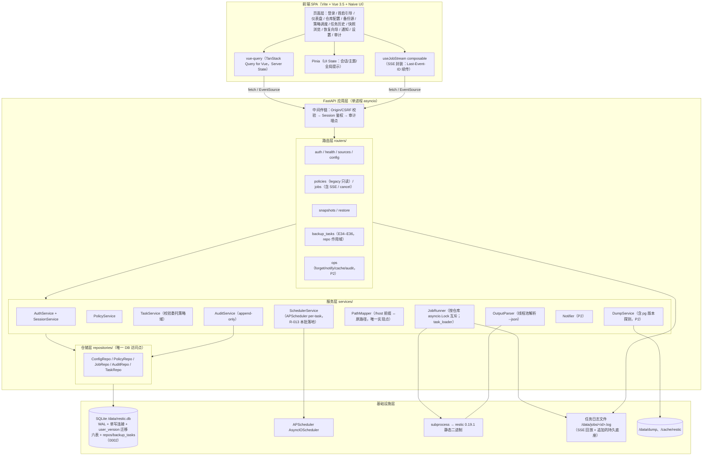

要点：

- **三层后端**（路由-服务-仓储）+ 独立 auth 模块；DB 访问只存在于仓储层，路径映射只存在于 PathMapper——两处"唯一实现点"是防泄漏的关键约束；
- **SSE 的持久底座是任务日志文件而非内存队列**：日志先落盘、SSE 只是"按偏移回放 + 追加"，天然获得断点续传与容器重启后的进度可回放性；
- **--json 解析放线程池**：解析为 CPU 密集，避免阻塞事件循环（方案 §5）。

### 1.2 部署拓扑

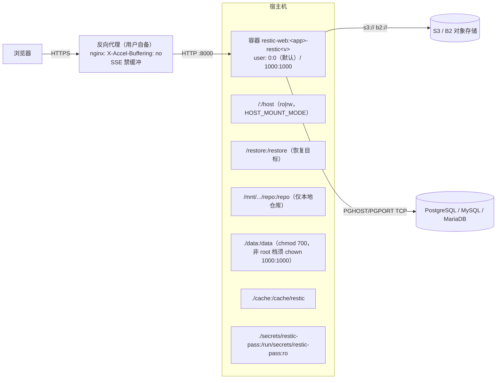

- 单实例强约束（禁止多副本，方案 §4）；`HEALTHCHECK` 探测 `GET /api/health`；
- 非 root 档部署前置：`chown -R 1000:1000 ./data ./cache ./secrets`，否则 SQLite 建库失败容器起不来；
- **HTTPS 双轨（Q2 裁决）**：上图为首选反代路径（终结 TLS + SSE 禁缓冲）；镜像内置"挂证书"式 TLS——config `server.tls_cert`/`server.tls_key` 齐备时 uvicorn 以 `ssl_certfile`/`ssl_keyfile` 直接启动（无自动签发续期），未配置则纯 HTTP 供反代终结（§4.3 键表）。
- **前端 SPA 由后端同源提供**（单容器方案 §2，不引入 nginx 第二进程）：构建阶段产出 `dist` 并 COPY 进运行时的 `/app/webroot`（`settings.static_dir`，环境变量 `STATIC_DIR` 可覆盖）；`create_app()` 在**业务路由之后** `mount("/", StaticFiles(html=True))`，保证 `/api` 优先匹配；404 处理器仅对 `GET/HEAD`、非 `/api` 前缀、末段无扩展名的请求回落 `index.html`（SPA 深链刷新），其余一律返回统一 JSON 错误。目录不存在时不挂载——`/` 仍是 JSON 404，本地开发页面由 Vite dev server 提供。

### 1.3 关键架构决策汇总

| #  | 决策                                                            | 理由（出处）                                                 |
| -- | ------------------------------------------------------------- | ------------------------------------------------------ |
| D1 | 单容器 + restic 静态二进制内嵌，版本随镜像 tag 固定                             | 版本确定性 + 仓库格式安全（方案 §4）                                  |
| D2 | SQLite 单库 + WAL + aiosqlite 单写连接                              | 自托管规模单实例足够；单写连接规避 SQLITE_BUSY（方案 §5）                   |
| D3 | 调度统一 cron 触发器（策略级 + 全局缺省），P1 即按多策略建表                          | 消除 interval/cron 双轨；P2 开放多策略零改表（方案 §4.1/§5）            |
| D4 | P1 恢复仅"时间戳子目录"，不存在任何覆盖路径                                      | 误操作零事故（PRD G3）；覆盖比对层 P2 自研                             |
| D5 | 鉴权是 P1 第 0 项，cookie session 全端点（含 SSE）统一                      | 无鉴权 + rw 全盘挂载 = 裸奔（方案 §6.1/§8）                         |
| D6 | SSE 持久底座 = 任务日志文件 + last_event_id 游标                          | 断点续传、刷新回放、重启可回放                                        |
| D7 | 路径映射/DB 访问各只有一个实现点（PathMapper / repositories/）                | 防止 `/host` 前缀语义泄漏到业务代码                                 |
| D8 | 内置排除集为代码常量（语义核心集 + 按 `RESTIC_WEB_MODE` 派生前缀，不存 DB），UI 可追加不可删减 | 单一事实来源，host/sources 两模式不漂移（方案 §3.1 v2.3.2）；"不可删减"由代码保证 |

---

## 2. 技术栈与依赖清单

### 2.1 后端

| 依赖                              | 版本锁定建议               | 用途 / 选型理由                                                                                                                                                       |
| ------------------------------- | -------------------- | --------------------------------------------------------------------------------------------------------------------------------------------------------------- |
| python                          | 3.13（alpine 镜像）      | zoneinfo、asyncio 成熟                                                                                                                                             |
| fastapi                         | `^0.115`             | 路由 + 依赖注入 + SSE（StreamingResponse）                                                                                                                              |
| uvicorn                         | `^0.32`              | ASGI server，单 worker（单实例假设）                                                                                                                                     |
| aiosqlite                       | `^0.20`              | **选型：裸 aiosqlite，不用 SQLAlchemy**——表仅 6 张、关系简单；单写连接串行化在裸连接上是一行语义（单例），SQLAlchemy async engine 反而引入连接池与 ORM 会话管理复杂度；迁移用自研 user_version + SQL 文件，不需要 Alembic 的依赖图能力 |
| apscheduler                     | `^3.10`（不用 4.x beta） | AsyncIOScheduler + CronTrigger + jitter，动态重载（remove_job/add_job）                                                                                                |
| argon2-cffi                     | `^23`                | argon2id 密码哈希                                                                                                                                                   |
| pydantic                        | `^2.9`               | API schema 校验（pydantic-settings 读环境变量）                                                                                                                          |
| httpx                           | `^0.27`              | 通知 webhook / healthchecks ping（P2）、pg 版本探测可复用                                                                                                                   |
| python-ulid                     | `^2`                 | job id（可排序 ULID）                                                                                                                                                |
| pytest / pytest-asyncio / respx | dev                  | 测试（respx mock httpx 通知）                                                                                                                                         |

### 2.2 前端

| 依赖                  | 版本锁定建议                    | 用途                                                                                                           |
| ------------------- | ------------------------- | ------------------------------------------------------------------------------------------------------------ |
| vite                | `^6` + @vitejs/plugin-vue | 构建（Vue SFC 支持）                                                                                               |
| vue                 | `^3.5`                    | UI 框架（3.6 尚在 RC/Vapor，稳定后再评估）                                                                                |
| vue-router          | `^4`                      | 路由                                                                                                           |
| naive-ui            | `^2.43`                   | 组件库（PRD §7 已裁决：n-data-table virtual 虚拟滚动、n-form 联动、n-steps 向导、n-modal 三重确认、n-config-provider + darkTheme 暗色） |
| @tanstack/vue-query | `^5`                      | Server State（请求缓存/失效/重试；TanStack Query 官方 Vue 适配版）                                                                |
| pinia               | `^3`                      | UI State（会话态、主题、全局提示），克制使用；Vue 官方状态库                                                                         |
| @vueuse/core        | `^11`                     | 虚拟滚动兜底（`useVirtualList`，n-data-table virtual 不足的非表格场景）                                                       |
| typescript          | `^5.6` + vue-tsc          | 类型（vue-tsc 负责 .vue SFC 类型检查）                                                                                 |
| vue-i18n            | `^10`                     | 国际化（PRD Q3 已裁决：首版即中英双语，i18n 架构 P1 预留——P1 仅骨架：语言包目录 + 文案抽取约定，不强制完成全部翻译）            |

锁定方式：后端 `pyproject.toml` + `uv.lock`（Dockerfile `uv sync --frozen`）；前端 `package-lock.json`（CI 用 `npm ci`）。镜像内依赖一次锁定、随镜像原子发布。

---

## 3. 目录结构（文件级）

```
web版/
├─ docker/
│  ├─ Dockerfile                      # python:3.13-alpine3.24（锁定小版本）+ restic 0.19.1 + HEALTHCHECK
│  ├─ docker-compose.yml              # 部署模板：host/sources 双模式 + HOST_MOUNT_MODE ro|rw（不含 build 段）
│  ├─ docker-compose.build.yml        # 本地构建叠加文件（overlay）：build 段 + 本地专用镜像名，须与上一份并用
│  └─ entrypoint.sh                   # 首启属主检查（root 档自动 chown，非 root 报错提示）
├─ backend/
│  ├─ pyproject.toml                  # 依赖 + uv.lock
│  ├─ app/
│  │  ├─ main.py                      # FastAPI 实例、中间件链、startup/shutdown 钩子（内置 TLS：server.tls_cert/tls_key 齐备时以 ssl_certfile/ssl_keyfile 启动，§4.3）
│  │  ├─ settings.py                  # 环境变量（RESTIC_WEB_MODE、TZ、DATA_DIR…，pydantic-settings）
│  │  ├─ errors.py                    # 统一 AppError 异常族 + 错误码→HTTP 状态唯一映射点（实现期新增，v1.2）
│  │  ├─ constants.py                 # JOB_TYPES、路径白名单前缀
│  │  ├─ exclusions.py               # ExclusionRules：内置排除集（语义核心集 + 模式派生，§7.3）
│  │  ├─ db/
│  │  │  ├─ database.py               # Database 单例：WAL、busy_timeout、单写连接、user_version 迁移器
│  │  │  ├─ migrations/
│  │  │  │  ├─ 0001_init.sql          # P1 全部建表（§4）
│  │  │  │  └─ 0002_multi_backup_tasks.sql  # 选项②：repos + backup_tasks + jobs.task_id（§4.7/§4.8/§4.5）
│  │  │  └─ repositories/
│  │  │     ├─ config_repo.py
│  │  │     ├─ policy_repo.py         # legacy：仅历史 jobs.policy_id 溯源与只读端点
│  │  │     ├─ job_repo.py            # + task_id 列与按任务聚合查询
│  │  │     ├─ task_repo.py           # backup_tasks 唯一 SQL 落点 + tag 生成（§4.8）
│  │  │     └─ audit_repo.py
│  │  ├─ auth/
│  │  │  ├─ service.py                # AuthService（登录校验/会话签发）+ LoginRateLimiter（IP 固定窗口限流，§8；实现期新增，v1.2）
│  │  │  ├─ password.py               # 密码哈希封装（argon2-cffi 默认 PasswordHasher，bcrypt 降级编译期选择，§8）
│  │  │  ├─ session.py                # session 签发/校验/滑动续期（DB 存储）
│  │  │  ├─ bootstrap.py              # 首启随机密码一次性展示 + 强制改密状态机
│  │  │  └─ dependencies.py           # require_session / require_csrf / require_bootstrap_done
│  │  ├─ routers/
│  │  │  ├─ auth.py                   # E01–E03 + E28 改密 + bootstrap
│  │  │  ├─ health.py                 # E04
│  │  │  ├─ sources.py                # E05（目录浏览）+ E31（首备 dry-run 预览）+ E32（内置排除集只读；E32 落点在本文件，不单独建路由——实现期定案，v1.2）
│  │  │  ├─ fs.py                     # E33 容器文件系统浏览（仓库路径选择的树/挂载点数据源）
│  │  │  ├─ config.py                 # E06/E07 + E29/E30（仓库测试连接/仓库状态）
│  │  │  ├─ policies.py               # E08–E11（legacy 只读：写路径恒 409，前端已退役入口）
│  │  │  ├─ jobs.py                   # E12–E16（含 SSE stream、cancel）+ E27
│  │  │  ├─ backup_tasks.py           # E34–E36 备份任务（repo 作用域前缀，§5.1）
│  │  │  ├─ snapshots.py              # E17/E18
│  │  │  ├─ restore.py                # E19（含 B1 paths → --include）/ E20（P2 preview）
│  │  │  └─ ops.py                    # P2：E21–E26（forget/notify/cache/audit）
│  │  ├─ services/
│  │  │  ├─ job_runner.py             # 核心执行器（§7.1）
│  │  │  ├─ restic.py                 # restic 命令拼装（参数白名单）+ spawn + tee 日志
│  │  │  ├─ parser.py                 # --json 逐行解析（线程池调用）
│  │  │  ├─ sse.py                    # SseChannel：日志回放 + 追加 + 心跳
│  │  │  ├─ path_mapper.py            # §7.3
│  │  │  ├─ policy_service.py
│  │  │  ├─ task_service.py           # 任务域归一（共享字段委托策略域）+ display 换算（§7.9）
│  │  │  ├─ env_sync.py               # env→config 一次性同步 + cred.* 唯一实现点 + passfile.status/repo.type 派生落库（实现期新增，v1.2）
│  │  │  ├─ scheduler.py              # R-013：APScheduler per-task cron + 动态重载 + 启动补跑（§7.4，本批落地）
│  │  │  ├─ compare.py                # P2：快照 ls × 目标磁盘覆盖比对
│  │  │  ├─ dump.py                   # P2：pg 版本探测 + dump + 清理
│  │  │  ├─ notifier.py               # P2
│  │  │  ├─ cache_service.py          # P2
│  │  │  └─ audit.py
│  │  ├─ schemas/                     # pydantic 请求/响应模型（api_schemas.py、enums.py）
│  │  └─ utils/                       # ulid、时间（zoneinfo + TZ 注入）、log 截断
│  └─ tests/
│     ├─ fixtures/restic-json/        # 固定版本 restic 真实输出 fixture（backup/restore/ls/snapshots…）
│     ├─ test_parser.py               # fixture 回归（优先级最高）
│     ├─ test_state_machine.py        # 状态机转换表驱动测试
│     ├─ test_migrations.py           # 迁移器幂等性
│     └─ test_api/                    # httpx AsyncClient 集成测试（auth/config/jobs/restore…）
├─ frontend/
│  ├─ index.html
│  ├─ package.json  package-lock.json
│  ├─ vite.config.ts                  # dev proxy → :8000
│  ├─ tsconfig.json
│  └─ src/
│     ├─ main.ts  App.vue  routes.ts            # .vue SFC 约定（vue-tsc 类型检查）
│     ├─ i18n/                        # vue-i18n（P1 骨架）：index.ts + locales/zh-CN.json + locales/en-US.json
│     ├─ api/                         # http.ts（统一错误/401 处理）+ auth/config/
│     │                               # backupTasks（E34–E36 + E05/E31 向导消费）/ exclusions（E32）
│     │                               # fs/health/jobs/repo/restore/snapshots
│     ├─ composables/
│     │  ├─ useJobStream.ts           # SSE composable：Last-Event-ID 续传 + 回放 + 心跳超时感知
│     │  └─ usePolicies.ts  useSnapshots.ts
│     ├─ stores/ui.ts                 # Pinia（defineStore）：session 态 / 暗色主题 / 全局消息
│     ├─ pages/                       # login/ bootstrap/ dashboard/ repo/ taskWizard/ jobs/
│     │                               # snapshots/ restore/ notify/ settings/ audit/（各页 index.vue）
│     │                               # 注：sources/ 与 policies/ 两页随选项②退役（§9.1）
│     ├─ components/
│     │  ├─ JobProgress.vue           # 统一 SSE 进度卡（所有长任务复用，PRD 贯穿规范）
│     │  ├─ ConfirmGate.vue           # 危险操作三重确认（预览→确认文本→二次确认）；删除任务门复用
│     │  ├─ PathBreadcrumb.vue        # 原路径语义面包屑（经 /host 映射）
│     │  ├─ VirtualTree.vue           # 懒加载 + 虚拟滚动文件树（+ selectedPaths 多选，B1 恢复用）
│     │  ├─ TaskCard.vue              # 任务卡片（仪表盘列表单元，§9.2）
│     │  ├─ TaskWizard.vue            # 新建/编辑任务五步向导（§9.3）
│     │  ├─ task/SourcesPicker.vue    # 向导步骤 2：源树勾选 + 内置排除集只读 + 追加排除
│     │  ├─ task/ScheduleRetentionForm.vue  # 向导步骤 4/5：cron 模板 + 保留档位
│     │  └─ TierCard.vue              # 运行模式说明卡（运行用户 × 挂载模式；向导步骤 1 复用）
│     └─ theme/                       # Naive UI n-config-provider 挂载（darkTheme 暗色主题切换）
└─ docs/
   ├─ Web版改造方案.md  Web版PRD.md  架构设计文档.md（本文）
```

---

## 4. 数据库 Schema（DDL）

八张表：六张 P1 一次性建齐于 `backend/app/db/migrations/0001_init.sql`（§4.1–§4.6），另两张随选项②于 `0002_multi_backup_tasks.sql` 建（§4.7 `repos`、§4.8 `backup_tasks`，同脚本并为 `jobs` 加 `task_id` 列，见 §4.5 注）。时间列统一 `TEXT`（ISO 8601 UTC）；布尔以 `INTEGER 0/1` 表示。

### 4.1 admin_account（单行表：鉴权 + 首启引导状态）

```sql
CREATE TABLE admin_account (
    id                       INTEGER PRIMARY KEY CHECK (id = 1),  -- 恒单行
    password_hash            TEXT NOT NULL,    -- argon2-cffi 默认 PasswordHasher（id 变体）；bcrypt 降级时以 "$2b$" 前缀区分（§8）
    must_change              INTEGER NOT NULL DEFAULT 1,          -- 1=首启未改密；Bootstrap 门（§5.1）依据
    bootstrap_shown          INTEGER NOT NULL DEFAULT 0,          -- 随机密码是否已展示（仅一次；1 后再取 → 410 BOOTSTRAP_SHOWN）
    bootstrap_password_hash  TEXT,                                 -- 首启随机密码哈希；改密完成后置 NULL
    failed_attempts          INTEGER NOT NULL DEFAULT 0,          -- 登录失败计数（存 DB 防容器重启清零，§8）
    lock_level               INTEGER NOT NULL DEFAULT 0,          -- 指数退避级数：锁定时长 = 5min × 2^lock_level，上限 1h
    locked_until             TEXT,
    updated_at               TEXT NOT NULL
);
```

### 4.2 sessions（服务端会话，24h 滑动续期）

```sql
CREATE TABLE sessions (
    token_hash    TEXT PRIMARY KEY,   -- SHA-256(会话 token)；明文 token 只存在于 cookie，不落库不落日志
    last_seen_at  TEXT NOT NULL,      -- 每次认证请求刷新（滑动续期）
    expires_at    TEXT NOT NULL,      -- = last_seen_at + 24h；过期行由启动期惰性清理（§8）
    created_at    TEXT NOT NULL
);
```

### 4.3 config（KV 配置 + 全局键表）

```sql
CREATE TABLE config (
    key         TEXT PRIMARY KEY,
    value       TEXT,                            -- 敏感项（cred.*）明文落盘程度与 compose env 等价（§6.1）
    source      TEXT NOT NULL DEFAULT 'ui',      -- 'ui' | 'env'：compose 环境变量覆盖；E07 对 source='env' 的键返回 409 ENV_OVERRIDDEN
    updated_at  TEXT NOT NULL
);
```

**config 键表**（E06 `GET /api/config` / E07 `PUT /api/config` 的键空间）：

| 键 | 说明 | 敏感 |
|---|---|---|
| `repo.url` / `repo.type` | 仓库地址与类型（type 枚举随 §4.2 归期扩展：P1 s3/b2/local） | 否 |
| `repo.host_tag` | host 标识（restic --host） | 否 |
| `passfile.status` | 只读派生、不落库：密码文件挂载状态 configured/missing | — |
| `cred.aws_*` / `cred.b2_*` | 后端凭据（S3/B2）；API 只回 `has_value` + `source` | 是 |
| `dump.*` | dump 类型/主机/端口/账号/密码/库名/保留天数（R-019） | password 是 |
| `schedule.cron_default` / `schedule.jitter` / `schedule.retry_times` / `schedule.retry_interval` | 全局调度缺省（**任务级 `cron` 为空时回退 `schedule.cron_default`；`schedule.jitter` 为调度触发抖动秒数，见 §7.4**） | 否 |
| `behavior.auto_init` / `behavior.auto_unlock` / `behavior.check_enabled` / `behavior.check_sample_ratio` / `behavior.monthly_full_day` | 行为开关（R-017） | 否 |
| `notify.*` | healthchecks_url、webhook.url/template、meow.nickname、on_success 开关、skipped 阈值、各渠道 redact 脱敏开关（R-018） | 否 |
| `server.tls_cert` / `server.tls_key` | 内置"挂证书"式 TLS 的证书/私钥路径（Q2 裁决）：**两者齐备时 main.py 以 uvicorn `ssl_certfile`/`ssl_keyfile` 启动；未配置则纯 HTTP，供反代终结 HTTPS** | 否 |
| `retention.jobs_days` | 任务元数据保留天数（默认 90，Q7） | 否 |
| `timezone` | 时区（zoneinfo 名；UI 可配，容器 TZ 仅回退）；**cron 解释与「当天」判定的真源（§7.4）** | 否 |

> 注（R-025 演进位）：`cred.*` 可选加密存储——密钥源自仓库密码文件派生，P1 不做；届时 `config.value` 改存密文（列不变，以格式前缀区分明文/密文），无需 schema 迁移。

### 4.4 policies（多策略；P1 建表即含全字段，UI 分期暴露）

```sql
CREATE TABLE policies (
    id                  INTEGER PRIMARY KEY,
    name                TEXT NOT NULL,
    is_default          INTEGER NOT NULL DEFAULT 0,   -- 恒一条；DELETE 默认策略 → 409 DEFAULT_POLICY_IMMUTABLE
    enabled             INTEGER NOT NULL DEFAULT 1,
    tag                 TEXT,
    sources             TEXT NOT NULL,                -- JSON 数组；**容器前缀形态**（host=/host、sources=/sources）：入库与下游 restic argv 均为该形态；展示映射由 PathMapper / display_* 派生字段管理（§5.1 E08–E11）
    excludes            TEXT NOT NULL,                -- JSON 数组（用户追加，容器前缀形态同 sources；纯 glob 不以 / 开头原样透传）；内置排除集为代码常量不入库（D8）
    keep_last           INTEGER NOT NULL DEFAULT 0,
    keep_hourly         INTEGER NOT NULL DEFAULT 0,
    keep_daily          INTEGER NOT NULL DEFAULT 0,
    keep_weekly         INTEGER NOT NULL DEFAULT 0,
    keep_monthly        INTEGER NOT NULL DEFAULT 0,
    keep_yearly         INTEGER NOT NULL DEFAULT 0,
    group_by            TEXT NOT NULL DEFAULT 'host,paths,tags',
    cron                TEXT,                          -- 空则回退全局缺省 schedule.cron_default
    one_file_system     INTEGER NOT NULL DEFAULT 0,   -- sources 模式缺省 1（方案 §3.2）
    compression         TEXT NOT NULL DEFAULT 'auto', -- auto/off/max
    check_sample_ratio  REAL NOT NULL DEFAULT 0.02,
    monthly_full_day    INTEGER NOT NULL DEFAULT 1,
    prune_interval_days INTEGER NOT NULL DEFAULT 7,
    limit_up_kibps      INTEGER NOT NULL DEFAULT 0,   -- Q5 裁决：P2 起生效；0=不限（对应 API 字段 limit_up/limit_down，KiB/s）
    limit_down_kibps    INTEGER NOT NULL DEFAULT 0,
    last_run_at         TEXT,                          -- 调度记账：先记账后执行，防崩溃重复触发（§6.4）
    created_at          TEXT NOT NULL,
    updated_at          TEXT NOT NULL
);
```

> 注（P1 实现定案）：用户提交的排除规则存在三分类——**展示路径**（`/etc/nginx`）、**容器路径**（`/host/etc/nginx`）、**锚定 glob**（`/etc/*.log`）——均在 API 边界归一为容器形态入库：sources 由 `PolicyService._normalize_sources`、excludes 由 `exclusions.normalize_user_excludes` 处理（白名单均 = `settings.mode_root`）；**纯 glob 模式**（不以 `/` 开头）原样透传。

### 4.5 jobs（任务元数据）

> **选项②增列（`0002_multi_backup_tasks.sql`）**：`task_id INTEGER REFERENCES backup_tasks(id) ON DELETE SET NULL`，见下方 DDL 的 `task_id` 行。语义与解绑规则见 §4.8 注与 §9「共享知识」。

```sql
CREATE TABLE jobs (
    id             TEXT PRIMARY KEY,     -- ULID（python-ulid，可排序）
    type           TEXT NOT NULL,        -- backup/restore/forget/check/unlock/init/dump（E12 白名单）
    status         TEXT NOT NULL DEFAULT 'pending',  -- pending/running/success/failed/interrupted/cancelled（方案 §5 状态机）
    trigger        TEXT NOT NULL,        -- manual | scheduled
    policy_id      INTEGER REFERENCES policies(id),  -- legacy 指针：仅历史行使用，新 job 为 NULL
    task_id        INTEGER REFERENCES backup_tasks(id) ON DELETE SET NULL,  -- 选项②：产生该 job 的备份任务（0002 增列）
    snapshot_id    TEXT,                 -- restore/forget 关联快照
    bytes_done     INTEGER,
    files_done     INTEGER,
    skipped_count  INTEGER NOT NULL DEFAULT 0,       -- 非 root 静默跳过计数（R-012）
    last_event_id  INTEGER NOT NULL DEFAULT 0,       -- SSE 游标（= 日志行偏移，E15 断点续传）
    log_path       TEXT NOT NULL,        -- /data/jobs/<id>.log
    summary        TEXT,
    started_at     TEXT,
    finished_at    TEXT,
    exit_code      INTEGER,
    created_at     TEXT NOT NULL
);
```

### 4.6 audit_logs（append-only）

```sql
CREATE TABLE audit_logs (
    id          INTEGER PRIMARY KEY AUTOINCREMENT,
    ts          TEXT NOT NULL,
    action      TEXT NOT NULL,     -- login.failed / restore.run / job.skipped_conflict / cache.clear / config.update …
    target      TEXT,              -- 操作对象（快照 id / 策略 id / 路径 / job id…）
    detail      TEXT,              -- JSON
    result      TEXT NOT NULL DEFAULT 'ok',   -- ok / denied / failed
    created_at  TEXT NOT NULL
);
-- append-only：代码面仅存在 INSERT 与 SELECT（AuditService.record/query）；无 UPDATE/DELETE 路径，
-- 归档 = 整段滚动导出后截断新文件（方案 §6.1），不覆盖已写入内容。
```

### 4.7 repos（仓库身份注册表 · 0002 新增，R-023 预留）

```sql
CREATE TABLE IF NOT EXISTS repos (
    id         TEXT PRIMARY KEY,          -- P2 恒 'default'；R-023 起为仓库 id
    name       TEXT NOT NULL,
    created_at TEXT NOT NULL
);
INSERT OR IGNORE INTO repos (id, name, created_at)
VALUES ('default', '默认仓库', strftime('%Y-%m-%dT%H:%M:%SZ', 'now'));
```

> **为什么不镜像 url**：本表是「身份注册表」而非连接事实源——仓库地址/类型仍以 config 的 `repo.url`/`repo.type` 为单一真源（§4.3、E4 精神），`repos` 只提供 E7 所需的 `repo_id` 外键父表。R-023 落地时退化为「加行 + 仓库切换器」，路由与调度器不动（§13 E7）。

### 4.8 backup_tasks（备份任务 · 0002 新增，选项②核心）

```sql
CREATE TABLE IF NOT EXISTS backup_tasks (
    id                  INTEGER PRIMARY KEY,
    repo_id             TEXT NOT NULL DEFAULT 'default' REFERENCES repos(id),  -- E7：第一天带外键
    name                TEXT NOT NULL,
    enabled             INTEGER NOT NULL DEFAULT 1,
    tag                 TEXT NOT NULL UNIQUE,     -- 自动生成只读：task-<id>（greenfield 无 legacy 继承）
    sources             TEXT NOT NULL,            -- JSON 数组，容器前缀形态（同 policies 口径）
    excludes            TEXT NOT NULL,            -- JSON 数组；内置排除集不入库（D8）
    keep_last           INTEGER NOT NULL DEFAULT 0,
    keep_hourly         INTEGER NOT NULL DEFAULT 0,
    keep_daily          INTEGER NOT NULL DEFAULT 0,
    keep_weekly         INTEGER NOT NULL DEFAULT 0,
    keep_monthly        INTEGER NOT NULL DEFAULT 0,
    keep_yearly         INTEGER NOT NULL DEFAULT 0,
    group_by            TEXT NOT NULL DEFAULT 'host,paths,tags',
    cron                TEXT,                     -- 空 → 回退全局缺省 schedule.cron_default（§7.4）
    one_file_system     INTEGER NOT NULL DEFAULT 0,
    compression         TEXT NOT NULL DEFAULT 'auto',
    check_sample_ratio  REAL NOT NULL DEFAULT 0.02,
    monthly_full_day    INTEGER NOT NULL DEFAULT 1,
    prune_interval_days INTEGER NOT NULL DEFAULT 7,
    limit_up_kibps      INTEGER NOT NULL DEFAULT 0,   -- KiB/s，0=不限
    limit_down_kibps    INTEGER NOT NULL DEFAULT 0,
    dry_run_pending     INTEGER NOT NULL DEFAULT 0,   -- R-026-08 首跑门：创建置 1，E36 预览成功清 0
    last_run_at         TEXT,                          -- 调度记账（先记账后执行，§6.8）
    created_at          TEXT NOT NULL,
    updated_at          TEXT NOT NULL
);
CREATE INDEX IF NOT EXISTS idx_backup_tasks_repo ON backup_tasks(repo_id);
```

**与 `policies` 的关系（决策 1:1）**：

- 任务即策略实体：`backup_tasks` 与 `policies` **字段同构**，任务表新增 `repo_id` / `dry_run_pending`，不设 `is_default`（策略的「恒一条默认」约束在任务域不存在）；
- `policies` 表**保留为 legacy**：仅供历史 `jobs.policy_id` 溯源与其只读端点（E08–E11 写路径恒 409），不再出现在任何 UI 写路径；
- **无 `status` 列**：任务状态是派生值（§5.1 E34 卡片），避免双状态源漂移；`enabled` 是调度门而非状态机迁移。

**tag 规则（共享知识）**：新建任务由 `TaskRepo.create` 插入后同方法内回写 `tag='task-<id>'`（单写连接串行无竞态，`UNIQUE(tag)` 兜底）；更新路径显式剔除 tag（`TaskRepo.update`），客户端提交一律忽略——防止改 tag 导致 forget `--tag` 误删他任务快照。greenfield 裁决下**无 legacy tag 继承分支**。

**删除任务的解绑语义（Q7）**：`DELETE` 一条任务 → `jobs.task_id` 经外键 `ON DELETE SET NULL` 置空（历史行与日志保留、脱离归属）；仓库内该 tag 的快照**不动**（forget 是唯一删快照路径）。库中**不存在**指向已删任务的孤儿 `task_id` —— 外键本身禁止该形态。

字段对应关系：E03/E06 ↔ config、E08–E11 ↔ policies（legacy）、E12–E14/E16 ↔ jobs、E26 ↔ audit_logs、**E34–E36 ↔ backup_tasks**、§6.1 时序 ↔ admin_account/sessions。


## 5. API 详细设计

### 5.0 统一约定

**统一错误响应**（所有非 2xx）：

```json
{ "code": "JOB_CONFLICT", "message": "已有任务进行中", "data": { "running_job_id": "01JAAA…" } }
```

| code               | HTTP | 场景                                             |
| ------------------ | ---- | ---------------------------------------------- |
| `VALIDATION_ERROR` | 422  | 参数/路径校验失败                                      |
| `UNAUTHORIZED`     | 401  | 未登录 / 会话过期                                     |
| `FORBIDDEN`        | 403  | CSRF Origin 校验失败 / 首启未改密（`BOOTSTRAP_REQUIRED`） |
| `NOT_FOUND`        | 404  | 资源不存在                                          |
| `JOB_CONFLICT`     | 409  | 同仓库已有 running/pending 任务（方案 §5：手动触发拒绝不排队）      |
| `ACCOUNT_LOCKED`   | 429  | 登录锁定（data 带 `retry_after`）                     |
| `RATE_LIMITED`     | 429  | 登录接口限流                                         |
| `INTERNAL`         | 500  | 兜底（不回内部细节）                                     |
| `TASK_RUNNING`     | 409  | 任务正在运行/等待中，拒绝删除（E35c；data 带 `running_job_id` + `task_name`；选项②新增） |
| `REPO_NOT_FOUND`   | 404  | repo 作用域 id 不存在（E34–E36 路径前缀；P2 仅 `default`；data 带 `repo_id`；选项②新增） |

> 端点级扩展码（响应格式同上表）：`400 PATH_OUT_OF_PREFIX`（E05）、`409 ENV_OVERRIDDEN`（E07）、`409 DEFAULT_POLICY_IMMUTABLE`（E11）、`409 NOT_CANCELLABLE`（E16）、`403 RESTORE_FORBIDDEN`（E19）、`410 BOOTSTRAP_SHOWN`（Bootstrap）、`409 TASK_RUNNING`（E35c）、`404 REPO_NOT_FOUND`（E34–E36）——见各端点定义。
>
> 其余已登记码（2026-10-11 补全，与 `app/constants.py` 的 `ERROR_STATUS` 对齐，此前本表遗漏 6 项）：`500 RESTIC_FAILED`（restic 子进程非 0 退出，message 不回显内部细节）、`409 POLICY_WRITE_CLOSED`（非默认策略写/删，E10）、`409 READONLY_KEY`（写只读派生源，`repo.type`）、`401 PASSWORD_WRONG`（E28 改密）、`403 CSRF_ORIGIN`（Origin/Referer 校验失败）、`403 BOOTSTRAP_REQUIRED`（首启未改密，业务 API 压制）。
> **维护约定**：`ERROR_STATUS` 新增条目时须同 PR 更新本表（规范 §3.2「错误码登记」为该要求的审查依据）。

**分页约定**：列表类 `?limit=50&offset=0` → `{"items": [...], "total": 123, "limit": 50, "offset": 0}`；文件树用游标 `?cursor=<opaque>&limit=200` → `{"items": [...], "next_cursor": "…" | null}`。

**鉴权**：除 E04 与 E01、bootstrap 外全部要求有效 session；写方法（POST/PUT/DELETE）额外要求 Origin 同源（§8）。

### 5.1 端点明细（方案 §5 全覆盖；E01–E32）

**E01 `POST /api/auth/login`**（P1，免鉴权）

```json
// 请求 {"password": "..."}
// 200：Set-Cookie: rw_session=<token>; HttpOnly; SameSite=Strict; Path=/; Max-Age=86400
// 401 PASSWORD_WRONG / 429 ACCOUNT_LOCKED / 429 RATE_LIMITED / 403 CSRF_ORIGIN
```

**E02 `POST /api/auth/logout`**（P1）：销毁服务端 session + 清 cookie；200 `{"code":"ok"}`。

**E03 `GET /api/auth/me`**（P1）：

```json
{ "authenticated": true, "must_change_password": false,
  "mode": "host", "host_mount": "rw", "user": "root" }   // 供四象限卡（US-G2）
// 401 UNAUTHORIZED / 403 BOOTSTRAP_REQUIRED（data 带 bootstrap 步骤提示）
```

**E04 `GET /api/health`**（P1，免鉴权）：HEALTHCHECK 用；200 `{"status":"ok","db":"ok"}`（不校验仓库连通，避免拖垮探测）。

**E05 `GET /api/sources?path=/etc/nginx`**（P1）：目录浏览（按 RESTIC_WEB_MODE 定位 `/host`|`/sources` 模式根下）。

> 入参 `path` 语义修订（P1 实现定案）：**收展示路径**（如 `/etc/nginx`；缺省为模式根），服务端内部经 PathMapper `to_snapshot` 还原为容器路径；**兼容旧文档示例的容器路径形态**——`/host`、`/sources` 前缀照常接受（按当前模式白名单校验）。响应 `items[].display_path` 一律为剥前缀的展示路径。

```json
{ "path": "/etc", "items": [ {"name":"nginx","type":"dir","display_path":"/etc/nginx"} ],
  "next_cursor": null }
```

错误：`400 PATH_OUT_OF_PREFIX`（越出当前模式白名单，方案 §6 注入防护）；跨模式输入（如 host 模式传 `/sources/...`）返回 `422 VALIDATION_ERROR`。

**E06 `GET /api/config`**（P1）：按 §4.3 键返回；敏感项 `{has_value:true, source:"env"}`，仓库密码只回 `passfile_status: "configured"|"missing"`。**E07 `PUT /api/config`**（P1）：`{"patch": {"repo.url": "s3:s3.amazonaws.com/bk", ...}}`；`source='env'` 的键返回 409 `ENV_OVERRIDDEN`；写审计。

**E08–E11 策略 CRUD**（E08 `GET /api/policies`、E09 `POST`、E10 `PUT /api/policies/{id}`、E11 `DELETE`；P1 仅默认策略可写，多策略写开放于 P2）：

```json
// GET 单条 / POST body 同构
{ "name": "default", "is_default": true, "tag": "auto",
  "sources": ["/host/etc", "/host/home"], "excludes": ["/host/var/backups"],
  "keep_last": 0, "keep_hourly": 0,
  "keep_daily": 7, "keep_weekly": 4, "keep_monthly": 6, "keep_yearly": 1,
  "group_by": "host,paths,tags", "cron": "0 3 * * *", "one_file_system": false,
  "compression": "auto", "check_sample_ratio": 0.02,
  "monthly_full_day": 1, "prune_interval_days": 7,
  "limit_up": 0, "limit_down": 0 }   // 限速 KiB/s，0=不限；P2 起生效（Q5；DDL 列 limit_up_kibps/limit_down_kibps，§4.4）
```

cron 改动 → SchedulerService 动态重载（P2 起生效）；DELETE 默认策略返回 409 `DEFAULT_POLICY_IMMUTABLE`。

> 响应模型补（P1 实现定案）：`PolicyOut` 额外携带 **`display_sources` / `display_excludes`**（展示形态，供 UI 回显）——锚定/容器路径剥前缀还原为展示路径、纯 glob 原样保留。上例 `"sources"` 为请求侧（写）字段，入库前按 §4.4 注归一为容器形态。**原则：容器形态只存在于存储与 restic argv，凡出 API 给 UI 的一律带 display 派生字段**（E05/E17/E18/E31 的 `display_path`、E08–E11 的 `display_sources`/`display_excludes` 同一原则）。

**E12 `POST /api/jobs`**（P1；选项②扩展 `task_id`）：

```json
// 请求 {"type": "backup", "task_id": 2}       // 白名单：backup|restore|check|forget|unlock|init|dump
//   或 {"type": "backup", "policy_id": 1}     // legacy 策略路径（与 task_id 互斥，同供 422 VALIDATION_ERROR）
// 202 {"id": "01JAAA...", "status": "pending"}
// 409 JOB_CONFLICT（同仓库 running/pending，manual 与 scheduled 同规则；
//                    scheduled 冲突不返回 409——由调度侧跳过并记 jobs(cancelled) + audit）
//     data: {"running_job_id": "01JAAA...", "running_task_name": "每日全量"}   ← 选项②新增任务名（US-026-04 AC2）
```

> `task_id` 与 `policy_id` 的 profile 解析：JobRunner 内 `task_id` **优先**（任务即策略 1:1），`policy_id` 仅 legacy 兼容（§7.1）。新 backup/forget job 落 `task_id`、`policy_id` 为 NULL。
**E13 `GET /api/jobs?status=&task_id=&limit=&offset=`**（P1 最小版：`status=running|pending` 进行中列表——仪表盘"最近任务"与任务历史页"进行中任务"数据源；P2 完整版：全量分页/筛选/retention）：jobs 表分页。

> 选项②扩展：新增 `task_id` 过滤维度（任务卡片「日志」入口与任务历史按任务筛选）。**`status` 门禁语义不变**（仍仅 running/pending）——全量历史筛选随 P2 完整版开放。

**E14 `GET /api/jobs/{id}`**（P1）：

```json
{ "id": "01JAAA...", "type": "backup", "status": "running", "trigger": "manual",
  "bytes_done": 104857600, "files_done": 3210, "skipped_count": 0,
  "last_event_id": 87,
  "log_path": "/data/jobs/01JAAA....log", "started_at": "...", "exit_code": null }
```


**E15 `GET /api/jobs/{id}/stream`**（P1，SSE；cookie 鉴权同普通 API）：

- 请求头 `Last-Event-ID`（或 `?last_event_id=` 仅限重连由浏览器自动携带）→ 从 jobs.last_event_id/日志偏移回放；
- 事件：`id: <n>` + `event: progress|log|done|error` + `data: {json}`；空闲 15s 发 `: keep-alive` 注释行；
- 响应头 `X-Accel-Buffering: no`、`Cache-Control: no-cache`；
- 无该事件游标时从头回放；任务已终态则回放完 done 后关闭；
- **客户端约定（P1 实现定案）**：客户端应先用 E14 响应的 `last_event_id` 作为起始游标开流——终态任务不必触发全量回放（带游标开流时服务端 seek 到日志文件尾，只补发终态帧后关闭）；服务端"无游标从头回放"语义不变；
- 服务端行为细节（P1 实现定案）：日志文件不存在时降级为空日志（不报错），按任务当前状态直接发终态帧后关闭连接。

**E16 `POST /api/jobs/{id}/cancel`**（P1）：202；JobRunner SIGTERM → 30s 宽限 → SIGKILL，终态 `cancelled`；对非 running/pending 返回 409 `NOT_CANCELLABLE`；写审计。

**E17 `GET /api/snapshots?limit=&offset=&tag=`**（P1；选项②补 `?tag=` 过滤）：`restic snapshots --json` → 映射原路径语义 →（可选 tag 包含过滤）→ 按时间倒序 → 分页：

```json
{ "items": [ {"id":"abc123","time":"...","host":"nas","tags":["task-2"],
  "paths":["/etc/nginx"], "size": 52428800} ], "total": 42, "limit": 50, "offset": 0 }
```

> **`?tag=` 过滤语义（R-026-10，X2 裁决已落地 d6bf5ca）**：可选 `tag` 参数，快照 `tags` 数组**包含**该 tag 则保留（任务 tag 形如 `task-<id>`）；过滤在 **Python 侧**对取回结果执行、**先于分页**（保证 `total` 为筛选后总数）；**不往 restic argv 传 `--tag`**（S2 白名单不扩面）。缺省时行为与既有契约完全一致。实现 `routers/snapshots.py:60-95`；用例 `tests/test_api/test_snapshots.py`（E17 首个 API 测试）。快照页的标签下拉与分组头（前端 `pages/snapshots/index.vue:31-78`）由此端到端生效。

**E18 `GET /api/snapshots/{id}/files?path=/etc&cursor=`**（P1）：`restic ls --json` 流式转发 + 子树过滤 + 游标分页；`items[].display_path` 为原路径语义。

**E19 `POST /api/restore`**（P1，**仅时间戳子目录**；选项②增 B1 `paths`）：

```json
// 请求 {"snapshot_id": "abc123", "target": "/restore"}
//   或 {"snapshot_id": "abc123", "target": "/restore", "paths": ["/etc", "/home/u/x"]}   ← B1 文件级恢复（R-027）
// 202 {"job_id": "01JAAB...", "restore_target": "/restore/etc-20261010-0138"}
//      ↑ 服务端计算时间戳子目录并落审计，请求体不存在任何覆盖语义参数
// 403 RESTORE_FORBIDDEN（目标不在白名单）/ 409 JOB_CONFLICT / 400 PATH_OUT_OF_PREFIX（paths 越界，data 带 path）
```

> **B1（R-027）语义**：`paths` 为**展示形态**的文件/目录清单（来自 E18 文件树多选），路由层逐条 `to_snapshot` + `PathMapper.validate`（模式根白名单）归一为容器形态，经 `params.include` 入 JobRunner，由 `ResticCmd.build` 拼 `--include`（§7.1，S2 白名单内，无自由字符串）。**缺省/空 = 整快照恢复**（兼容既有行为）。目标仍是服务端计算的时间戳子目录，`--overwrite=if-changed` 仍由 JobRunner 固定注入——**不引入任何覆盖语义**（S7）。审计沿用 `restore.run`（detail 增 `include_count`，不新增动作名）。

**E20 `POST /api/restore/preview`**（P2）：`{"snapshot_id","target"}` → CompareService 比对 → `{"overwrite_count": n, "items":[{"path","snapshot_mtime","disk_mtime","snapshot_size","disk_size"}], "total_bytes": n}`（游标分页）。

**E21 `POST /api/forget/preview`**（P2，**已交付 2026-10-14**）：策略参数 `{tag?, group_by, keep_*, prune}` → `forget --dry-run --json` → `{remove: [...], remove_count, keep_count, group_count, params(回显), truncated}`；确认后经 E12 `{"type":"forget", params}` 执行（三重确认门在 UI，执行入审计）。实现锚点：`routers/ops.py`（恒 `dry_run=True`，调用方无法覆盖）+ `parser.parse_forget_groups`（NDJSON 分组）+ `JobRunner._build_args` forget 分支（params 与预览同源消费，`prune` 仅执行侧）。**G3 服务端兜底**：无任何 `keep_*` 规则 → preview 与执行两侧同拒 422（无规则 forget 会删除组内全部快照）。参数回显 `params` 与执行侧消费键同名（tag → `params.tags` 列表），前端确认门原样透传，保证「预览与实际结果一致」。

**E22 `GET /api/checks/{id}`**（P2）：check 任务结果（errors、read_data 进度、抽样文件集）。

**E23 `GET/PUT /api/notify`**（P2，**已交付 2026-10-14**，`routers/ops.py`）：healthchecks/webhook URL（敏感，只回 `*_set` 布尔不回明文；写入三态 None=不变/""=清除/非空=设置）、webhook 模板、MeoW 昵称、各渠道 redact 脱敏开关、成功通知开关、skipped 阈值（默认 100，0=只要有 skipped 即告警，Q4）。**E24 `POST /api/notify/test`**（已交付）：向全部已配置渠道发测试消息，逐渠道回结果（失败必须带原因）；入审计 `notify.update`/`notify.test`。

**E25 `GET /api/cache` / `POST /api/cache/clear`**（P2）：缓存占用（du /cache/restic）与清空（审计；UI 注明"不丢数据，仅变慢"）。

**E26 `GET /api/audit?action=&limit=&offset=`**（P2）：append-only 查询；**不存在** PUT/DELETE。

**E27 `GET /api/jobs/{id}/log`**（P1）：日志文件尾部（`?tail_bytes=`）——日志详情抽屉与 skipped 明细数据源（R-012）。

**E28 `PUT /api/admin/password`**（P1）：`{"old_password": "...", "new_password": "..."}`；首启场景 old=随机引导密码；argon2id 重哈希 + 销毁其他 session + 审计；强度校验失败 422。

**E29 `POST /api/repo/test`**（P1）：仓库连通性测试（PRD 页 4"测试连接"动作）——复用 `restic cat config` 探测，返回 `{"ok": true, "latency_ms": 120}` 或 `{"ok": false, "reason": "..."}`（锁残留/凭据缺失等原因明示，禁止静默）。

**E30 `GET /api/repo/status`**（P1）：仓库状态卡数据源（PRD 页 3 仪表盘 + §6.5 锁残留醒目提示）——`{"connected": true, "locked": false, "capacity": {"size": n, "snaps": 42}, "last_error": null}`；锁状态供"仓库锁残留，请手动解锁"提示（走 E12 unlock 三重确认门）。

**E31 `POST /api/sources/dry-run`**（P1）：首备扫描范围预览（PRD 页 5/US-B2/R-006 确认门）——`restic backup --dry-run --json` 流式返回 `{"items": [{"path", "display_path", "size"}], "warnings": [{"type": "pseudo_fs_name", "path": "/sources/proc"}]}`；扫描范围中出现 proc/sys/dev/run/docker/lost+found 类目录名时 warnings 置黄色警告（不强制拦截，方案 §3.2 四层防线）。

> 入参口径同 E05（P1 实现定案）：`sources` **收展示路径**、兼容 `/host`/`/sources` 容器路径形态；白名单收紧为 `settings.mode_root`（host=/host、sources=/sources），跨模式输入 `422 VALIDATION_ERROR`。restic 非 0 退出时返回 **200 + `error` 字段**（原因明示，如仓库未初始化/凭据缺失/预览超时截断）——不 5xx、不静默。

**E32 `GET /api/exclusions?mode=host|sources`**（P1；归期由 P2 提前至 P1——随 P1 备份源页"内置排除集只读展示"一并实现，v1.2 同步）：内置排除集按模式派生结果（`ExclusionRules.built_in(mode)` 的只读暴露）——供备份源页"内置排除集（强制生效）"只读展示与 `is_builtin` 校验，保证 D8 单一事实来源不因前端展示而泄漏复制。落点在 `routers/sources.py`（不单独建文件）。

**E33 `GET /api/fs/browse?path=/&cursor=&limit=`**（P1，v1.0.x 新增；仓库配置页「浏览路径」用）：容器文件系统的**单层只读列举**，回 `{"path", "items": [{"name","type","path","is_mountpoint"}], "mounts", "next_cursor"}`——与 E05 的两处关键差异：① **无 `/host`|`/sources` 白名单**（仓库地址可落在 `/repo` 或用户自挂的任意挂载点），② **回容器绝对路径而非 display_path**（`repo.url` 本就容器形态，`PathMapper` 的模式根换算不适用）。`mounts` 由 `/proc/mounts` 过滤伪文件系统（proc/sys/cgroup/overlay…）得出，仅 `path=/` 时返回，供前端做挂载点快跳；Linux 外环境（开发机/Windows）返回空列表。**只列名不看内容**，且鉴权同其余业务端点（会话 + 首启完成）。单层扫描与游标分页抽到 `services/dir_scan.py`，与 E05 共用（D8）。

---

**选项②任务端点（E34–E36，§13 E6 路径前缀作用域）**

> 统一前缀 `/api/repos/{repo_id}/backup-tasks`；`repo_id` 仅接受 `default`（P2 唯一仓库），其余 404 `REPO_NOT_FOUND`（data 带 `repo_id`）。R-023 多仓库时零改路由（加行 + 仓库切换器）。全部端点挂 `require_session` + `require_bootstrap_done`，写方法过 Origin 同源校验（S4）。

**E34 `GET /api/repos/{repo_id}/backup-tasks?limit=&offset=`**：任务卡片列表（`Page[TaskCardOut]`，US-026-06）。

```json
{ "items": [ {
    "id": 2, "name": "每日全量", "enabled": true, "tag": "task-2", "cron": "0 3 * * *",
    "status": "running",              // 派生：paused > running/pending > 最近一次 backup 终态 > never_run
    "last_run_at": "2026-10-12T19:00:00Z", "last_result": "success",
    "next_run_at": "2026-10-13T03:00:00Z",   // null = 仅手动或已暂停（SchedulerService 推导）
    "running_job_id": "01JAAA...",            // 非空时卡片内联 SSE 进度 / 取消 / 日志
    "dry_run_pending": false,                 // true 时 UI 拦截 Start（R-026-08）
    "prune_due": false,                       // 保留清理到期提示（只提示不执行，见 §7.4 N3）
    "updated_at": "2026-10-13T02:00:00Z"
  } ], "total": 3, "limit": 50, "offset": 0 }
```

派生状态的**单一装配点**在路由内（`routers/backup_tasks.py::_to_card`）：`TaskRepo.list_all` + `JobRepo.list_active` + `JobRepo.latest_backup_by_tasks` + `SchedulerService.next_fire_time` / `_due_for_prune`，无新 SQL 散出（A1）。

**E34b `GET /api/repos/{repo_id}/backup-tasks/{id}`**：任务详情/编辑预填（`TaskOut`，全字段 + `display_sources`/`display_excludes`，tag 只读露出）；不存在 404 `NOT_FOUND`。

**E35 `POST /api/repos/{repo_id}/backup-tasks`**（201）：创建（US-026-01）。请求体 `TaskUpsertRequest`——**无 `tag` 字段**（服务端生成 `task-<id>`）；校验走 `TaskService.normalize`（共享字段委托 `PolicyService.normalize`：sources/excludes 三分类归一、cron 字段数、keep_* 非负、compression 白名单）+ 任务域 `name` 必填。落库 `dry_run_pending=1`（R-026-08 首跑门）→ 审计 `task.create` → `SchedulerService.reload()`（cron 即时生效，无需重启）。错误：404 `REPO_NOT_FOUND`、422 `VALIDATION_ERROR`。

**E35b `PUT /api/repos/{repo_id}/backup-tasks/{id}`**（200）：更新（全量语义，US-026-02）。sources/excludes 与库中现值不同 → `dry_run_pending=1`（源变更须重新预览）；tag/`repo_id` 永不被写 → 审计 `task.update` → `reload()`。错误：404 `NOT_FOUND` / `REPO_NOT_FOUND`、422。

**E35c `DELETE /api/repos/{repo_id}/backup-tasks/{id}`**（200 `OkResponse`）：删除（US-026-03，危险操作三重确认在 UI + 审计）。该任务存在 running/pending job → **409 `TASK_RUNNING`**（data：`running_job_id` + `task_name`，提示先取消）；否则删除（jobs.task_id 外键置空、快照不动）→ 审计 `task.delete` → `reload()` 移除触发器。

**E36 `POST /api/repos/{repo_id}/backup-tasks/{id}/dry-run`**（200 `DryRunResponse`）：任务域扫描预览（R-026-08）。请求体字段均可选（缺省取任务存量 sources/excludes，支撑「源集合变更后重新预览」）→ `restic backup --dry-run --json --verbose`（与 E31 同链路：120s 超时、5000 条上限、伪文件系统目录名黄色 warnings、restic 非 0 回 200 + `error` 字段）。**预览成功（无 error 且未 truncated）即清 `dry_run_pending=0`**（截断视为未看全，保守不清）。

> E31（`POST /api/sources/dry-run`）契约不变，定位收窄为「向导内**无任务实体**的新建流预览」（sources 必填）；任务实体存在后用 E36。E05 仍是无状态目录浏览——「源选择 per-task」指选择态存入 `backup_tasks.sources`，非 E05 契约变更。

**Bootstrap（E01 前置，P1）**：`GET /api/auth/bootstrap` —— `must_change=1` 且 `bootstrap_shown=0` 时返回随机密码明文一次并置 `bootstrap_shown=1`（之后 410 `BOOTSTRAP_SHOWN`，须删数据重引导）；改密完成前中间件将除 auth/bootstrap 外全部路由压到 403 `BOOTSTRAP_REQUIRED`（PRD US-A1 AC2）。

---

## 6. 关键流程时序图

### 6.1 登录 + 首启改密（R-001）

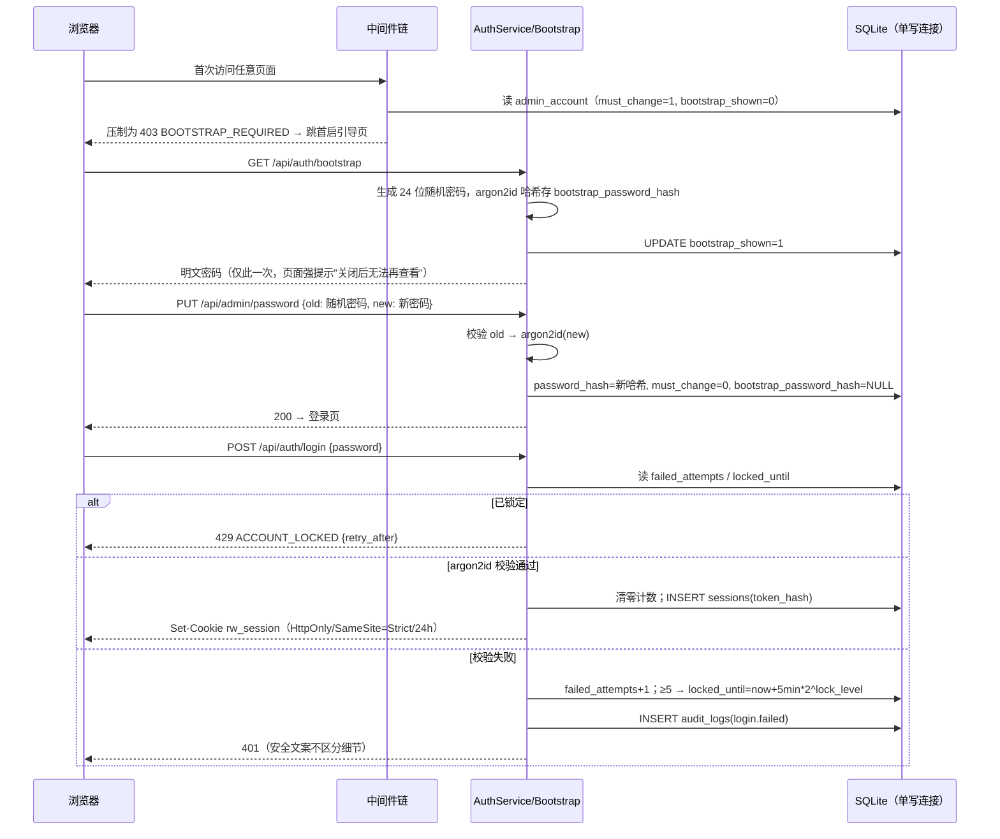

### 6.2 手动备份全链路（R-004/007/011）

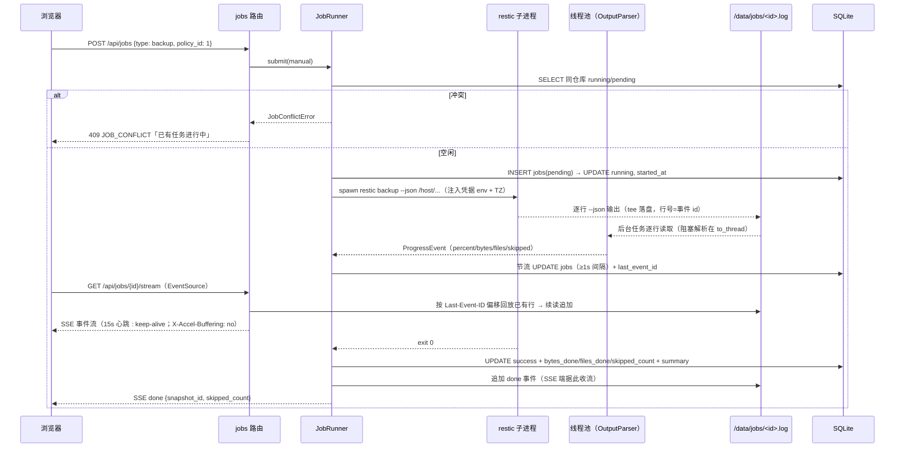

### 6.3 恢复到时间戳子目录（R-008，P1 唯一恢复路径）

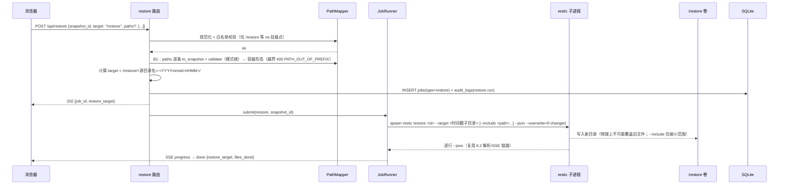

### 6.4 APScheduler per-task cron 触发 + 互斥拒绝（R-013，**本批落地**）

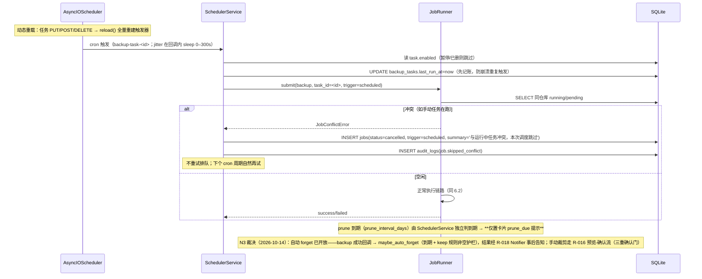

### 6.5 容器重启补跑 + AUTO_UNLOCK 语义（R-004/013）

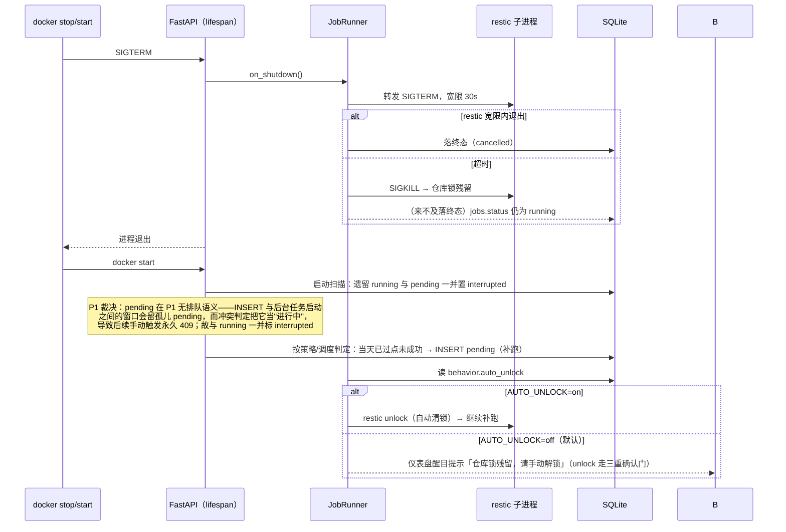

> **选项②补充**：本序列中"按策略补跑"的具体实现为 `SchedulerService.catchup_on_startup()`（§6.8），判据由「策略」改为「任务」；启动时序为 `recover_on_startup()` → `scheduler.start()`（内部 reload + 补跑），停机时序为 `scheduler.shutdown()` → `job_runner.on_shutdown()`（先停调度再收尾子进程）。

### 6.6 创建备份任务（E35，US-026-01）

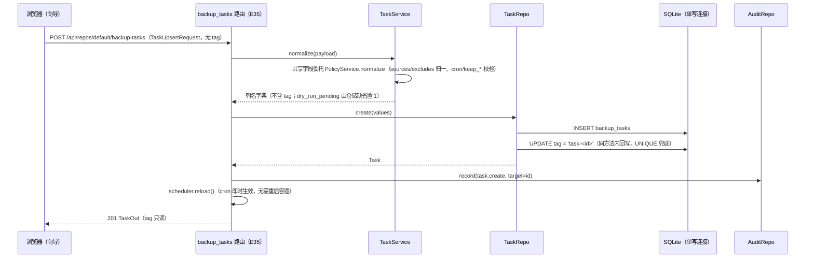

### 6.7 任务卡片手动 Start 与 409 冲突（E12 per-task，US-026-04）

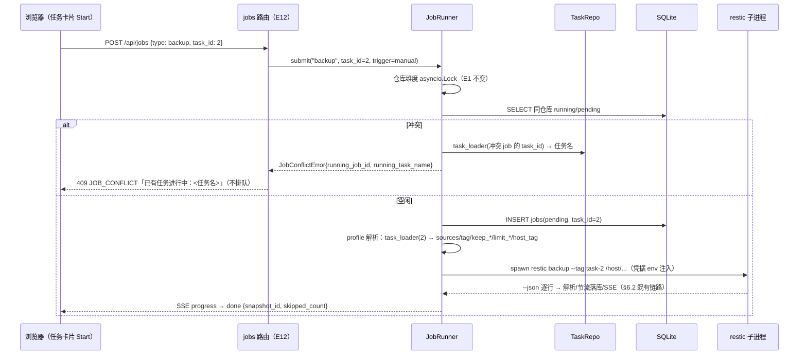

### 6.8 调度器启动时序与补跑（R-013，US-026-07 AC3/AC4）

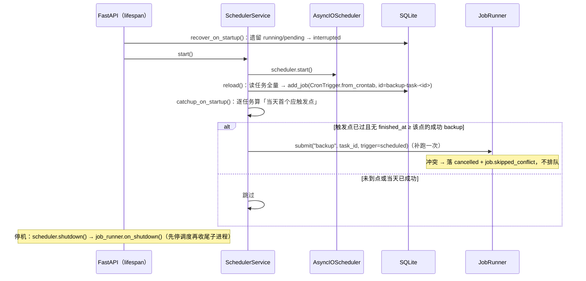

判据（N8 裁决）：`trigger.get_next_fire_time(None, 当天 00:00(tz)) ≤ now` 且该任务无 `finished_at ≥ 该点` 的成功 backup job；时区取 `config.timezone` → `settings.tz` → UTC。

### 6.9 B1 文件级恢复（E19 + `--include`，R-027）

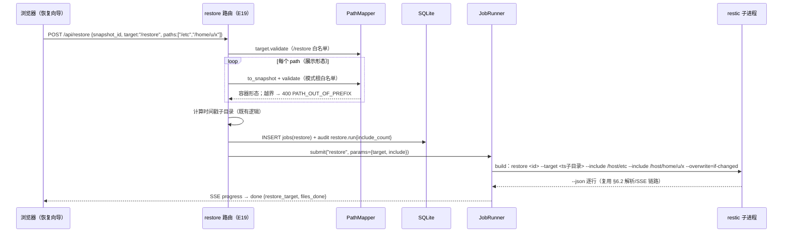

---

## 7. 模块设计（签名级接口）

### 7.1 JobRunner（R-004/011）

```python
# services/job_runner.py
class JobType(StrEnum): BACKUP/RESTORE/FORGET/CHECK/UNLOCK/INIT/DUMP

class JobConflictError(Exception): ...

class JobRunner:
    def __init__(self, db: Database, restic: ResticCmd, parser: OutputParser,
                 audit: AuditService, notifier: Notifier,
                 grace_seconds: int = 30, db_flush_interval: float = 1.0,
                 settings: Settings | None = None,
                 policy_loader: PolicyLoader | None = None,
                 task_loader: TaskLoader | None = None,      # 选项②：(int) -> Awaitable[dict | None]，注入 TaskRepo.get_dict
                 on_finish: Callable[[], None] | None = None,
                 on_task_backup_success: Callable[[int], Awaitable[None]] | None = None,
                 #   ↑ X6 裁决：backup 类型 success 终态且 task_id 非空时调用（main.py 注入
                 #     TaskRepo.clear_dry_run_pending）；回调异常就地吞掉——本回调在 _run 的
                 #     try 块内，不吞会被外层 except 把已落库的 success 篡改为 failed。): ...

    def _repo_lock(self, repo_url: str) -> asyncio.Lock:
        """按仓库维度互斥（字典惰性建锁）；当前单仓库，为 R-023 多仓库预留。
        选项②多任务**不新增锁维度**——多任务串行由仓库锁决定（E1）。"""

    async def submit(self, job_type: JobType, *, policy_id: int | None = None,
                     task_id: int | None = None,
                     trigger: Literal["manual", "scheduled"],
                     snapshot_id: str | None = None, params: dict = {}) -> Job:
        """查重（同仓库 running/pending）→ 冲突抛 JobConflictError；
        INSERT jobs(pending)，创建后台任务 _run()。返回 Job。

        选项②：``task_id`` 与 ``policy_id`` 互斥（上层校验，同供 422）；
        冲突时 data 增 ``running_task_name``（经 task_loader 取运行中 job 的任务名）。"""

    async def _load_profile(self, job: Job) -> dict[str, Any]:
        """profile 解析（选项②）：``job.task_id`` 优先（任务即策略 1:1），
        legacy ``job.policy_id`` 兼容；两者字典同形（sources/excludes/tag/group_by/
        one_file_system/compression/keep_*/limit_*_kibps/host_tag/name）。"""

    async def cancel(self, job_id: str) -> Job:
        """SIGTERM → 宽限 grace_seconds → SIGKILL；终态 cancelled；写审计。"""

    async def _run(self, job: Job) -> None:
        """acquire 仓库锁 → pending→running → restic.spawn（tee 日志文件）
        → 后台任务逐行读日志 → to_thread(parser.parse_line) → 节流落库+SSE
        → 退出码落终态 → 通知/审计。异常路径全部收敛到 failed。"""

    async def on_shutdown(self) -> None:   # 容器 stop 收尾（§6.5）
    async def recover_on_startup(self) -> None:
        """启动扫描：遗留 running 与 pending 一并置 interrupted（P1 裁决，理由见 §6.5 图注）；
        随后按策略/调度判定补跑、AUTO_UNLOCK。"""
```

```python
# services/restic.py
class WhitelistArgs:
    """restic 参数白名单：只允许具名字段，调用方无法塞入任意 flag。
    选项②新增：``include: tuple[str, ...]``——B1 文件级恢复的 ``--include`` 清单。"""

class ResticCmd:
    def build(self, verb: Literal["backup","restore","forget","check","snapshots","ls","unlock","init","cat","stats"],
              *, args: WhitelistArgs, env_extras: dict[str, str]) -> list[str]:
        """参数白名单拼装（方案 §6 注入防护）：无自由字符串进 shell；路径经 PathMapper.validate。
        restore 分支：``--target`` 与 ``--include`` 取值均过 ``PathMapper.validate``
        （include 的允许前缀取当前模式根 ``settings.mode_root``，与 sources 归一口径一致）。"""

    async def spawn(self, argv: list[str], log_path: Path) -> ResticProcess:
        """subprocess + stdout/stderr tee 到日志文件；暴露 stdout 逐行异步迭代器。"""
```

### 7.2 OutputParser（R-007，fixture 回归对象）

```python
@dataclass
class ProgressEvent:
    event_id: int; percent: float; bytes_done: int; total_bytes: int
    files_done: int; total_files: int; skipped_delta: int; raw: dict

class OutputParser:
    """仅做行→结构转换与聚合，零 IO，纯函数化便于 fixture 回归测试。"""
    def parse_line(self, raw: str) -> ProgressEvent | SnapshotRecord | FileRecord | LogLine | None: ...
    def aggregate(self, state: JobAggregate, ev: ProgressEvent) -> JobAggregate: ...
```

### 7.3 PathMapper（R-005，唯一实现点）

```python
class PathMapper:
    PREFIX = "/host"   # sources 模式为 "/sources"

    def to_snapshot(self, display_path: str) -> str:      # /etc/nginx → /host/etc/nginx
    def to_display(self, stored_path: str) -> str:        # /host/etc/nginx → /etc/nginx
    def validate(self, path: str, *, allowed_prefixes: tuple[str, ...] = ("/host", "/sources", "/restore")) -> str:
        """规范化（realpath 语义）+ 前缀白名单；越界抛 PathValidationError → API 400。"""

class ExclusionRules:
    """内置排除集（v2.3.2 模式感知，方案 §3.1/§3.2）：语义核心集 + 模式附加集的唯一实现点。"""
    CORE = ("proc", "sys", "dev", "run", "var/run", "var/lib/docker", "tmp", "lost+found")

    def built_in(self, mode: Literal["host", "sources"]) -> list[str]:
        """核心集按 mode 派生前缀（host=/host、sources=/sources）+ 模式附加条目
        （host：部署目录 data/cache/restore 防套娃；sources：仓库/缓存特征路径）。"""
    def is_builtin(self, rule: str, mode: Literal["host", "sources"]) -> bool:
        """供 UI 只读展示与"不可删减"校验。"""
```


### 7.4 SchedulerService（R-013，**本批落地**；per-task）

```python
# services/scheduler.py（APScheduler AsyncIOScheduler，架构 §2.1 既选型本批首次启用）
class SchedulerService:
    def __init__(self, tasks: TaskRepo, runner: JobRunner, config: ConfigRepo,
                 settings: Settings | None = None, *, jobs: JobRepo) -> None:
        """``jobs`` 为设计稿未列的显式注入：catchup/prune 判定必须读 jobs 表，
        且 A1 要求 DB 访问只经仓储——JobRunner 未暴露该查询，故显式注入。"""

    async def start(self) -> None:
        """AsyncIOScheduler.start() → reload() → catchup_on_startup()（lifespan 接线，§6.8）。"""
    async def shutdown(self) -> None:
        """scheduler.shutdown(wait=True)；时序上先于 JobRunner.on_shutdown（先停调度再收尾子进程）。"""

    async def reload(self) -> None:
        """全量重建 backup 触发器：enabled=1 且有效 cron 非空的任务各一个
        CronTrigger.from_crontab（job id ``backup-task-<id>``，replace_existing），
        随后移除已不存在/已暂停/无有效 cron 的遗留 job。任务增改删后调用（保存即生效不重启）。"""

    async def catchup_on_startup(self) -> None:
        """补跑：当天首个应触发点已过（``get_next_fire_time(None, 当天 00:00(tz))`` ≤ now）
        且该任务无 finished_at ≥ 该点的成功 backup job → submit(scheduled) 一次。"""

    def next_fire_time(self, task: Task) -> str | None:
        """E34 卡片「下次运行」；enabled=0 或无有效 cron（含无法解析）→ None（已暂停/仅手动）。"""
    async def _due_for_prune(self, task: Task) -> bool:
        """prune 到期判定（N3 裁决 2026-10-14 语义修正）：
        距上次**成功 forget** 超 prune_interval_days（原「距上次成功 backup」在备份
        正常进行时永不触发，等于配置形同虚设）；从未 forget 且有成功备份 → 首次到期。
        E34 卡片 ``prune_due`` 与自动 forget 共用本判定。"""
    async def maybe_auto_forget(self, task_id: int) -> None:
        """N3 开放的自动裁剪：backup 成功回调触发；护栏 = enabled + interval>0 +
        到期 + 任务至少一个 keep_*>0（0=未启用）；提交 scheduled forget + --prune，
        仓库忙走既有冲突语义（cancelled 跳过，下轮再判）。"""
    async def _fire_backup(self, task_id: int) -> None:
        """触发链：读任务 → enabled 复核 → sleep(jitter) → set_last_run_at(记账) → submit。"""

    def _effective_cron(self, task: Task) -> str | None:
        """有效 cron 解析（单一实现点）：task.cron → config ``schedule.cron_default`` → 无（仅手动）。"""
    def _build_trigger(self, task_id: int, cron: str) -> CronTrigger | None:
        """``CronTrigger.from_crontab(cron, timezone=tz)``；**仅收 5 字段**，6 字段解析失败
        → WARNING + None（该任务退化为仅手动）。见 §14 X5 与 §12 V3。"""
```

**关键语义**：① 时区 = `config.timezone` → `settings.tz` → UTC（cron 解释与「当天」判定同源）；② jitter = `config.schedule.jitter`（缺省 300s，上限 3600s），在 fire 回调内 sleep，顺序为「查 enabled → jitter → 记账 → submit」（先记账后执行防崩溃重复触发）；③ 冲突不排队——scheduled 提交遇活跃 job 落 cancelled + `job.skipped_conflict`，下个周期自然再试（E1）。

### 7.9 TaskService（任务域归一，选项②）

```python
# services/task_service.py
class TaskService:
    def __init__(self, repo: TaskRepo, policy_service: PolicyService) -> None: ...

    def to_api(self, task: Task) -> dict[str, Any]:
        """任务行 → E34b 的 API 形态；display_sources/display_excludes 复用
        PolicyService.display_of（共享换算点，不复制第二套）。"""

    def normalize(self, payload: dict[str, Any]) -> dict[str, Any]:
        """共享字段（sources/excludes 三分类归一、cron/keep_*/compression…）**委托
        PolicyService.normalize**；任务域另加 ``name`` 必填非空、``tag`` 显式剔除。
        返回列名字典，不含 tag / dry_run_pending / last_run_at（服务端控制列）。"""
```

### 7.5 DumpService（R-019，P2）

```python
class DumpService:
    async def probe_pg(self, cfg: DumpConfig) -> tuple[int, int]:
        """SELECT version() 取 server 主版本；与镜像内 pg_dump --version 主版本比对；
        client < server → 抛 PgVersionMismatchError → 任务 failed + UI 提示
        『镜像内 client 为 N、server 为 M：请以 Alpine edge 源自构建镜像，或等待镜像更新收录』（方案 §4 v2.3.3）。"""
    async def run(self, cfg: DumpConfig) -> Path:   # → /data/dump/<db>-<ts>.sql，空文件校验
    def cleanup(self, keep_days: int) -> None: ...
    # mysql-client（MariaDB 系）无主版本强校验，仅探测并记录
```

### 7.6 Notifier / AuditService / CacheService（R-018/020/021，P2）

```python
class Notifier:
    async def on_start(self, job: Job) -> None: ...        # healthchecks /start ping
    async def on_finish(self, job: Job) -> None: ...       # /fail 或成功摘要；skipped>阈值 → 告警
    async def send_test(self) -> TestResult: ...           # E24

# 渠道：healthchecks / webhook（飞书钉钉模板）/ MeoW（POST JSON 至 api.chuckfang.com/{昵称}，
#   成功以响应 JSON status==200 判定（HTTP 恒 200），429 记日志不重试推送）
# 渠道级脱敏（方案 §5）：channel.redact 布尔，渲染时按变量分级过滤——
#   敏感变量（paths/error_detail/repo/host/db_names）直接剔除、不显示占位符；
#   非敏感摘要（job_id/task_type/status/duration/file_count/bytes/started_at）保留；
#   消息附任务详情深链 url={web_base}/jobs/{job_id}；默认值：MeoW=true、自建 webhook=false

class AuditService:
    async def record(self, action: str, *, target: str | None = None,
                     detail: dict | None = None, result: Literal["ok","denied","failed"] = "ok") -> None:
        """唯一写入口（INSERT only）；无更新/删除方法（append-only 由接口面保证）。"""
    async def query(self, *, action: str | None, limit: int, offset: int) -> Page[AuditRow]: ...

class CacheService:
    async def usage(self) -> CacheUsage: ...               # du /cache/restic
    async def clear(self) -> None: ...                     # rm -rf /cache/restic/*（白名单路径），入审计
```

### 7.7 Database（R-010）

```python
class Database:
    """aiosqlite 单例：启动时 journal_mode=WAL、busy_timeout、foreign_keys=ON。"""

    def __init__(self, db_path, migrations_dir=None, *, busy_timeout_ms: int | None = None) -> None:
        """busy_timeout_ms 缺省读 settings.db_busy_timeout_ms（默认 constants.DB_BUSY_TIMEOUT_MS=5000）。"""

    @property
    def busy_timeout_ms(self) -> int:
        """实际生效的锁等待超时；显式注入优先，否则读 settings，再回退常量。"""

    async def migrate(self) -> None:
        """PRAGMA user_version=N；按序执行 migrations/000N_*.sql（每文件包在事务内，可重复执行）。"""
    async def write(self, sql: str, params: tuple = ()) -> None:   # 全部写经此串行（单连接天然串行）
    async def fetch_all / fetch_one(self, sql, params) -> ...:     # 读走同一连接（SQLite 单文件，读写共用即可）
```

> **可调阈值约定（2026-10-11）**：SQLite 锁等待与 SSE 心跳不再硬编码，改由 `settings` 承载，
> 环境变量为 `DB_BUSY_TIMEOUT_MS`（默认 5000）与 `SSE_HEARTBEAT_SECONDS`（默认 15.0），
> 常量仅作默认值单一真源（`constants.DB_BUSY_TIMEOUT_MS` / `SSE_HEARTBEAT_SECONDS`）。
> 参照 `JobRunner(db_flush_interval: float = 1.0)` 的既有可注入设计——**新阈值一律走 settings 或构造参数，不得裸写在业务逻辑里**。

### 7.8 CompareService（R-015，P2）

```python
class CompareService:
    async def diff(self, snapshot_id: str, target: str) -> AsyncIterator[OverwriteItem]:
        """restic ls --json（线程池流式）× 目标磁盘 os.stat 逐文件比对：
        目标存在且 (mtime != 快照 mtime 或 size != 快照 size) → 记为将被覆盖项。
        供 E20 预览与原位恢复确认门（P2 前不接任何路由）。"""
```

---

## 8. 鉴权实现（R-001）

| 项       | 实现                                                                                                                                                                                 |
| ------- | ---------------------------------------------------------------------------------------------------------------------------------------------------------------------------------- |
| Cookie  | 名 `rw_session`；`HttpOnly` + `SameSite=Strict` + `Path=/`；反代 HTTPS 时加 `Secure`（由 settings `force_https` 或检测 `X-Forwarded-Proto`）；服务端只存 SHA-256(token)（§4.2）                         |
| 会话有效期   | 24h 滑动：每次认证请求刷新 `last_seen_at`，`expires_at=last_seen_at+24h`；登出 DELETE 行（E02）；过期行由启动期惰性清理                                                                                          |
| CSRF    | **写方法**（POST/PUT/DELETE）校验 `Origin`（缺失则回退 `Referer`）host 与 `Host`/`X-Forwarded-Host` 同源，不一致 403 `CSRF_ORIGIN`；SameSite=Strict 为第一道，Origin 校验为第二道（双保险，兼容非浏览器客户端禁用场景为零——本产品只有浏览器客户端） |
| 密码哈希    | argon2-cffi 默认 PasswordHasher（默认 type 即 id 变体）：`time_cost=3, memory_cost=65536(64MiB), parallelism=4`；argon2 不可用时降级 bcrypt（cost=12）——编译期选择，运行期常量                                                       |
| 登录锁定    | 计数持久化于 `admin_account`（failed_attempts/lock_level/locked_until，§4.1）——**存 DB 不存内存，容器重启不清零**（防绕过）；5 次失败 → 锁 5min×2^level，上限 1h；成功登录清零                                               |
| 登录限流    | 进程内固定窗口：同 IP 登录接口 5 次/分钟（内存实现，重启清零可接受——锁定持久化已兜底）；429 `RATE_LIMITED`                                                                                                                |
| 中间件顺序   | `main.py` 中间件链：① Origin/CSRF（仅写方法）→ ② Session 鉴权（FastAPI dependency `require_session`）→ ③ Bootstrap 门（must_change=1 时仅放行 auth/bootstrap 相关）→ ④ 审计埋点（危险操作路由显式调用 AuditService，非全局）   |
| SSE 鉴权  | `EventSource` 无法自定义 header → **不用 query token**；`/api/jobs/{id}/stream` 与普通 API 走同一 `require_session` dependency（cookie 自动携带）；中间件链对 stream 端点完全一致（§8 中间件位置即在此）                     |
| 仓库密码/凭据 | 密码文件永不入库不出 API（只回挂载状态）；凭据 API 脱敏 has_value + source；Job Runner spawn 时注入 env                                                                                                       |

---

## 9. 前端架构

### 9.1 路由表（对齐 PRD §5 十二页面）

| 路由           | PRD 页面  | 阶段                           | 关键组件                                    |
| ------------ | ------- | ---------------------------- | --------------------------------------- |
| `/login`     | 1 登录页   | P1                           | 锁定倒计时提示                                 |
| `/bootstrap` | 2 首启引导  | P1                           | 一次性密码展示（Steps）+ 强制改密                    |
| `/`          | 3 仪表盘   | P1（选项②改造）                    | **任务卡片列表（TaskCard + useVirtualList）**、仓库状态卡、仓库/运行模式卡 |
| `/repo`      | 4 仓库配置  | P1                           | 类型联动表单、脱敏回显、env 置灰                      |
| ~~`/sources`~~ | ~~5 备份源~~ | **退役（选项②）**                 | 源勾选迁入任务向导步骤 2；内置排除集只读展示同步迁入（E32 仍在 `api/exclusions.ts` 消费） |
| ~~`/policies`~~ | ~~6 策略与调度~~ | **退役（选项②）**                | 策略随任务走；E08–E11 端点保留为 legacy 只读（写路径恒 409） |
| `/tasks/new` | 3（新增入口）  | 选项②                         | TaskWizard 五步向导（新建）；「新建备份任务」主按钮在仪表盘 |
| `/tasks/:id/edit` | 3（卡片「⋯」菜单） | 选项②                    | TaskWizard 五步向导（编辑预填 + dry-run 门重开） |
| `/jobs`      | 7 任务历史  | P1（进行中任务）/ P2（历史与 retention） | JobProgress、日志抽屉（skipped 折叠）            |
| `/snapshots` | 8 快照浏览  | P1                           | 分页 Table + VirtualTree 懒加载              |
| `/restore`   | 9 恢复向导  | P1                           | Steps；P2 增加"原位置"（ro 档置灰+原因）             |
| `/notify`    | 10 通知设置 | P2                           | 测试按钮即时反馈                                |
| `/settings`  | 11 系统设置 | P2                           | dump 表单（pg 版本报错提示）、行为开关、缓存维护、改密         |
| `/audit`     | 12 审计日志 | P2                           | 只读 Table，无删除入口                          |

### 9.2 状态管理与数据层

- **Server State（@tanstack/vue-query）**：全部 REST 请求；失效策略——任务终态事件后 invalidate `jobs`/`snapshots`；策略保存后 invalidate `policies`（TanStack Query 官方 Vue 适配版，失效策略不变）；
- **UI State（Pinia，克制）**：会话态（me 缓存）、暗色主题、全局 message（`useUiStore` defineStore）；**不缓存任何服务端数据**；
- **SSE 不进 Vue 响应式树**：`useJobStream(jobId)` composable 内部持有 EventSource，暴露 `progress/log/done/error` 回调与 `lastEventId`；组件卸载即 close，重挂载自动凭 Last-Event-ID 续传（对应 PRD US-D1 AC1 刷新不丢进度）。

### 9.3 SSE 客户端封装要点

```typescript
// composables/useJobStream.ts
// 1. new EventSource(`/api/jobs/${id}/stream`) —— cookie 自动携带，无自定义 header
// 2. 浏览器重连自动带 Last-Event-ID；首次订阅如已知进度偏移可经 ?last_event_id= 传入
// 3. 心跳超时检测：>45s 无任何行（含 : keep-alive）判定断链 → 显式 close + query 重取状态
// 4. done/error 事件后 close，并 invalidateJobs()
```

### 9.4 目录约定

见 §3 前端树：`api/`（网络层唯一出口，`http.ts` 统一处理 401→跳登录、403 BOOTSTRAP_REQUIRED→跳引导、错误码→message）；`components/` 全局复用；页面内私有组件不放公共目录；**i18n 约定（PRD Q3）**：页面/组件文案一律经 `vue-i18n` 的 `$t()` 引用，禁止硬编码中文字符串（P1 即生效，双语文案翻译可分期补齐）。
**视觉层目录（2026-10-13 视觉对齐批次新增）**：`theme/tokens.ts`（设计令牌**单一真源**——Naive UI themeOverrides 明暗两套，色值/圆角唯一出处，其他文件不得硬编码）；`components/icons/`（零依赖内联 SVG 图标，`currentColor` 继承文字色）；`assets/`（品牌资源，如 restic 原版 logo）。

### 9.5 设计令牌与响应式布局（2026-10-13 落地）

- **令牌注入**：`App.vue` 的 `NConfigProvider` 按 `ui.isDark` 切换 `lightThemeOverrides` / `darkThemeOverrides`（`theme/tokens.ts`）；已实证 `inline-theme-disabled` 不影响覆盖生效（css-render 生成 `<style>` 注入 CSS 变量，QA 运行时挂载验证）；
- **响应式断点**：`useMediaQuery('(max-width: 959px)')`——≥960px 常驻可折叠 sider（200↔64px），<960px 收顶栏汉堡按钮 + `n-drawer` 抽屉菜单，跨断点自动收抽屉；
- **顶栏状态区**：仓库连接状态 + 运行中任务数标签，15s 轮询（`retry:1`），查询键带 `header` 后缀与页面级查询隔离；仓库未配置时后端返回 200 + `connected=false`，前端统一 error 红字 + tooltip 透出 `last_error`；
- 色值/字体/圆角等具体令牌值以《UI视觉对齐Duplicati设计方案.md》§4.1 为准，本文不复制（文档管理规范 §2 裁决链）。

### 9.6 任务域前端结构（选项②）

| 关注点 | 实现 |
|---|---|
| **仪表盘任务列表** | `pages/dashboard/index.vue` + `components/TaskCard.vue`；数据源 `api/backupTasks.listBackupTasks`（E34）；主菜单 7 项收敛为 **5 项**（仪表盘/仓库配置/任务历史/快照浏览/恢复向导） |
| **虚拟滚动选型** | `useVirtualList`（`@vueuse/core`，固定卡片骨架高度）——任务卡片为**非表格场景**，按 PRD §7「非表格场景用 `useVirtualList` 兜底」；非 `n-data-table virtual-scroll`（表格行高契约与卡片可变内容冲突）。见 §14 X7 |
| **五步向导** | `components/TaskWizard.vue`（n-steps）：① 基础信息（名称必填 + 运行模式卡 + 密码文件状态**只读**，S3）② 备份源（`task/SourcesPicker.vue`：VirtualTree 多选 + E32 只读 + 追加排除）③ 存储目标（仓库只读 + 测试连接 E29）④ 调度（`task/ScheduleRetentionForm.vue`：cron 模板 + 下次触发预览）⑤ 保留与首跑（E31/E36 dry-run → 确认首跑 或 仅保存） |
| **删除三重门** | 复用 `ConfirmGate.vue`：第 1 步影响告知（`delete.impact`）→ 第 2 步输入**任务名**（`keyword`）→ 第 3 步红色确认（`delete.final`）；运行中任务菜单项置灰 + 服务端 409 `TASK_RUNNING` 双保险 |
| **409 两套契约** | 立即运行 → `JOB_CONFLICT`（读 `data.running_task_name`，提示「已有任务进行中：<任务名>」）；删除 → `TASK_RUNNING`（读 `data.running_job_id`/`task_name`，提示先取消）。**前端分别读各自字段**，勿混用 |
| **B1 恢复多选** | `pages/restore/index.vue` + `VirtualTree`（`selectedPaths` 多选态）→ `restoreSnapshot(id, target, paths)`；`ConfirmGate` 预览 slot 增「已选文件清单」（前 20 条 + 总数） |
| **快照标签筛选** | 快照页有标签下拉与分组头（R-026-10）；E17 `?tag=` 服务端过滤已落地（X2 裁决，d6bf5ca，§5.1），端到端生效 |
| **i18n** | 任务域键（`task.*` / `wizard.*` / `delete.*` / `restore.files*` / `snapshot.tag*`）成对写入 `locales/zh-CN.ts` 与 `en-US.ts`，模板零硬编码 |

---

## 10. 测试策略与 CI

### 10.1 测试分层

| 层          | 范围                                                                                                                                | 工具 / 方法                                                               |
| ---------- | --------------------------------------------------------------------------------------------------------------------------------- | --------------------------------------------------------------------- |
| 解析层（最高优先级） | `parser.py` 对固定版本 restic 真实 `--json` 输出的全量 fixture 回归：backup status / restore / snapshots / ls / check / forget dry-run 六类，含畸形行容错 | pytest + `tests/fixtures/restic-json/`；**解析器改动必须先补 fixture**（方案 §8.1） |
| 状态机        | JobRunner 六状态转换表驱动测试（含 cancel 竞态、shutdown 路径 mock）                                                                                | pytest-asyncio                                                        |
| 迁移器        | user_version 升级链、幂等重复执行                                                                                                           | 临时 SQLite 文件                                                          |
| API 集成     | auth/bootstrap/CSRF/409/分页/脱敏回显全链路（restic 子进程 mock 为预录脚本输出）                                                                       | httpx AsyncClient + dependency_overrides                              |
| 前端         | composables（useJobStream 用 mock EventSource）、ConfirmGate、api 层错误处理；页面冒烟                                                           | vitest + Vue Test Utils（@vue/test-utils，mount/stub n-* 组件）            |

### 10.2 CI 流水线（GitHub Actions 或同等）

```yaml
# 阶段：lint(backend ruff + frontend eslint/tsc) → test(pytest + vitest) → build(镜像)
# 依赖安装源固化：https://mirrors.cloud.tencent.com/pypi/simple（P1 实测 pypi 直连/清华/阿里均不可用）
# 镜像 tag：分支构建 = sha 短标签；发布 = 双版本 <app>-restic<restic>（如 1.2.0-restic0.19.1）
# 发布由 git tag 触发（main 保护）；构建参数 RESTIC_VERSION 显式声明，与方案 §4 双版本约定一致
```

---

## 11. 需求追溯矩阵（PRD 需求池 R-001~R-027 全覆盖）

| 编号    | 需求                          | 模块                                                                                        | API                   | 页面    | 阶段                        |
| ----- | --------------------------- | ----------------------------------------------------------------------------------------- | --------------------- | ----- | ------------------------- |
| R-001 | 鉴权与首启改密                     | auth/（§8）、admin_account/sessions 表                                                        | E01–E03、E28、bootstrap | 1、2   | P1                        |
| R-002 | 镜像骨架与 compose               | docker/（Dockerfile/entrypoint）                                                            | E04                   | —     | P1                        |
| R-003 | 配置模型（仓库+凭据）                 | ConfigRepo、env 同步逻辑                                                                       | E06/E07、E29/E30       | 4     | P1                        |
| R-004 | Job Runner 与状态机             | JobRunner（§7.1）、jobs 表                                                                    | E12/E14/E16           | 7     | P1                        |
| R-005 | /host 路径映射层                 | PathMapper（§7.3，唯一实现点）                                                                    | E05/E17/E18/E19       | 5、8、9 | P1                        |
| R-006 | 备份源与内置排除集                   | ExclusionRules（§7.3，模式感知派生）+ sources 路由 + 首备 dry-run 门（含伪文件系统目录名警告）+ one-file-system 模式缺省 | E05/E31/E32           | 5     | P1                        |
| R-007 | --json 解析 + SSE             | OutputParser、SseChannel、useJobStream                                                      | E15、E27               | 7、9   | P1                        |
| R-008 | 恢复到时间戳子目录                   | restore 路由（§6.3）                                                                          | E19                   | 9     | P1                        |
| R-009 | 快照浏览                        | snapshots 路由分页/流式 + VirtualTree                                                           | E17/E18               | 8     | P1                        |
| R-010 | SQLite 工程约定                 | Database（§7.7）、迁移器                                                                        | —                     | —     | P1                        |
| R-011 | 手动触发与取消                     | JobRunner.submit/cancel、409                                                               | E12/E16               | 7     | P1                        |
| R-012 | 非 root skipped 展示           | parser.skipped_delta、jobs.skipped_count；**阈值告警经 R-018 Notifier 已交付（2026-10-14）** | E14/E27               | 3、7   | P1 基础 / P2 阈值告警（**已交付**） |
| R-013 | 调度器                         | **SchedulerService（§7.4，per-task，本批落地）**、backup_tasks.last_run_at                          | E34/E35/E35b（reload 触发）、E34（next_run_at/prune_due） | 3     | P2（**已交付**）               |
| R-014 | 多备份任务管理 UI（选项②）             | backup_tasks + TaskRepo/TaskService（§4.8/§7.9）+ 仪表盘任务卡片与五步向导（§9.6）                         | E34/E34b/E35/E35b/E35c/E36、E12(task_id) | 3（改造）、tasks/new\|edit | P2（**已交付**）               |
| R-015 | 覆盖比对确认流 + 原位恢复              | CompareService（§7.8）                                                                      | E20                   | 9     | P2                        |
| R-016 | forget 预览-确认流               | **E21（§5.1，已交付）**：`routers/ops.py` + `parser.parse_forget_groups` + `JobRunner` forget 分支；前端快照页 forget 卡片 + ConfirmGate | E21、E12(type=forget)  | 6     | P2（**已交付**，自动 forget 已随 N3 裁决开放） |
| R-017 | check 校验与行为开关               | config.behavior.* + check 任务                                                              | E22                   | 11    | P2                        |
| R-018 | 通知模块                        | **Notifier（§7.6，已交付 2026-10-14）**：`services/notifier.py` 三渠道 + JobRunner on_start/on_finish 接线；前端通知设置页（页面 10） | E23/E24               | 10    | P2（**已交付**）               |
| R-019 | DB dump 配置 UI               | DumpService（§7.5）                                                                         | E07                   | 11    | P2                        |
| R-020 | 任务历史与审计                     | JobRepo retention + AuditService                                                          | E13/E26/E27           | 7、12  | P2                        |
| R-021 | 缓存维护                        | CacheService                                                                              | E25                   | 11    | P2                        |
| R-022 | sftp / rclone / REST Server | sftp/rclone：**待设计**（镜像依赖 + known_hosts 托管）；REST Server：P2（协议即 HTTP，E07 类型枚举扩展，方案 §4.2）    | E07 扩展                | 4     | P2/P3                     |
| R-023 | 多仓库/多主机视图                   | JobRunner.\_repo_lock 已按仓库维度预留；演进位决策（config/password/API 作用域化）见 §13（2026-10-13）                        | —                     | —     | P3                        |
| R-024 | Prometheus 指标与报表            | 新增 metrics 路由（P3 设计时补）                                                                    | —                     | —     | P3                        |
| R-025 | 凭据可选加密存储                    | config.value 加密列演进（§4.3 注）                                                                | —                     | —     | P3                        |
| R-026 | 轻量多备份任务（选项②）              | backup_tasks/repos 表（§4.7/§4.8，0002）+ JobRunner task_id（§7.1）+ 仓库级串行互斥（E1 不变）+ 仪表盘任务卡片 | E34–E36、E12/E13 扩展    | 3（改造） | P2（**已交付**）               |
| R-027 | B1 文件级恢复                   | restore 路由 `paths` + `ResticCmd --include` 白名单（§6.9/§7.1）+ 恢复向导 VirtualTree 多选 + ConfirmGate 清单 | E19 扩展（paths）         | 9     | P2（**已交付**）               |

覆盖情况：**27/27 全部映射**（R-027 为选项②新增编号）；P0×11 → 全部落在阶段 P1；P1×12 → P2 为主（R-012 跨 P1/P2；R-013/R-014/R-026/R-027 已随选项②在 P2 交付）；P2×3 → P3。**greenfield 裁决**：原增量 PRD 的「存量迁移」（R-026-07/US-026-09）不适用，未计入矩阵（§14 X1）。

---

## 12. 风险与待实测项

| #  | 项                                                    | 影响                                    | 缓解 / 状态                                                                  |
| -- | ---------------------------------------------------- | ------------------------------------- | ------------------------------------------------------------------------ |
| V1 | restic 0.19.1 `restore --dry-run --json` 是否输出结构化文件清单 | E20/CompareService 是否可直接消费 dry-run 输出 | **待实测验证**；无论结果，比对层以 `ls --json × os.stat` 自研为准（方案 §3.4），dry-run 结果仅作交叉校验 |
| V2 | restic 0.19.1 限速实际行为确认                          | IO 影响缓解（PRD Q5、方案 §7 第 7 条）           | **Q5 已裁决支持**（`--limit-upload/--limit-download`，P2 以策略字段接入，DDL 列 §4.4）；P2 实现时对限速实际行为做确认性实测并记录（非存在性验证）                                |
| V3 | ~~任务 cron 为 6 字段（秒级）时保存可通过校验、调度器无法解析~~ **已消除（X5 裁决收紧写入侧）**                | —（历史记录）                    | 保存校验已收紧为**只收 5 字段**（`policy_service.py:223-236`，0e0ce6d，6/4 字段 422）；`_build_trigger` 的 ValueError→WARNING 兜底**仍保留**——config 表 `schedule.cron_default` 为运维直写值、不经 PolicyService 校验，该兜底是最后一道防线（§7.4 / §14 X3 补测应覆盖） |
| V4 | 手动提交的第二个任务**阻塞在仓库锁**上而非立即 409（QA 复验 F2）：`_repo_lock` 由 `_run` 全程持有，顺序第二个 manual submit 会挂起至首个任务结束；409 仅在预置 running 行或真并发竞态时触发 | 长备份期间「立即运行」请求挂起（体验问题，非正确性问题） | **owner 已裁决：不修，记 P2**。fb2c966 基线即有的架构特性、非选项②回归；后续优化需动互斥核心（submit 冲突判定改非阻塞 try_lock，或拆短锁），单独立项评估 |
| R1 | 非 root 档静默跳过被误读为全量成功                                 | 用户数据缺失而不自知                            | skipped_count 贯穿 jobs 表/日志/SSE/UI + 阈值告警（R-012），PRD G4                   |
| R2 | 容器被 SIGKILL（非 stop）时 last_run_at 先记账可能造成当期漏备         | 单次备份缺失                                | 启动补跑扫描覆盖"当天已过点未成功"场景；healthchecks /start 未 ping 亦可被外部监测发现                |
| R3 | SQLite `/data` bind-mount 属主错误导致容器起不来                | 部署失败                                  | entrypoint 首启检查 + 部署文档 chown 前置（方案 §4）                                   |
| R4 | EventSource 在代理层被缓冲                                  | 进度卡住                                  | 文档强制 X-Accel-Buffering: no + 响应头双保险；心跳超时检测兜底                             |
| R5 | 单写连接串行化在高频进度落库时的写放大                                  | DB 延迟                                 | 进度落库节流 ≥1s（§7.1），细粒度进度只走 SSE/日志文件                                        |

---

## 13. 演进位预留（2026-10-13 裁决：选项②立项 + R-023 多仓库规划提前）

> 本节只记录**设计预留与决策**，不含实现。背景：《对齐Duplicati的改造方案.md》+ 多仓库可行性评估。
> 两项裁决：①「轻量多备份任务」（选项②：同仓库下 N 个备份任务，各绑源集合 + tag + cron + keep_*）**立项**，随 P2 交付；② R-023 多仓库**规划提前、实现不提前**（仍归 P3），但以下预留从现在起生效。

### 13.1 已免费预留（无需改动，列出以防回归破坏）

| # | 预留 | 证据 |
|---|---|---|
| E1 | JobRunner 互斥为**仓库维度** `asyncio.Lock`，按 `repo_url` 为键 | `services/job_runner.py` 文件头注释（「为 R-023 多仓库预留」）+ `_locks: dict[str, asyncio.Lock]`；多仓库时天然按仓库并行，**不得**改回全局单锁 |
| E2 | `policies` 表按多策略建（P1 仅暴露默认策略） | §4.4；选项②的 per-task cron/keep_* 直接复用 |
| E3 | restic `--tag` / `group_by` / `--keep-*` 均在既有字段；forget 预览流（R-016）按 `--tag` 设计 | §4.4 / §6.4 |

### 13.2 分叉点与决策（从现在起约束新代码）

| # | 决策 | 内容 |
|---|---|---|
| E4 | **config 单例抽象** | §4.3 config 为 KV 全局键表，`repo.url`/`repo.type` 是**单例全局键**（`config_repo.py`，`repo.type` 为只读派生键）。R-023 落地时 `repo.*` 全局键整体迁移至 `repos` 表，存量回填策略援 `backfill_repo_type` 先例。**约束：P2 起禁止把仓库级状态继续塞进全局 KV**（如 per-repo REST Server 配置） |
| E5 | **密码文件 per-repo 布局** | 现在就定为 `/data/repos/<repo_id>/password`（权限 600、属主为运行用户；P1 仅 `default` 一行）；`RESTIC_PASSWORD_FILE` 从单例（`services/restic.py` 注入点）演进为**按 repo 解析**。**明确：多仓库不公用一个密码文件**——restic `--password-file` 只提供单一密码值，「共用」等价于所有仓库同一密码，爆炸半径单点化且无法单库轮转；唯一例外（单管理员 + 全本地盘 + 放弃轮转）须在部署文档写明代价、由用户自担 |
| E6 | **API 作用域化** | P2 起新端点一律 repo 作用域（路径前缀或显式 `repo_id` 参数）；既有隐式「当前唯一仓库」端点随 R-023 统一迁移（P3）。禁止在错误抽象上续命。**✅ 已满足（选项②）**：E34–E36 采用路径前缀 `/api/repos/{repo_id}/backup-tasks`（§5.1），`repo_id` 非 `default` → 404 `REPO_NOT_FOUND` |
| E7 | **选项②数据模型** | 新 `backup_tasks` 表**从第一天带 `repo_id` 外键**（与 policies 的关系 1:1 或 1:N 由增量设计细化）；R-023 因此退化为「加行 + 仓库切换器」，不做 remodel。**✅ 已满足（0002）**：`backup_tasks.repo_id REFERENCES repos(id)`（§4.8），1:1 定稿（任务即策略，§4.8 注） |

### 13.3 与 Duplicati 对齐改造的关系（2026-10-13 修订）

《对齐Duplicati的改造方案.md》的 **A 档主体（/setup 向导、仪表盘 checklist、立即备份按钮）并入选项②**，作为「新建/编辑备份任务」流程实现，**不按单备份集先行**（避免按全局源集合做完再按 per-task 返工）；A 档中与任务模型无关的小项（恢复页默认选最新版本、快照页直达恢复入口、i18n 文案对齐）可立即实施，零依赖。B1（文件级恢复）归期随 P2 打包裁决；C 档维持 PRD P2 既有排期。

---

## 14. 设计与实现差异登记（选项②并入时核实，2026-10-13）

> 本章登记《增量设计-多备份任务-2026-10-13.md》（过程稿）与已合入 main 的 15 笔实现提交（e942bf3…2beaa5b）之间的差异。**本次并入以代码为准**——正文各节已按代码定稿，此处只留痕差异与处置，供追溯与后续裁决。编号前缀 `X`，避免与 §1.3 决策表（D1–D8）、§12 风险表（V/R）撞号。
> 核实方式：逐文件读码（下表均给出 文件:行号）+ git 提交清单核对；测试基线为全量 182 passed / ruff 全绿 / 红线 16 项全绿 / 前端 typecheck+build 通过（2026-10-13，owner 现场复核）。

| #  | 差异内容                                                                                                                              | 设计出处（增量设计）              | 代码现状（文件:行号）                                                                                                     | 影响                                                                                             | 处置 / 状态 |
| -- | --------------------------------------------------------------------------------------------------------------------------------- | ----------------------- | ---------------------------------------------------------------------------------------------------------------- | ---------------------------------------------------------------------------------------------- | ------- |
| X1 | **greenfield 裁决取代「存量迁移」**：设计稿的 0002 含「默认策略全字段物化为首任务『默认备份』＋ `legacy_policy_id` 列 ＋ 首任务继承 legacy tag（auto）」；实现为纯建表，无任何物化/迁移分支          | 设计 §1.2 决策三、§2.1 E35、§7-T01 | `db/migrations/0002_multi_backup_tasks.sql:1-49`（无物化 INSERT、无 legacy_policy_id 列）；`schemas/api_schemas.py:379`（TaskOut.legacy_policy_id 恒 None，wire 兼容占位） | 原 R-026-07 / US-026-09 不适用；用户从空任务列表开始，首任务 tag 直接为 `task-1`（无 legacy 继承分支）                        | **owner 已裁决**（greenfield），正文 §4.8 已按代码定稿；增量设计相应段落视为被裁决取代 |
| X2 | **E17 tag 过滤（R-026-10）后端未实现**：设计 M4 为 E17 增 `?tag=` 服务端过滤；前端已实现筛选 UI 并传参，后端端点无该参数                                                    | 设计 §2.2 E17 扩展行、§5.6     | `routers/snapshots.py:56-84`（无 `tag` 参数；该文件最后一次修改在 P1 批次3 c7abf1b，未随选项②提交更新）；前端 `api/snapshots.ts:7-9`、`pages/snapshots/index.vue:31-78`（筛选下拉 + 分组头已就位） | **筛选为静默空操作**（FastAPI 忽略未声明的 query 参数）：用户选中标签后看到的仍是未筛选列表，分组头的「快照数」实为全库总数                          | **已闭环（owner 裁决 2026-10-13，提交 d6bf5ca）**：后端补 `?tag=` 包含过滤——Python 侧对取回结果过滤、分页前执行保证 `total` 正确，**不往 restic argv 传 `--tag`**（S2 不扩面）；`routers/snapshots.py:60-95`，用例 `tests/test_api/test_snapshots.py`（E17 首个 API 测试）；§5.1 E17 已同步定稿 |
| X3 | **调度器零测试覆盖**：设计 T04 验收要求 `tests/test_scheduler.py`（reload 重建、补跑判据、jitter/记账顺序、prune 只提示）；实现未交付任何调度器测试                                | 设计 §7-T04 验收标准          | `backend/tests/` 全目录 grep `scheduler\|catchup\|reload` 零命中；182 passed 不含 R-013 覆盖                                                | R-013 核心逻辑（触发器重建/补跑/jitter 顺序/到期判定）无回归保护——后续改动可能静默破坏调度                                          | **已裁决未实现（列 P2 首个补测项）**：调度器补测可复用 test_state_machine/test_api 现有基建；补测时应一并覆盖 `scheduler._build_trigger` 的 ValueError→WARNING 兜底——config 表 `schedule.cron_default` 是运维直写值、不经 PolicyService 校验，该兜底仍是最后防线 |
| X4 | **SchedulerService 构造签名多一个 `jobs: JobRepo`**：设计 §4.1 签名未列；实现显式注入                                                                    | 设计 §4.1                  | `services/scheduler.py:53-77`（docstring 已说明原因：catchup/prune 判定必须读 jobs 表，且 A1 要求 DB 访问只经仓储——JobRunner 未暴露该查询）        | 无（签名为设计超集，语义一致）                                                                                 | 已按代码并入 §7.4；闭环，无需裁决 |
| X5 | **cron 6 字段「保存可通过、调度不触发」**：设计沿用 `PolicyService._normalize_cron` 的 5/6 字段校验；调度器 `CronTrigger.from_crontab` 仅收 5 字段，6 字段建触发器失败        | 设计 §1.1（委托策略域校验）、§4.1    | `services/policy_service.py:213-222`（5/6 字段均放行）；`services/scheduler.py:244-255`（解析失败 → WARNING + None，任务退化「仅手动」）  | 用户保存了看似合法的 cron 但任务不自动触发（后端有 WARNING 日志、卡片「下次运行」为空，但 UI 无显式报错）                                   | **已闭环（owner 裁决 2026-10-13，提交 0e0ce6d）**：保存校验收紧为**只收 5 字段**（`policy_service.py:223-236`，6/4 字段 422 VALIDATION_ERROR「cron 须为 5 字段（分 时 日 月 周）」）；`_build_trigger` 的 ValueError→WARNING 兜底保留（覆盖 config 直写 `schedule.cron_default` 场景，§12 V3 已更新） |
| X6 | **dry_run_pending 清除路径单一**：设计为「E36 预览成功**或首次成功备份**清 0」；实现唯一清除点是 E36 且要求「无 error 且未 truncated」                                       | 设计 §9 共享知识第 7 条          | `routers/backup_tasks.py:377-379`（唯一调用点）；`services/job_runner.py` 无清除调用（grep 证实）                                  | 绕过 UI 直接触发并成功备份的任务，卡片 Start 拦截不会自动解除（须再跑一次 E36 预览）——非数据风险，属体验边缘场景                                 | **已闭环（owner 裁决 2026-10-13，提交 7eff049）**：JobRunner 增可选回调 `on_task_backup_success`——backup 类型 **success** 终态且 task_id 非空时以 task_id 调用（`job_runner.py:330-334` 调用点、`:371-384` 回调包装），`main.py:207` 注入 `TaskRepo.clear_dry_run_pending`（A1：业务层不写 SQL）；回调异常就地吞掉（在 `_run` 的 try 块内，不吞会被外层 except 把已落库 success 篡改为 failed）；§7.1 签名已同步 |
| X7 | **虚拟滚动选型偏离 PM 建议**：PM Q6 建议 `n-data-table virtual-scroll`；实现采用 `useVirtualList` + 固定卡片骨架                                            | 设计 §5.5（N2，架构师建议偏离）     | `pages/dashboard/index.vue:7,78-83`（`useVirtualList`，ITEM_HEIGHT 固定骨架）                                            | 无——卡片为非表格场景，PRD §7 本就规定非表格场景用 `useVirtualList` 兜底；n-data-table 行高契约与卡片可变内容（进度/摘要/skipped 折叠）冲突    | **已闭环**（N2 裁决采纳），§9.6 已定稿 |
| X8 | **E34 卡片字段子集**：设计稿样例含 `created_at`；实现 TaskCardOut 仅 `updated_at`                                                                   | 设计 §2.1 E34 响应样例         | `schemas/api_schemas.py:384-405`（TaskCardOut 无 created_at）                                                        | 无（卡片无需创建时间；需要时可后补）                                                                              | 正文 §5.1 已按代码定稿；闭环 |
| X9 | **§3 目录树的既有漂移（P1 遗留，非选项②引入）**：正文树中 `routes.ts`/`locales/*.json`/`QuadrantCard.vue` 等条目与实现不符                                        | —（本文 §3 历史条目）           | 实现为 `router/index.ts`、`i18n/locales/zh-CN.ts`+`en-US.ts`、`components/TierCard.vue`                                | 文档与代码命名不一致，新人按树找文件会落空                                                                            | 本次已顺手修正 TierCard 一处；其余建议 owner 择机统一修正 §3 树（不影响语义） |
| X10 | **手动触发与调度触发的 `last_run_at` 记账时序相反**：两条写 `backup_tasks.last_run_at` 的路径时序相反——调度路径在 `_submit` **之前**记账（先记账后执行），手动路径在 `runner.submit(...)` 返回**之后**才记账（成功后才记账） | 设计 §6.4（防崩溃重复触发，**仅覆盖调度路径**）、本文 §4.8/`db/migrations/0002_multi_backup_tasks.sql:40` 的 DDL 注释 | 调度 `services/scheduler.py:403-405`（`set_last_run_at` → `_submit`，docstring `:388-389` 明示「顺序即设计口径」）；手动 `routers/jobs.py:92-105`（`runner.submit()` 在 `:92-99`，记账在 `:104-105`，且仅 `type == JobType.BACKUP` 记账）；两侧写入点同为 `db/repositories/task_repo.py:234` | 两条路径语义不完全一致：调度路径下遇 409 冲突或进程崩溃时 `last_run_at` **已写入**（可能记了但实际未跑成），手动路径下 409 `JOB_CONFLICT` 不写。非数据风险——该字段**只用于任务卡片「上次运行」展示**（`schemas/api_schemas.py:378/399`、`routers/backup_tasks.py:419`），不参与补跑判据（补跑读 `jobs` 表，见 X4） | **维持现状（owner 裁决 2026-10-14，不改代码）**：手动侧「冲突即未跑、不记账」语义更精确（确实没跑起来就不该记账），调度侧「先记账」是 §6.4 防重复触发的必需设计，两侧语义在各自场景下均成立，强行统一必破坏其中一侧；此处仅登记差异备查。**关联**：手动记账本身是 2026-10-14 真机 E2E 缺陷 B 的修复内容（此前手动运行完全不记账，导致卡片「上次运行：无」与「上次运行：[成功]」并存） |
| X11 | **cron「日」与「星期」同时受限时取 AND，而非标准 Vixie cron 的 OR**：标准 Vixie cron 在 day-of-month 与 day-of-week 同时受限时取 **OR**（满足任一即触发）；本项目底层 APScheduler 3.x 取 **AND**（两者须同时满足） | 设计 §7-T04 / 本文 §6.4（按 5 字段直接构造 `CronTrigger`，未涉及该语义） | `services/scheduler.py:194-232`（`_cron_trigger` 分字段校验后把 `day`/`day_of_week` 透传给 `CronTrigger`）。实证：`0 3 1 * 1` 在本项目只在「每月 1 号**且**当天是周一」触发，标准 cron 语义为「每月 1 号**或**每周一」。系 APScheduler 3.x 既有行为，非本项目代码引入 | 同时配置「日」与「星期」的任务，实际触发频率**低于**按标准 cron 的预期。当前 UI 未引导用户同时配置这两项，实际触发面很小 | **维持现状并落档告知（owner 裁决 2026-10-14）**：改为 OR 需自行实现触发器或将一条 cron 拆成多个 `CronTrigger` 组合，改动面与回归风险均较高，当前无需求驱动；后续若要支持，推荐路径是「一条 cron 拆分为多个触发器」而非魔改表达式解析。**关联**：与 2026-10-14 修复的 cron 星期语义偏移（APScheduler 3.x 官方 issue #286，见 `_cron_trigger` docstring `:197-209`）同源——同属「cron 直接暴露给管理员填写、但底层解析器语义与标准 cron 存在差异」这一类问题。同类另一项（跨周围绕区间如 `sun-sat` 不支持）标准 Vixie cron 同样不支持，两边一致，不构成差异，无需登记 |

> **「任务已删」语义澄清（无差异，特此固化）**：删除任务后历史 jobs 的 `task_id` 由外键 `ON DELETE SET NULL` **置空**，库中不存在指向已删任务的孤儿 id（外键禁止该形态）；正文 §4.8 注与 §4.5 DDL 已按此表述，增量设计中所有「解绑」描述均为此语义，无需纠正。

---

## 附：本文与上游文档的一致性声明

- API 端点、状态机枚举、策略字段、鉴权参数、SQLite 约定全部继承《改造方案 v2.3.4》§5/§6，无偏离；
- 页面/需求编号引用《PRD v1.1》§4/§5；
- P1/P2/P3 阶段划分与人周估算见《改造方案 v2.3.4》§8 / 《PRD v1.1》§9，本文不重复排期。
